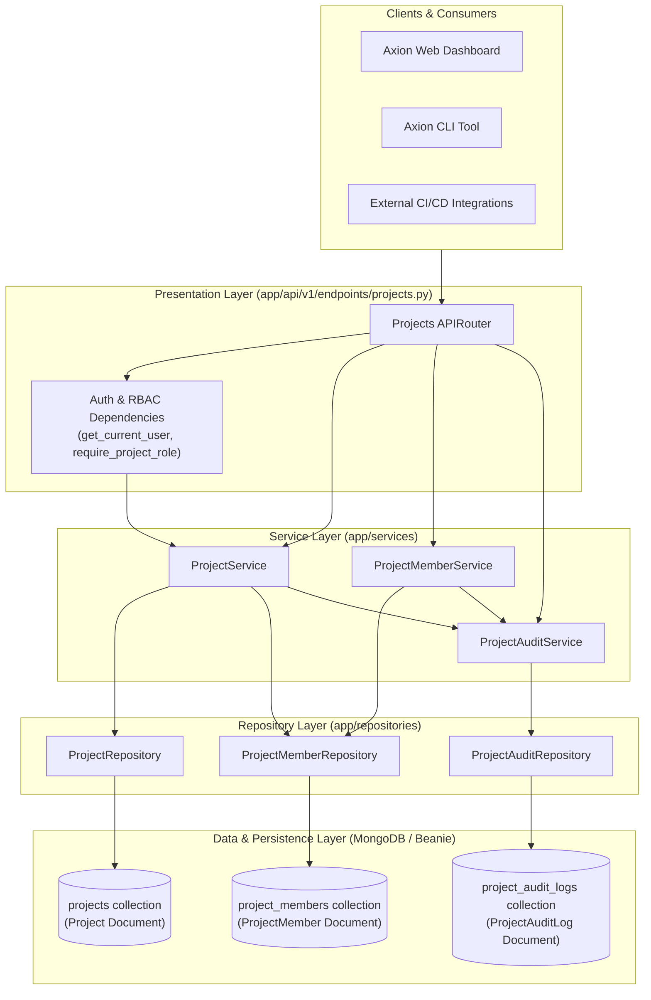
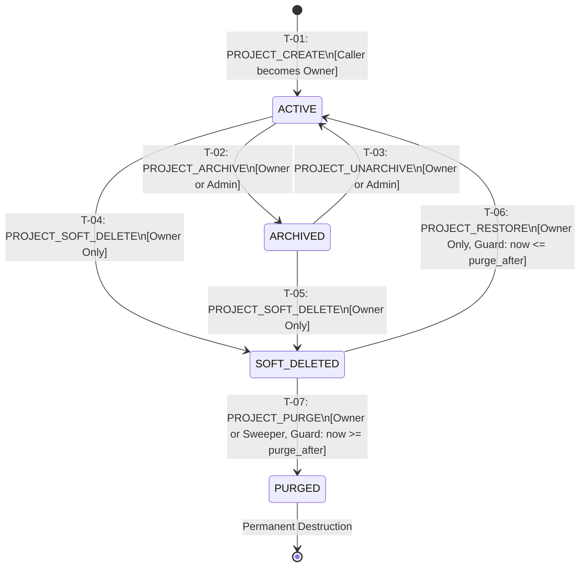

# Software Requirements Specification (SRS)
## Module 01: Project Management (Axion Runtime)

- **Document Version**: 1.0.0
- **Status**: Ready for Verification
- **Module ID**: `MOD-01`
- **Component**: `apps/api`
- **Architectural Reference**: `docs/system-design-rules.md`
- **Target Frameworks**: FastAPI, Beanie ODM (MongoDB), Clerk Authentication, Pydantic v2

---

## 1. Executive Summary & Purpose

The **Project Management Module (`MOD-01`)** forms the core administrative and multi-tenant security boundary of the **Axion Runtime** platform. A **Project** represents an isolated workspace encompassing configurations, workflows, execution runs, environment variables, credentials, and associated audit logs. 

All operations, resource quotas, and collaborative workflows in Axion execute strictly within the context of a Project. This module provides robust project lifecycle management, hierarchical Role-Based Access Control (RBAC), multi-user membership management, optimistic concurrency control, soft-deletion/restoration semantics, and audit trail generation.

### Core Objectives
1. **Multi-Tenant Boundary Enforcement**: Guarantee that data, workflows, and configurations are cryptographically or logically isolated between distinct projects.
2. **Flexible & Granular Collaboration**: Provide distinct administrative and operational roles (`OWNER`, `ADMIN`, `MEMBER`, `VIEWER`) governing project actions.
3. **High Data Integrity & Concurrency Resilience**: Implement optimistic locking (`version` field) and atomic transactions for sensitive state transitions (such as ownership transfer).
4. **Zero Architectural Erosion**: Full conformance with the 4-Layer Architecture (`Controller` -> `Service` -> `Repository` -> `Model`) defined in [system-design-rules.md](file:///D:/axion/docs/system-design-rules.md).

---

## 2. Scope & Module Boundaries

### 2.1 In-Scope
- **Project Lifecycle**: Creation, retrieval, partial updates, soft-deletion, restoration, and permanent archiving.
- **Project Identification**: Dual lookup via MongoDB BSON ID (`PydanticObjectId`) and human-readable, URL-safe `slug`.
- **Membership & RBAC**: Project invitations, direct additions, role modifications, member removals, and member self-leave.
- **Ownership Management**: Formal ownership assignment and atomic ownership transfer workflows.
- **Project Configuration & Metadata**: Key-value metadata stores, tags, environment settings, and runtime profiles.
- **Listing, Filtering & Search**: Cursor/offset-based pagination, case-insensitive substring search, tag filtering, and multi-field sorting.
- **Audit Trails**: Granular event logging for security-sensitive operations.

### 2.2 Out-of-Scope (Handled by Neighboring Modules)
- **Identity Provisioning & JWT Issuance**: Managed externally by Clerk and synchronized via `app.services.user_service.UserService`.
- **Workflow Orchestration & Task Execution**: Handled by downstream execution engines (`MOD-02+`) which accept `project_id` as an immutable tenant foreign key.
- **Billing & Quota Enforcement**: Handled by the commercial billing gateway module.

### 2.3 System Context & Architecture Diagram



---

## 3. Detailed Functional Requirements (FR-01 to FR-10)

### FR-01: Project Creation & Initial Ownership
- **Description**: An authenticated user creates a new project workspace.
- **Behavior**:
  - Validates request payload (`name`, `description`, optional `slug`, `tags`, `settings`, `metadata`).
  - **Slug Generation & Collision Strategy**:
    - If `slug` is not supplied, auto-generate a base URL-safe slug from `name` (lowercase alphanumeric characters separated by single hyphens).
    - If the generated slug collides with an existing active project, automatically append a short 4-character hexadecimal suffix (e.g., `acme-platform-a1b2`) with up to 3 generation attempts before failing.
    - If `slug` is explicitly provided by the caller and collides with an existing active project, immediately raise `ConflictError("Project slug already in use")`.
  - Automatically registers the creating user as the `OWNER` of the project.
  - Creates a corresponding `ProjectMember` document with role `OWNER`.
  - Dispatches a `PROJECT_CREATED` event to `ProjectAuditLog`.
  - Increments initial document `version = 1`.
  - Returns `201 Created` with `ApiResponse[ProjectResponse]`.

### FR-02: Project Retrieval & Identification
- **Description**: Retrieve project metadata and membership summary.
- **Behavior**:
  - Supports retrieval by either 24-character hexadecimal `id` or unique string `slug`.
  - Enforces project membership: if the authenticated user is not a member (and not a system Super Admin), returns `404 Not Found` (to eliminate tenant resource enumeration vulnerabilities).
  - Includes calculated member count and user's current effective role in the response payload.

### FR-03: Project Metadata & Settings Management
- **Description**: Modify mutable project configuration, descriptions, tags, and settings.
- **Behavior**:
  - Restricts update capability to users holding `OWNER` or `ADMIN` roles.
  - Supports partial updates via `PATCH /api/v1/projects/{project_id}`.
  - Implements Optimistic Concurrency Control (OCC): the client must supply `version` in the payload or via `If-Match` header. If the stored version does not match, raises `409 Conflict`.
  - Automatically updates `updated_at` timestamp and increments `version += 1`.
  - Emits `PROJECT_UPDATED` audit record.

### FR-04: Project Listing, Pagination, Search & Filtering
- **Description**: Query projects visible to the authenticated user with search, filter, and sort capabilities.
- **Behavior**:
  - Queries `project_members` to identify all project IDs associated with the calling user.
  - Supports text search (`search` param) evaluated against `name`, `description`, and `slug`.
  - Supports filtering by `status` (`ACTIVE`, `ARCHIVED`, `DELETED`). By default, excludes `DELETED` and `ARCHIVED` unless specifically requested.
  - Supports filtering by `tags`.
  - Supports sorting (`sort_by`: `name`, `created_at`, `updated_at`; `sort_order`: `asc`, `desc`).
  - Implements standardized pagination (`page`, `page_size`, `limit`, `offset`) via `PaginationParams`.
  - Returns payload encapsulated in `PaginatedResponse[ProjectSummaryResponse]`.

### FR-05: Member Invitation & Addition
- **Description**: Add or invite existing Axion users into a project with an assigned role.
- **Behavior**:
  - Requires caller to have `OWNER` or `ADMIN` role.
  - Target user identified by `clerk_id` or verified `email`.
  - Allowed roles for assignment: `ADMIN`, `MEMBER`, `VIEWER` (assignment of `OWNER` directly via invite is prohibited; see FR-07).
  - Enforces uniqueness: if target user is already an active member, returns `409 Conflict`.
  - **Concurrency & Race Condition Handling**: Under concurrent invitations or rapid duplicate requests, MongoDB raises `DuplicateKeyError` (code 11000) on unique index `idx_project_member_unique`. The repository/service layer explicitly catches `DuplicateKeyError` and translates it into domain `ConflictError("User is already a member of this project")`.
  - Emits `MEMBER_ADDED` audit record.

### FR-06: Member Role Modification, Removal & Self-Leave
- **Description**: Modify assigned member roles, revoke membership, or allow members to leave.
- **Behavior**:
  - **Role Modification**: Requires `OWNER` or `ADMIN` role. `ADMIN` cannot modify another `ADMIN` or the `OWNER`.
  - **Member Removal**: Requires `OWNER` or `ADMIN`. `ADMIN` cannot remove another `ADMIN` or the `OWNER`.
  - **Self-Leave**: Any member (`ADMIN`, `MEMBER`, `VIEWER`) can leave a project.
  - **Sole Owner Invariant**: The `OWNER` cannot leave or be removed without first completing an ownership transfer (FR-07). Attempting to do so raises `400 Bad Request` or `403 Forbidden`.
  - Emits `MEMBER_ROLE_UPDATED` or `MEMBER_REMOVED` audit records.

### FR-07: Atomic Ownership Transfer
- **Description**: Transfer project ownership from the existing `OWNER` to an existing active project member.
- **Behavior**:
  - Strictly restricted to the current `OWNER`.
  - Target must already be an active member of the project.
  - **Transaction & Session Management**:
    - Executed inside a MongoDB multi-document transaction managed by `ProjectService` using a client session (`async with await mongo_client.start_session() as session: async with session.start_transaction(): ...`).
    - The `session` is passed to repository write methods (`project_repo.update(..., session=session)`, `member_repo.update(..., session=session)`, `audit_repo.log_event(..., session=session)`).
    - Ensures the 4-layer encapsulation rule is preserved: Repositories encapsulate database commands while accepting an optional `session` parameter, allowing the Service layer to coordinate multi-document atomic workflows.
    - Transaction sequence:
      1. Update project `owner_id` to target user ID.
      2. Update target member's role to `OWNER`.
      3. Downgrade previous owner's role to `ADMIN` (or caller-specified role).
      4. Increment project `version += 1`.
      5. Write `OWNERSHIP_TRANSFERRED` audit log.
  - Atomicity guarantee: Either all documents update or transaction aborts cleanly with zero partial state.

### FR-08: Soft-Deletion, Restoration, Archiving & Purging (Lifecycle Governance)
- **Description**: Manage project state progression in strict compliance with the Project Finite State Machine (FSM) (Section 4).
- **Behavior**:
  - **Soft-Delete (`DELETE /api/v1/projects/{project_id}`)**:
    - Restricted to `OWNER`.
    - Triggers transition `ACTIVE -> SOFT_DELETED` or `ARCHIVED -> SOFT_DELETED`.
    - Records `deleted_at = datetime.now(timezone.utc)` and calculates grace period expiration `purge_after = deleted_at + timedelta(days=settings.retention_days)`.
    - Hides project from general listings and restricts read access to `OWNER` only with `include_deleted=true`.
  - **Restoration (`POST /api/v1/projects/{project_id}/restore`)**:
    - Restricted to `OWNER`.
    - Triggers transition `SOFT_DELETED -> ACTIVE`.
    - Precondition: current timestamp `now <= purge_after`.
    - Resets `deleted_at = None` and `purge_after = None`.
  - **Archiving (`POST /api/v1/projects/{project_id}/archive`)**:
    - Restricted to `OWNER` or `ADMIN`.
    - Triggers transition `ACTIVE -> ARCHIVED`. Places project in frozen read-only mode (all mutation requests to project, members, secrets, and workflow runs are rejected).
  - **Unarchiving (`POST /api/v1/projects/{project_id}/unarchive`)**:
    - Restricted to `OWNER` or `ADMIN`.
    - Triggers transition `ARCHIVED -> ACTIVE`. Re-enables operational capabilities.
  - **Permanent Purge (`DELETE /api/v1/projects/{project_id}/purge`)**:
    - Restricted to `OWNER` (or automated background retention sweeper).
    - Triggers terminal transition `SOFT_DELETED -> PURGED`.
    - Cascades permanent deletion or tombstoning across all child collections (`project_members`, `project_audit_logs`, child workflows, credentials).
  - Emits corresponding audit logs (`PROJECT_DELETED`, `PROJECT_RESTORED`, `PROJECT_ARCHIVED`, `PROJECT_UNARCHIVED`, `PROJECT_PURGED`).

### FR-09: Optimistic Concurrency Control (OCC)
- **Description**: Prevent lost updates during concurrent edits.
- **Behavior**:
  - Every `Project` document contains an integer `version` field (starting at 1).
  - Update payloads must provide the expected `version`.
  - MongoDB update query executes with criteria `{"_id": project_id, "version": expected_version}` and increments `version` by 1.
  - If modified count is 0, raises `ConflictError("Project has been modified by another concurrent request")`.

### FR-10: Audit Logging & Security Activity Trail
- **Description**: Provide an immutable audit trail for security and governance.
- **Behavior**:
  - Automatically records all security-sensitive events: `PROJECT_CREATED`, `PROJECT_UPDATED`, `PROJECT_ARCHIVED`, `PROJECT_UNARCHIVED`, `PROJECT_RESTORED`, `PROJECT_DELETED`, `PROJECT_PURGED`, `MEMBER_ADDED`, `MEMBER_ROLE_UPDATED`, `MEMBER_REMOVED`, `OWNERSHIP_TRANSFERRED`.
  - Stores actor `clerk_id`, timestamp, action enum, previous state diff, and target details.
  - Audit logs are append-only; update and delete operations on the `project_audit_logs` collection are strictly forbidden.
  - Accessible via `GET /api/v1/projects/{project_id}/audit-logs` by `OWNER` and `ADMIN` roles.

---

## 4. Project Lifecycle & Finite State Machine (FSM) Specification

### 4.1 Architectural Rationale
Because a Project serves as the root tenant container for sensitive configurations, active workflow runs, credentials, and member permissions, managing project state transitions informally via ad-hoc boolean flags (e.g. `is_active`, `is_deleted`) leads to severe race conditions, zombie workflow executions, and security bypasses. 

An explicit **Finite State Machine (FSM)** provides:
1. **Mathematical State Determinism**: Only registered, validated transitions can occur.
2. **Atomic Guard Evaluation**: Preconditions and permissions are checked before state progression.
3. **Optimistic Locking Integration**: Transitions execute atomically via MongoDB conditional filters (`{"_id": id, "status": from_state, "version": v}`), eliminating race conditions between concurrent requests.
4. **Child Resource Invariant Enforcement**: Downstream subsystems (workflow execution engines, secret managers) can query project state to immediately gate mutations.

---

### 4.2 Formal State Definitions

| State Identifier | Machine Value | Type | Description |
| :--- | :--- | :--- | :--- |
| **`ACTIVE`** | `"active"` | Operational | The project is fully functional. Members can execute workflows, alter configuration, manage memberships, and query data according to their RBAC role. |
| **`ARCHIVED`** | `"archived"` | Frozen / Read-Only | The project is preserved in a read-only state for historical audit or compliance. Workflows cannot be triggered; project metadata, settings, secrets, and member rosters are immutable. |
| **`SOFT_DELETED`** | `"soft_deleted"` | Decommissioned | The project has been deleted by its Owner and entered a time-bound grace/retention period. It is invisible to non-owners and normal queries. Can be restored to `ACTIVE` before retention expiry. |
| **`PURGED`** | `"purged"` | Terminal | The project has passed its retention window or was explicitly purged by its Owner. All resources, memberships, and dependencies are permanently expunged or permanently tombstoned. Resurrection is impossible. |

---

### 4.3 State Transition Diagram



---

### 4.4 Valid State Transition Matrix

| ID | From State | To State | Trigger Event / API Endpoint | Allowed Roles | Preconditions & Guards | Side Effects & Post-Actions |
| :--- | :--- | :--- | :--- | :--- | :--- | :--- |
| **T-01** | `[*]` | `ACTIVE` | `POST /api/v1/projects` | Any Auth User | Valid request schema; unique slug. | Assign caller as `OWNER`; create initial `ProjectMember`; set `version=1`; emit `PROJECT_CREATED` log. |
| **T-02** | `ACTIVE` | `ARCHIVED` | `POST /api/v1/projects/{id}/archive` | `OWNER`, `ADMIN` | None (or check for zero active in-flight executions). | Set `archived_at=now()`; increment `version+=1`; emit `PROJECT_ARCHIVED` log. |
| **T-03** | `ARCHIVED` | `ACTIVE` | `POST /api/v1/projects/{id}/unarchive` | `OWNER`, `ADMIN` | None. | Set `archived_at=None`; increment `version+=1`; emit `PROJECT_UNARCHIVED` log. |
| **T-04** | `ACTIVE` | `SOFT_DELETED` | `DELETE /api/v1/projects/{id}` | `OWNER` | Caller is current `OWNER`. | Set `deleted_at=now()`, calculate `purge_after=now() + retention_days`; pause child tasks; increment `version+=1`; emit `PROJECT_DELETED` log. |
| **T-05** | `ARCHIVED` | `SOFT_DELETED` | `DELETE /api/v1/projects/{id}` | `OWNER` | Caller is current `OWNER`. | Set `deleted_at=now()`, calculate `purge_after=now() + retention_days`; increment `version+=1`; emit `PROJECT_DELETED` log. |
| **T-06** | `SOFT_DELETED` | `ACTIVE` | `POST /api/v1/projects/{id}/restore` | `OWNER` | `now() <= purge_after` (retention grace period active). | Clear `deleted_at=None`, `purge_after=None`; increment `version+=1`; emit `PROJECT_RESTORED` log. |
| **T-07** | `SOFT_DELETED` | `PURGED` | `DELETE /api/v1/projects/{id}/purge` or Scheduled Sweeper | `OWNER` or System Worker | If sweeper: `now() >= purge_after`. If Owner: explicit confirmation. | Permanently remove/tombstone project, delete `project_members`, archive audit logs, clean up child resources; emit `PROJECT_PURGED` log. |

---

### 4.5 Forbidden Transitions & Domain Exceptions

Any state transition attempt not explicitly defined in the Valid Transition Matrix is strictly illegal and MUST be rejected before modifying persistent storage.

```
+---------------------------------------------------------------------------------+
|                               ILLEGAL TRANSITION MATRIX                         |
+-------------------+---------------+-------------------+-------------------------+
| Attempted From    | Attempted To  | Rejection Reason  | Domain Exception Raised |
+-------------------+---------------+-------------------+-------------------------+
| ACTIVE            | PURGED        | Cannot bypass     | InvalidStateTransition  |
|                   |               | soft deletion     | Error (409 Conflict)   |
+-------------------+---------------+-------------------+-------------------------+
| ARCHIVED          | PURGED        | Cannot bypass     | InvalidStateTransition  |
|                   |               | soft deletion     | Error (409 Conflict)   |
+-------------------+---------------+-------------------+-------------------------+
| SOFT_DELETED      | ARCHIVED      | Cannot archive a  | InvalidStateTransition  |
|                   |               | deleted project   | Error (409 Conflict)   |
+-------------------+---------------+-------------------+-------------------------+
| PURGED            | (Any State)   | Terminal state;   | ProjectPurgedError      |
|                   |               | cannot resurrect  | (404 / 410 Gone)        |
+-------------------+---------------+-------------------+-------------------------+
```

#### Domain Exception Hierarchy (`app/core/exceptions.py`):

```python
class ProjectFSMError(ConflictError):
    """Base exception for FSM domain rule violations."""
    pass

class InvalidStateTransitionError(ProjectFSMError):
    """Raised when an illegal transition is requested."""
    def __init__(self, from_state: str, to_state: str):
        super().__init__(
            message=f"Illegal project state transition from '{from_state}' to '{to_state}'"
        )

class ProjectNotActiveError(ProjectFSMError):
    """Raised when a mutation is attempted on a non-active project."""
    pass

class ProjectArchivedError(ProjectNotActiveError):
    def __init__(self, project_id: str):
        super().__init__(
            message=f"Project '{project_id}' is ARCHIVED. Mutation operations are prohibited."
        )

class ProjectDeletedError(ProjectNotActiveError):
    def __init__(self, project_id: str):
        super().__init__(
            message=f"Project '{project_id}' is SOFT_DELETED. Restore project before modifying resources."
        )

class ProjectPurgedError(NotFoundError):
    def __init__(self, project_id: str):
        super().__init__(
            message=f"Project '{project_id}' has been permanently purged."
        )
```

---

### 4.6 Atomic Conditional Transition Updates (Repository Pattern)

To ensure zero race conditions when multiple actors trigger state changes or concurrent updates, state transitions MUST execute using an atomic Compare-And-Swap (CAS) update pattern at the repository layer:

```python
async def transition_status(
    self,
    project_id: PydanticObjectId,
    from_state: ProjectStatus,
    to_state: ProjectStatus,
    expected_version: int,
    additional_updates: Optional[Dict[str, Any]] = None,
    session: Optional[Any] = None,
) -> Project:
    """
    Atomically transition project state while enforcing expected state and version.
    Guarantees zero-collision state transitions under high concurrency.
    """
    now = datetime.now(timezone.utc)
    set_fields: Dict[str, Any] = {
        "status": to_state,
        "version": expected_version + 1,
        "updated_at": now,
    }
    if additional_updates:
        set_fields.update(additional_updates)

    query = {
        "_id": self._to_object_id(project_id),
        "status": from_state,
        "version": expected_version,
    }

    motor_col = self.model_class.get_motor_collection()
    res = await motor_col.find_one_and_update(
        query,
        {"$set": set_fields},
        return_document=True,
        session=session,
    )

    if res is None:
        # Determine exact conflict cause for transparent error feedback
        existing = await self.get_by_id(project_id)
        if not existing:
            raise NotFoundError(f"Project '{project_id}' not found")
        if existing.status != from_state:
            raise InvalidStateTransitionError(from_state=existing.status.value, to_state=to_state.value)
        if existing.version != expected_version:
            raise ConflictError("Project version conflict: document was modified by a concurrent request")

    return self.model_class.model_validate(res)
```

---

### 4.7 Resource Access & Mutation Rules per State

| Operation Category | `ACTIVE` | `ARCHIVED` | `SOFT_DELETED` | `PURGED` |
| :--- | :---: | :---: | :---: | :---: |
| **Read Project Metadata & Summary** | :white_check_mark: All members | :white_check_mark: All members | :lock: `OWNER` only | :x: None (404) |
| **Update Project Metadata / Settings** | :white_check_mark: Owner, Admin | :x: Blocked (409 `ProjectArchivedError`) | :x: Blocked (409 `ProjectDeletedError`) | :x: None (404) |
| **Manage Members (Add / Role / Remove)** | :white_check_mark: Owner, Admin | :x: Blocked (409 `ProjectArchivedError`) | :x: Blocked (409 `ProjectDeletedError`) | :x: None (404) |
| **Member Self-Leave** | :white_check_mark: Non-owners | :white_check_mark: Non-owners | :x: Blocked | :x: None (404) |
| **Transfer Ownership** | :white_check_mark: Owner only | :white_check_mark: Owner only | :x: Blocked | :x: None (404) |
| **Trigger New Workflows / Runs** | :white_check_mark: Allowed | :x: Blocked (409) | :x: Blocked (409) | :x: None (404) |
| **Read Downstream Secrets & Envs** | :white_check_mark: Allowed | :white_check_mark: Read-only | :x: Blocked | :x: None (404) |
| **Mutate Downstream Secrets & Envs** | :white_check_mark: Allowed | :x: Blocked (409) | :x: Blocked (409) | :x: None (404) |
| **Project Query Listing / Enumeration** | Included by default | Included by default | Hidden (requires `include_deleted=true` & Owner) | Excluded permanently |

---

### 4.8 Retention & Grace Period Semantics

1. **Grace Period Initiation**:
   - When transitioning `ACTIVE -> SOFT_DELETED`, `deleted_at = datetime.now(timezone.utc)`.
   - `purge_after` is computed dynamically based on the project's retention policy:
     $$\text{purge\_after} = \text{deleted\_at} + \text{timedelta}(\text{days} = \text{project.settings.retention\_days})$$
   - Default retention period is **30 days** (configurable from 1 to 365 days in `ProjectSettings.retention_days`).
2. **Restoration Window**:
   - During the interval $t \in [\text{deleted\_at}, \text{purge\_after}]$, the `OWNER` can restore the project at any time via `POST /api/v1/projects/{id}/restore`.
   - If an Owner attempts to restore a project after $t > \text{purge\_after}$, the API rejects the request with `ProjectPurgedError`.
3. **Automated Purge Sweeper**:
   - A scheduled background job (or worker task) queries MongoDB for expired tombstones:
     $$\text{filter} = \{ \text{status}: \text{"soft\_deleted"}, \text{purge\_after}: \{ \$lte: \text{now}() \} \}$$
   - The sweeper invokes `ProjectService.purge_project(project_id)` inside a transaction to cascade deletions.

---

## 5. Detailed Non-Functional Requirements (NFR-01 to NFR-06)

| ID | Category | Requirement Specification | Metric / Target |
| :--- | :--- | :--- | :--- |
| **NFR-01** | **Performance & Latency** | - Single-project read endpoints (`GET /projects/{id}`) P95 response time < 50ms.<br>- Paginated list endpoints P95 response time < 100ms for collections up to 100k items.<br>- Write operations P95 response time < 150ms.<br>- All database queries must be backed by compound indexes (zero collscans). | P95 < 50ms (Read)<br>P95 < 150ms (Write) |
| **NFR-02** | **Security & Isolation** | - Multi-tenant logical isolation strictly enforced at the service/query layer.<br>- Return `404 Not Found` instead of `403 Forbidden` for unauthorized project discovery to prevent identifier probing.<br>- All input validated against Pydantic schemas (RFC 8259 compliance, strict type checking).<br>- Bearer JWT validation on all endpoints. | Zero data leak between tenants; 100% authenticated. |
| **NFR-03** | **Concurrency & Consistency** | - Optimistic concurrency control via atomic conditional updates (`{"_id": id, "version": v}`).<br>- FSM state transitions enforced via atomic CAS queries (`{"_id": id, "status": from_state, "version": v}`).<br>- Multi-document transactions enabled for ownership transfer via MongoDB sessions.<br>- Idempotent update endpoints where applicable. | Zero silent data overwrites (Lost Updates); zero race-condition state changes. |
| **NFR-04** | **Availability & Resilience** | - 99.95% API uptime.<br>- Graceful degradation on database connection hiccups with exponential backoff.<br>- Stateless service layer permitting seamless horizontal scale-out across container instances. | 99.95% Availability. |
| **NFR-05** | **Scalability & Capacity** | - System must support 1,000,000+ active projects and 10,000,000+ project membership mappings.<br>- Max page size enforced at 100 items to bound query execution memory. | Max memory per query < 10MB; 100 records max per page. |
| **NFR-06** | **Observability & Auditability** | - Structured JSON logging using `app.core.logging.logger`.<br>- Every request carries a trace context / request ID.<br>- Append-only audit logs with retention policy support. | 100% of mutation events audited; structured logs. |

---

## 6. Data Model & MongoDB Beanie ODM Specifications

All models inherit from `app.db.base.BaseDocument` to automatically track UTC `created_at` and `updated_at`.

### 6.1 Enums (`app/models/project.py`)

```python
from enum import Enum

class ProjectStatus(str, Enum):
    ACTIVE = "active"
    ARCHIVED = "archived"
    SOFT_DELETED = "soft_deleted"
    PURGED = "purged"

class ProjectRole(str, Enum):
    OWNER = "owner"
    ADMIN = "admin"
    MEMBER = "member"
    VIEWER = "viewer"

class ProjectAuditAction(str, Enum):
    PROJECT_CREATED = "project.created"
    PROJECT_UPDATED = "project.updated"
    PROJECT_ARCHIVED = "project.archived"
    PROJECT_UNARCHIVED = "project.unarchived"
    PROJECT_RESTORED = "project.restored"
    PROJECT_DELETED = "project.deleted"
    PROJECT_PURGED = "project.purged"
    MEMBER_ADDED = "member.added"
    MEMBER_ROLE_UPDATED = "member.role_updated"
    MEMBER_REMOVED = "member.removed"
    OWNERSHIP_TRANSFERRED = "ownership.transferred"
```

### 6.2 Embedded Schemas

```python
from typing import Dict, Any, Optional
from pydantic import BaseModel, Field

class ProjectSettings(BaseModel):
    default_environment: str = Field(default="production", description="Default environment context")
    notifications_enabled: bool = Field(default=True, description="Enable notification hooks")
    retention_days: int = Field(default=30, ge=1, le=365, description="Retention grace period in days for soft-deleted projects")
    custom_settings: Dict[str, Any] = Field(default_factory=dict, description="Arbitrary custom settings")
```

### 6.3 Beanie Document: `Project`

```python
from datetime import datetime
from typing import Optional, List, Dict, Any
from beanie import Indexed
from pymongo import ASCENDING, DESCENDING, TEXT, IndexModel
from pydantic import Field
from app.db.base import BaseDocument

class Project(BaseDocument):
    name: str = Field(..., min_length=2, max_length=100, description="Display name of the project")
    slug: str = Field(..., min_length=2, max_length=100, description="URL-safe unique project slug")
    description: Optional[str] = Field(default=None, max_length=1000, description="Project summary description")
    owner_id: str = Field(..., description="Clerk ID of project owner")
    status: ProjectStatus = Field(default=ProjectStatus.ACTIVE, description="FSM lifecycle status")
    tags: List[str] = Field(default_factory=list, description="Categorization tags")
    settings: ProjectSettings = Field(default_factory=ProjectSettings, description="Project configuration settings")
    metadata: Dict[str, Any] = Field(default_factory=dict, description="Custom metadata attributes")
    version: int = Field(default=1, description="Optimistic locking revision counter")
    archived_at: Optional[datetime] = Field(default=None, description="Timestamp of archiving")
    deleted_at: Optional[datetime] = Field(default=None, description="Timestamp of soft deletion")
    purge_after: Optional[datetime] = Field(default=None, description="Timestamp after which soft-deleted project is purged")

    class Settings:
        name = "projects"
        indexes = [
            IndexModel(
                [("slug", ASCENDING)],
                unique=True,
                partialFilterExpression={"deleted_at": None, "status": "active"},
                name="idx_projects_slug_unique_active",
            ),
            IndexModel([("owner_id", ASCENDING), ("status", ASCENDING)], name="idx_projects_owner_status"),
            IndexModel([("status", ASCENDING), ("updated_at", DESCENDING)], name="idx_projects_status_updated"),
            IndexModel([("status", ASCENDING), ("purge_after", ASCENDING)], name="idx_projects_purge_retention"),
            IndexModel([("tags", ASCENDING)], name="idx_projects_tags"),
            IndexModel([("name", TEXT), ("description", TEXT)], name="idx_projects_text_search"),
        ]
```

### 6.4 Beanie Document: `ProjectMember`

```python
from datetime import datetime, timezone
from beanie import PydanticObjectId
from pymongo import ASCENDING, IndexModel
from pydantic import Field
from app.db.base import BaseDocument

class ProjectMember(BaseDocument):
    project_id: PydanticObjectId = Field(..., description="Reference to target Project document ID")
    user_id: str = Field(..., description="Clerk user ID of the member")
    role: ProjectRole = Field(default=ProjectRole.MEMBER, description="Assigned role in the project")
    invited_by: Optional[str] = Field(default=None, description="Clerk ID of user who granted membership")
    joined_at: datetime = Field(default_factory=lambda: datetime.now(timezone.utc), description="Membership join timestamp")

    class Settings:
        name = "project_members"
        indexes = [
            IndexModel([("project_id", ASCENDING), ("user_id", ASCENDING)], unique=True, name="idx_project_member_unique"),
            IndexModel([("user_id", ASCENDING)], name="idx_member_user_id"),
            IndexModel([("project_id", ASCENDING), ("role", ASCENDING)], name="idx_project_role"),
        ]
```

### 6.5 Beanie Document: `ProjectAuditLog`

```python
from typing import Dict, Any, Optional
from beanie import PydanticObjectId
from pymongo import ASCENDING, DESCENDING, IndexModel
from pydantic import Field
from app.db.base import BaseDocument

class ProjectAuditLog(BaseDocument):
    project_id: PydanticObjectId = Field(..., description="Target Project document ID")
    actor_id: str = Field(..., description="Clerk user ID of the actor initiating the action")
    action: ProjectAuditAction = Field(..., description="Action identifier")
    target_user_id: Optional[str] = Field(default=None, description="Clerk user ID of affected member, if applicable")
    payload: Dict[str, Any] = Field(default_factory=dict, description="Snapshot of affected data, diffs, or metadata")

    class Settings:
        name = "project_audit_logs"
        indexes = [
            IndexModel([("project_id", ASCENDING), ("created_at", DESCENDING)], name="idx_audit_project_time"),
            IndexModel([("actor_id", ASCENDING), ("created_at", DESCENDING)], name="idx_audit_actor_time"),
        ]
```

---

## 7. API Contract Specifications

All endpoints are mounted under the prefix `/api/v1/projects` with tag `Projects`. Responses follow the platform envelope standard `ApiResponse[T]` or `PaginatedResponse[T]` defined in `app/schemas/common.py`.

### 7.1 Request & Response DTOs (`app/schemas/project.py`)

```python
from datetime import datetime
from typing import Optional, List, Dict, Any
from pydantic import BaseModel, Field, field_validator
import re
from app.models.project import ProjectStatus, ProjectRole, ProjectSettings

class ProjectCreateRequest(BaseModel):
    name: str = Field(..., min_length=2, max_length=100, example="Core Platform Services")
    slug: Optional[str] = Field(None, min_length=2, max_length=100, example="core-platform-services")
    description: Optional[str] = Field(None, max_length=1000, example="Primary orchestration workspace")
    tags: List[str] = Field(default_factory=list, example=["infrastructure", "prod"])
    settings: Optional[ProjectSettings] = None
    metadata: Dict[str, Any] = Field(default_factory=dict)

    @field_validator("slug")
    @classmethod
    def validate_slug(cls, v: Optional[str]) -> Optional[str]:
        if v is not None:
            if not re.match(r"^[a-z0-9]+(?:-[a-z0-9]+)*$", v):
                raise ValueError("Slug must be lowercase alphanumeric characters and single hyphens")
        return v

class ProjectUpdateRequest(BaseModel):
    name: Optional[str] = Field(None, min_length=2, max_length=100)
    description: Optional[str] = Field(None, max_length=1000)
    tags: Optional[List[str]] = None
    settings: Optional[ProjectSettings] = None
    metadata: Optional[Dict[str, Any]] = None
    version: int = Field(..., description="Expected current version for optimistic locking", example=1)

class ProjectResponse(BaseModel):
    id: str
    name: str
    slug: str
    description: Optional[str]
    owner_id: str
    status: ProjectStatus
    tags: List[str]
    settings: ProjectSettings
    metadata: Dict[str, Any]
    version: int
    user_role: Optional[ProjectRole] = None
    member_count: int = 1
    created_at: datetime
    updated_at: datetime
    archived_at: Optional[datetime] = None
    deleted_at: Optional[datetime] = None
    purge_after: Optional[datetime] = None

class ProjectSummaryResponse(BaseModel):
    id: str
    name: str
    slug: str
    description: Optional[str]
    owner_id: str
    status: ProjectStatus
    tags: List[str]
    user_role: ProjectRole
    member_count: int
    created_at: datetime
    updated_at: datetime

class AddMemberRequest(BaseModel):
    user_id: str = Field(..., description="Clerk ID of the user to add", example="user_2abc123")
    role: ProjectRole = Field(default=ProjectRole.MEMBER, description="Initial role", example=ProjectRole.MEMBER)

    @field_validator("role")
    @classmethod
    def validate_role(cls, v: ProjectRole) -> ProjectRole:
        if v == ProjectRole.OWNER:
            raise ValueError("Direct assignment of OWNER is prohibited. Use ownership transfer.")
        return v

class UpdateMemberRoleRequest(BaseModel):
    role: ProjectRole = Field(..., description="New role for member", example=ProjectRole.ADMIN)

    @field_validator("role")
    @classmethod
    def validate_role(cls, v: ProjectRole) -> ProjectRole:
        if v == ProjectRole.OWNER:
            raise ValueError("Direct upgrade to OWNER is prohibited. Use ownership transfer.")
        return v

class MemberResponse(BaseModel):
    id: str
    project_id: str
    user_id: str
    role: ProjectRole
    invited_by: Optional[str]
    joined_at: datetime
    email: Optional[str] = None
    first_name: Optional[str] = None
    last_name: Optional[str] = None

class TransferOwnershipRequest(BaseModel):
    new_owner_user_id: str = Field(..., description="Clerk ID of active member receiving ownership", example="user_3def456")
    former_owner_role: ProjectRole = Field(default=ProjectRole.ADMIN, description="Role assigned to former owner")

    @field_validator("former_owner_role")
    @classmethod
    def validate_former_role(cls, v: ProjectRole) -> ProjectRole:
        if v == ProjectRole.OWNER:
            raise ValueError("Former owner role cannot remain OWNER.")
        return v

class AuditLogResponse(BaseModel):
    id: str
    project_id: str
    actor_id: str
    action: str
    target_user_id: Optional[str]
    payload: Dict[str, Any]
    created_at: datetime
```

### 7.2 Endpoint Route Matrix

| Method | Endpoint Route | Request Body | Response DTO | Auth / Minimum Role | Status Codes | Description |
| :--- | :--- | :--- | :--- | :--- | :--- | :--- |
| `POST` | `/` | `ProjectCreateRequest` | `ApiResponse[ProjectResponse]` | `CurrentUser` | `201`, `400`, `401`, `409` | Create new project |
| `GET` | `/` | None (Query params) | `PaginatedResponse[ProjectSummaryResponse]` | `CurrentUser` | `200`, `401` | List caller's accessible projects |
| `GET` | `/{project_id}` | None | `ApiResponse[ProjectResponse]` | `VIEWER` (or caller member) | `200`, `401`, `404` | Get project by ID or slug |
| `PATCH` | `/{project_id}` | `ProjectUpdateRequest` | `ApiResponse[ProjectResponse]` | `ADMIN` or `OWNER` | `200`, `400`, `401`, `404`, `409` | Partial update with OCC |
| `POST` | `/{project_id}/archive` | None | `ApiResponse[ProjectResponse]` | `ADMIN` or `OWNER` | `200`, `401`, `404`, `409` | Archive project (FSM T-02) |
| `POST` | `/{project_id}/unarchive` | None | `ApiResponse[ProjectResponse]` | `ADMIN` or `OWNER` | `200`, `401`, `404`, `409` | Unarchive project (FSM T-03) |
| `POST` | `/{project_id}/restore` | None | `ApiResponse[ProjectResponse]` | `OWNER` | `200`, `401`, `404`, `409` | Restore soft-deleted project (FSM T-06) |
| `DELETE` | `/{project_id}` | None | `ApiResponse[Dict[str, str]]` | `OWNER` | `200`, `401`, `404`, `409` | Soft-delete project (FSM T-04, T-05) |
| `DELETE` | `/{project_id}/purge` | None | `ApiResponse[Dict[str, str]]` | `OWNER` | `200`, `401`, `404`, `409` | Permanent purge project (FSM T-07) |
| `POST` | `/{project_id}/transfer-ownership` | `TransferOwnershipRequest` | `ApiResponse[ProjectResponse]` | `OWNER` | `200`, `400`, `401`, `404`, `409` | Atomic ownership transfer |
| `GET` | `/{project_id}/members` | None (Query params) | `PaginatedResponse[MemberResponse]` | `VIEWER` | `200`, `401`, `404` | List project members |
| `POST` | `/{project_id}/members` | `AddMemberRequest` | `ApiResponse[MemberResponse]` | `ADMIN` or `OWNER` | `201`, `400`, `401`, `404`, `409` | Add member to project |
| `PATCH` | `/{project_id}/members/{user_id}` | `UpdateMemberRoleRequest` | `ApiResponse[MemberResponse]` | `ADMIN` or `OWNER` | `200`, `400`, `401`, `404`, `409` | Update member's role |
| `DELETE` | `/{project_id}/members/{user_id}` | None | `ApiResponse[Dict[str, str]]` | `ADMIN`, `OWNER`, or Self | `200`, `400`, `401`, `404` | Remove member / Self leave |
| `GET` | `/{project_id}/audit-logs` | None (Query params) | `PaginatedResponse[AuditLogResponse]` | `ADMIN` or `OWNER` | `200`, `401`, `404` | Retrieve audit trail |

---

## 8. Security & Authorization Matrix

Axion utilizes a 4-tier hierarchical Role-Based Access Control model scoped per project.

### 8.1 Role Hierarchy
$$\text{OWNER} \succ \text{ADMIN} \succ \text{MEMBER} \succ \text{VIEWER}$$

### 8.2 Granular Permissions Matrix

| Permission Action | Description | OWNER | ADMIN | MEMBER | VIEWER |
| :--- | :--- | :---: | :---: | :---: | :---: |
| `project:read` | View project metadata, configuration, status | :white_check_mark: | :white_check_mark: | :white_check_mark: | :white_check_mark: |
| `project:update` | Edit name, description, tags, settings, metadata | :white_check_mark: | :white_check_mark: | :x: | :x: |
| `project:archive` | Place project in read-only archived state | :white_check_mark: | :white_check_mark: | :x: | :x: |
| `project:unarchive` | Restore archived project to active operational state | :white_check_mark: | :white_check_mark: | :x: | :x: |
| `project:delete` | Soft-delete project workspace | :white_check_mark: | :x: | :x: | :x: |
| `project:restore` | Restore soft-deleted project | :white_check_mark: | :x: | :x: | :x: |
| `project:purge` | Permanently destroy project and associated resources | :white_check_mark: | :x: | :x: | :x: |
| `project:transfer_ownership` | Transfer project ownership to another member | :white_check_mark: | :x: | :x: | :x: |
| `member:list` | View list of members and assigned roles | :white_check_mark: | :white_check_mark: | :white_check_mark: | :white_check_mark: |
| `member:add` | Add or invite new members | :white_check_mark: | :white_check_mark: | :x: | :x: |
| `member:update_role` | Change member role (up to ADMIN) | :white_check_mark: | :white_check_mark:\* | :x: | :x: |
| `member:remove` | Remove existing member from project | :white_check_mark: | :white_check_mark:\* | :x: | :x: |
| `member:leave` | Voluntarily leave project | :x:\*\* | :white_check_mark: | :white_check_mark: | :white_check_mark: |
| `audit:read` | Read project security and mutation audit logs | :white_check_mark: | :white_check_mark: | :x: | :x: |

*\* An `ADMIN` cannot modify or remove another `ADMIN` or the `OWNER`.*  
*\*\* The `OWNER` cannot leave without transferring ownership first.*

### 8.3 Multi-Tenant Isolation Rule
If a user is not a member of a project, any query or request for that project ID/slug MUST yield `404 Not Found` rather than `403 Forbidden`, preventing discovery and enumeration of existing project identifiers across tenants.

---

## 9. Layered Architecture Implementation Blueprint

Per `docs/system-design-rules.md`, implementation must strictly maintain 4 decoupled layers:

### 9.1 Repository Layer Contracts (`app/repositories/`)
Repositories encapsulate all Beanie/MongoDB query expressions and accept an optional `session: Optional[Any] = None` parameter on mutation methods to support atomic multi-document transactions coordinated by the service layer:

- `ProjectRepository(BaseRepository[Project])`:
  - `get_by_slug(slug: str) -> Optional[Project]`
  - `get_by_id_or_slug(identifier: str) -> Optional[Project]`
  - `list_by_ids(project_ids: List[PydanticObjectId], status: Optional[ProjectStatus], filter_params, pagination_params)`
  - `create(document: Project, session: Optional[Any] = None) -> Project`
  - `update(document: Project, session: Optional[Any] = None) -> Project`
  - `update_with_version(project: Project, expected_version: int, session: Optional[Any] = None) -> bool`
  - `transition_status(project_id: PydanticObjectId, from_state: ProjectStatus, to_state: ProjectStatus, expected_version: int, additional_updates: Optional[Dict[str, Any]] = None, session: Optional[Any] = None) -> Project`
- `ProjectMemberRepository(BaseRepository[ProjectMember])`:
  - `get_membership(project_id: PydanticObjectId, user_id: str) -> Optional[ProjectMember]`
  - `list_project_ids_for_user(user_id: str) -> List[PydanticObjectId]`
  - `list_members(project_id: PydanticObjectId, pagination_params) -> Tuple[List[ProjectMember], int]`
  - `count_members(project_id: PydanticObjectId) -> int`
  - `create(document: ProjectMember, session: Optional[Any] = None) -> ProjectMember`
  - `update(document: ProjectMember, session: Optional[Any] = None) -> ProjectMember`
  - `delete(document: ProjectMember, session: Optional[Any] = None) -> None`
- `ProjectAuditRepository(BaseRepository[ProjectAuditLog])`:
  - `log_event(project_id: PydanticObjectId, actor_id: str, action: ProjectAuditAction, payload: Dict[str, Any], target_user_id: Optional[str] = None, session: Optional[Any] = None) -> ProjectAuditLog`
  - `list_events(project_id: PydanticObjectId, pagination_params) -> Tuple[List[ProjectAuditLog], int]`

### 9.2 Service Layer Contracts (`app/services/`)
- Pure business logic, zero FastAPI `Request`/`Response`/`HTTPException` imports.
- Raises `NotFoundError`, `ConflictError`, `ValidationError`, `ForbiddenError`, `BadRequestError`, and FSM domain exceptions (`InvalidStateTransitionError`, `ProjectArchivedError`, `ProjectDeletedError`, `ProjectPurgedError`) from `app.core.exceptions`.
- Injected via `get_project_service`, `get_project_member_service`.

### 9.3 Controller Layer Contracts (`app/api/v1/endpoints/projects.py`)
- Resolves authenticated user via `CurrentUser`.
- Enforces role requirements with dependency `require_project_role(...)`.
- Converts Beanie models to DTOs and wraps in `ApiResponse` or `PaginatedResponse`.

---

## 10. Acceptance Criteria & Test Scenarios

### Scenario 1: Project Creation (Happy Path)
- **Given**: An authenticated user with Clerk ID `user_creator`.
- **When**: The user calls `POST /api/v1/projects` with `name="Acme Platform"`.
- **Then**: 
  - Status is `201 Created`.
  - Response body contains generated slug `"acme-platform"`, `version=1`, `status="active"`.
  - A `ProjectMember` record exists with `role="owner"` and `user_id="user_creator"`.
  - A `ProjectAuditLog` record exists with action `"project.created"`.

### Scenario 2: Slug Conflict Handling
- **Given**: An existing project with slug `"acme-platform"`.
- **When**: A user attempts to create another project specifying slug `"acme-platform"`.
- **Then**: 
  - Status is `409 Conflict`.
  - Error code is `CONFLICT`.
  - No duplicate project or membership is inserted.

### Scenario 3: Optimistic Concurrency Control Collision
- **Given**: A project at `version=3`.
- **When**: Client A and Client B both attempt to update the project settings supplying `version=3`.
- **Then**:
  - The first update succeeds, returning `200 OK` and setting project `version=4`.
  - The second update fails with `409 Conflict` and message `"Resource modified concurrently"`.

### Scenario 4: Unauthorized Access / Multi-Tenant Isolation
- **Given**: Project `proj_123` owned by `user_alice`.
- **When**: `user_bob` (not a member of `proj_123`) calls `GET /api/v1/projects/proj_123`.
- **Then**:
  - Status is `404 Not Found` (ensuring project existence is not leaked).

### Scenario 5: Atomic Ownership Transfer
- **Given**: Project `proj_123` owned by `user_alice`, with `user_charlie` as an `ADMIN` member.
- **When**: `user_alice` calls `POST /api/v1/projects/proj_123/transfer-ownership` with `new_owner_user_id="user_charlie"`.
- **Then**:
  - Status is `200 OK`.
  - Project `owner_id` is updated to `"user_charlie"`.
  - `user_charlie`'s membership role is updated to `"owner"`.
  - `user_alice`'s membership role is updated to `"admin"`.
  - Audit log records `"ownership.transferred"`.
  - If any step fails during execution, all changes are rolled back.

### Scenario 6: Sole Owner Deletion Invariant
- **Given**: `user_alice` is the sole `OWNER` of `proj_123`.
- **When**: `user_alice` calls `DELETE /api/v1/projects/proj_123/members/user_alice` (attempting to leave).
- **Then**:
  - Status is `400 Bad Request` or `403 Forbidden`.
  - Error indicates that an owner cannot leave the project without transferring ownership.

### Scenario 7: Soft-Delete and Restore Cycle
- **Given**: An active project `proj_123`.
- **When**: The owner calls `DELETE /api/v1/projects/proj_123`.
- **Then**:
  - Project status becomes `"soft_deleted"`, `deleted_at` timestamp is set, and `purge_after` is set to `now + 30 days`.
  - Project is excluded from default `GET /api/v1/projects` listing.
- **When**: The owner calls `POST /api/v1/projects/proj_123/restore`.
- **Then**:
  - Status is restored to `"active"`, and both `deleted_at` and `purge_after` are reset to `None`.
  - Project reappears in standard project listings.

### Scenario 8: FSM Illegal State Transition Rejection
- **Given**: An active project `proj_123` (`status="active"`).
- **When**: An actor attempts to bypass soft deletion by directly invoking permanent purge `DELETE /api/v1/projects/proj_123/purge`.
- **Then**:
  - Status is `409 Conflict`.
  - Domain exception `InvalidStateTransitionError` is returned with detail `"Illegal project state transition from 'active' to 'purged'"`.

### Scenario 9: Mutation Prevention in Frozen Archived State
- **Given**: An archived project `proj_123` (`status="archived"`).
- **When**: An `ADMIN` or `OWNER` calls `PATCH /api/v1/projects/proj_123` to update metadata or `POST /api/v1/projects/proj_123/members` to invite a member.
- **Then**:
  - Status is `409 Conflict`.
  - Domain exception `ProjectArchivedError` is returned with message `"Project is ARCHIVED. Mutation operations are prohibited."`.

### Scenario 10: Retention Grace Period Expiry & Permanent Purge
- **Given**: A soft-deleted project `proj_123` whose `purge_after` timestamp is in the past (`now > purge_after`).
- **When**: The background sweeper task or Owner calls `DELETE /api/v1/projects/proj_123/purge`.
- **Then**:
  - Status is `200 OK`.
  - Project status transitions to `"purged"` and child collections are purged or tombstoned.
  - Any subsequent restore call `POST /api/v1/projects/proj_123/restore` yields `404 Not Found` (`ProjectPurgedError`).

---

## 11. Document Approval & Next Steps

This specification is submitted to `@verifier` for formal review against the engineering criteria in `docs/system-design-rules.md`. Upon approval, implementation will proceed through the 4-layer development sequence:
1. **Layer 4**: Models (`app/models/project.py`) and schema migrations.
2. **Layer 3**: Repositories (`app/repositories/project_repository.py`, etc.).
3. **Layer 2**: Services (`app/services/project_service.py`, etc.).
4. **Layer 1**: Routers & Endpoints (`app/api/v1/endpoints/projects.py`) and RBAC dependencies.
5. **Testing**: Comprehensive zero-monkeypatch unit and integration test suites.
