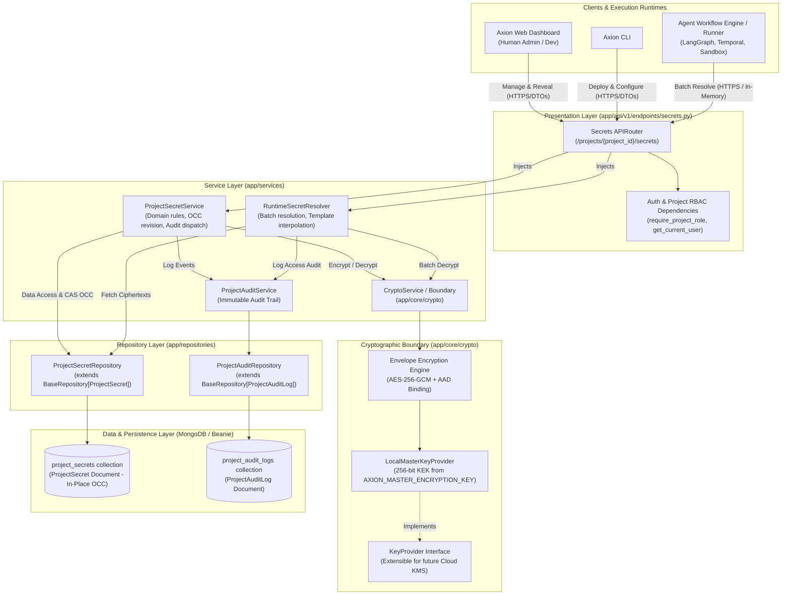
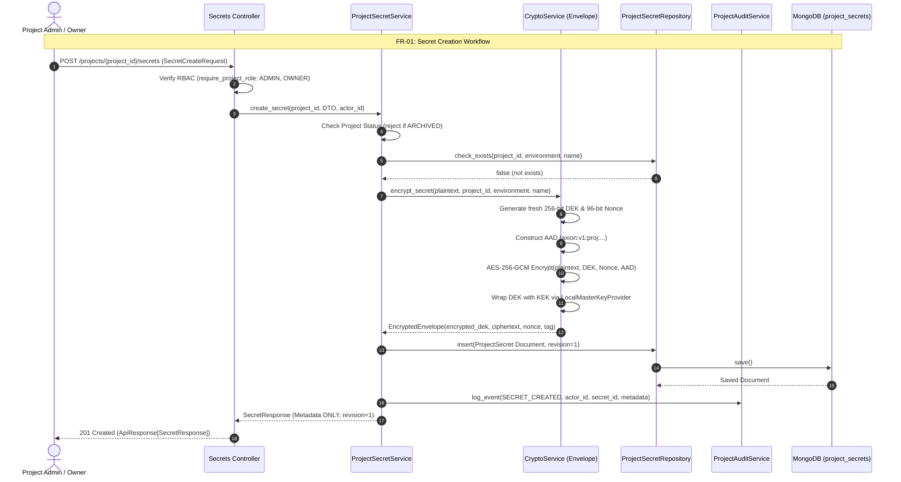
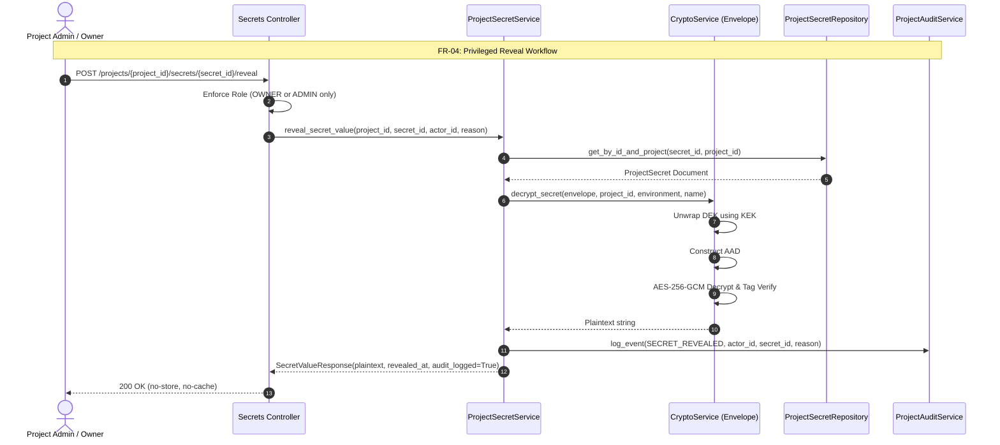
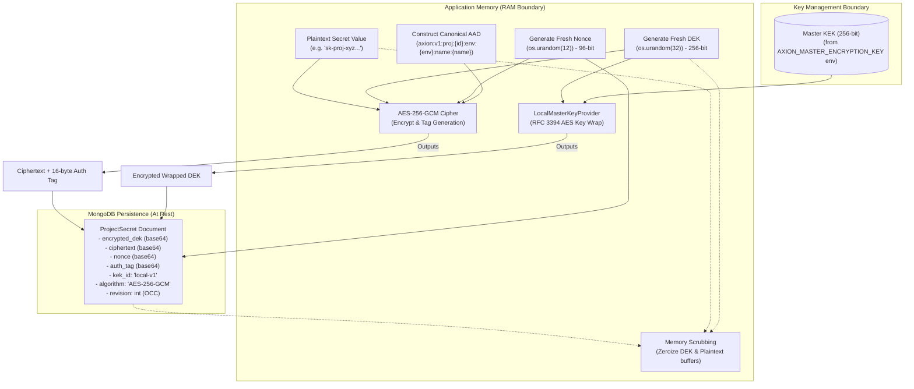
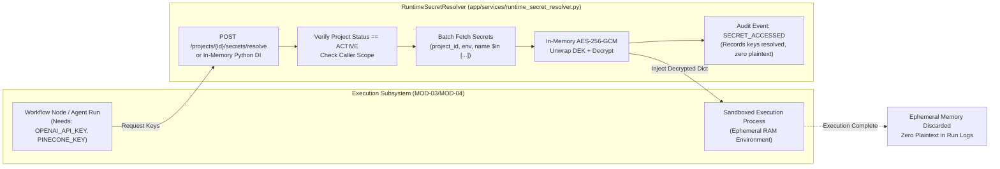

# Software Requirements Specification (SRS)
## Module 02: Project Secrets Management (Axion Runtime)

- **Document Version**: 2.0.0
- **Status**: Ready for Verification & Approval
- **Module ID**: `MOD-02`
- **Component**: `apps/api`
- **Architectural Reference**: `docs/system-design-rules.md`, `docs/specs/srs-01-project-management.md`
- **Target Frameworks**: FastAPI, Beanie ODM (MongoDB), Clerk Authentication, Pydantic v2, Python Cryptography (AES-GCM / RFC 3394)

---

## 1. Executive Summary & Purpose

The **Project Secrets Management Module (`MOD-02`)** establishes the secure credential, API key, and environment variable management subsystem for the **Axion Runtime** platform. In an AI agent and workflow orchestration platform, automated pipelines require runtime access to heterogeneous external credentials—including LLM provider API keys (OpenAI, Anthropic, Cohere), vector database tokens (Pinecone, Qdrant), third-party SaaS credentials (GitHub, Slack, Stripe), and internal database connection strings.

Storing credentials insecurely or exposing plaintext in configuration databases, telemetry, audit logs, or browser dashboards poses critical operational and compliance risks. `MOD-02` provides a multi-tenant, cryptographically fortified secret storage and retrieval system adhering to the Axion 4-Layer Architecture (`Controller` -> `Service` -> `Repository` -> `Model`).

### Core Objectives
1. **Zero-Plaintext Persistence & Storage Confidentiality**: All secret values are encrypted at rest using industry-standard **AES-256-GCM** via **Envelope Encryption** (DEK/KEK two-tier hierarchy). Plaintext is never written to disk, database collections, or application log files.
2. **Cryptographic Tamper-Proofing (AAD Binding)**: Additional Authenticated Data (AAD) binds every ciphertext payload mathematically to its parent `project_id`, `environment`, and `name`. Ciphertext cannot be transplanted across projects, environments, or variable identifiers.
3. **Rigorous RBAC Separation (Metadata vs. Plaintext Reveal)**: Viewing secret metadata (name, environment, last rotated, revision) is decoupled from revealing decrypted plaintext values. Only authorized project administrators (`OWNER`, `ADMIN`) can trigger explicit plaintext reveals, and every reveal generates an immutable audit record.
4. **In-Place Replacement & Zero Historical Drift**: Updating or rotating a secret permanently replaces the previous ciphertext with a freshly generated 256-bit DEK and unique nonce. No historical secret versions are retained, minimizing sensitive data exposure and eliminating storage bloat.
5. **Optimistic Concurrency Control (OCC Revision Counter)**: An integer `revision` counter protects against race conditions and concurrent overwrite hazards. The `revision` counter is strictly for OCC concurrency control, not version history.
6. **Decoupled Runtime Resolver**: Provides an engine-agnostic resolution interface capable of safely injecting decrypted secrets into sandboxed agent runners, code executors, and workflow engines without persisting or logging credentials.
7. **Strict Multi-Tenancy & Project Lifecycle Coherence**: Integrates seamlessly with `MOD-01` Project Management. Secrets inherit project boundary isolation, tenant anti-enumeration protections (HTTP 404 for non-members), and project lifecycle state constraints (read-only in `ARCHIVED`, inaccessible in `SOFT_DELETED`/`PURGED`).

---

## 2. Scope & Module Boundaries

### 2.1 In-Scope
- **Secret Lifecycle**: Creation, metadata inspection, updating, soft deletion, and permanent purge of project-scoped secrets.
- **Environment Partitioning**: Scoping secrets by execution environment (`development`, `staging`, `production`, or custom environments).
- **Cryptographic Envelope Engine**: Generation of cryptographically random Data Encryption Keys (DEKs), DEK wrapping via Key Encryption Keys (KEKs), AES-256-GCM encryption/decryption, and nonce management.
- **Key Management (Local Master Key Provider Initially)**: Core `LocalMasterKeyProvider` loading a 256-bit KEK from `AXION_MASTER_ENCRYPTION_KEY` environment variable with fail-fast startup validation. Abstract `KeyProvider` interface retained for future cloud KMS extensibility.
- **In-Place Secret Replacement & Rotation**: Atomic replacement of encrypted values with freshly generated DEKs and nonces upon update or rotation; tracking `last_rotated_at`.
- **Optimistic Concurrency Control**: Explicit `revision` counter preventing concurrent overwrite conflicts.
- **Privileged Plaintext Reveal**: Explicit, audit-logged endpoint for authorized human operators (`OWNER`, `ADMIN`) to inspect decrypted secret values.
- **Decoupled Runtime Batch Resolver**: High-performance batch resolution endpoint and Python service interface for sandboxed runtime execution engines.
- **Immutable Audit Logging**: Comprehensive audit trail integration recording secret creations, updates, rotations, deletions, reveals, and runtime accesses via `ProjectAuditService`.

### 2.2 Out-of-Scope (Handled by Neighboring Modules or Explicit Architectural Exclusions)
- **Secret Version History & Rollback**: Intentionally excluded by architectural design. Secrets are replaced in-place to minimize stale credential leakage surfaces and reduce storage complexity.
- **Cloud KMS Integration (Initial Phase)**: Cloud-native KMS (AWS KMS, GCP KMS, Azure Key Vault, HashiCorp Vault) is architected via the abstract `KeyProvider` interface but deferred to a future infrastructure release; initial implementation targets `LocalMasterKeyProvider`.
- **User Authentication & Token Verification**: Managed by Clerk and `MOD-01` (`app.api.deps.get_current_user`).
- **Project Boundary & Member RBAC Enforcement**: Handled by `MOD-01` (`app.api.deps.require_project_role`).
- **Agent Sandbox Process Isolation**: Handled by downstream execution engines (`MOD-04 Execution Sandbox`); `MOD-02` supplies decrypted environment variables in-memory to the sandbox boundary.

### 2.3 System Context & Architecture Diagram



---

## 3. Immediate Architectural Review (6 Key Points)

### 3.1 What Already Exists and Can Be Reused
The existing Axion Runtime codebase (`MOD-01`) provides a robust and fully verified foundation that `MOD-02` directly leverages:
1. **Authentication Subsystem (`app/core/security.py`)**: Bearer JWT decoding, Clerk JWKS verification, and `AuthenticatedUser` model.
2. **Project Scoping & Tenant Authorization (`app/api/deps.py`)**: `require_project_role(*allowed_roles)` factory dependency automatically resolves projects by BSON ID or slug, validates user project membership, enforces role hierarchy (`OWNER` > `ADMIN` > `MEMBER` > `VIEWER`), attaches project entities to `request.state`, and critically raises `NotFoundError` (404) for non-members to prevent tenant resource enumeration.
3. **Project FSM Lifecycle Guards**: Project statuses (`ACTIVE`, `ARCHIVED`, `SOFT_DELETED`, `PURGED`) are enforced at the dependency and service layers.
4. **Immutable Audit Logging (`app/services/project_audit_service.py`, `app/models/project.py`)**: Append-only collection `project_audit_logs` storing actor identity, timestamps, target IDs, and payloads.
5. **Generic Repository Abstraction (`app/repositories/base.py`)**: `BaseRepository[T]` with standardized async CRUD primitives, query builders, sorting, pagination, and BSON ObjectId validation.
6. **Standardized Schemas & Exception Handling (`app/schemas/common.py`, `app/core/exceptions.py`)**: Uniform response envelopes (`ApiResponse[T]`, `PaginatedResponse[T]`, `ApiErrorResponse`), standard pagination parameters (`PaginationParams`), and domain exception hierarchy (`NotFoundError`, `ForbiddenError`, `ConflictError`, `ValidationError`).

### 3.2 What Is Missing & Needs to Be Built
1. **Dedicated Cryptographic Module (`app/core/crypto/`)**:
   - AES-256-GCM cipher execution with 12-byte cryptographically secure random nonces and 16-byte authentication tags.
   - Envelope encryption workflows: 256-bit DEK generation (`os.urandom(32)`), DEK wrapping/unwrapping via KEK, and canonical AAD construction.
   - `LocalMasterKeyProvider`: Reads 256-bit KEK from `AXION_MASTER_ENCRYPTION_KEY`, validates 32-byte key material at application startup, and performs RFC 3394 AES Key Wrap. Extensible `KeyProvider` interface for future Cloud KMS.
2. **Persistence Model (`app/models/secret.py`)**:
   - `ProjectSecret`: Stores metadata, encrypted DEK, ciphertext, nonce, auth tag, KEK identifier, environment, and OCC `revision`. Zero plaintext fields. Zero historical snapshot collections.
3. **Repository (`app/repositories/secret_repository.py`)**:
   - `ProjectSecretRepository` implementing tenant-scoped queries, compound unique index checks, and atomic compare-and-swap (CAS) updates checking `revision`.
4. **Service Layer (`app/services/secret_service.py`, `app/services/runtime_secret_resolver.py`)**:
   - `ProjectSecretService`: Business logic for secret CRUD, in-place replacement, OCC revision validation, role checks, encryption orchestration, and audit event dispatch.
   - `RuntimeSecretResolver`: Engine-agnostic resolver performing batch decryption and template placeholder interpolation (`{{secrets.VAR_NAME}}`).
5. **Presentation Layer & DTOs (`app/api/v1/endpoints/secrets.py`, `app/schemas/secret.py`)**:
   - DTOs ensuring zero plaintext leakage in listing/detail responses (`SecretResponse`).
   - Plaintext wrapped in `pydantic.SecretStr` in request payloads (`SecretCreateRequest`, `SecretUpdateRequest`, `SecretRotateRequest`).
   - Dedicated privileged reveal endpoint (`POST .../reveal`) returning `SecretValueResponse`.
   - Logging middleware exclusion rules protecting secret endpoints from payload logging.

### 3.3 Proposed Architecture (4-Layer Pattern & Separation of Concerns)
Following `docs/system-design-rules.md`, `MOD-02` strictly segregates concerns into 4 layers plus a dedicated cryptographic boundary:

| Layer | Component Path | Responsibility & Rules |
| :--- | :--- | :--- |
| **Layer 1: Presentation** | `app/api/v1/endpoints/secrets.py` | Extracts HTTP parameters, enforces project RBAC via `require_project_role`, validates DTOs, returns `ApiResponse`. Zero direct database queries or raw ODM calls. |
| **Layer 2: Service** | `app/services/secret_service.py`<br>`app/services/runtime_secret_resolver.py` | Pure domain workflows: validates project lifecycle, enforces OCC revisions, coordinates encryption with `CryptoService`, dispatches audit events. Transport-agnostic (no `Request`/`Response`/`HTTPException`). |
| **Cryptographic Boundary** | `app/core/crypto/` (`crypto_service.py`, `envelope.py`, `provider.py`) | Isolated cryptographic engine. Handles DEK generation, KEK wrapping via `LocalMasterKeyProvider`, AES-GCM ciphering, and AAD generation. Has no database or HTTP dependencies. |
| **Layer 3: Repository** | `app/repositories/secret_repository.py` | Encapsulates all Beanie/MongoDB queries, index expressions, BSON conversions, and atomic CAS operations. Enforces tenant filter `{ "project_id": ... }`. |
| **Layer 4: Persistence** | `app/models/secret.py` | Defines Beanie document `ProjectSecret`. Strictly stores encrypted binary/base64 structures; no plaintext attribute exists. |

### 3.4 Proposed API Endpoints Overview (8 Endpoints)
1. `GET /api/v1/projects/{project_id}/secrets` — List secret metadata (Paginated, filtered by environment/tags; **Zero Plaintext**).
2. `POST /api/v1/projects/{project_id}/secrets` — Create secret (Encrypts value; returns metadata only).
3. `GET /api/v1/projects/{project_id}/secrets/{secret_id}` — Get single secret metadata (**Zero Plaintext**).
4. `PUT /api/v1/projects/{project_id}/secrets/{secret_id}` — Update secret metadata or value in-place (Generates fresh DEK/nonce; increments OCC revision).
5. `DELETE /api/v1/projects/{project_id}/secrets/{secret_id}` — Soft delete secret.
6. `POST /api/v1/projects/{project_id}/secrets/{secret_id}/reveal` — Privileged reveal of decrypted plaintext (**Strictly OWNER/ADMIN; Audit logged**).
7. `POST /api/v1/projects/{project_id}/secrets/{secret_id}/rotate` — Rotate secret value in-place (Generates fresh DEK/nonce; updates `last_rotated_at`; increments OCC revision).
8. `POST /api/v1/projects/{project_id}/secrets/resolve` — Batch runtime resolution for execution engines (Decoupled, authenticated, zero-log).

### 3.5 Security & Encryption Strategy Summary
1. **AES-256-GCM AEAD**: Guarantees confidentiality and cryptographic integrity verification.
2. **Envelope Encryption Hierarchy**: Master KEK wraps ephemeral 256-bit DEKs generated uniquely per secret record.
3. **In-Place Replacement**: Updates and rotations permanently overwrite previous ciphertext with a freshly generated DEK. No stale historical versions exist.
4. **AAD Binding**: Additional Authenticated Data string `axion:v1:proj:{project_id}:env:{environment}:name:{name}` is fed to AES-GCM tag calculation, preventing cross-tenant or cross-variable ciphertext translocation.
5. **Tenant Isolation**: Database-level `{ "project_id": ... }` compound queries + RBAC anti-enumeration 404 responses + cryptographic AAD isolation.
6. **Zero-Plaintext Leakage**: Plaintext fields are prohibited in Beanie models; DTOs use `SecretStr`; HTTP logging middleware explicitly redacts secret route request/response bodies.

### 3.6 Key Architectural Decisions Requiring Approval (ADRs)
- **ADR-01**: Two-Tier Envelope Encryption with `LocalMasterKeyProvider` (Fail-fast startup check; extensible `KeyProvider` interface).
- **ADR-02**: Mandatory AAD Binding incorporating `project_id`, `environment`, and `name`.
- **ADR-03**: RBAC Separation: `VIEWER`/`MEMBER` can view metadata and resolve runtime secrets; strictly `OWNER`/`ADMIN` can reveal plaintext in UI.
- **ADR-04**: In-Place Secret Replacement & OCC Revision Counter (Strictly concurrency protection, no historical version snapshots).
- **ADR-05**: Standalone Engine-Agnostic Runtime Resolver interface returning in-memory decrypted dictionaries without persistent storage.

---

## 4. Detailed Functional Requirements (FR-01 to FR-12)



### FR-01: Secret Creation & Encryption
- **Description**: An authorized project member creates a new secret under a specific environment.
- **Actor Roles**: `OWNER`, `ADMIN`.
- **Preconditions**:
  - Project must exist and have status `ACTIVE`.
  - Secret `name` must be unique within `(project_id, environment)` where `is_deleted == false`.
- **Business Rules**:
  - `name` must match regex `^[A-Z0-9_]{1,128}$` (uppercase alphanumeric with underscores).
  - `environment` defaults to project `default_environment` (typically `production`) if omitted.
  - Plaintext value must not be empty and must not exceed 65,536 bytes (64 KB).
  - Service generates a cryptographically fresh 256-bit DEK, generates a 12-byte nonce, constructs AAD, and encrypts via AES-256-GCM.
  - DEK is wrapped using the active KEK (`LocalMasterKeyProvider`).
  - Plaintext value is scrubbed from memory; only the encrypted envelope is persisted.
  - Secret document initializes with OCC counter `revision = 1`.
  - Audit event `SECRET_CREATED` is emitted.
- **Postconditions**: Secret persisted in MongoDB with `revision = 1`. Response contains metadata only; plaintext is never returned.

### FR-02: Secret Metadata Listing
- **Description**: Retrieves a paginated list of secret metadata for a project.
- **Actor Roles**: `OWNER`, `ADMIN`, `MEMBER`, `VIEWER`.
- **Preconditions**: Project exists, user is a member, project not `PURGED`.
- **Business Rules**:
  - Supports query filters: `environment`, `search` (case-insensitive substring match on name/description), `tags`.
  - Supports pagination (`page`, `page_size`, `limit`, `offset`) and sorting (`name`, `created_at`, `updated_at`).
  - Response DTO `SecretSummaryResponse` contains: `id`, `name`, `environment`, `description`, `tags`, `is_system`, `revision`, `created_at`, `updated_at`, `last_rotated_at`, `expires_at`.
  - **Inviolable Invariant**: Under no circumstances does the listing response contain `ciphertext`, `encrypted_dek`, `nonce`, `auth_tag`, or plaintext `value`.

### FR-03: Secret Detail Inspection (Metadata)
- **Description**: Retrieves single secret metadata by ID or name.
- **Actor Roles**: `OWNER`, `ADMIN`, `MEMBER`, `VIEWER`.
- **Business Rules**:
  - Verifies `project_id` matching to enforce tenant boundaries.
  - Returns `SecretResponse` (metadata, encryption algorithm, KEK ID, OCC revision counter).
  - Plaintext value is omitted.

### FR-04: Secret Value Privileged Reveal
- **Description**: Explicitly decrypts and displays the plaintext value of a secret.
- **Actor Roles**: Strictly `OWNER` and `ADMIN`. (`MEMBER` and `VIEWER` are rejected with `403 Forbidden`).
- **Preconditions**: Project status is `ACTIVE` or `ARCHIVED` (read permitted in archived).
- **Business Rules**:
  - Requires optional `reason` parameter in request body for audit trail.
  - Service loads encrypted envelope from repository.
  - CryptoService unwraps DEK using KEK, reconstructs AAD, and decrypts ciphertext via AES-256-GCM.
  - If authentication tag verification fails, raises `CryptographicIntegrityError` (500) and emits security alert audit log.
  - Emits immutable audit log `SECRET_REVEALED` with `actor_id`, `client_ip`, `user_agent`, `secret_id`, `secret_name`, `environment`, and `reason`.
  - Returns `SecretValueResponse` containing decrypted plaintext `value`, `revealed_at` timestamp, and `audit_log_id`.
  - HTTP cache-control headers set to `no-store, no-cache, must-revalidate, private`.



### FR-05: Secret In-Place Update
- **Description**: Updates secret description, tags, expiration date, or replaces its value in-place.
- **Actor Roles**: `OWNER`, `ADMIN`.
- **Business Rules**:
  - Rejects if project is in `ARCHIVED` state (`ProjectArchivedError` 409).
  - Enforces Optimistic Concurrency Control (OCC): request must provide `revision`. If database `revision != payload.revision`, raises `ConflictError` (409).
  - If a new `value` is provided:
    - Generates fresh 256-bit DEK (`os.urandom(32)`) and fresh 12-byte nonce.
    - Encrypts new value with AES-256-GCM.
    - Permanently overwrites the existing encrypted envelope in MongoDB. No previous envelope or historical record is retained.
    - Sets `last_rotated_at = utcnow()`.
  - Increments OCC counter `revision = revision + 1`.
  - Emits `SECRET_UPDATED` audit event.

### FR-06: Secret Rotation
- **Description**: Dedicated endpoint to rotate an existing secret value in-place.
- **Actor Roles**: `OWNER`, `ADMIN`.
- **Business Rules**:
  - Accepts `SecretRotateRequest` containing `new_value` and expected `revision`.
  - Rejects if project is in `ARCHIVED` state (`ProjectArchivedError` 409).
  - Generates fresh 256-bit DEK and fresh 12-byte nonce.
  - Encrypts new value with AES-256-GCM.
  - Executes atomic Compare-And-Swap (CAS) update, overwriting old ciphertext, updating `last_rotated_at = utcnow()`, and incrementing `revision = revision + 1`.
  - Emits `SECRET_ROTATED` audit event recording secret ID, name, environment, and new revision number.

### FR-07: Secret Soft Deletion & Restoration
- **Description**: Marks a secret as deleted without immediately erasing ciphertext.
- **Actor Roles**: `OWNER`, `ADMIN`.
- **Business Rules**:
  - Sets `is_deleted = true`, `deleted_at = utcnow()`.
  - Soft-deleted secret is immediately excluded from active listings and runtime resolutions.
  - Unique index partial filter (`is_deleted: false`) allows immediate re-creation of a secret with the same name if desired.
  - Emits `SECRET_DELETED` audit event.

### FR-08: Secret Purging (Permanent Erase)
- **Description**: Permanently deletes a soft-deleted secret document from the database.
- **Actor Roles**: `OWNER` only.
- **Business Rules**:
  - Permanently removes document from `project_secrets` collection.
  - Emits `SECRET_PURGED` audit event.

### FR-09: Optimistic Concurrency Control (OCC) via Revision Counter
- **Description**: Prevents concurrent updates from overwriting changes made by another operator or automated process.
- **Business Rules**:
  - The `revision` attribute is strictly an integer revision counter for OCC and CAS operations. It does not represent historical snapshots.
  - Every update (`PUT /secrets/{id}`) and rotation (`POST /secrets/{id}/rotate`) must provide the client's observed `revision`.
  - The repository executes:
    ```python
    filter_expr = {"_id": secret_oid, "project_id": proj_oid, "revision": expected_revision}
    update_expr = {"$set": update_dict, "$inc": {"revision": 1}}
    ```
  - If `modified_count == 0`, raises `ConflictError("Secret has been modified by another process. Please reload and retry.")` (HTTP 409).

### FR-10: Decoupled Runtime Batch Resolution
- **Description**: High-speed batch decryption for execution runtimes (agent workers, sandbox containers, workflow nodes).
- **Actor Roles**: `OWNER`, `ADMIN`, `MEMBER`, or Execution Token / Service Account.
- **Business Rules**:
  - Accepts `SecretBatchResolveRequest` containing `names: List[str]` (e.g. `["OPENAI_API_KEY", "PINECONE_KEY"]`), `environment: str`, and optional `execution_id`.
  - Verifies project status is `ACTIVE` (runtime execution blocked if project is `ARCHIVED`, `SOFT_DELETED`, or `PURGED`).
  - Fetches matching active secrets in a single MongoDB query (`$in: names`).
  - Batch decrypts secrets in-memory using CryptoService.
  - Validates expirations (`expires_at`); expired secrets are flagged and excluded.
  - Emits `SECRET_ACCESSED` audit event summarizing resolved keys (names only, zero plaintext).
  - Returns `SecretBatchResolveResponse` containing key-value dictionary and list of missing keys.
  - Execution runtime injects keys into process memory and guarantees zero storage in workflow run logs.

### FR-11: Environment Variable Template Interpolation
- **Description**: Service utility parsing workflow configuration strings and replacing secret placeholders (e.g. `{{secrets.OPENAI_API_KEY}}`).
- **Business Rules**:
  - Regex pattern: `\{\{\s*secrets\.([A-Z0-9_]+)\s*\}\}`.
  - Extracts all unique variable names.
  - Calls `RuntimeSecretResolver` to batch resolve the referenced keys.
  - Interpolates decrypted values into configuration strings in-memory.
  - Disallows logging of interpolated strings.

### FR-12: Project Lifecycle Binding & Cascade
- **Description**: Enforces `MOD-01` project lifecycle transitions on all secrets operations.
- **Business Rules**:
  - If Project status is `ARCHIVED`: Secret creation, modification, rotation, deletion, and runtime resolution are rejected (`ProjectArchivedError` 409). Plaintext reveal and metadata inspection remain permitted for compliance review.
  - If Project status is `SOFT_DELETED`: All secrets APIs return `NotFoundError` (404) for non-owners. For owner, returns 409 Conflict for mutations.
  - If Project status is `PURGED`: All secrets APIs return `NotFoundError` (404). During project purge cascade, all `project_secrets` documents for that project are permanently erased.

---

## 5. Cryptographic & Security Architecture



### 5.1 The Envelope Encryption Pattern
To achieve high performance, strict blast-radius isolation, and instant master key rotation capability, `MOD-02` adopts **Envelope Encryption**:
1. **Data Encryption Key (DEK)**:
   - A 256-bit symmetric key uniquely generated for each secret record (and refreshed on each secret update or rotation) using `os.urandom(32)`.
   - Never stored in plaintext on disk or in the database.
   - Used exclusively to encrypt the secret plaintext value using AES-256-GCM.
2. **Key Encryption Key (KEK)**:
   - A long-lived master key managed outside the database via environment variable `AXION_MASTER_ENCRYPTION_KEY`.
   - Used strictly to wrap (encrypt) and unwrap (decrypt) DEKs via RFC 3394 AES Key Wrap.
   - Because KEKs only encrypt 32-byte DEKs, they undergo very low cryptographic wear.
   - When a KEK is rotated, existing secret ciphertexts do **not** need re-encryption; only the small wrapped DEKs are unwrapped with the old KEK and re-wrapped with the new KEK.

### 5.2 Cipher Specification: AES-256-GCM
All secret encryption uses **Advanced Encryption Standard in Galois/Counter Mode (AES-GCM)**:
- **Key Length**: 256 bits (32 bytes).
- **Initialization Vector (Nonce)**: 96 bits (12 bytes), generated via `os.urandom(12)`. Nonce reuse under the same DEK is mathematically impossible because a fresh DEK is generated for every single encryption operation.
- **Authentication Tag**: 128 bits (16 bytes). Verifies ciphertext authenticity and detects any unauthorized tampering or bit flipping.

### 5.3 Additional Authenticated Data (AAD) Tamper-Proofing
To prevent **ciphertext translocation attacks** (where an attacker with direct database access moves an encrypted ciphertext payload from Project A to Project B, or from variable `STRIPE_KEY` to `PUBLIC_URL`), every encryption operation incorporates canonical AAD:

$$\text{AAD} = \text{axion:v1:proj:}\langle \text{project\_id} \rangle\text{:env:}\langle \text{environment} \rangle\text{:name:}\langle \text{name} \rangle$$

During decryption, the exact same AAD is reconstructed from the requesting project, environment, and secret context. If an attacker has copied the ciphertext to a different project or variable name, AES-GCM tag verification fails catastrophically, preventing unauthorized decryption.

### 5.4 Key Management Strategy: `LocalMasterKeyProvider`
1. **Initial Implementation (`LocalMasterKeyProvider`)**:
   - Loads a 256-bit master key from `settings.AXION_MASTER_ENCRYPTION_KEY` (base64-encoded 32-byte string).
   - Validates on startup: verifies string decodes to exactly 32 bytes (256 bits). If key is missing, empty, or improperly sized, application fails fast on startup with `ConfigurationError`.
   - Wraps and unwraps DEKs using RFC 3394 AES Key Wrap algorithm (`cryptography.hazmat.primitives.keywrap`).
2. **Pluggable Architecture for Future Cloud KMS**:
   - The cryptographic boundary programs to an abstract `KeyProvider` interface:
     ```python
     class KeyProvider(ABC):
         @abstractmethod
         async def wrap_key(self, dek: bytes, key_id: Optional[str] = None) -> Tuple[bytes, str]:
             """Wraps a plaintext DEK. Returns (wrapped_dek_bytes, key_id)."""
             pass

         @abstractmethod
         async def unwrap_key(self, wrapped_dek: bytes, key_id: str) -> bytes:
             """Unwraps a wrapped DEK using the specified KEK ID. Returns plaintext DEK."""
             pass
     ```
   - Cloud KMS (AWS KMS, GCP KMS, Azure Key Vault, HashiCorp Vault) is architecturally enabled as a drop-in provider for future sprints without modifying service or repository logic.

### 5.5 Zero-Plaintext Leakage Guarantees
1. **Database Tier**: The Beanie model `ProjectSecret` strictly contains fields for `ciphertext`, `encrypted_dek`, `nonce`, and `auth_tag`. No column, field, or index for plaintext exists.
2. **DTO Layer**: `SecretResponse` and `SecretSummaryResponse` schemas strictly exclude value fields.
3. **Pydantic Validation**: Request DTOs wrap plaintext input in `pydantic.SecretStr`, ensuring that string representation (`repr()`, `str()`, traceback logs) prints `**********` rather than the raw secret.
4. **Middleware Sanitization**: `app/middleware/logging.py` contains path regex filters to redact request/response bodies for `/secrets`, `/reveal`, and `/resolve`.
5. **Memory Hygiene**: Secret plaintext is handled in localized scopes and garbage collected immediately after encryption or HTTP transmission.

---

## 6. Data Models & Database Schemas

All models reside in `app/models/secret.py` and extend `BaseDocument` (`app/db/base.py`) which automatically maintains UTC `created_at` and `updated_at`.

### 6.1 `ProjectSecret` Document Model

```python
# Specification for app/models/secret.py
class EncryptedEnvelope(BaseModel):
    """Cryptographic payload stored in database - ZERO PLAINTEXT."""
    algorithm: str = Field(default="AES-256-GCM", description="Cipher algorithm")
    encrypted_dek: str = Field(..., description="Base64-encoded wrapped Data Encryption Key")
    ciphertext: str = Field(..., description="Base64-encoded ciphertext")
    nonce: str = Field(..., description="Base64-encoded 12-byte initialization vector")
    auth_tag: str = Field(..., description="Base64-encoded 16-byte authentication tag")
    kek_id: str = Field(default="local-v1", description="Identifier of KEK used to wrap DEK")


class ProjectSecret(BaseDocument):
    project_id: PydanticObjectId = Field(..., description="Target Project document ID")
    name: str = Field(..., min_length=1, max_length=128, description="Identifier name (e.g. OPENAI_API_KEY)")
    environment: str = Field(default="production", min_length=1, max_length=50, description="Execution environment")
    description: Optional[str] = Field(default=None, max_length=1000, description="Human-readable description")
    tags: List[str] = Field(default_factory=list, description="Categorization tags")
    is_system: bool = Field(default=False, description="System-managed flag")
    
    # Cryptographic Envelope (In-Place, Zero Plaintext)
    envelope: EncryptedEnvelope = Field(..., description="Encrypted secret payload")
    
    # Metadata, In-Place Rotation & Concurrency
    revision: int = Field(default=1, description="Optimistic locking revision counter (strictly OCC, not history)")
    last_rotated_at: Optional[datetime] = Field(default=None, description="Timestamp of last rotation/replacement")
    expires_at: Optional[datetime] = Field(default=None, description="Optional secret expiration timestamp")
    is_deleted: bool = Field(default=False, description="Soft-delete flag")
    deleted_at: Optional[datetime] = Field(default=None, description="Timestamp of soft-deletion")
    created_by: str = Field(..., description="Clerk ID of creator")
    updated_by: str = Field(..., description="Clerk ID of last updater")

    class Settings:
        name = "project_secrets"
        indexes = [
            # Compound Unique Index: One active secret per name per environment per project
            IndexModel(
                [("project_id", ASCENDING), ("environment", ASCENDING), ("name", ASCENDING)],
                unique=True,
                partialFilterExpression={"is_deleted": False},
                name="idx_project_secrets_unique_active",
            ),
            # Query & Listing Indexes
            IndexModel([("project_id", ASCENDING), ("environment", ASCENDING)], name="idx_secrets_project_env"),
            IndexModel([("project_id", ASCENDING), ("is_deleted", ASCENDING), ("updated_at", DESCENDING)], name="idx_secrets_project_listing"),
            IndexModel([("project_id", ASCENDING), ("tags", ASCENDING)], name="idx_secrets_tags"),
            IndexModel([("expires_at", ASCENDING)], name="idx_secrets_expiration"),
        ]
```

### 6.2 Audit Action Integrations
`MOD-02` adds the following actions to `app/models/project.py` `ProjectAuditAction` enum:
- `SECRET_CREATED = "secret.created"`
- `SECRET_UPDATED = "secret.updated"`
- `SECRET_DELETED = "secret.deleted"`
- `SECRET_ROTATED = "secret.rotated"`
- `SECRET_ACCESSED = "secret.accessed"`
- `SECRET_REVEALED = "secret.revealed"`

---

## 7. API Specifications & Endpoints

All endpoints are registered under `/api/v1/projects/{project_id}/secrets`. All responses are enveloped via `ApiResponse[T]` or `PaginatedResponse[T]` per `app/schemas/common.py`.

### 7.1 Endpoint Routing Table (8 Endpoints)

| HTTP Method | Relative Path | Operation / Summary | Minimum Required Project Role | Audit Logged? | Response Schema |
| :--- | :--- | :--- | :--- | :--- | :--- |
| `GET` | `/` | List secret metadata | `VIEWER` | No | `PaginatedResponse[SecretSummaryResponse]` |
| `POST` | `/` | Create secret | `ADMIN` | Yes (`secret.created`) | `ApiResponse[SecretResponse]` (201) |
| `GET` | `/{secret_id}` | Get secret metadata | `VIEWER` | No | `ApiResponse[SecretResponse]` |
| `PUT` | `/{secret_id}` | Update metadata / value in-place | `ADMIN` | Yes (`secret.updated`) | `ApiResponse[SecretResponse]` |
| `DELETE` | `/{secret_id}` | Soft-delete secret | `ADMIN` | Yes (`secret.deleted`) | `ApiResponse[None]` (200) |
| `POST` | `/{secret_id}/reveal`| Privileged reveal plaintext | `ADMIN` (`OWNER` / `ADMIN` only) | **Yes (`secret.revealed`)** | `ApiResponse[SecretValueResponse]` |
| `POST` | `/{secret_id}/rotate`| Rotate secret value in-place | `ADMIN` | Yes (`secret.rotated`) | `ApiResponse[SecretResponse]` |
| `POST` | `/resolve` | Batch resolve runtime secrets | `MEMBER` | Yes (`secret.accessed`) | `ApiResponse[SecretBatchResolveResponse]` |

### 7.2 Request & Response DTO Schemas (`app/schemas/secret.py`)

```python
# Specification for app/schemas/secret.py
from datetime import datetime
from typing import Dict, List, Optional
from pydantic import BaseModel, Field, SecretStr

class SecretCreateRequest(BaseModel):
    name: str = Field(..., pattern=r"^[A-Z0-9_]{1,128}$", description="Uppercase identifier (e.g. OPENAI_API_KEY)")
    value: SecretStr = Field(..., min_length=1, max_length=65536, description="Plaintext secret value")
    environment: str = Field(default="production", min_length=1, max_length=50, description="Target environment")
    description: Optional[str] = Field(default=None, max_length=1000, description="Description")
    tags: List[str] = Field(default_factory=list, description="Categorization tags")
    expires_at: Optional[datetime] = Field(default=None, description="Optional expiration date")


class SecretUpdateRequest(BaseModel):
    value: Optional[SecretStr] = Field(default=None, min_length=1, max_length=65536, description="New secret value if replacing")
    description: Optional[str] = Field(default=None, max_length=1000, description="Updated description")
    tags: Optional[List[str]] = Field(default=None, description="Updated tags")
    expires_at: Optional[datetime] = Field(default=None, description="Updated expiration date")
    revision: int = Field(..., description="Current OCC revision counter for concurrency check")


class SecretRotateRequest(BaseModel):
    new_value: SecretStr = Field(..., min_length=1, max_length=65536, description="Rotated plaintext value")
    revision: int = Field(..., description="Current OCC revision counter for concurrency check")


class SecretRevealRequest(BaseModel):
    reason: Optional[str] = Field(default=None, max_length=500, description="Operator justification for revealing secret")


class SecretSummaryResponse(BaseModel):
    """Metadata summary response for listings - ZERO PLAINTEXT."""
    id: str
    project_id: str
    name: str
    environment: str
    description: Optional[str]
    tags: List[str]
    is_system: bool
    revision: int = Field(..., description="OCC revision counter")
    last_rotated_at: Optional[datetime]
    expires_at: Optional[datetime]
    created_at: datetime
    updated_at: datetime


class SecretResponse(SecretSummaryResponse):
    """Detailed metadata response - ZERO PLAINTEXT."""
    algorithm: str
    kek_id: str
    created_by: str
    updated_by: str


class SecretValueResponse(BaseModel):
    """Privileged plaintext reveal response."""
    id: str
    name: str
    environment: str
    value: str = Field(..., description="Decrypted plaintext value")
    revealed_at: datetime = Field(..., description="UTC timestamp of reveal")
    audit_logged: bool = Field(default=True, description="Confirmation of audit logging")


class SecretBatchResolveRequest(BaseModel):
    names: List[str] = Field(..., min_length=1, max_length=100, description="List of secret keys to resolve")
    environment: str = Field(default="production", description="Execution environment")
    execution_id: Optional[str] = Field(default=None, description="Associated execution run ID for audit")


class SecretBatchResolveResponse(BaseModel):
    resolved: Dict[str, str] = Field(..., description="Map of secret names to decrypted plaintext values")
    missing: List[str] = Field(default_factory=list, description="Requested keys not found or inactive")
```

---

## 8. RBAC, Security & Multi-Tenancy Architecture

### 8.1 Role Permission Matrix

The platform enforces a hierarchical RBAC structure: `OWNER (Level 4) > ADMIN (Level 3) > MEMBER (Level 2) > VIEWER (Level 1)`.

| Capability / Action | OWNER | ADMIN | MEMBER | VIEWER | Unauthenticated / Non-Member |
| :--- | :---: | :---: | :---: | :---: | :---: |
| **List Secret Metadata** | Yes | Yes | Yes | Yes | 404 Not Found (Anti-Enumeration) |
| **View Secret Metadata Details** | Yes | Yes | Yes | Yes | 404 Not Found |
| **Create Secret** | Yes | Yes | No | No | 404 Not Found |
| **Update Secret (In-Place)** | Yes | Yes | No | No | 404 Not Found |
| **Rotate Secret (In-Place)** | Yes | Yes | No | No | 404 Not Found |
| **Soft Delete Secret** | Yes | Yes | No | No | 404 Not Found |
| **Purge Secret (Permanent)** | Yes | No | No | No | 404 Not Found |
| **Reveal Plaintext Value (`/reveal`)** | **Yes** | **Yes** | **No (403)** | **No (403)** | 404 Not Found |
| **Runtime Batch Resolve (`/resolve`)** | Yes | Yes | Yes | No (403) | 404 Not Found |

### 8.2 Tenant Anti-Enumeration & Scoping
- All endpoints depend on `require_project_role(...)`.
- If a caller is not a member of the project specified by `project_id`, the dependency raises `NotFoundError("Project not found")`.
- This ensures that unauthorized attackers cannot determine whether a project ID or secret name exists in the database.
- Every repository query enforces the tenant filter:
  ```python
  {"project_id": project_object_id, "is_deleted": False}
  ```
  preventing any cross-tenant data leakage.

### 8.3 Concurrency Control via Optimistic Locking (OCC)
To prevent lost updates in multi-user or automated CI/CD deployments:
1. Every `ProjectSecret` maintains an integer `revision` field initialized to `1`.
2. Mutation requests (`PUT /secrets/{id}`, `POST /secrets/{id}/rotate`) must include `revision`.
3. The repository executes an atomic Compare-And-Swap (CAS) update:
   ```python
   await collection.update_one(
       {"_id": secret_oid, "project_id": proj_oid, "revision": expected_revision},
       {"$set": update_dict, "$inc": {"revision": 1}}
   )
   ```
4. If no document was modified, the service raises `ConflictError("Secret has been modified by another process. Please reload and retry.")` (HTTP 409).
5. The `revision` counter is strictly used for OCC concurrency control and does not indicate historical version depth.

---

## 9. Decoupled Runtime Secret Resolver Specification



### 9.1 Purpose & Design Principles
Execution runtimes (such as temporal workers, LangGraph agent nodes, Docker sandbox executors, or CLI test runners) need plaintext credentials to invoke external APIs. The `RuntimeSecretResolver` solves this without compromising security:
1. **Engine-Agnostic Interface**: Exposes both an internal Python service interface (`RuntimeSecretResolver.resolve_secrets(...)`) for in-process microservices and a secure HTTP endpoint (`POST /projects/{id}/secrets/resolve`) for distributed sandboxes.
2. **Ephemeral Memory Injection**: Decrypted secrets are returned directly into the running process's memory dictionary for immediate injection into process environment tables or HTTP headers.
3. **Strict Audit Trail**: Dispatches a `SECRET_ACCESSED` audit record containing the execution run ID, actor ID, timestamp, and array of resolved secret names. Plaintext values are never logged.
4. **Template Parsing Utility**:
   ```python
   def interpolate_templates(template_str: str, secrets_map: Dict[str, str]) -> str:
       """Replaces {{secrets.VAR_NAME}} with corresponding decrypted value."""
   ```

---

## 10. Non-Functional Requirements (NFRs)

### 10.1 Performance & Latency Targets
- **Metadata Listing (`GET /secrets`)**: $P_{95} \le 25\text{ ms}$ for projects with up to 500 secrets.
- **Single Secret Metadata (`GET /secrets/{id}`)**: $P_{95} \le 10\text{ ms}$.
- **Creation & Encryption (`POST /secrets`)**: $P_{95} \le 35\text{ ms}$ (including DEK generation, AES-GCM ciphering, and MongoDB write).
- **Runtime Batch Resolution (`POST /secrets/resolve`)**: $P_{95} \le 50\text{ ms}$ for batches of up to 25 secrets.

### 10.2 Cryptographic Standards & Compliance
- **Cipher Standard**: FIPS 140-3 and NIST SP 800-38D compliant AES-256-GCM authenticated encryption.
- **Random Number Generation**: Cryptographically secure system entropy (`os.urandom` / `secrets` module).
- **Key Wrap Standard**: RFC 3394 AES Key Wrap for symmetric DEK protection.

### 10.3 Reliability & Fault Tolerance
- **Database Connection Pooling**: Utilizes shared Motor connection pool (`min_pool_size=10`, `max_pool_size=50`).
- **Data Integrity**: Cryptographic authentication tag validation ensures corrupt or truncated data fails safely with explicit exceptions before reaching applications.
- **Fail-Fast Startup**: Validates `AXION_MASTER_ENCRYPTION_KEY` on service startup.

### 10.4 Maintainability & Clean Architecture
- Zero layer-jumping: No direct DB calls from controllers or services.
- Zero raw HTTP exceptions in service layers.
- 100% type-hinted Python 3.12+ code with strict Pydantic v2 validation.

---

## 11. Architectural Decision Records (ADRs)

### ADR-01: Two-Tier Envelope Encryption Hierarchy with `LocalMasterKeyProvider`
- **Context**: Encrypting secrets directly with a single static master key makes key rotation extremely expensive (requiring re-encrypting all database rows) and increases cryptographic key wear.
- **Decision**: Adopt a two-tier Envelope Encryption architecture. Every secret receives a unique 256-bit DEK. The master KEK only encrypts DEKs. For the initial implementation, `LocalMasterKeyProvider` manages the 256-bit KEK loaded from `AXION_MASTER_ENCRYPTION_KEY` with fail-fast startup checks. The interface is pluggable to accommodate cloud KMS providers in future sprints.
- **Consequences**: Fast cryptographic operations, negligible KEK wear, instant KEK rotation without touching ciphertext, and zero DEK reuse.

### ADR-02: Cryptographic AAD Binding to Project, Environment, and Key Name
- **Context**: In multi-tenant databases, an attacker with write access to MongoDB could move an encrypted ciphertext from a high-privilege project into their own project to decrypt it via legitimate APIs.
- **Decision**: Incorporate canonical AAD `axion:v1:proj:{project_id}:env:{env}:name:{name}` into all AES-GCM tag calculations.
- **Consequences**: Mathematically prevents ciphertext translocation across projects, environments, or variable identifiers.

### ADR-03: Strict Decoupling of Metadata Listing vs. Privileged Plaintext Reveal
- **Context**: Standard developers (`MEMBER`, `VIEWER`) need to view secret configurations and trigger automated runs, but allowing general users to view plaintext API keys introduces high exfiltration risks.
- **Decision**: Decouple metadata from plaintext. Standard listing/detail APIs omit values entirely. A dedicated `/reveal` endpoint is strictly guarded by `OWNER` and `ADMIN` roles and requires mandatory audit logging.
- **Consequences**: Enforces principle of least privilege while providing complete operational visibility.

### ADR-04: In-Place Secret Replacement & Optimistic Concurrency Control (OCC)
- **Context**: Retaining historical versions of credentials increases the blast radius of credential leaks, complicates compliance (e.g. key revocation verification), and introduces storage bloat.
- **Decision**: Secrets are updated and rotated strictly in-place. Updating or rotating generates a fresh DEK and permanently overwrites the old encrypted envelope. An integer `revision` counter is maintained solely for OCC concurrency protection via CAS updates, with zero historical version collections.
- **Consequences**: Minimal attack surface, zero stale secret storage, deterministic credential state, and robust concurrency protection against race conditions.

### ADR-05: Dedicated Transport-Agnostic Runtime Resolver Interface
- **Context**: Downstream workflow orchestrators and sandbox containers need to resolve secrets without coupling `MOD-02` to specific agent frameworks.
- **Decision**: Build `RuntimeSecretResolver` as a clean service abstraction and batch REST endpoint providing in-memory key-value maps.
- **Consequences**: Seamless integration with LangGraph, Temporal, AutoGen, CrewAI, and sandboxed Docker runners.

---

## 12. Verification & Acceptance Criteria

### 12.1 Acceptance Checklist
- [ ] **Architecture Boundary**: Verified 4-layer separation (`Controller` -> `Service` -> `Repository` -> `Model`) with dedicated `CryptoService`.
- [ ] **Zero Plaintext Persistence**: Confirmed no plaintext `value` field in `ProjectSecret` document schema or MongoDB records.
- [ ] **Zero Plaintext Leakage**: Confirmed `SecretResponse` and `SecretSummaryResponse` schemas exclude secret values. Confirmed HTTP logging middleware redacts secret routes.
- [ ] **In-Place Replacement**: Confirmed secret updates and rotations permanently overwrite ciphertext and do not create version documents or history collections.
- [ ] **OCC Concurrency**: Confirmed updates and rotations enforce atomic CAS checking `revision`. Stale `revision` inputs reject with HTTP 409 Conflict.
- [ ] **Cryptographic Verification**: AES-256-GCM encryption verified with fresh 256-bit DEK, 12-byte nonce, 16-byte auth tag, and AAD binding.
- [ ] **RBAC Enforcement**: Confirmed `VIEWER` and `MEMBER` are rejected (403) from `/reveal` endpoint.
- [ ] **Tenant Isolation**: Confirmed non-members receive 404 Not Found on all secret endpoints.
- [ ] **Audit Trail**: Confirmed every secret creation, update, rotation, deletion, reveal (`secret.revealed`), and runtime resolution (`secret.accessed`) emits an immutable `ProjectAuditLog` entry.
- [ ] **Project Lifecycle**: Confirmed `ARCHIVED` projects reject mutations with 409 Conflict (`ProjectArchivedError`).

### 12.2 Verification Test Scenarios
1. **Happy Path Secret Lifecycle**: Create secret -> List metadata -> Get metadata -> Update description -> Rotate value (in-place) -> Reveal plaintext -> Soft delete -> Verify exclusion from list.
2. **In-Place Replacement Test**: Verify that updating secret value replaces `ciphertext` and `encrypted_dek` with new values, bumps `revision` by 1, and creates no auxiliary history records.
3. **OCC Race Condition Test**: Submit two concurrent update requests with `revision = 1`. Verify one succeeds (bumping revision to 2) and the other fails with HTTP 409 Conflict.
4. **AAD Translocation Tamper Test**: Manually alter `project_id` or `name` of a secret record in MongoDB. Attempt `/reveal`. Decryption must fail with `CryptographicIntegrityError` (500).
5. **Privilege Escalation Test**: Authenticate as `MEMBER`. Attempt `POST .../secrets/{id}/reveal`. Verify immediate HTTP 403 Forbidden.
6. **Tenant Isolation Test**: Authenticate as a user not belonging to the project. Attempt any secret endpoint. Verify HTTP 404 Not Found.
7. **Project Archived Freeze Test**: Archive project via `MOD-01`. Attempt to create or rotate secret in `MOD-02`. Verify HTTP 409 Conflict (`ProjectArchivedError`). Verify `/reveal` still functions for compliance audit.
