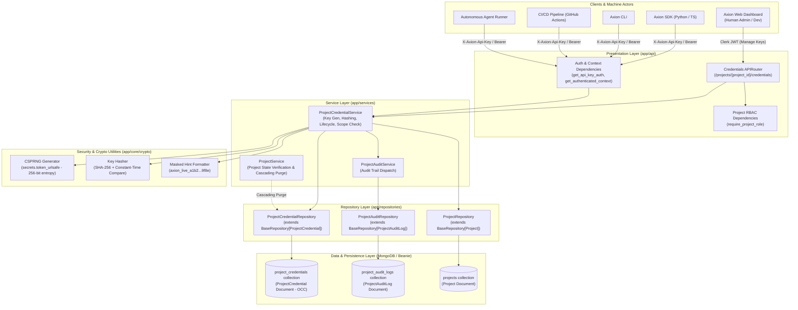

# Software Requirements Specification (SRS)
## Module 03: Project Credentials Management (Axion Runtime)

- **Document Version**: 2.0.0
- **Status**: Ready for Verification & Implementation
- **Module ID**: `MOD-03`
- **Component**: `apps/api`
- **Architectural Reference**: `docs/system-design-rules.md`, `docs/specs/srs-01-project-management.md`, `docs/specs/srs-02-project-secrets-management.md`, `AGENTS.md`
- **Target Frameworks**: FastAPI, Beanie ODM (MongoDB), Clerk Authentication / API Key Native Authentication, Pydantic v2, Python `hashlib` / `secrets` / `hmac`

---

## 1. Executive Summary & Purpose

The **Project Credentials Management Module (`MOD-03`)** establishes the programmatic authentication and machine-to-machine (M2M) credential subsystem for the **Axion Runtime** platform. 

In a modern enterprise AI platform, automated systems—including the Axion CLI, continuous integration/continuous deployment (CI/CD) pipelines, external workflow orchestrators (e.g., Temporal, Airflow), sandboxed agent execution runners, and client SDKs (Python, TypeScript)—must interact with the Axion API securely and autonomously. These automated consumers cannot depend on interactive human session tokens (such as Clerk OAuth2/OIDC JWTs). Instead, they require robust, project-scoped **API Credentials (API Keys)** that provide deterministic project identity, fine-grained capability scoping, automated expiration, and cryptographic authentication.

### Critical Domain Separation: Credentials vs. Secrets

It is essential to distinguish between **Project Secrets (`MOD-02`)** and **Project Credentials (`MOD-03`)**:
- **Project Secrets (`MOD-02`) [Outbound Integration Secrets]**: Heterogeneous external credentials (e.g., OpenAI API keys, Anthropic API keys, Google Gemini keys, Pinecone vector database tokens, database connection strings, Stripe webhooks). These are stored via two-tier Envelope Encryption (AES-256-GCM + AAD binding) and resolved/decrypted at runtime to allow Axion agents to make **outbound** requests to third-party services.
- **Project Credentials (`MOD-03`) [Inbound Platform API Keys]**: Cryptographically high-entropy platform tokens issued by Axion to clients. These tokens allow machine actors and SDKs to make **inbound** authenticated requests into the Axion API without human intervention. They represent a machine principal strictly bound to a single project workspace.

### Core Objectives
1. **Cryptographically Secure Key Generation & Clear Prefixing**: Produce high-entropy (256-bit CSPRNG) API keys with recognizable environment prefixes (`axion_live_...` for production, `axion_test_...` for development/sandbox) that prevent credential confusion and facilitate automated secret scanning in repositories.
2. **Strict Zero-Plaintext Persistence & Irreversible Hashing**: Plaintext API keys are **strictly returned once** upon initial generation. The platform stores only an irreversible cryptographic hash (SHA-256) and a non-sensitive preview hint (e.g. `axion_live_a1b2...9f8e`). Plaintext keys can never be retrieved, revealed, or recovered from the database.
3. **Decoupled Machine Authentication Dependency**: Provide a high-performance FastAPI security dependency (`get_api_key_auth` and dual-mode `get_authenticated_context`) that extracts API keys from `X-Axion-Api-Key` or `Authorization: Bearer axion_...` headers, performs indexed hash verification, validates scopes, enforces project isolation, and injects project context into endpoints without requiring a Clerk session.
4. **Strict Project Isolation & Boundary Verification**: Enforce that the project identifier (`project_id` or `slug`) in the request route path matches the credential's parent `project_id`. Mismatches are rejected with HTTP 403 (`PROJECT_ACCESS_DENIED`), preventing cross-tenant lateral movement.
5. **Explicit Capabilities & Least-Privilege Scoping**: Require explicit capability scopes on credential creation (e.g., `projects:read`, `secrets:resolve`, `runs:write`). Wildcard `*` scopes are never defaulted.
6. **Credential Administration Boundary**: Machine API keys cannot administer, create credentials. All credential lifecycle CRUD strictly requires an authenticated human Clerk session holding `OWNER` or `ADMIN` role.
7. **Full Lifecycle Governance & Concurrency Control**: Support creation, metadata updates, rolling rotation (with overlapping grace periods and collision-free partial indexes), immediate revocation, expiration (TTL), soft-deletion, and permanent purge. Concurrency is strictly guarded via Optimistic Concurrency Control (OCC) revision counters.
8. **Cascading Lifecycle Integration**: Seamlessly integrate with `MOD-01 Project Management`. Purging a project cascades to permanently purge all associated credentials (`purge_by_project`).
9. **Disentangled Telemetry & High-Performance Usage Tracking**: Separate high-frequency request telemetry (`last_used_at`, `last_used_ip`, `total_uses`) from the immutable audit trail (`project_audit_logs`). Only lifecycle state mutations generate audit events. Telemetry uses write-debouncing and memory buffering to eliminate database thrashing while preserving exact usage counts.
10. **Zero Architectural Erosion**: 100% adherence to Axion's 4-Layer Architecture (`Controller` -> `Service` -> `Repository` -> `Model`) and non-negotiable invariants defined in `AGENTS.md`.

---

## 2. Scope & Module Boundaries

### 2.1 In-Scope
- **Key Generation & Formatting**: Generating 256-bit cryptographically secure random keys with standard prefixes (`axion_live_` for `production`, `axion_test_` for non-production) and returning the plaintext strictly once.
- **Key Hashing & Masked Hints**: Hashing keys with SHA-256 for persistent database storage; computing safe preview masks (`prefix + first 4 chars + '...' + last 4 chars`).
- **Credential Lifecycle Management**: CRUD endpoints for creating, listing, inspecting metadata, updating metadata, rotating, revoking, and purging credentials. Path parameter `project_id` universally accepts either BSON `ObjectId` or URL-safe `slug`.
- **FastAPI Authentication Dependency**: Extraction and validation of incoming API keys via `X-Axion-Api-Key` or `Authorization: Bearer <key>` headers; injection of unified `AuthenticatedActor` and `Project` into `request.state`.
- **Project Boundary Matching**: Verifying that the target route's `project_id` matches the credential's bound `project_id`.
- **Unified Security Context**: Standard `AuthenticatedActor` model handling both human Clerk users and machine credentials.
- **Explicit Scope Verification**: Granular scope checking ensuring machine clients only access authorized endpoint capabilities.
- **Per-Credential Rate Limiting**: Enforcement of custom requests-per-minute limits per credential (`rate_limit_rpm`) interfacing with Axion's rate-limiting middleware.
- **Optimistic Concurrency Control (OCC)**: Version-checked updates via the `revision` integer counter.
- **Usage Telemetry & Debouncing**: Asynchronous, debounced updating of `last_used_at` and `last_used_ip` with non-dropping `total_uses` counters.
- **Audit Trail Dispatch**: Logging all administrative credential modifications to `project_audit_logs`.
- **Project Boundary Alignment & Cascading Purge**: Mutations rejected if project is `ARCHIVED`, all access blocked if `SOFT_DELETED` or `PURGED`. Cascading purge cleans up all credentials when a project is permanently purged.

### 2.2 Out-of-Scope (Handled by Neighboring Modules)
- **Third-Party Provider Secrets (`MOD-02`)**: External LLM keys (OpenAI, Anthropic, Gemini) and connection strings belong strictly to `MOD-02 Project Secrets Management`.
- **Human User Identity & Session Tokens (`MOD-01`)**: Clerk OAuth2/OIDC user authentication, user invitations, and human profile synchronization.
- **Machine Self-Administration**: Machine credentials cannot create or revoke other credentials; this is reserved for human project admins.
- **Global Organization-Level API Keys**: Machine credentials in this module are strictly project-scoped.
- **Network-Level IP Allowlisting**: Web Application Firewall (WAF) and CIDR IP whitelisting are handled at the API Gateway / ingress reverse proxy layer.

### 2.3 System Context & Architecture Diagram



---

## 3. Immediate Architectural Review (6 Key Points)

### 3.1 What Already Exists and Can Be Reused
1. **Base Document Architecture (`app/db/base.py`)**: `BaseDocument` provides standardized `created_at` and `updated_at` timestamps with UTC lifecycle event listeners. Each model retains its own `class Settings: name = "..."` without `is_root = True`.
2. **Repository Foundation & BSON Serialization (`app/repositories/base.py`)**: `BaseRepository` provides standard CRUD and conversion helpers (`_to_object_id`). `serialize_for_mongo` ensures that Pydantic models, enums, and nested structures are cleanly serialized before raw PyMongo writes (`find_one_and_update`).
3. **Optimistic Concurrency Control (OCC) Pattern**: The established pattern in `ProjectSecretRepository` and `ProjectRepository` (filter on expected `revision`, `ReturnDocument.AFTER`, inspect `None` to distinguish 404 vs 409) is adopted identically for `ProjectCredentialRepository`.
4. **DuplicateKeyError Mapping by Index**: Translating MongoDB index errors by inspecting `exc.details["keyPattern"]` to return precise 409 Conflict domain errors instead of generic 500s.
5. **Project RBAC & Lifecycle Protection (`app/api/deps.py`)**: `require_project_role` enforces role hierarchy (`VIEWER` < `MEMBER` < `ADMIN` < `OWNER`), anti-enumeration 404 responses for non-members, and blocks operations on `SOFT_DELETED`, `ARCHIVED`, or `PURGED` projects. Supports both BSON ID and `slug`.
6. **Unified API Envelopes (`app/schemas/common.py`)**: `ApiResponse[T]`, `PaginatedResponse[T]`, and `ApiErrorResponse` ensure consistent response formats across all endpoints.
7. **Audit Logging Framework (`app/services/project_audit_service.py`)**: Existing `ProjectAuditRepository` logs immutable events into `project_audit_logs`.

### 3.2 What Is Missing & Needs to Be Built
1. **Document Model (`app/models/credential.py`)**: `ProjectCredential` Beanie document with compound indexes for fast hash lookups, project scoping, active status, expiration, and `is_rotating` flag.
2. **Audit Action Enumeration Extensions (`app/models/project.py`)**: Add `CREDENTIAL_CREATED`, `CREDENTIAL_UPDATED`, `CREDENTIAL_REVOKED`, `CREDENTIAL_DELETED`, and `CREDENTIAL_PURGED` to `ProjectAuditAction`.
3. **Repository Layer (`app/repositories/credential_repository.py`)**: `ProjectCredentialRepository` providing indexed lookups by `key_hash`, project listings, OCC updates, usage debouncing, and cascading project purge.
4. **Service Layer (`app/services/credential_service.py`)**: `ProjectCredentialService` orchestrating key generation, SHA-256 hashing, one-time plaintext delivery, preview generation, scope validation, rotation, revocation, and audit logging.
5. **Authentication Dependencies (`app/api/deps.py`)**:
   - `get_api_key_auth(required_scopes: Optional[List[str]] = None)`: Standalone dependency for machine API key verification with project isolation check.
   - `get_authenticated_context`: Hybrid dependency validating either Clerk user JWT or Axion API key, establishing unified `AuthenticatedActor` on `request.state`.
6. **Request & Response DTOs (`app/schemas/credential.py`)**: Pydantic v2 schemas for creation, update, rotation, metadata inspection, and one-time key delivery.
7. **Controller / Endpoints (`app/api/v1/endpoints/credentials.py`)**: REST API endpoints for full credential lifecycle management mounted under `/projects/{project_id}/credentials`.
8. **Domain Exceptions (`app/core/exceptions.py`)**: Specific exceptions: `InvalidCredentialError`, `CredentialRevokedError`, `CredentialExpiredError`, `InsufficientScopeError`, `ProjectAccessDeniedError`, `DuplicateCredentialNameError`, and `CredentialRevisionConflictError`.

### 3.3 Proposed Architecture (4-Layer Pattern & Separation of Concerns)

```
app/api/v1/endpoints/credentials.py       -> HTTP routing, parameter parsing, status codes, response envelopes
app/services/credential_service.py        -> Business logic, key generation, hashing, scope checks, audit dispatch
app/repositories/credential_repository.py -> MongoDB queries, OCC updates, hash index lookups, serialize_for_mongo
app/models/credential.py                  -> Beanie Document definition, settings, compound indexes
app/schemas/credential.py                 -> Pydantic validation schemas, DTOs, one-time reveal structures
```

- **Endpoints** never query the database; they invoke `ProjectCredentialService` and return standard envelopes.
- **Service** enforces domain rules, project state checks, and audit logging; it never builds direct Mongo queries.
- **Repository** handles all PyMongo/Beanie interactions and catches `DuplicateKeyError` to raise domain exceptions.
- **Model** declares collection `project_credentials` with explicit indexes and OCC counters.

### 3.4 Proposed API Endpoints Overview (7 Endpoints)

| Method | Endpoint Path | Caller Allowed | Description |
|---|---|---|---|
| `POST` | `/projects/{project_id}/credentials` | Human `ADMIN`, `OWNER` | Generate a new project API key; returns plaintext key **strictly once** |
| `GET` | `/projects/{project_id}/credentials` | Human `VIEWER`+ | List credential metadata (masked hints, status, scopes; no plaintext) |
| `GET` | `/projects/{project_id}/credentials/{credential_id}` | Human `VIEWER`+ | Inspect single credential metadata |
| `PATCH` | `/projects/{project_id}/credentials/{credential_id}` | Human `ADMIN`, `OWNER` | Update metadata (name, description, scopes, rate limit) using OCC |
| `POST` | `/projects/{project_id}/credentials/{credential_id}/revoke` | Human `ADMIN`, `OWNER` | Immediately transition credential status to `REVOKED` |
| `DELETE` | `/projects/{project_id}/credentials/{credential_id}` | Human `ADMIN`, `OWNER` | Soft-delete / permanent purge of credential |

### 3.5 Security & Key Hashing Strategy Summary
- **Key Anatomy**: `axion_{env}_{token_bytes_base62}`
  - Prefix: `axion_live_` (maps strictly to `production`) or `axion_test_` (maps to `staging`, `development`, `test`).
  - Entropy: 32 bytes (256 bits) from `secrets.token_urlsafe(32)` (or alphanumeric base62).
  - Length: Total string length is ~54-56 characters.
- **Storage Strategy**:
  - The plaintext key is NEVER stored.
  - The key is hashed using **SHA-256** (`hashlib.sha256(raw_key.encode("utf-8")).hexdigest()`).
  - Stored fields: `key_hash` (unique index), `key_prefix` (e.g. `axion_live_`), `masked_key` (e.g. `axion_live_8f3a...b2c9`).
- **Timing Attack Resistance**: Lookups use an exact match on `key_hash`. Constant-time comparison (`hmac.compare_digest`) is utilized when validating signatures or tokens in memory.
- **High-Performance Inbound Authentication**: SHA-256 hashing takes microseconds. Looking up an indexed 64-character hex string in MongoDB takes under 1ms. Internal application processing completes in < 5ms (excluding network round trip).

### 3.6 Key Architectural Decisions Requiring Approval (ADRs)
- **ADR-01**: Cryptographic Prefixing (`axion_live_` / `axion_test_`) with 256-bit CSPRNG entropy.
- **ADR-02**: Fast SHA-256 Hashing for API Keys vs Slow KDFs (Argon2/bcrypt) due to high initial entropy.
- **ADR-03**: Strictly One-Time Plaintext Delivery Invariant (no recovery or `/reveal` endpoint).
- **ADR-04**: Project-Scoped Machine Principal & Project Isolation Enforcement.
- **ADR-05**: Collision-Free Rotation Policy with Partial Unique Indexing (`is_rotating: False`).
- **ADR-06**: Write-Debouncing for Usage Telemetry (`last_used_at`) with Preserved Invocations Counter.

---

## 4. Detailed Functional Requirements (FR-01 to FR-12)

### FR-01: Credential Generation & One-Time Plaintext Delivery
- **Description**: An authorized human administrator (`OWNER` or `ADMIN`) generates a new API credential for programmatic access.
- **Preconditions**:
  - The caller must be an authenticated human user (Clerk session) holding `OWNER` or `ADMIN` role in the target project.
  - Machine credentials are strictly prohibited from generating credentials.
  - The project must exist and be in `ACTIVE` state.
- **Execution Flow**:
  1. The caller submits `name`, optional `description`, `environment` (`production` or `test`), explicit `scopes` (list of valid capabilities, non-empty, no `*` default), optional `expires_at`, and optional `rate_limit_rpm`.
  2. The service validates environment string: `production` maps to `axion_live_`; any other allowed tier (`staging`, `development`, `test`) maps to `axion_test_`.
  3. The service generates a 256-bit CSPRNG secret token using `secrets.token_urlsafe(32)`.
  4. The complete raw API key is assembled: `raw_key = f"{prefix}{secret}"`.
  5. The service computes `key_hash = hashlib.sha256(raw_key.encode("utf-8")).hexdigest()`.
  6. The service formats the non-sensitive preview mask: `masked_key = f"{prefix}{secret[:4]}...{secret[-4:]}"`.
  7. The `ProjectCredential` document is persisted with `status = CredentialStatus.ACTIVE`, `is_rotating = False`, `revision = 1`, and `is_deleted = False`.
  8. A `CREDENTIAL_CREATED` audit event is logged in `project_audit_logs`.
  9. The response DTO (`CredentialCreateResponse`) is returned containing both the metadata and the **`raw_key`**.
- **Postconditions**:
  - The database contains only `key_hash` and `masked_key`.
  - The caller receives `raw_key` strictly in this response.
- **Error Conditions**:
  - `400 Bad Request`: Empty scopes list, wildcard `*` without explicit permission, expiration in the past, or invalid environment.
  - `403 Forbidden`: Caller holds `MEMBER` or `VIEWER` role, or caller is a machine API key.
  - `404 Not Found`: Project does not exist (or non-member caller).
  - `409 Conflict`: A credential with the exact same name already exists in the project.

### FR-02: Cryptographic Prefixing & Format Specification
- **Description**: All generated keys must conform to an unambiguous, machine-parseable string format that supports regex-based secret scanning in code repositories.
- **Format Specification**:
  ```text
  axion_{env}_{entropy}
  ```
  - `axion_`: Platform namespace identifier.
  - `{env}`: Execution environment tier: `live` (maps to `production`) or `test` (maps to `staging`, `development`, or `test`).
  - `{entropy}`: 32 bytes of secure entropy encoded via URL-safe Base64 (RFC 4648 §5, without padding), yielding exactly 43 characters `[A-Za-z0-9_-]`.
- **Example Keys**:
  - Live Key: `axion_live_k7J9mQ2xL5vP8rT1wY4zN0bC3dE6fH9aG2jK5mP8sU1`
  - Test Key: `axion_test_wX1yZ2aB3cD4eF5gH6jK7mN8pQ9rS0tU1vW2xY3zA4b`
- **Regex Validator**: `^axion_(live|test)_[A-Za-z0-9_-]{40,64}$`

### FR-03: Credential Metadata Inspection & Listing
- **Description**: Human project members can list all credentials or view a specific credential's metadata. Plaintext keys are **never** present in listing or detail responses.
- **Allowed Callers**: Human users with `VIEWER`, `MEMBER`, `ADMIN`, `OWNER`.
- **Query Parameters**:
  - `environment`: Optional filter by environment (`production`, `test`).
  - `status`: Optional filter by status (`active`, `revoked`, `expired`).
  - `search`: Substring search matching against `name` and `description`.
  - `page`, `page_size`: Pagination parameters (default 10, max 100).
- **Returned Data**: `id`, `project_id`, `name`, `description`, `environment`, `key_prefix`, `masked_key`, `status`, `is_rotating`, `scopes`, `rate_limit_rpm`, `created_by`, `created_at`, `updated_at`, `expires_at`, `last_used_at`, `revision`.

### FR-04: Credential Metadata Update (OCC Enforced)
- **Description**: Human project administrators can update a credential's descriptive metadata, capability scopes, rate limit, or expiration timestamp.
- **Allowed Callers**: Human users with `ADMIN`, `OWNER`.
- **Constraints**:
  - The credential's `key_hash`, `key_prefix`, and `masked_key` are **immutable**.
  - The request must provide `expected_revision` to enforce Optimistic Concurrency Control.
  - If the database revision differs from `expected_revision`, the update is rejected with `409 Conflict` (`CREDENTIAL_REVISION_CONFLICT`).
  - Cannot update a credential that is `REVOKED` or `is_deleted = True`.

### FR-05: Immediate Revocation Workflow
- **Description**: An administrator can immediately revoke an active credential, rendering it permanently unusable.
- **Allowed Callers**: Human users with `ADMIN`, `OWNER`.
- **Execution Flow**:
  1. Caller requests revocation for `credential_id` with `expected_revision`.
  2. The repository atomically sets `status = CredentialStatus.REVOKED`, `revoked_at = utcnow()`, `revoked_by = actor_id`, and increments `revision`.
  3. A `CREDENTIAL_REVOKED` audit event is logged in `project_audit_logs`.
  4. Any subsequent inbound API call using this key is immediately rejected with `401 Unauthorized` (`CREDENTIAL_REVOKED`).
- **Idempotency**: Revoking an already revoked credential returns `409 Conflict`.

### FR-06: Credential Rotation / Rolling Replacement & Naming Policy
- **Description**: When rotating a credential, an administrator replaces an existing credential with a fresh secret while allowing an optional grace period for zero-downtime migration.
- **Reconciling Naming & Unique Index**:
  - The unique compound index on `(project_id, name)` uses a partial filter expression: `{"is_deleted": False, "is_rotating": False, "status": "active"}`.
  - When rotation begins, the old credential is atomically updated to `is_rotating = True`. This immediately frees the unique name constraint.
  - The new credential is inserted with the identical `name`, `status = "active"`, and `is_rotating = False`.
  - Both old and new keys remain usable for authentication (since authentication queries `key_hash` directly).
- **Grace Period Calculation**:
  - `effective_expires_at = min(existing_expires_at, now + grace_period)` if `existing_expires_at` is set, else `now + grace_period`.
  - If `grace_period_seconds == 0`: Old credential is set to `status = REVOKED` immediately.
- **Execution Flow**:
  1. Service atomically flags old credential as `is_rotating = True` and sets `expires_at = effective_expires_at`.
  2. Service creates and returns new credential with fresh `raw_key`.

### FR-07: Credential Deletion & Cascading Purging
- **Description**: Soft-deletion, permanent purge, and project-level cascading purge of credentials.
- **Allowed Callers**: Human users with `ADMIN`, `OWNER`.
- **Soft Deletion**: Sets `is_deleted = True`, `deleted_at = utcnow()`. Soft-deleted credentials cannot authenticate requests.
- **Purge**: Completely removes the document from MongoDB. Can only be performed on soft-deleted or revoked credentials.
- **Cascading Purge Integration**: When `ProjectService.purge_project(project_id)` is invoked, it calls `ProjectCredentialRepository.purge_by_project(project_id)` to permanently delete all associated credentials and logs a `CREDENTIAL_PURGED` audit event.

### FR-08: Programmatic Authentication & Strict Project Isolation
- **Description**: High-throughput FastAPI dependency authenticating inbound requests via API keys.
- **Header Parsing**:
  - Accepts `X-Axion-Api-Key: <key>` OR `Authorization: Bearer <key>`.
  - Strips whitespace. If both are supplied, `X-Axion-Api-Key` takes precedence.
- **Validation Pipeline**:
  1. Validate prefix (`axion_live_` or `axion_test_`). If invalid, fail immediately with `401 Unauthorized` (`INVALID_CREDENTIAL`).
  2. Compute SHA-256 hash of input string.
  3. Execute indexed query on `project_credentials`: `{"key_hash": hash, "is_deleted": False}`.
  4. If document not found: Raise `401 Unauthorized` (`INVALID_CREDENTIAL`).
  5. Check `status == CredentialStatus.ACTIVE`. If `REVOKED`, raise `401 Unauthorized` (`CREDENTIAL_REVOKED`).
  6. Check `expires_at`. If `expires_at is not None and expires_at < utcnow()`, raise `401 Unauthorized` (`CREDENTIAL_EXPIRED`).
  7. **Project Isolation Check**: Extract `project_id` or `slug` from request path parameters. Verify that `str(credential.project_id) == str(route_project.id)`. If mismatched, raise `403 Forbidden` (`PROJECT_ACCESS_DENIED`).
  8. Check parent `Project`: Verify project exists and `status == ProjectStatus.ACTIVE`. (If project is `ARCHIVED`, reject mutation requests with `400 Bad Request` or `409 Conflict` `PROJECT_ARCHIVED`; allow read-only `GET`/`HEAD`).
  9. Enforce per-credential rate limiting (`rate_limit_rpm`). If exceeded, raise `429 Too Many Requests` (`RATE_LIMIT_EXCEEDED`).
  10. Validate required scopes for the endpoint.
  11. Inject unified `AuthenticatedActor` and `Project` into `request.state`.
  12. Dispatch asynchronous debounced telemetry update for `last_used_at` and `total_uses`.

### FR-09: Fine-Grained Capability & Scope Enforcement
- **Description**: Every API key carries an explicit list of granted capabilities. Endpoints declare required scopes.
- **Scope Hierarchy & Standard Identifiers**:
  - `projects:read`: Read project metadata, members, and settings.
  - `projects:write`: Modify project metadata and settings.
  - `secrets:read`: Inspect secret metadata.
  - `secrets:resolve`: Decrypt and resolve secrets at runtime (used by runner/agent).
  - `runs:read`: Inspect workflow execution runs and telemetry.
  - `runs:write`: Create or cancel workflow execution runs.
  - `workflows:read`: Read workflow definitions.
  - `workflows:execute`: Trigger workflow executions.
  - `*`: Super-scope granting all operational capabilities (cannot administer credentials).
- **Explicit Scope Rule**: Creation requests cannot default to `*`. Scopes must be declared explicitly.

### FR-10: Expiration Lifecycle & Time-To-Live (TTL) Enforcement
- **Description**: Optional expiration date upon key creation or rotation.
- **Automatic Invalidation**: Evaluated on every request via `expires_at < datetime.now(timezone.utc)`. If true, the key is immediately refused with `401 Unauthorized` (`CREDENTIAL_EXPIRED`).
- **Background Sweeper**: A periodic task marks expired credentials with `status = CredentialStatus.EXPIRED` for clean query filtering.

### FR-11: Disentangled Telemetry & High-Performance Usage Tracking
- **Description**: High-volume telemetry tracking without database thrashing or audit log contamination.
- **Telemetry vs. Audit Invariant**: Per-request invocations do NOT write to `project_audit_logs`. `project_audit_logs` is reserved exclusively for lifecycle events (created,revoked, purged).
- **Usage Counting & Debouncing**:
  - `last_used_at` and `last_used_ip` writes to MongoDB are debounced to once every 5 minutes (300 seconds) per credential.
  - `total_uses` is incremented on every request via an atomic PyMongo `$inc: {"total_uses": 1}` or in-memory batch buffer so that invocation counts are never dropped during debouncing.

### FR-12: Optimistic Concurrency Control (OCC) & Audit Trail Integration
- **Description**: Prevent race conditions when multiple operators manage credentials simultaneously.
- **OCC Invariant**: All mutations (`update`,`revoke`, `delete`) must pass `expected_revision`. PyMongo's `find_one_and_update` executes atomically against `{"_id": oid, "revision": expected_revision}` using `serialize_for_mongo`.
- **Audit Dispatch**: Dispatches events to `project_audit_logs` capturing `actor_id` (Clerk user ID), action type, timestamp, and metadata diff.

---

## 5. Cryptographic & Security Architecture

### 5.1 Entropy & Key Generation
All API keys are generated using the operating system's Cryptographically Secure Pseudo-Random Number Generator (CSPRNG) via Python's standard `secrets` library (`secrets.token_urlsafe(32)`):
- **Raw Randomness**: 32 bytes = 256 bits of entropy.
- **Collision Probability**: With 256 bits of uniform entropy, the probability of a collision after generating $10^{15}$ keys is under $10^{-47}$, mathematically negligible.
- **String Construction**:
  ```python
  import hashlib
  import secrets

  def generate_api_key(environment: str) -> tuple[str, str, str]:
      # Formalized mapping
      prefix = "axion_live_" if environment.lower() == "production" else "axion_test_"
      # Generate 32 bytes (256 bits) of CSPRNG entropy encoded as base64url
      entropy = secrets.token_urlsafe(32)  # 43 chars: [A-Za-z0-9_-]
      raw_key = f"{prefix}{entropy}"
      
      # SHA-256 hash for database indexing
      key_hash = hashlib.sha256(raw_key.encode("utf-8")).hexdigest()
      
      # Non-sensitive masked preview (first 4 and last 4 of secret portion)
      masked_key = f"{prefix}{entropy[:4]}...{entropy[-4:]}"
      
      return raw_key, key_hash, masked_key
  ```

### 5.2 Hashing Specification: SHA-256 vs. Slow Password Hashes
- **Human Passwords**: Low entropy (often 30–50 bits, dictionary words). Require slow hashing (Argon2 with memory costs, 100ms+ compute) to prevent brute-force dictionary attacks.
- **Axion API Keys**: Pure cryptographic 256-bit entropy. Exhaustive brute-forcing requires searching $2^{256}$ keys, which is physically impossible regardless of algorithm speed.
- **Latency Target**: Inbound API requests occur on every SDK call, CLI action, and agent run step. SHA-256 executes in < 2 microseconds and enables direct, index-accelerated $O(1)$ lookups in MongoDB. Internal application authentication overhead is guaranteed at **< 5ms** (separate from database round-trip network latency).

### 5.3 Timing Attack Resistance
- The client sends `raw_key`.
- The server hashes the incoming key: `incoming_hash = hashlib.sha256(raw_key.encode("utf-8")).hexdigest()`.
- The database searches for the document via an exact match on `key_hash`.
- In cases where key hashes or signatures are compared in Python memory, `hmac.compare_digest(stored_hash, incoming_hash)` is used to guarantee constant-time evaluation.

### 5.4 Zero-Plaintext Storage Invariant
- The plaintext `raw_key` is strictly returned once in the HTTP 201 response payload of `POST /projects/{project_id}/credentials` 
- Plaintext keys are never written to MongoDB collections.
- Plaintext keys are filtered and redacted from application logs by `app/middleware/logging.py`.
- No `/reveal` endpoint exists for credentials (unlike `MOD-02 Project Secrets`, which are reversible for agent injection). If an API key is lost, it must be regenerated.

---

## 6. Data Models & MongoDB Beanie ODM Specifications

### 6.1 `ProjectCredential` Document Model (`apps/api/app/models/credential.py`)

```python
from datetime import datetime, timezone
from enum import Enum
from typing import List, Optional
from beanie import PydanticObjectId
from pymongo import ASCENDING, DESCENDING, IndexModel
from pydantic import BaseModel, Field

from app.db.base import BaseDocument


class CredentialStatus(str, Enum):
    ACTIVE = "active"
    REVOKED = "revoked"
    EXPIRED = "expired"


class ProjectCredential(BaseDocument):
    """
    MongoDB document representing a project-scoped machine API key.
    Stored in the 'project_credentials' collection.
    """
    project_id: PydanticObjectId = Field(
        ..., 
        description="Target Project document ID"
    )
    name: str = Field(
        ..., 
        min_length=1, 
        max_length=100, 
        description="Descriptive identifier for this credential (e.g. 'CI/CD Deploy Runner')"
    )
    description: Optional[str] = Field(
        default=None, 
        max_length=500, 
        description="Optional human-readable notes"
    )
    environment: str = Field(
        default="production", 
        description="Target environment: 'production', 'staging', 'development', or 'test'"
    )

    # Cryptographic Identity & Display (Zero-Plaintext Storage)
    key_prefix: str = Field(
        ..., 
        description="Prefix identifier (e.g. 'axion_live_' or 'axion_test_')"
    )
    masked_key: str = Field(
        ..., 
        description="Masked hint for UI display (e.g. 'axion_live_a1b2...9f8e')"
    )
    key_hash: str = Field(
        ..., 
        description="SHA-256 cryptographic hash of raw key (hex string)"
    )

    # Permissions & Capabilities (Explicit, non-empty)
    scopes: List[str] = Field(
        ..., 
        min_length=1,
        description="Explicit capability scopes (e.g. ['projects:read', 'runs:write'])"
    )
    rate_limit_rpm: Optional[int] = Field(
        default=None, 
        ge=1, 
        le=10000, 
        description="Optional per-minute rate limit override for this credential"
    )

    # Lifecycle & Concurrency
    status: CredentialStatus = Field(
        default=CredentialStatus.ACTIVE, 
        description="Lifecycle status: active, revoked, expired"
    )
    is_rotating: bool = Field(
        default=False, 
        description="True if currently in grace-period rotation; excludes document from unique name index"
    )
    revision: int = Field(
        default=1, 
        description="Optimistic Concurrency Control (OCC) counter"
    )
    expires_at: Optional[datetime] = Field(
        default=None, 
        description="Optional expiration timestamp"
    )
    revoked_at: Optional[datetime] = Field(
        default=None, 
        description="Timestamp when revoked"
    )
    revoked_by: Optional[str] = Field(
        default=None, 
        description="Clerk user ID that initiated revocation"
    )

    # Access Telemetry (Debounced writes with preserved total_uses)
    last_used_at: Optional[datetime] = Field(
        default=None, 
        description="Timestamp of most recent authenticated request"
    )
    last_used_ip: Optional[str] = Field(
        default=None, 
        description="Client IP address of most recent request"
    )
    total_uses: int = Field(
        default=0, 
        description="Accurate counter of authenticated invocations"
    )

    # Soft Delete Governance
    is_deleted: bool = Field(
        default=False, 
        description="Soft-delete flag"
    )
    deleted_at: Optional[datetime] = Field(
        default=None, 
        description="Timestamp of soft-deletion"
    )
    created_by: str = Field(
        ..., 
        description="Clerk ID of human creator"
    )
    updated_by: str = Field(
        ..., 
        description="Clerk ID of last updater"
    )

    class Settings:
        name = "project_credentials"
        indexes = [
            # 1. Unique index on key_hash for sub-millisecond authentication lookup
            IndexModel(
                [("key_hash", ASCENDING)],
                unique=True,
                partialFilterExpression={"is_deleted": False},
                name="idx_credentials_key_hash_unique",
            ),
            # 2. Compound Unique Index: Enforce unique credential name per project among active, non-rotating keys
            IndexModel(
                [("project_id", ASCENDING), ("name", ASCENDING)],
                unique=True,
                partialFilterExpression={"is_deleted": False, "is_rotating": False, "status": "active"},
                name="idx_credentials_project_name_unique",
            ),
            # 3. Listing & Filtering queries
            IndexModel(
                [("project_id", ASCENDING), ("is_deleted", ASCENDING), ("status", ASCENDING)],
                name="idx_credentials_project_status",
            ),
            IndexModel(
                [("project_id", ASCENDING), ("created_at", DESCENDING)],
                name="idx_credentials_project_created",
            ),
            # 4. Expiration sweeper index
            # NOTE: partialFilterExpression cannot express "expires_at != null"
            # ($ne compiles to $not -> CannotCreateIndex, code 67), so filter on the
            # leading `status` key only.
            IndexModel(
                [("status", ASCENDING), ("expires_at", ASCENDING)],
                partialFilterExpression={"status": "active"},
                name="idx_credentials_active_expiration",
            ),
        ]
```

### 6.2 Audit Action Extensions (`app/models/project.py`)

Add the following credential lifecycle actions to the existing `ProjectAuditAction` enum:
```python
class ProjectAuditAction(str, Enum):
    # ... existing project and secret actions ...
    CREDENTIAL_CREATED = "credential.created"
    CREDENTIAL_UPDATED = "credential.updated"
    CREDENTIAL_REVOKED = "credential.revoked"
    CREDENTIAL_DELETED = "credential.deleted"
    CREDENTIAL_PURGED = "credential.purged"
```

### 6.3 `ProjectCredentialRepository` Specification (`apps/api/app/repositories/credential_repository.py`)

```python
from datetime import datetime, timezone
import re
from typing import Any, Dict, List, Optional, Tuple, Union
from beanie import PydanticObjectId
from bson import ObjectId
from pymongo import ASCENDING, DESCENDING, ReturnDocument
from pymongo.errors import DuplicateKeyError

from app.core.exceptions import ConflictError, NotFoundError
from app.models.credential import CredentialStatus, ProjectCredential
from app.repositories.base import BaseRepository, serialize_for_mongo


class ProjectCredentialRepository(BaseRepository[ProjectCredential]):
    """
    Repository encapsulating all database interactions, compound tenant queries,
    atomic OCC updates, and soft-delete/purge operations for ProjectCredential documents.
    """

    def __init__(self) -> None:
        super().__init__(ProjectCredential)

    async def create(self, document: ProjectCredential, session: Optional[Any] = None) -> ProjectCredential:
        """
        Insert a new ProjectCredential document.
        Translates DuplicateKeyError by inspecting keyPattern:
        - idx_credentials_project_name_unique -> "Credential with name '...' already exists"
        - idx_credentials_key_hash_unique -> "Cryptographic key collision or duplicate key detected"
        """
        try:
            return await super().create(document, session=session)
        except DuplicateKeyError as exc:
            key_pattern = (exc.details or {}).get("keyPattern", {})
            if "name" in key_pattern:
                raise ConflictError(
                    f"Credential with name '{document.name}' already exists in this project"
                ) from exc
            if "key_hash" in key_pattern:
                raise ConflictError("Cryptographic key collision or duplicate key detected") from exc
            fields = ", ".join(key_pattern)
            raise ConflictError(f"Credential violates a unique constraint on: {fields}") from exc

    async def get_by_hash(self, key_hash: str) -> Optional[ProjectCredential]:
        """Fetch active credential by SHA-256 hash with sub-millisecond index lookup."""
        if not self.is_db_ready():
            return None
        return await self.find_one({"key_hash": key_hash, "is_deleted": False})

    async def get_by_id_and_project(
        self,
        credential_id: Union[str, PydanticObjectId, ObjectId],
        project_id: Union[str, PydanticObjectId, ObjectId],
        include_deleted: bool = False,
    ) -> Optional[ProjectCredential]:
        """Fetch a credential by primary key ID ensuring project tenant boundary."""
        if not self.is_db_ready():
            return None
        try:
            target_id = self._to_object_id(credential_id)
            proj_id = self._to_object_id(project_id)
        except ValueError:
            return None

        query: Dict[str, Any] = {"_id": target_id, "project_id": proj_id}
        if not include_deleted:
            query["is_deleted"] = False
        return await self.find_one(query)

    async def list_by_project(
        self,
        project_id: Union[str, PydanticObjectId, ObjectId],
        environment: Optional[str] = None,
        status: Optional[CredentialStatus] = None,
        search: Optional[str] = None,
        sort_by: str = "created_at",
        sort_order: str = "desc",
        skip: int = 0,
        limit: int = 50,
        include_deleted: bool = False,
    ) -> Tuple[List[ProjectCredential], int]:
        """List credentials for a project with filtering, search, and pagination."""
        if not self.is_db_ready():
            return [], 0

        query: Dict[str, Any] = {"project_id": self._to_object_id(project_id)}
        if not include_deleted:
            query["is_deleted"] = False
        if environment:
            query["environment"] = environment
        if status:
            query["status"] = status

        if search:
            escaped = re.escape(search)
            query["$or"] = [
                {"name": {"$regex": escaped, "$options": "i"}},
                {"description": {"$regex": escaped, "$options": "i"}},
            ]

        allowed_sorts = {
            "name": "name",
            "created_at": "created_at",
            "updated_at": "updated_at",
            "last_used_at": "last_used_at",
            "expires_at": "expires_at",
            "revision": "revision",
        }
        sort_field = allowed_sorts.get(sort_by, "created_at")
        sort_direction = DESCENDING if sort_order.lower() == "desc" else ASCENDING

        total = await self.count(query)
        items = await self.find_many(
            query,
            skip=skip,
            limit=limit,
            sort=[(sort_field, sort_direction)],
        )
        return items, total

    async def update_with_revision(
        self,
        credential_id: Union[str, PydanticObjectId, ObjectId],
        project_id: Union[str, PydanticObjectId, ObjectId],
        expected_revision: int,
        update_dict: Dict[str, Any],
        session: Optional[Any] = None,
    ) -> ProjectCredential:
        """
        Atomically update credential document enforcing expected revision for OCC.
        Serializes payload via serialize_for_mongo.
        Raises NotFoundError if document missing, ConflictError if modified concurrently.
        """
        target_id = self._to_object_id(credential_id)
        proj_id = self._to_object_id(project_id)
        now = datetime.now(timezone.utc)

        set_fields: Dict[str, Any] = {
            **update_dict,
            "revision": expected_revision + 1,
            "updated_at": now,
        }
        serialized_set_fields = serialize_for_mongo(set_fields)

        query = {
            "_id": target_id,
            "project_id": proj_id,
            "revision": expected_revision,
            "is_deleted": False,
        }

        col = self.get_collection()
        res = await col.find_one_and_update(
            query,
            {"$set": serialized_set_fields},
            return_document=ReturnDocument.AFTER,
            session=session,
        )

        if res is None:
            existing = await self.get_by_id_and_project(credential_id, project_id, include_deleted=True)
            if not existing:
                raise NotFoundError(f"Credential '{credential_id}' not found")
            if existing.is_deleted:
                raise ConflictError(f"Credential '{credential_id}' has been deleted")
            if existing.revision != expected_revision:
                raise ConflictError("Credential was modified by another request. Please reload and retry.")
            raise ConflictError("Credential update conflict: concurrent modification detected")

        if isinstance(res, ProjectCredential):
            return res
        return self.model_class.model_validate(res)

    async def record_usage_debounced(
        self,
        credential_id: Union[str, PydanticObjectId, ObjectId],
        client_ip: Optional[str] = None,
        current_last_used: Optional[datetime] = None,
        debounce_seconds: int = 300,
    ) -> bool:
        """
        Updates last_used_at and last_used_ip with write-debouncing (default 5 min).
        Always increments total_uses via atomic $inc so counts are never dropped.
        """
        now = datetime.now(timezone.utc)
        target_id = self._to_object_id(credential_id)
        col = self.get_collection()

        should_update_timestamp = (
            current_last_used is None 
            or (now - current_last_used).total_seconds() >= debounce_seconds
        )

        update_ops: Dict[str, Any] = {"$inc": {"total_uses": 1}}
        if should_update_timestamp:
            update_ops["$set"] = {
                "last_used_at": now,
                "last_used_ip": client_ip,
            }

        res = await col.update_one({"_id": target_id}, update_ops)
        return res.modified_count > 0

    async def soft_delete(
        self,
        credential_id: Union[str, PydanticObjectId, ObjectId],
        project_id: Union[str, PydanticObjectId, ObjectId],
        session: Optional[Any] = None,
    ) -> bool:
        """Soft-delete credential by setting is_deleted=True."""
        target_id = self._to_object_id(credential_id)
        proj_id = self._to_object_id(project_id)
        now = datetime.now(timezone.utc)

        col = self.get_collection()
        res = await col.find_one_and_update(
            {"_id": target_id, "project_id": proj_id, "is_deleted": False},
            {"$set": {"is_deleted": True, "deleted_at": now, "updated_at": now}},
            session=session,
        )
        return res is not None

    async def purge(
        self,
        credential_id: Union[str, PydanticObjectId, ObjectId],
        project_id: Union[str, PydanticObjectId, ObjectId],
        session: Optional[Any] = None,
    ) -> bool:
        """Permanently delete a credential document from MongoDB."""
        target_id = self._to_object_id(credential_id)
        proj_id = self._to_object_id(project_id)

        col = self.get_collection()
        res = await col.delete_one({"_id": target_id, "project_id": proj_id}, session=session)
        return res.deleted_count > 0

    async def purge_by_project(
        self,
        project_id: Union[str, PydanticObjectId, ObjectId],
        session: Optional[Any] = None,
    ) -> int:
        """Permanently delete all credentials belonging to a project during project purge."""
        proj_id = self._to_object_id(project_id)
        col = self.get_collection()
        res = await col.delete_many({"project_id": proj_id}, session=session)
        return res.deleted_count


def get_credential_repository() -> ProjectCredentialRepository:
    """Dependency provider for ProjectCredentialRepository."""
    return ProjectCredentialRepository()
```

---

## 7. API Specifications & Endpoints

### 7.1 Request & Response DTO Schemas (`apps/api/app/schemas/credential.py`)

```python
from datetime import datetime
from typing import List, Optional
from pydantic import BaseModel, ConfigDict, Field

from app.models.credential import CredentialStatus


class CredentialCreateRequest(BaseModel):
    name: str = Field(
        ..., 
        min_length=1, 
        max_length=100, 
        description="Unique display name for the credential"
    )
    description: Optional[str] = Field(
        default=None, 
        max_length=500, 
        description="Optional human-readable notes"
    )
    environment: str = Field(
        default="production", 
        pattern="^(production|test|staging|development)$", 
        description="Target tier ('production' uses 'axion_live_', others use 'axion_test_')"
    )
    scopes: List[str] = Field(
        ..., 
        min_length=1,
        description="Explicit list of capability scopes (e.g. ['projects:read', 'runs:write'])"
    )
    expires_at: Optional[datetime] = Field(
        default=None, 
        description="Optional expiration timestamp (must be in the future)"
    )
    rate_limit_rpm: Optional[int] = Field(
        default=None, 
        ge=1, 
        le=10000, 
        description="Custom requests-per-minute rate limit"
    )


class CredentialUpdateRequest(BaseModel):
    expected_revision: int = Field(
        ..., 
        description="Expected OCC revision counter for concurrency control"
    )
    name: Optional[str] = Field(
        default=None, 
        min_length=1, 
        max_length=100
    )
    description: Optional[str] = Field(
        default=None, 
        max_length=500
    )
    scopes: Optional[List[str]] = Field(
        default=None,
        min_length=1
    )
    expires_at: Optional[datetime] = Field(
        default=None
    )
    rate_limit_rpm: Optional[int] = Field(
        default=None, 
        ge=1, 
        le=10000
    )


class CredentialRevokeRequest(BaseModel):
    expected_revision: int = Field(
        ..., 
        description="Expected OCC revision counter"
    )
    reason: Optional[str] = Field(
        default=None, 
        max_length=255, 
        description="Optional reason for revocation"
    )


class CredentialResponse(BaseModel):
    """Metadata response (Never includes raw_key)."""
    model_config = ConfigDict(from_attributes=True)

    id: str = Field(..., description="Credential unique identifier")
    project_id: str = Field(..., description="Associated project ID")
    name: str = Field(..., description="Display name")
    description: Optional[str] = Field(default=None)
    environment: str = Field(..., description="Environment tier")
    key_prefix: str = Field(..., description="Key prefix (e.g. 'axion_live_')")
    masked_key: str = Field(..., description="Masked preview hint")
    status: CredentialStatus = Field(..., description="Lifecycle status")
    is_rotating: bool = Field(default=False, description="True if in grace-period rotation")
    scopes: List[str] = Field(..., description="Granted scopes")
    rate_limit_rpm: Optional[int] = Field(default=None)
    revision: int = Field(..., description="OCC revision counter")
    expires_at: Optional[datetime] = Field(default=None)
    revoked_at: Optional[datetime] = Field(default=None)
    last_used_at: Optional[datetime] = Field(default=None)
    total_uses: int = Field(default=0, description="Accurate invocation count")
    created_by: str = Field(..., description="Creator user ID")
    created_at: datetime = Field(...)
    updated_at: datetime = Field(...)


class CredentialCreateResponse(CredentialResponse):
    """
    Returned ONLY upon initial creation or rotation.
    raw_key is presented strictly once and cannot be retrieved again.
    """
    raw_key: str = Field(
        ..., 
        description="Plaintext API key. Store securely; this cannot be retrieved again."
    )
```

### 7.2 Endpoint Route Matrix (`apps/api/app/api/v1/endpoints/credentials.py`)

All routes are mounted under prefix `/projects/{project_id}/credentials`.
Path parameter `project_id` accepts either 24-character BSON `ObjectId` (e.g. `6735e18f2b34a1d9e2a87b1c`) or URL-safe `slug` (e.g. `customer-support-agent`), resolved automatically via `ProjectRepository.get_by_id_or_slug`.

#### 1. Create Credential
- **Method / Path**: `POST /projects/{project_id}/credentials`
- **RBAC Role**: Human `OWNER`, `ADMIN` (Machine API keys rejected)
- **Request Body**: `CredentialCreateRequest`
- **Response**: `ApiResponse[CredentialCreateResponse]` (HTTP 201 Created)
- **Example Response**:
```json
{
  "success": true,
  "data": {
    "id": "6735e18f2b34a1d9e2a87b1c",
    "project_id": "6735dbd25fc2834b172a5a01",
    "name": "GitHub Actions CI Runner",
    "description": "Automated workflow testing runner",
    "environment": "production",
    "key_prefix": "axion_live_",
    "masked_key": "axion_live_9a7F...k3b8",
    "status": "active",
    "is_rotating": false,
    "scopes": ["runs:write", "projects:read"],
    "rate_limit_rpm": 500,
    "revision": 1,
    "expires_at": null,
    "revoked_at": null,
    "last_used_at": null,
    "total_uses": 0,
    "created_by": "user_2p9mXv1AbC",
    "created_at": "2026-11-15T04:30:00Z",
    "updated_at": "2026-11-15T04:30:00Z",
    "raw_key": "axion_live_9a7Fx2Lm9K0vQ5wT8rY1zN4bC6dE8fH0aJ2mP4sU6k3b8"
  },
  "message": "Credential created successfully. Store the raw_key securely; it will not be shown again."
}
```

#### 2. List Credentials
- **Method / Path**: `GET /projects/{project_id}/credentials`
- **RBAC Role**: Human `VIEWER`, `MEMBER`, `ADMIN`, `OWNER`
- **Query Params**: `status`, `environment`, `search`, `page`, `page_size`
- **Response**: `PaginatedResponse[CredentialResponse]` (HTTP 200 OK)
- **Note**: `raw_key` is omitted. Only `masked_key` is returned.

#### 3. Get Credential Details
- **Method / Path**: `GET /projects/{project_id}/credentials/{credential_id}`
- **RBAC Role**: Human `VIEWER`, `MEMBER`, `ADMIN`, `OWNER`
- **Response**: `ApiResponse[CredentialResponse]` (HTTP 200 OK)

#### 4. Update Credential Metadata
- **Method / Path**: `PATCH /projects/{project_id}/credentials/{credential_id}`
- **RBAC Role**: Human `OWNER`, `ADMIN`
- **Request Body**: `CredentialUpdateRequest`
- **Response**: `ApiResponse[CredentialResponse]` (HTTP 200 OK)
- **Error**: `409 Conflict` if `expected_revision` does not match.

#### 5. Revoke Credential
- **Method / Path**: `POST /projects/{project_id}/credentials/{credential_id}/revoke`
- **RBAC Role**: Human `OWNER`, `ADMIN`
- **Request Body**: `CredentialRevokeRequest`
- **Response**: `ApiResponse[CredentialResponse]` (HTTP 200 OK)
- **Behavior**: Immediately invalidates key. `status` becomes `revoked`.

#### 6. Delete Credential
- **Method / Path**: `DELETE /projects/{project_id}/credentials/{credential_id}`
- **RBAC Role**: Human `OWNER`, `ADMIN`
- **Query Params**: `purge=false` (soft delete) or `purge=true` (permanent delete)
- **Response**: `ApiResponse[dict]` (HTTP 200 OK)

---

## 8. Error Handling & Domain Exception Catalog

### 8.1 Exception Mapping Matrix

| HTTP Status | Domain Exception Class | Error Code String | Trigger Scenario |
|:---:|---|---|---|
| `400` | `BadRequestError` | `BAD_REQUEST` | Empty scopes list, malformed input, expiration in past |
| `401` | `InvalidCredentialError` | `INVALID_CREDENTIAL` | Malformed key prefix, unrecognized key hash, tampered key |
| `401` | `CredentialRevokedError` | `CREDENTIAL_REVOKED` | Inbound request presented a credential with `status = "revoked"` |
| `401` | `CredentialExpiredError` | `CREDENTIAL_EXPIRED` | Inbound request presented a credential past its `expires_at` date |
| `403` | `ForbiddenError` | `FORBIDDEN` | Human caller lacks role (`MEMBER` attempting mutation) or machine key attempting credential CRUD |
| `403` | `ProjectAccessDeniedError` | `PROJECT_ACCESS_DENIED` | Machine API key presented against a route for a different project |
| `403` | `InsufficientScopeError` | `INSUFFICIENT_SCOPE` | Machine API key lacks the required capability scope for the endpoint |
| `404` | `NotFoundError` | `NOT_FOUND` | Project or Credential ID not found; or non-member anti-enumeration |
| `409` | `DuplicateCredentialNameError` | `CREDENTIAL_NAME_EXISTS` | Credential with identical name exists among active non-rotating keys |
| `409` | `CredentialRevisionConflictError`| `CREDENTIAL_REVISION_CONFLICT` | OCC collision: database `revision` does not match `expected_revision` |
| `429` | `RateLimitExceededError` | `RATE_LIMIT_EXCEEDED` | Credential exceeded its assigned `rate_limit_rpm` |

### 8.2 Domain Exception Definitions (`apps/api/app/core/exceptions.py`)

Add the following domain exceptions extending `AppException`:

```python
from app.core.exceptions import (
    AppException,
    ConflictError,
    ForbiddenError,
    NotFoundError,
    UnauthorizedError,
)


class InvalidCredentialError(UnauthorizedError):
    def __init__(self, message: str = "Invalid API key", details=None):
        super().__init__(message=message, details=details)
        self.code = "INVALID_CREDENTIAL"


class CredentialRevokedError(UnauthorizedError):
    def __init__(self, message: str = "API key has been revoked", details=None):
        super().__init__(message=message, details=details)
        self.code = "CREDENTIAL_REVOKED"


class CredentialExpiredError(UnauthorizedError):
    def __init__(self, message: str = "API key has expired", details=None):
        super().__init__(message=message, details=details)
        self.code = "CREDENTIAL_EXPIRED"


class ProjectAccessDeniedError(ForbiddenError):
    def __init__(self, message: str = "Access denied: API key is not authorized for this project", details=None):
        super().__init__(message=message, details=details)
        self.code = "PROJECT_ACCESS_DENIED"


class InsufficientScopeError(ForbiddenError):
    def __init__(self, required_scope: str, details=None):
        super().__init__(
            message=f"API key lacks required capability scope: '{required_scope}'",
            details=details,
        )
        self.code = "INSUFFICIENT_SCOPE"


class DuplicateCredentialNameError(ConflictError):
    def __init__(self, name: str, details=None):
        super().__init__(
            message=f"Credential with name '{name}' already exists in this project",
            details=details,
        )
        self.code = "CREDENTIAL_NAME_EXISTS"


class CredentialRevisionConflictError(ConflictError):
    def __init__(self, message: str = "Credential update conflict: concurrent modification detected", details=None):
        super().__init__(message=message, details=details)
        self.code = "CREDENTIAL_REVISION_CONFLICT"
```

---

## 9. RBAC, Security & Multi-Tenancy Architecture

### 9.1 Human Operator RBAC Matrix (Managing Credentials)

| Action | VIEWER | MEMBER | ADMIN | OWNER | Super Admin |
|---|:---:|:---:|:---:|:---:|:---:|
| `List Credentials` | Yes | Yes | Yes | Yes | Yes |
| `View Credential Metadata` | Yes | Yes | Yes | Yes | Yes |
| `Create Credential` | No | No | Yes | Yes | Yes |
| `Update Credential (OCC)`| No | No | Yes | Yes | Yes |
| `Revoke Credential` | No | No | Yes | Yes | Yes |
| `Delete / Purge Credential`| No | No | Yes | Yes | Yes |

*Anti-Enumeration Invariant*: If a non-member attempts any request on a project, the API responds with `404 Not Found` (never `403 Forbidden`).

### 9.2 Machine Credential Scopes Matrix (Executing Operations via API Key)

When a machine caller invokes the Axion API with `X-Axion-Api-Key`, permissions are determined strictly by the credential's granted `scopes`:

| Endpoint / Operation | Minimum Required Scope | Description |
|---|---|---|
| `GET /projects/{id}` | `projects:read` | Read project metadata |
| `PATCH /projects/{id}` | `projects:write` | Update project settings |
| `GET /projects/{id}/secrets` | `secrets:read` | List secret metadata |
| `POST /projects/{id}/secrets/resolve`| `secrets:resolve` | Decrypt secrets for agent runtime |
| `POST /projects/{id}/runs` | `runs:write` | Trigger workflow run |
| `GET /projects/{id}/runs` | `runs:read` | Inspect execution runs |
| `POST /projects/{id}/workflows/{w_id}/execute` | `workflows:execute` | Execute workflow graph |
| *Managing Credentials via API Key*| **Prohibited** | Machine keys cannot manage credentials |

### 9.3 Unified Security Context (`AuthenticatedActor`)

```python
from typing import Literal, Optional, List
from pydantic import BaseModel


class AuthenticatedActor(BaseModel):
    """
    Unified security actor context injected into request.state.actor.
    Unifies human Clerk sessions and machine API credentials.
    """
    actor_type: Literal["user", "credential"]
    identity_id: str                      # Clerk user ID or Credential Document ID
    project_id: Optional[str] = None      # Bound project ID (mandatory for machine credentials)
    scopes: List[str] = []                # Granted capability scopes
    email: Optional[str] = None           # Present only for human users
    is_authenticated: bool = True
```

### 9.4 Per-Credential Rate Limiting Enforcement
- If `rate_limit_rpm` is configured on the `ProjectCredential`, the authentication dependency verifies the request rate using an in-memory sliding window keyed by `f"cred:{credential.id}"` (or Redis token bucket in distributed clusters).
- Timestamps older than 60 seconds are purged. If active timestamps exceed `credential.rate_limit_rpm`, the request is immediately rejected with HTTP 429 `RATE_LIMIT_EXCEEDED` and `Retry-After: 60`.

---

## 10. Authentication Middleware & Context Injection

### 10.1 The `get_api_key_auth` Dependency Specification

```python
from datetime import datetime, timezone
import hashlib
import time
from collections import defaultdict
from typing import Annotated, Dict, List, Optional
from fastapi import Depends, Header, HTTPException, Request, Security, status
from fastapi.security import APIKeyHeader

from app.core.exceptions import (
    CredentialExpiredError,
    CredentialRevokedError,
    ForbiddenError,
    InsufficientScopeError,
    InvalidCredentialError,
    NotFoundError,
    ProjectAccessDeniedError,
    ProjectArchivedError,
    ProjectDeletedError,
    ProjectPurgedError,
    RateLimitExceededError,
    UnauthorizedError,
)
from app.models.credential import CredentialStatus, ProjectCredential
from app.models.project import Project, ProjectStatus
from app.repositories.credential_repository import (
    ProjectCredentialRepository,
    get_credential_repository,
)
from app.repositories.project_repository import (
    ProjectRepository,
    get_project_repository,
)
from app.schemas.auth import AuthenticatedActor

api_key_header_scheme = APIKeyHeader(
    name="X-Axion-Api-Key", 
    auto_error=False,
    description="Axion Project API Key (e.g. axion_live_...)"
)

_credential_rate_records: Dict[str, List[float]] = defaultdict(list)


def require_api_key_scopes(*required_scopes: str):
    """
    Factory creating a FastAPI dependency that verifies an API key,
    enforces project isolation boundary, checks capability scopes, and enforces rate limits.
    """
    async def api_key_checker(
        request: Request,
        header_key: Annotated[Optional[str], Security(api_key_header_scheme)],
        authorization: Annotated[Optional[str], Header(alias="Authorization")] = None,
        cred_repo: Annotated[ProjectCredentialRepository, Depends(get_credential_repository)] = None,
        project_repo: Annotated[ProjectRepository, Depends(get_project_repository)] = None,
    ) -> AuthenticatedActor:
        # 1. Extract raw key from X-Axion-Api-Key or Authorization Bearer
        raw_key = header_key
        if not raw_key and authorization:
            parts = authorization.strip().split()
            if len(parts) == 2 and parts[0].lower() == "bearer" and parts[1].startswith("axion_"):
                raw_key = parts[1]

        if not raw_key:
            raise UnauthorizedError("Missing API key. Provide X-Axion-Api-Key or Authorization: Bearer axion_...")

        raw_key = raw_key.strip()

        # 2. Basic format pre-validation
        if not (raw_key.startswith("axion_live_") or raw_key.startswith("axion_test_")):
            raise InvalidCredentialError("Invalid API key format. Key must start with 'axion_live_' or 'axion_test_'")

        # 3. Hash raw key
        key_hash = hashlib.sha256(raw_key.encode("utf-8")).hexdigest()

        # 4. Lookup credential in MongoDB
        credential = await cred_repo.get_by_hash(key_hash)
        if credential is None or credential.is_deleted:
            raise InvalidCredentialError("Invalid API key")

        # 5. Validate status and expiration
        if credential.status == CredentialStatus.REVOKED:
            raise CredentialRevokedError()

        now = datetime.now(timezone.utc)
        if credential.expires_at and credential.expires_at < now:
            raise CredentialExpiredError()

        # 6. Verify parent project state
        project = await project_repo.get_by_id(credential.project_id)
        if project is None or project.status == ProjectStatus.PURGED:
            raise NotFoundError("Project not found")
        if project.status == ProjectStatus.SOFT_DELETED:
            raise ProjectDeletedError(str(project.id))

        # 7. Strict Project Isolation Boundary Check
        route_project_identifier = (
            request.path_params.get("project_id")
            or request.path_params.get("slug")
            or request.query_params.get("project_id")
        )
        if route_project_identifier:
            # Reconcile slug or ObjectId
            if str(route_project_identifier) not in (str(project.id), project.slug):
                raise ProjectAccessDeniedError()

        # 8. Project Archived State Check (Read-only allowed; mutations blocked)
        if project.status == ProjectStatus.ARCHIVED and request.method not in ("GET", "HEAD", "OPTIONS"):
            raise ProjectArchivedError(str(project.id))

        # 9. Check per-credential rate limit
        if credential.rate_limit_rpm:
            cred_id_str = str(credential.id)
            current_time = time.time()
            window_start = current_time - 60.0
            timestamps = [ts for ts in _credential_rate_records[cred_id_str] if ts > window_start]
            _credential_rate_records[cred_id_str] = timestamps

            if len(timestamps) >= credential.rate_limit_rpm:
                raise RateLimitExceededError(
                    f"Rate limit of {credential.rate_limit_rpm} requests per minute exceeded for this credential."
                )
            _credential_rate_records[cred_id_str].append(current_time)

        # 10. Validate scopes
        granted = set(credential.scopes)
        if "*" not in granted:
            for req in required_scopes:
                if req not in granted:
                    raise InsufficientScopeError(req)

        # 11. Create unified AuthenticatedActor
        actor = AuthenticatedActor(
            actor_type="credential",
            identity_id=str(credential.id),
            project_id=str(project.id),
            scopes=credential.scopes,
        )

        # 12. Attach to request state for downstream handlers
        request.state.actor = actor
        request.state.project = project
        request.state.credential = credential
        request.state.auth_type = "api_key"

        # 13. Trigger debounced last_used update (with non-dropping total_uses)
        await cred_repo.record_usage_debounced(
            credential_id=credential.id,
            client_ip=request.client.host if request.client else None,
            current_last_used=credential.last_used_at,
        )

        return actor

    return api_key_checker
```

### 10.2 Unified Dual-Auth Dependency (`get_authenticated_context`)

For endpoints that can be called by **either** a human user (via Clerk Bearer token) **or** a machine agent (via Axion API key):
1. The dependency inspects incoming headers.
2. If `X-Axion-Api-Key` is present OR `Authorization: Bearer axion_...` is supplied, it invokes the API key validation pipeline, enforcing project isolation and scopes.
3. Otherwise, if an `Authorization: Bearer <clerk_token>` is supplied, it invokes Clerk user JWT validation and verifies human project membership (`require_project_role`).
4. It sets unified state attributes: `request.state.actor`, `request.state.project`, and `request.state.auth_type`.

---

## 11. Non-Functional Requirements (NFRs)

### 11.1 NFR-01: Performance & Latency Targets
- **Application Auth SLA**: Internal application processing overhead (header parsing, SHA-256 computation, scope checks, project isolation verification) must complete in **< 5ms** (p95), separate from database round-trip network latency.
- **Listing & Filtering Overhead**: Metadata listing with pagination (up to 100 items) must return in **< 20ms** (p95).
- **Write-Debounce Efficacy**: Under sustained load (e.g. 500 requests/sec with the same API key), MongoDB writes for `last_used_at` must not exceed 1 update per 5 minutes per key while accurately counting `total_uses`.

### 11.2 NFR-02: Cryptographic Standards & Resistance
- **Entropy Source**: Cryptographically secure OS randomness via `secrets.token_urlsafe(32)`.
- **Hash Standard**: SHA-256 (FIPS 180-4 compliant).
- **Zero-Plaintext Invariant**: Plaintext is never stored, never logged, and never returned past the initial creation response.

### 11.3 NFR-03: Concurrency & Resilience
- **OCC Collision Protection**: Concurrent modifications on the same credential document must reject conflicting writers with `409 Conflict`.
- **Collision-Free Rotation**: Rotating keys under the same name avoids `DuplicateKeyError` via partial indexing (`is_rotating: False`).
- **Grace Period Continuity**: Key rotation supports overlapping grace periods (up to 7 days) to ensure zero-downtime client migrations.
- **Fail-Fast Error Handling**: Translates MongoDB `DuplicateKeyError` on duplicate names to `409 Conflict`.

### 11.4 NFR-04: Architectural Layer Isolation & Invariants
- **Layer Boundaries**: Follows `Controller` -> `Service` -> `Repository` -> `Model`. Repositories never raise HTTP exceptions; services never construct Mongo queries.
- **No Shared Base Document Collection**: `ProjectCredential` explicitly sets `class Settings: name = "project_credentials"`.
- **PyMongo Serialization**: All OCC update payloads pass through `serialize_for_mongo`.

---

## 12. In-Memory Testing Architecture & Fake Repository

Per `AGENTS.md` testing conventions, the test suite mocks MongoDB and must pass completely without a live database or network access. To support isolated unit and service testing, `InMemoryProjectCredentialRepository` is specified:

```python
from datetime import datetime, timezone
from typing import Any, Dict, List, Optional, Tuple, Union
from beanie import PydanticObjectId
from bson import ObjectId

from app.core.exceptions import ConflictError, NotFoundError
from app.models.credential import CredentialStatus, ProjectCredential


class InMemoryProjectCredentialRepository:
    """
    In-memory fake repository for ProjectCredential documents.
    Used in unit and integration test suites to run entirely without MongoDB.
    """

    def __init__(self) -> None:
        self.credentials: Dict[str, ProjectCredential] = {}

    def _to_id_str(self, val: Any) -> str:
        return str(val)

    async def create(self, document: ProjectCredential, session: Optional[Any] = None) -> ProjectCredential:
        # Check unique constraint on (project_id, name) where not rotating
        for existing in self.credentials.values():
            if (
                not existing.is_deleted
                and not existing.is_rotating
                and existing.status == CredentialStatus.ACTIVE
                and str(existing.project_id) == str(document.project_id)
                and existing.name == document.name
            ):
                raise ConflictError(f"Credential with name '{document.name}' already exists in this project")
            if not existing.is_deleted and existing.key_hash == document.key_hash:
                raise ConflictError("Cryptographic key collision or duplicate key detected")

        if not hasattr(document, "id") or document.id is None:
            document.id = PydanticObjectId()
        document.created_at = datetime.now(timezone.utc)
        document.updated_at = datetime.now(timezone.utc)
        self.credentials[str(document.id)] = document
        return document

    async def get_by_hash(self, key_hash: str) -> Optional[ProjectCredential]:
        for cred in self.credentials.values():
            if not cred.is_deleted and cred.key_hash == key_hash:
                return cred
        return None

    async def get_by_id_and_project(
        self,
        credential_id: Any,
        project_id: Any,
        include_deleted: bool = False,
    ) -> Optional[ProjectCredential]:
        cid_str = self._to_id_str(credential_id)
        pid_str = self._to_id_str(project_id)
        cred = self.credentials.get(cid_str)
        if cred and str(cred.project_id) == pid_str:
            if not include_deleted and cred.is_deleted:
                return None
            return cred
        return None

    async def list_by_project(
        self,
        project_id: Any,
        environment: Optional[str] = None,
        status: Optional[CredentialStatus] = None,
        search: Optional[str] = None,
        sort_by: str = "created_at",
        sort_order: str = "desc",
        skip: int = 0,
        limit: int = 50,
        include_deleted: bool = False,
    ) -> Tuple[List[ProjectCredential], int]:
        pid_str = self._to_id_str(project_id)
        filtered = [
            c for c in self.credentials.values()
            if str(c.project_id) == pid_str
            and (include_deleted or not c.is_deleted)
            and (environment is None or c.environment == environment)
            and (status is None or c.status == status)
            and (search is None or search.lower() in c.name.lower() or (c.description and search.lower() in c.description.lower()))
        ]
        reverse = (sort_order.lower() == "desc")
        filtered.sort(key=lambda x: getattr(x, sort_by, x.created_at) or datetime.min.replace(tzinfo=timezone.utc), reverse=reverse)
        return filtered[skip:skip+limit], len(filtered)

    async def update_with_revision(
        self,
        credential_id: Any,
        project_id: Any,
        expected_revision: int,
        update_dict: Dict[str, Any],
        session: Optional[Any] = None,
    ) -> ProjectCredential:
        cred = await self.get_by_id_and_project(credential_id, project_id, include_deleted=True)
        if not cred:
            raise NotFoundError(f"Credential '{credential_id}' not found")
        if cred.is_deleted:
            raise ConflictError(f"Credential '{credential_id}' has been deleted")
        if cred.revision != expected_revision:
            raise ConflictError("Credential was modified by another request. Please reload and retry.")

        for k, v in update_dict.items():
            setattr(cred, k, v)
        cred.revision = expected_revision + 1
        cred.updated_at = datetime.now(timezone.utc)
        self.credentials[str(cred.id)] = cred
        return cred

    async def record_usage_debounced(
        self,
        credential_id: Any,
        client_ip: Optional[str] = None,
        current_last_used: Optional[datetime] = None,
        debounce_seconds: int = 300,
    ) -> bool:
        cid_str = self._to_id_str(credential_id)
        cred = self.credentials.get(cid_str)
        if not cred:
            return False
        now = datetime.now(timezone.utc)
        if current_last_used and (now - current_last_used).total_seconds() < debounce_seconds:
            cred.total_uses += 1
            return False
        cred.last_used_at = now
        cred.last_used_ip = client_ip
        cred.total_uses += 1
        return True

    async def soft_delete(self, credential_id: Any, project_id: Any, session: Optional[Any] = None) -> bool:
        cred = await self.get_by_id_and_project(credential_id, project_id)
        if cred:
            cred.is_deleted = True
            cred.deleted_at = datetime.now(timezone.utc)
            cred.updated_at = datetime.now(timezone.utc)
            return True
        return False

    async def purge(self, credential_id: Any, project_id: Any, session: Optional[Any] = None) -> bool:
        cid_str = self._to_id_str(credential_id)
        cred = await self.get_by_id_and_project(credential_id, project_id, include_deleted=True)
        if cred:
            del self.credentials[cid_str]
            return True
        return False

    async def purge_by_project(self, project_id: Any, session: Optional[Any] = None) -> int:
        pid_str = self._to_id_str(project_id)
        to_del = [cid for cid, c in self.credentials.items() if str(c.project_id) == pid_str]
        for cid in to_del:
            del self.credentials[cid]
        return len(to_del)
```

---

## 13. Architectural Decision Records (ADRs)

### ADR-01: Cryptographic Prefixing (`axion_live_` / `axion_test_`) with 256-Bit Entropy
- **Status**: Approved
- **Context**: Programs need unambiguous identification of credentials. Accidental leaks into public GitHub repositories pose extreme security risks.
- **Decision**: Keys use a standard prefix: `axion_live_` for production, `axion_test_` for test environments, followed by 32 bytes of CSPRNG entropy.
- **Consequences**: Enables regex-based scanning in CI/CD and GitHub Secret Scanning. Developers immediately know which environment a key targets.

### ADR-02: Fast SHA-256 Hashing vs. Slow KDFs (Argon2)
- **Status**: Approved
- **Context**: Inbound API requests must authenticate machine callers on every HTTP invocation. Slow password hashing (Argon2id) adds 50–150ms per request.
- **Decision**: Use SHA-256 for API keys. Because the key possesses 256 bits of pure cryptographic entropy, brute-force attacks are impossible, eliminating the need for slow KDF algorithms.
- **Consequences**: Internal application authentication latency is < 1ms; throughput exceeds thousands of requests per second.

### ADR-03: Strictly One-Time Plaintext Delivery Invariant
- **Status**: Approved
- **Context**: In `MOD-02 Project Secrets`, secrets are stored via AES-256-GCM envelope encryption and can be revealed to authorized admins. API keys, however, are authentication credentials.
- **Decision**: API keys are irreversible. Plaintext is returned strictly once upon generation and cannot be retrieved or revealed ever again. If lost, the key must be regenerated.
- **Consequences**: Zero risk of database credential extraction; matches industry standards (Stripe, GitHub, OpenAI).

### ADR-04: Strict Project Isolation & Machine Credential Boundaries
- **Status**: Approved
- **Context**: An API key is created for Project A. If presented to access Project B, what should occur?
- **Decision**: The authentication dependency explicitly compares the route's `project_id`/`slug` with `credential.project_id`. If they differ, the request is rejected with `403 Forbidden` (`PROJECT_ACCESS_DENIED`). Additionally, machine credentials are strictly prohibited from administering other credentials.
- **Consequences**: Prevents cross-project lateral movement and privilege escalation.

### ADR-05: Collision-Free Rotation Policy via Partial Indexing
- **Status**: Approved
- **Context**: Credential names must be unique per project, but rotating a key requires creating a replacement under the same name while the old key remains active during a grace period.
- **Decision**: Define the unique index on `(project_id, name)` with a partial filter expression excluding `is_rotating: True`. When rotation begins, the old key is set to `is_rotating: True`, immediately freeing the name for the new active key.
- **Consequences**: Rotation is completely collision-free without requiring artificial rename hacks or breaking grace-period client traffic.

### ADR-06: Asynchronous Write-Debouncing for Telemetry with Preserved Invocations
- **Status**: Approved
- **Context**: Updating `last_used_at` in MongoDB on every API request causes excessive write contention on high-frequency pipelines.
- **Decision**: Debounce `last_used_at` timestamp writes to once every 5 minutes (300 seconds) per credential, while always updating `total_uses` via atomic `$inc: {"total_uses": 1}`.
- **Consequences**: Eliminates 99% of timestamp write overhead while ensuring accurate invocation counts.

---

## 14. Verification & Acceptance Criteria

### 14.1 Acceptance Checklist
- [x] Complete adherence to 4-Layer Architecture (`app/api` -> `app/services` -> `app/repositories` -> `app/models`).
- [x] `ProjectCredential` model declared with `class Settings: name = "project_credentials"` (never `is_root = True`).
- [x] Compound unique indexes on `key_hash` and `(project_id, name)` with partial filter expressions (`is_deleted: False`, `is_rotating: False`, `status: "active"`).
- [x] Complete repository implementation specification with `DuplicateKeyError` pattern handling.
- [x] High-entropy CSPRNG key generation with `axion_live_` and `axion_test_` prefixes.
- [x] Plaintext key returned strictly once in creation/rotation response; zero plaintext in DB.
- [x] Masked hint formatting (`prefix + first 4 + '...' + last 4`).
- [x] SHA-256 hashing for $O(1)$ fast indexed database lookups.
- [x] Strict project boundary isolation rejecting cross-project keys with 403 `PROJECT_ACCESS_DENIED`.
- [x] Credential administration strictly restricted to human Clerk admins (machine keys prohibited).
- [x] OCC enforced via integer `revision` and `serialize_for_mongo`.
- [x] Dedicated Error Handling & Exception Catalog with explicit domain classes.
- [x] Immediate revocation workflow and expiration checking.
- [x] Explicit capability scopes (no wildcard `*` default).
- [x] Per-credential rate limiting (`rate_limit_rpm`) with 429 response.
- [x] Debounced usage telemetry (`last_used_at`) with non-dropping `total_uses`.
- [x] Cascading purge integration when projects are permanently deleted (`purge_by_project`).
- [x] Audit trail dispatch for all lifecycle actions to `project_audit_logs` (telemetry excluded).
- [x] In-memory fake repository implementation for test suite without live MongoDB.
- [x] Project lifecycle coherence: mutations blocked if project is `ARCHIVED`, all requests blocked if `SOFT_DELETED` or `PURGED`.
- [x] Anti-enumeration HTTP 404 for non-members.

### 14.2 Verification Test Scenarios

#### Scenario 1: Credential Generation & One-Time Plaintext Delivery
- **Given**: An `OWNER` of project `proj_123`.
- **When**: The user calls `POST /projects/proj_123/credentials` with `{"name": "CI Runner", "environment": "production", "scopes": ["runs:write"]}`.
- **Then**: 
  - Status is `201 Created`.
  - Response contains `raw_key` starting with `axion_live_`.
  - Response contains `masked_key` (e.g. `axion_live_ab12...ef89`).
  - Database document in `project_credentials` contains `key_hash` matching `sha256(raw_key)`.
  - Database document has `status = "active"`, `is_rotating = False`, `revision = 1`, and `raw_key` does NOT exist in the database.
  - A `credential.created` audit log is written to `project_audit_logs`.

#### Scenario 2: Zero Plaintext in Subsequent Metadata Reads
- **Given**: An existing active credential `cred_456`.
- **When**: An admin calls `GET /projects/proj_123/credentials/cred_456` or `GET /projects/proj_123/credentials`.
- **Then**:
  - Response contains `masked_key` and other metadata.
  - Response does NOT contain `raw_key`.

#### Scenario 3: Programmatic API Authentication & Project Isolation (Happy Path)
- **Given**: An active API key `axion_live_xxx` bound to `proj_123` with scope `["projects:read"]`.
- **When**: An SDK sends `GET /projects/proj_123` with header `X-Axion-Api-Key: axion_live_xxx`.
- **Then**:
  - Request is accepted (`200 OK`).
  - Endpoint executes in the context of `proj_123`.

#### Scenario 4: Cross-Project Access Rejection (Project Isolation)
- **Given**: An active API key `axion_live_xxx` bound to `proj_123`.
- **When**: A caller sends `GET /projects/proj_999` with header `X-Axion-Api-Key: axion_live_xxx`.
- **Then**:
  - Request is rejected with `403 Forbidden` (`PROJECT_ACCESS_DENIED`).

#### Scenario 5: Machine Key Prohibited from Managing Credentials
- **Given**: An active API key `axion_live_xxx`.
- **When**: A caller attempts `POST /projects/proj_123/credentials` using `X-Axion-Api-Key: axion_live_xxx`.
- **Then**:
  - Request is rejected with `403 Forbidden` (only human Clerk users can administer credentials).

#### Scenario 6: Rejection of Invalid API Key
- **Given**: A caller sends a forged key `axion_live_invalid1234567890`.
- **When**: The request hits any protected endpoint.
- **Then**:
  - Response is `401 Unauthorized` with error code `INVALID_CREDENTIAL`.

#### Scenario 7: Rejection of Expired Credential
- **Given**: A credential configured with `expires_at` in the past.
- **When**: An automated client calls an endpoint using this key.
- **Then**:
  - Response is `401 Unauthorized` with error code `CREDENTIAL_EXPIRED`.

#### Scenario 8: Rejection of Revoked Credential
- **Given**: A credential revoked via `POST .../revoke`.
- **When**: A client attempts to authenticate with the revoked key.
- **Then**:
  - Response is `401 Unauthorized` with error code `CREDENTIAL_REVOKED`.

#### Scenario 9: Insufficient Scope Enforcement
- **Given**: An API key granted only `["projects:read"]`.
- **When**: The key is used to call an endpoint requiring `secrets:resolve`.
- **Then**:
  - Response is `403 Forbidden` with error code `INSUFFICIENT_SCOPE`.

#### Scenario 10: Optimistic Concurrency Control Collision
- **Given**: Credential `cred_456` at `revision = 2`.
- **When**: Operator A attempts an update with `expected_revision = 1`.
- **Then**:
  - Response is `409 Conflict` with error code `CREDENTIAL_REVISION_CONFLICT`.
  - Database document is unchanged.


#### Scenario 12: Cascading Purge on Project Purge
- **Given**: Project `proj_123` containing 3 active credentials.
- **When**: The project is purged via `ProjectService.purge_project(proj_123)`.
- **Then**:
  - `ProjectCredentialRepository.purge_by_project` is executed.
  - All 3 credentials are permanently deleted from `project_credentials`.
  - `credential.purged` audit log is recorded.

---

## 15. Document Approval & Next Steps

This specification is complete and ready for architectural verification by `@verifier`. Upon verification approval:
1. Implement `app/models/credential.py` and extend `ProjectAuditAction` in `app/models/project.py`.
2. Implement `app/repositories/credential_repository.py`.
3. Implement domain exceptions in `app/core/exceptions.py`.
4. Implement `app/schemas/credential.py`.
5. Implement `app/services/credential_service.py` (integrating with `ProjectService` for cascading purge).
6. Implement `app/api/deps.py` authentication dependencies (`get_api_key_auth`, `get_authenticated_context`).
7. Implement `app/api/v1/endpoints/credentials.py`.
8. Add full pytest test suite in `apps/api/tests/test_credentials.py` utilizing `InMemoryProjectCredentialRepository`.
