# Software Requirements Specification (SRS)
## Module 03: Project Credentials Management (Axion Runtime)

- **Document Version**: 1.0.0
- **Status**: Ready for Verification & Implementation
- **Module ID**: `MOD-03`
- **Component**: `apps/api`
- **Architectural Reference**: `docs/system-design-rules.md`, `docs/specs/srs-01-project-management.md`, `docs/specs/srs-02-project-secrets-management.md`, `AGENTS.md`
- **Target Frameworks**: FastAPI, Beanie ODM (MongoDB), Clerk Authentication / API Key Native Authentication, Pydantic v2, Python `hashlib` / `secrets` / `hmac`

---

## 1. Executive Summary & Purpose

The **Project Credentials Management Module (`MOD-03`)** establishes the programmatic authentication and machine-to-machine (M2M) credential subsystem for the **Axion Runtime** platform. 

In a modern enterprise AI platform, automated systems—including the Axion CLI, continuous integration/continuous deployment (CI/CD) pipelines, external workflow orchestrators (e.g., Temporal, Airflow), sandboxed agent execution runners, and client SDKs (Python, TypeScript)—must interact with the Axion API securely and autonomously. These automated consumers cannot depend on interactive human session tokens (such as Clerk OAuth2/OIDC JWTs). Instead, they require robust, project-scoped **API Credentials (API Keys)** that provide deterministic project identity, fine-grained capability scoping, automated expiration, and cryptographic authentication.

### Critical Domain Separation: Credentials vs. Secrets

It is essential to distinguish between **Project Secrets (`MOD-02`)** and **Project Credentials (`MOD-03`)**:
- **Project Secrets (`MOD-02`) [Outbound Integration Secrets]**: Heterogeneous external credentials (e.g., OpenAI API keys, Anthropic API keys, Google Gemini keys, Pinecone vector database tokens, database connection strings, Stripe webhooks). These are stored via two-tier Envelope Encryption (AES-256-GCM + AAD binding) and resolved/decrypted at runtime to allow Axion agents to make **outbound** requests to third-party services.
- **Project Credentials (`MOD-03`) [Inbound Platform API Keys]**: Cryptographically high-entropy platform tokens issued by Axion to clients. These tokens allow machine actors and SDKs to make **inbound** authenticated requests into the Axion API without human intervention. They represent a machine principal tied to a specific project workspace.

### Core Objectives
1. **Cryptographically Secure Key Generation & Clear Prefixing**: Produce high-entropy (256-bit CSPRNG) API keys with recognizable environment prefixes (`axion_live_...` for production, `axion_test_...` for development/sandbox) that prevent credential confusion and facilitate automated secret scanning in repositories.
2. **Strict Zero-Plaintext Persistence & Irreversible Hashing**: Plaintext API keys are **strictly returned once** upon initial generation. The platform stores only an irreversible cryptographic hash (SHA-256 with optional server pepper) and a non-sensitive preview hint (e.g. `axion_live_a1b2...9f8e`). Plaintext keys can never be retrieved, revealed, or recovered from the database.
3. **Decoupled Machine Authentication Dependency**: Provide a high-performance FastAPI security dependency (`get_api_key_auth` and dual-mode `get_authenticated_context`) that extracts API keys from `X-Axion-Api-Key` or `Authorization: Bearer axion_...` headers, performs sub-millisecond indexed hash verification, validates scopes, and injects project context into endpoints without requiring a Clerk session.
4. **Fine-Grained Capabilities & Least-Privilege Scoping**: Restrict machine access through capability scopes (e.g., `projects:read`, `secrets:read`, `secrets:resolve`, `runs:write`, `workflows:execute`, `*`). A compromised credential only grants access to its explicitly assigned capabilities.
5. **Full Lifecycle Governance & Concurrency Control**: Support creation, metadata updates, rolling rotation (with overlapping grace periods), immediate revocation, expiration (TTL), soft-deletion, and permanent purge. Concurrency is strictly guarded via Optimistic Concurrency Control (OCC) revision counters.
6. **Auditability & Observability**: Every lifecycle operation (creation, rotation, revocation, deletion) is permanently recorded in `project_audit_logs`. Per-credential usage telemetry (`last_used_at`, `last_used_ip`, `total_uses`) is tracked efficiently with write-debouncing to prevent database thrashing.
7. **Zero Architectural Erosion**: 100% adherence to Axion's 4-Layer Architecture (`Controller` -> `Service` -> `Repository` -> `Model`) and non-negotiable invariants defined in `AGENTS.md`.

---

## 2. Scope & Module Boundaries

### 2.1 In-Scope
- **Key Generation & Formatting**: Generating 256-bit cryptographically secure random keys with standard prefixes (`axion_live_` / `axion_test_`) and returning the plaintext strictly once.
- **Key Hashing & Masked Hints**: Hashing keys with SHA-256 for persistent database storage; computing safe preview masks (`prefix + first 4 chars + '...' + last 4 chars`).
- **Credential Lifecycle Management**: CRUD endpoints for creating, listing, inspecting metadata, updating metadata, rotating, revoking, and purging credentials.
- **FastAPI Authentication Dependency**: Extraction and validation of incoming API keys via `X-Axion-Api-Key` or `Authorization: Bearer <key>` headers; injection of `Project` and `ProjectCredential` into `request.state`.
- **Dual-Mode Request Context**: Unified dependency allowing endpoints to accept either human Clerk JWT users or machine API keys, resolving to a unified security context.
- **Scope Verification**: Granular scope checking ensuring machine clients only access authorized endpoint capabilities.
- **Optimistic Concurrency Control (OCC)**: Version-checked updates via the `revision` integer counter.
- **Usage Telemetry & Debouncing**: Asynchronous, debounced updating of `last_used_at` and `last_used_ip` to avoid write bottlenecks on high-frequency API traffic.
- **Audit Trail Dispatch**: Logging all administrative credential modifications to `project_audit_logs`.
- **Project Boundary Alignment**: Full inheritance of project status rules (mutations rejected if project is `ARCHIVED`, all access blocked if `SOFT_DELETED` or `PURGED`).

### 2.2 Out-of-Scope (Handled by Neighboring Modules)
- **Third-Party Provider Secrets (`MOD-02`)**: External LLM keys (OpenAI, Anthropic, Gemini) and connection strings belong strictly to `MOD-02 Project Secrets Management`.
- **Human User Identity & Session Tokens (`MOD-01`)**: Clerk OAuth2/OIDC user authentication, user invitations, and human profile synchronization.
- **Global Organization-Level API Keys**: Machine credentials in this module are strictly project-scoped. Organization-level routing keys are deferred to future enterprise multi-org specs.
- **Network-Level IP Allowlisting**: Web Application Firewall (WAF) and CIDR IP whitelisting are handled at the API Gateway / ingress reverse proxy layer.

### 2.3 System Context & Architecture Diagram

```mermaid
flowchart TD
    subgraph Clients["Clients & Machine Actors"]
        SDK["Axion SDK (Python / TS)"]
        CLI["Axion CLI"]
        CICD["CI/CD Pipeline (GitHub Actions)"]
        Agent["Autonomous Agent Runner"]
        WebUI["Axion Web Dashboard\n(Human Admin / Dev)"]
    end

    subgraph PresentationLayer["Presentation Layer (app/api)"]
        Router["Credentials APIRouter\n(/projects/{project_id}/credentials)"]
        AuthDeps["Auth & Context Dependencies\n(get_api_key_auth, get_authenticated_context)"]
        RBACDeps["Project RBAC Dependencies\n(require_project_role)"]
    end

    subgraph ServiceLayer["Service Layer (app/services)"]
        CredService["ProjectCredentialService\n(Key Gen, Hashing, Lifecycle, Scope Check)"]
        AuditService["ProjectAuditService\n(Audit Trail Dispatch)"]
        ProjService["ProjectService\n(Project State Verification)"]
    end

    subgraph SecurityBoundary["Security & Crypto Utilities (app/core/crypto)"]
        KeyGenerator["CSPRNG Generator\n(secrets.token_urlsafe - 256-bit entropy)"]
        Hasher["Key Hasher\n(SHA-256 + Constant-Time Compare)"]
        Masker["Masked Hint Formatter\n(axion_live_a1b2...9f8e)"]
    end

    subgraph RepositoryLayer["Repository Layer (app/repositories)"]
        CredRepo["ProjectCredentialRepository\n(extends BaseRepository[ProjectCredential])"]
        AuditRepo["ProjectAuditRepository\n(extends BaseRepository[ProjectAuditLog])"]
        ProjRepo["ProjectRepository\n(extends BaseRepository[Project])"]
    end

    subgraph PersistenceLayer["Data & Persistence Layer (MongoDB / Beanie)"]
        M_Creds[("project_credentials collection\n(ProjectCredential Document - OCC)")]
        M_Audit[("project_audit_logs collection\n(ProjectAuditLog Document)")]
        M_Projects[("projects collection\n(Project Document)")]
    end

    SDK -->|"X-Axion-Api-Key / Bearer"| AuthDeps
    CLI -->|"X-Axion-Api-Key / Bearer"| AuthDeps
    CICD -->|"X-Axion-Api-Key / Bearer"| AuthDeps
    Agent -->|"X-Axion-Api-Key / Bearer"| AuthDeps
    WebUI -->|"Clerk JWT (Manage Keys)"| Router

    Router --> RBACDeps
    Router --> CredService
    AuthDeps --> CredService

    CredService --> KeyGenerator
    CredService --> Hasher
    CredService --> Masker
    CredService --> CredRepo
    CredService --> AuditService
    CredService --> ProjRepo

    AuditService --> AuditRepo
    CredRepo --> M_Creds
    AuditRepo --> M_Audit
    ProjRepo --> M_Projects
```



---

## 3. Immediate Architectural Review (6 Key Points)

### 3.1 What Already Exists and Can Be Reused
1. **Base Document Architecture (`app/db/base.py`)**: `BaseDocument` provides standardized `created_at` and `updated_at` timestamps with UTC lifecycle event listeners. Each model retains its own `class Settings: name = "..."` without `is_root = True`.
2. **Repository Foundation & BSON Serialization (`app/repositories/base.py`)**: `BaseRepository` provides standard CRUD and conversion helpers (`_to_object_id`). `serialize_for_mongo` ensures that Pydantic models, enums, and nested structures are cleanly serialized before raw PyMongo writes (`find_one_and_update`).
3. **Optimistic Concurrency Control (OCC) Pattern**: The established pattern in `ProjectSecretRepository` and `ProjectRepository` (filter on expected `revision`, `ReturnDocument.AFTER`, inspect `None` to distinguish 404 vs 409) will be adopted identically for `ProjectCredentialRepository`.
4. **DuplicateKeyError Mapping by Index**: Translating MongoDB index errors by inspecting `exc.details["keyPattern"]` to return precise 409 Conflict domain errors instead of generic 500s.
5. **Project RBAC & Lifecycle Protection (`app/api/deps.py`)**: `require_project_role` enforces role hierarchy (`VIEWER` < `MEMBER` < `ADMIN` < `OWNER`), anti-enumeration 404 responses for non-members, and blocks operations on `SOFT_DELETED`, `ARCHIVED`, or `PURGED` projects.
6. **Unified API Envelopes (`app/schemas/common.py`)**: `ApiResponse[T]`, `PaginatedResponse[T]`, and `ApiErrorResponse` ensure consistent response formats across all endpoints.
7. **Audit Logging Framework (`app/services/project_audit_service.py`)**: Existing `ProjectAuditRepository` logs immutable events into `project_audit_logs`.

### 3.2 What Is Missing & Needs to Be Built
1. **Document Model (`app/models/credential.py`)**: `ProjectCredential` Beanie document with compound indexes for fast hash lookups, project scoping, active status, and expiration.
2. **Audit Action Enumeration Extensions (`app/models/project.py`)**: Add `CREDENTIAL_CREATED`, `CREDENTIAL_UPDATED`, `CREDENTIAL_REVOKED`, `CREDENTIAL_ROTATED`, `CREDENTIAL_DELETED`, and `CREDENTIAL_ACCESSED` to `ProjectAuditAction`.
3. **Repository Layer (`app/repositories/credential_repository.py`)**: `ProjectCredentialRepository` providing indexed lookups by `key_hash`, project listings, OCC updates, and atomic status transitions.
4. **Service Layer (`app/services/credential_service.py`)**: `ProjectCredentialService` orchestrating key generation, SHA-256 hashing, one-time plaintext delivery, preview generation, scope validation, rotation, revocation, and audit logging.
5. **Authentication Dependencies (`app/api/deps.py`)**:
   - `get_api_key_auth(required_scopes: Optional[List[str]] = None)`: Standalone dependency for machine API key verification.
   - `get_authenticated_context`: Hybrid dependency validating either Clerk user JWT or Axion API key, establishing `request.state.project` and caller identity.
6. **Request & Response DTOs (`app/schemas/credential.py`)**: Pydantic v2 schemas for creation, update, rotation, metadata inspection, and one-time key delivery.
7. **Controller / Endpoints (`app/api/v1/endpoints/credentials.py`)**: REST API endpoints for full credential lifecycle management mounted under `/projects/{project_id}/credentials`.
8. **Domain Exceptions (`app/core/exceptions.py`)**: Specific exceptions: `InvalidCredentialError`, `CredentialRevokedError`, `CredentialExpiredError`, and `InsufficientScopeError`.

### 3.3 Proposed Architecture (4-Layer Pattern & Separation of Concerns)

```
app/api/v1/endpoints/credentials.py   -> HTTP routing, parameter parsing, status codes, response envelopes
app/services/credential_service.py    -> Business logic, key generation, hashing, scope checks, audit dispatch
app/repositories/credential_repository.py -> MongoDB queries, OCC updates, hash index lookups, serialize_for_mongo
app/models/credential.py              -> Beanie Document definition, settings, compound indexes
app/schemas/credential.py             -> Pydantic validation schemas, DTOs, one-time reveal structures
```

- **Endpoints** never query the database; they invoke `ProjectCredentialService` and return standard envelopes.
- **Service** enforces domain rules, project state checks, and audit logging; it never builds direct Mongo queries.
- **Repository** handles all PyMongo/Beanie interactions and catches `DuplicateKeyError` to raise domain exceptions.
- **Model** declares collection `project_credentials` with explicit indexes and OCC counters.

### 3.4 Proposed API Endpoints Overview (7 Endpoints)

| Method | Endpoint Path | Role Required | Description |
|---|---|---|---|
| `POST` | `/projects/{project_id}/credentials` | `ADMIN`, `OWNER` | Generate a new project API key; returns plaintext key **strictly once** |
| `GET` | `/projects/{project_id}/credentials` | `VIEWER`, `MEMBER`, `ADMIN`, `OWNER` | List credential metadata (masked hints, status, scopes; no plaintext) |
| `GET` | `/projects/{project_id}/credentials/{credential_id}` | `VIEWER`, `MEMBER`, `ADMIN`, `OWNER` | Inspect single credential metadata |
| `PATCH` | `/projects/{project_id}/credentials/{credential_id}` | `ADMIN`, `OWNER` | Update metadata (name, description, scopes, rate limit) using OCC |
| `POST` | `/projects/{project_id}/credentials/{credential_id}/rotate` | `ADMIN`, `OWNER` | Rotate credential; issues new key, invalidates old (or starts grace period) |
| `POST` | `/projects/{project_id}/credentials/{credential_id}/revoke` | `ADMIN`, `OWNER` | Immediately transition credential status to `REVOKED` |
| `DELETE` | `/projects/{project_id}/credentials/{credential_id}` | `ADMIN`, `OWNER` | Soft-delete / permanent purge of credential |

### 3.5 Security & Key Hashing Strategy Summary
- **Key Anatomy**: `axion_{env}_{token_bytes_base62}`
  - Prefix: `axion_live_` (production) or `axion_test_` (staging/dev/test).
  - Entropy: 32 bytes (256 bits) from `secrets.token_urlsafe(32)` (or alphanumeric base62).
  - Length: Total string length is ~54-56 characters.
- **Storage Strategy**:
  - The plaintext key is NEVER stored.
  - The key is hashed using **SHA-256** (`hashlib.sha256(raw_key.encode("utf-8")).hexdigest()`).
  - Stored fields: `key_hash` (unique index), `key_prefix` (e.g. `axion_live_`), `masked_key` (e.g. `axion_live_8f3a...b2c9`).
- **Timing Attack Resistance**: Lookups use an exact match on `key_hash`. Constant-time comparison (`hmac.compare_digest`) is utilized when validating signatures or tokens.
- **High-Performance Inbound Authentication**: SHA-256 hashing takes microseconds. Looking up an indexed 64-character hex string in MongoDB takes under 1ms, satisfying the < 5ms auth latency budget.

### 3.6 Key Architectural Decisions Requiring Approval (ADRs)
- **ADR-01**: Cryptographic Prefixing (`axion_live_` / `axion_test_`) with 256-bit CSPRNG entropy.
- **ADR-02**: Fast SHA-256 Hashing for API Keys vs Slow KDFs (Argon2/bcrypt) due to high initial entropy.
- **ADR-03**: Strictly One-Time Plaintext Delivery Invariant (no recovery or `/reveal` endpoint).
- **ADR-04**: Project-Scoped Machine Identity with Granular Capability Scopes.
- **ADR-05**: Dual-Mode Authentication Dependency (`get_authenticated_context`).
- **ADR-06**: Write-Debouncing for Usage Telemetry (`last_used_at`).

---

## 4. Detailed Functional Requirements (FR-01 to FR-12)

### FR-01: Credential Generation & One-Time Plaintext Delivery
- **Description**: An authorized project administrator (`OWNER` or `ADMIN`) generates a new API credential for programmatic access.
- **Preconditions**:
  - The caller must be authenticated and hold `OWNER` or `ADMIN` role in the target project.
  - The project must exist and be in `ACTIVE` state.
- **Execution Flow**:
  1. The caller submits `name`, optional `description`, `environment` (`production` or `test`), `scopes` (list of valid capabilities), optional `expires_at`, and optional `rate_limit_rpm`.
  2. The service generates a 256-bit CSPRNG secret token using `secrets.token_urlsafe(32)`.
  3. The prefix is formatted as `axion_live_` (if environment is `production`) or `axion_test_` (if environment is `test`/`development`/`staging`).
  4. The complete raw API key is assembled: `raw_key = f"{prefix}{secret}"`.
  5. The service computes `key_hash = hashlib.sha256(raw_key.encode("utf-8")).hexdigest()`.
  6. The service formats the non-sensitive preview mask: `masked_key = f"{prefix}{secret[:4]}...{secret[-4:]}"`.
  7. The `ProjectCredential` document is persisted with `status = CredentialStatus.ACTIVE`, `revision = 1`, and `is_deleted = False`.
  8. A `CREDENTIAL_CREATED` audit event is logged.
  9. The response DTO (`CredentialCreateResponse`) is returned containing both the metadata and the **`raw_key`**.
- **Postconditions**:
  - The database contains only `key_hash` and `masked_key`.
  - The caller receives `raw_key` strictly in this response.
- **Error Conditions**:
  - `400 Bad Request`: Invalid scope names, expiration in the past, or invalid environment string.
  - `403 Forbidden`: Caller holds `MEMBER` or `VIEWER` role.
  - `404 Not Found`: Project does not exist (or non-member caller).
  - `409 Conflict`: A credential with the exact same name already exists in the project.

### FR-02: Cryptographic Prefixing & Format Specification
- **Description**: All generated keys must conform to an unambiguous, machine-parseable string format that supports regex-based secret scanning in code repositories (e.g. GitHub Secret Scanning).
- **Format Specification**:
  ```text
  axion_{env}_{entropy}
  ```
  - `axion_`: Platform namespace identifier.
  - `{env}`: Execution environment tier: `live` (maps to `production`) or `test` (maps to `staging`, `development`, or `test`).
  - `{entropy}`: 32 bytes of secure entropy encoded via URL-safe Base64 (RFC 4648 §5, without padding), yielding exactly 43 characters `[A-Za-z0-9_-]`.
- **Example Keys**:
  - Live Key: `axion_live_k7J9mQ2xL5vP8rT1wY4zN0bC3dE6fH9aG2jK5mP8sU1`
  - Test Key: `axion_test_wX1yZ2aB3cD4eF5gH6jK7mN8pQ9rS0tU1vW2xY3zA4b`
- **Regex Validator**: `^axion_(live|test)_[A-Za-z0-9_-]{40,64}$`

### FR-03: Credential Metadata Inspection & Listing
- **Description**: Project members can list all credentials or view a specific credential's metadata. Plaintext keys are **never** present in listing or detail responses.
- **Allowed Roles**: `VIEWER`, `MEMBER`, `ADMIN`, `OWNER`.
- **Query Parameters**:
  - `environment`: Optional filter by environment (`production`, `test`).
  - `status`: Optional filter by status (`active`, `revoked`, `expired`).
  - `search`: Substring search matching against `name` and `description`.
  - `page`, `page_size`: Pagination parameters (default 10, max 100).
- **Returned Data**: `id`, `project_id`, `name`, `description`, `environment`, `key_prefix`, `masked_key`, `status`, `scopes`, `rate_limit_rpm`, `created_by`, `created_at`, `updated_at`, `expires_at`, `last_used_at`, `revision`.

### FR-04: Credential Metadata Update (OCC Enforced)
- **Description**: Project administrators can update a credential's descriptive metadata, capability scopes, rate limit, or expiration timestamp.
- **Allowed Roles**: `ADMIN`, `OWNER`.
- **Constraints**:
  - The credential's `key_hash`, `key_prefix`, and `masked_key` are **immutable** and cannot be modified.
  - The request must provide `expected_revision` to enforce Optimistic Concurrency Control.
  - If the database revision differs from `expected_revision`, the update is rejected with `409 Conflict`.
  - Cannot update a credential that is `REVOKED` or `is_deleted = True`.

### FR-05: Immediate Revocation Workflow
- **Description**: An administrator can immediately revoke an active credential, rendering it permanently unusable.
- **Allowed Roles**: `ADMIN`, `OWNER`.
- **Execution Flow**:
  1. Caller requests revocation for `credential_id` with `expected_revision`.
  2. The repository atomically sets `status = CredentialStatus.REVOKED`, `revoked_at = utcnow()`, `revoked_by = actor_id`, and increments `revision`.
  3. A `CREDENTIAL_REVOKED` audit event is logged.
  4. Any subsequent inbound API call using this key is immediately rejected with `401 Unauthorized` (`CREDENTIAL_REVOKED`).
- **Idempotency**: Revoking an already revoked credential returns `409 Conflict` (or successful no-op if revision matches).

### FR-06: Credential Rotation / Rolling Replacement
- **Description**: When rotating a credential, an administrator replaces an existing credential with a fresh secret while optionally allowing a grace period for client migration.
- **Allowed Roles**: `ADMIN`, `OWNER`.
- **Parameters**:
  - `credential_id`: Target credential to rotate.
  - `grace_period_seconds`: Integer (0 to 604800, i.e. up to 7 days). Default is `0` (immediate revocation of old key).
- **Execution Flow**:
  1. Service generates a new raw API key and hash.
  2. A new `ProjectCredential` document is inserted inheriting the name, description, scopes, and environment of the parent, returning the new `raw_key` once.
  3. If `grace_period_seconds == 0`: Old credential is set to `status = REVOKED` immediately.
  4. If `grace_period_seconds > 0`: Old credential is set to `expires_at = utcnow() + timedelta(seconds=grace_period_seconds)` and tagged with `is_rotating = True`.
  5. A `CREDENTIAL_ROTATED` audit event is logged with references to both old and new IDs.

### FR-07: Credential Deletion & Purging
- **Description**: Soft-deletion and permanent purge of credentials.
- **Allowed Roles**: `ADMIN`, `OWNER`.
- **Soft Deletion**: Sets `is_deleted = True`, `deleted_at = utcnow()`. Soft-deleted credentials cannot authenticate requests.
- **Purge**: Completely removes the document from MongoDB. Can only be performed on soft-deleted or revoked credentials.

### FR-08: Programmatic Authentication & Context Injection
- **Description**: High-throughput FastAPI dependency authenticating inbound requests via API keys.
- **Header Parsing**:
  - Accepts `X-Axion-Api-Key: <key>` OR `Authorization: Bearer <key>`.
  - Strips whitespace. If both are supplied, `X-Axion-Api-Key` takes precedence.
- **Validation Pipeline**:
  1. Validate prefix (`axion_live_` or `axion_test_`). If invalid, fail immediately with `401 Unauthorized`.
  2. Compute SHA-256 hash of the input string.
  3. Execute indexed query on `project_credentials`: `{"key_hash": hash, "is_deleted": False}`.
  4. If document not found: Raise `401 Unauthorized` (`INVALID_CREDENTIAL`).
  5. Check `status == CredentialStatus.ACTIVE`. If `REVOKED`, raise `401 Unauthorized` (`CREDENTIAL_REVOKED`).
  6. Check `expires_at`. If `expires_at is not None and expires_at < utcnow()`, raise `401 Unauthorized` (`CREDENTIAL_EXPIRED`).
  7. Check parent `Project`: Verify project exists and `status == ProjectStatus.ACTIVE`. (If project is `ARCHIVED`, reject mutation requests with `403 Forbidden`; allow read requests).
  8. Inject into `request.state`:
     - `request.state.project`: Active `Project` model instance.
     - `request.state.credential`: Active `ProjectCredential` model instance.
     - `request.state.auth_type`: Literal `"api_key"`.
     - `request.state.scopes`: List of granted scope strings.
  9. Enforce required scopes (if dependency was declared with `required_scopes`).
  10. Dispatch asynchronous background task to update `last_used_at` and `last_used_ip` (debounced).

### FR-09: Fine-Grained Capability & Scope Enforcement
- **Description**: Every API key carries an explicit list of granted capabilities. Endpoints declare required scopes.
- **Scope Hierarchy & Standard Identifiers**:
  - `*`: Super-scope granting all project operations.
  - `projects:read`: Read project metadata, members, and settings.
  - `projects:write`: Modify project metadata and settings.
  - `secrets:read`: Inspect secret metadata.
  - `secrets:resolve`: Decrypt and resolve secrets at runtime (used by runner/agent).
  - `credentials:read`: List credential metadata (cannot generate keys).
  - `runs:read`: Inspect workflow execution runs and telemetry.
  - `runs:write`: Create or cancel workflow execution runs.
  - `workflows:read`: Read workflow definitions.
  - `workflows:execute`: Trigger workflow executions.
- **Enforcement Rule**: If an endpoint requires `secrets:resolve` and the credential has `["runs:write", "projects:read"]`, the request is rejected with `403 Forbidden` (`INSUFFICIENT_SCOPE`).

### FR-10: Expiration Lifecycle & Time-To-Live (TTL) Enforcement
- **Description**: Optional expiration date upon key creation or rotation.
- **Automatic Invalidation**: The authentication dependency evaluates `expires_at < datetime.now(timezone.utc)`. If true, the key is immediately refused with `401 Unauthorized`.
- **Background Sweeper**: A periodic task marks expired credentials with `status = CredentialStatus.EXPIRED` for clean query filtering.

### FR-11: High-Performance Last-Used Tracking & Access Telemetry
- **Description**: Recording when and from where an API key was last used.
- **Write-Debounce Mitigation**: Updating MongoDB on every single HTTP request would degrade database performance on high-frequency pipelines (e.g., 500 req/sec).
- **Debounce Invariant**: The service only updates `last_used_at` and `last_used_ip` in MongoDB if `last_used_at` is `None` OR `(utcnow() - last_used_at).total_seconds() > 300` (5 minutes). This reduces write load by 99% while maintaining accurate access telemetry.

### FR-12: Optimistic Concurrency Control (OCC) & Audit Trail Integration
- **Description**: Prevent race conditions when multiple operators or automated CI scripts manage credentials simultaneously.
- **OCC Invariant**: All mutations (`update`, `rotate`, `revoke`, `delete`) must pass `expected_revision`. PyMongo's `find_one_and_update` executes atomically against `{"_id": oid, "revision": expected_revision}`.
- **Audit Dispatch**: Dispatches events to `project_audit_logs` capturing `actor_id` (Clerk user ID or parent credential ID), action type, timestamp, and metadata diff.

---

## 5. Cryptographic & Security Architecture

### 5.1 Entropy & Key Generation
All API keys are generated using the operating system's Cryptographically Secure Pseudo-Random Number Generator (CSPRNG) via Python's standard `secrets` library (`secrets.token_urlsafe(32)`):
- **Raw Randomness**: 32 bytes = 256 bits of entropy.
- **Collision Probability**: With 256 bits of uniform entropy, the probability of a collision after generating $10^{15}$ keys is under $10^{-47}$, mathematically negligible.
- **String Construction**:
  ```python
  import secrets

  def generate_api_key(environment: str) -> tuple[str, str, str]:
      # Determine prefix
      prefix = "axion_live_" if environment.lower() == "production" else "axion_test_"
      # Generate 32 bytes (256 bits) of CSPRNG entropy encoded as base64url
      entropy = secrets.token_urlsafe(32)  # 43 chars: [A-Za-z0-9_-]
      raw_key = f"{prefix}{entropy}"
      
      # SHA-256 hash for database indexing
      key_hash = hashlib.sha256(raw_key.encode("utf-8")).hexdigest()
      
      # Non-sensitive masked preview (first 4 and last 4 of secret portion)
      masked_key = f"{prefix}{entropy[:4]}...{entropy[-4:]}"
      
      return raw_key, key_hash, masked_key
  ```

### 5.2 Hashing Specification: SHA-256 vs. Slow Password Hashes
A frequent architectural dilemma is whether to use slow adaptive password hashing functions (e.g., Argon2id, PBKDF2, bcrypt) or fast cryptographic hash functions (SHA-256) for API keys:
- **Human Passwords**: Low entropy (often 30–50 bits, dictionary words). Require slow hashing (Argon2 with memory costs, 100ms+ compute) to prevent brute-force dictionary attacks.
- **Axion API Keys**: Pure cryptographic 256-bit entropy. Exhaustive brute-forcing requires searching $2^{256}$ keys, which is physically impossible regardless of algorithm speed.
- **Latency Impact**: Inbound API requests occur on every SDK call, CLI action, and agent run step. Adding a 100ms Argon2 verification to every request would severely cripple platform throughput and responsiveness.
- **Decision**: **SHA-256** is the chosen algorithm. It executes in < 2 microseconds and enables direct, index-accelerated $O(1)$ lookups in MongoDB without placing computational stress on API servers.

### 5.3 Timing Attack Resistance
- The client sends `raw_key`.
- The server hashes the incoming key: `incoming_hash = hashlib.sha256(raw_key.encode("utf-8")).hexdigest()`.
- The database searches for the document via an exact match on `key_hash`.
- In cases where key hashes or signatures are compared in Python memory, `hmac.compare_digest(stored_hash, incoming_hash)` is used to guarantee constant-time evaluation.

### 5.4 Zero-Plaintext Storage Invariant
- The plaintext `raw_key` is strictly returned once in the HTTP 201 response payload of `POST /projects/{project_id}/credentials` or `POST .../rotate`.
- Plaintext keys are never written to MongoDB collections.
- Plaintext keys are filtered and redacted from application logs by `app/middleware/logging.py`.
- No `/reveal` endpoint exists for credentials (unlike `MOD-02 Project Secrets`, which are reversible for agent injection). If an API key is lost, it must be rotated or regenerated.

---

## 6. Data Models & Database Schemas

### 6.1 `ProjectCredential` Document Model (`apps/api/app/models/credential.py`)

```python
from datetime import datetime, timezone
from enum import Enum
from typing import List, Optional
from beanie import PydanticObjectId
from pymongo import ASCENDING, DESCENDING, IndexModel
from pydantic import BaseModel, Field

from app.db.base import BaseDocument


class CredentialStatus(str, Enum):
    ACTIVE = "active"
    REVOKED = "revoked"
    EXPIRED = "expired"


class ProjectCredential(BaseDocument):
    """
    MongoDB document representing a project-scoped machine API key.
    Stored in the 'project_credentials' collection.
    """
    project_id: PydanticObjectId = Field(
        ..., 
        description="Target Project document ID"
    )
    name: str = Field(
        ..., 
        min_length=1, 
        max_length=100, 
        description="Descriptive identifier for this credential (e.g. 'CI/CD Deploy Runner')"
    )
    description: Optional[str] = Field(
        default=None, 
        max_length=500, 
        description="Optional human-readable notes"
    )
    environment: str = Field(
        default="production", 
        description="Target environment: 'production' or 'test'"
    )

    # Cryptographic Identity & Display (Zero-Plaintext Storage)
    key_prefix: str = Field(
        ..., 
        description="Prefix identifier (e.g. 'axion_live_' or 'axion_test_')"
    )
    masked_key: str = Field(
        ..., 
        description="Masked hint for UI display (e.g. 'axion_live_a1b2...9f8e')"
    )
    key_hash: str = Field(
        ..., 
        description="SHA-256 cryptographic hash of raw key (hex string)"
    )

    # Permissions & Capabilities
    scopes: List[str] = Field(
        default_factory=lambda: ["*"], 
        description="Granted capabilities (e.g. ['projects:read', 'runs:write'])"
    )
    rate_limit_rpm: Optional[int] = Field(
        default=None, 
        ge=1, 
        le=10000, 
        description="Optional per-minute rate limit override for this credential"
    )

    # Lifecycle & Concurrency
    status: CredentialStatus = Field(
        default=CredentialStatus.ACTIVE, 
        description="Lifecycle status: active, revoked, expired"
    )
    revision: int = Field(
        default=1, 
        description="Optimistic Concurrency Control (OCC) counter"
    )
    expires_at: Optional[datetime] = Field(
        default=None, 
        description="Optional expiration timestamp"
    )
    revoked_at: Optional[datetime] = Field(
        default=None, 
        description="Timestamp when revoked"
    )
    revoked_by: Optional[str] = Field(
        default=None, 
        description="Clerk user ID or actor that initiated revocation"
    )

    # Access Telemetry (Debounced writes)
    last_used_at: Optional[datetime] = Field(
        default=None, 
        description="Timestamp of most recent authenticated request"
    )
    last_used_ip: Optional[str] = Field(
        default=None, 
        description="Client IP address of most recent request"
    )
    total_uses: int = Field(
        default=0, 
        description="Approximate counter of authenticated invocations"
    )

    # Soft Delete Governance
    is_deleted: bool = Field(
        default=False, 
        description="Soft-delete flag"
    )
    deleted_at: Optional[datetime] = Field(
        default=None, 
        description="Timestamp of soft-deletion"
    )
    created_by: str = Field(
        ..., 
        description="Clerk ID of creator"
    )
    updated_by: str = Field(
        ..., 
        description="Clerk ID of last updater"
    )

    class Settings:
        name = "project_credentials"
        indexes = [
            # 1. Unique index on key_hash for sub-millisecond authentication lookup
            IndexModel(
                [("key_hash", ASCENDING)],
                unique=True,
                partialFilterExpression={"is_deleted": False},
                name="idx_credentials_key_hash_unique",
            ),
            # 2. Compound Unique Index: Enforce unique credential name per project among active keys
            IndexModel(
                [("project_id", ASCENDING), ("name", ASCENDING)],
                unique=True,
                partialFilterExpression={"is_deleted": False},
                name="idx_credentials_project_name_unique",
            ),
            # 3. Listing & Filtering queries
            IndexModel(
                [("project_id", ASCENDING), ("is_deleted", ASCENDING), ("status", ASCENDING)],
                name="idx_credentials_project_status",
            ),
            IndexModel(
                [("project_id", ASCENDING), ("created_at", DESCENDING)],
                name="idx_credentials_project_created",
            ),
            # 4. Expiration sweeper index
            IndexModel(
                [("status", ASCENDING), ("expires_at", ASCENDING)],
                partialFilterExpression={"expires_at": {"$ne": None}, "status": "active"},
                name="idx_credentials_active_expiration",
            ),
        ]
```

### 6.2 Audit Action Extensions (`app/models/project.py`)

Add the following credential lifecycle actions to the existing `ProjectAuditAction` enum:
```python
class ProjectAuditAction(str, Enum):
    # ... existing project and secret actions ...
    CREDENTIAL_CREATED = "credential.created"
    CREDENTIAL_UPDATED = "credential.updated"
    CREDENTIAL_REVOKED = "credential.revoked"
    CREDENTIAL_ROTATED = "credential.rotated"
    CREDENTIAL_DELETED = "credential.deleted"
    CREDENTIAL_ACCESSED = "credential.accessed"
```

---

## 7. API Specifications & Endpoints

### 7.1 Request & Response DTO Schemas (`apps/api/app/schemas/credential.py`)

```python
from datetime import datetime
from typing import List, Optional
from pydantic import BaseModel, ConfigDict, Field

from app.models.credential import CredentialStatus


class CredentialCreateRequest(BaseModel):
    name: str = Field(
        ..., 
        min_length=1, 
        max_length=100, 
        description="Unique display name for the credential"
    )
    description: Optional[str] = Field(
        default=None, 
        max_length=500, 
        description="Optional human-readable notes"
    )
    environment: str = Field(
        default="production", 
        pattern="^(production|test|staging|development)$", 
        description="Target tier ('production' uses 'axion_live_', others use 'axion_test_')"
    )
    scopes: List[str] = Field(
        default_factory=lambda: ["*"], 
        description="List of capability scopes"
    )
    expires_at: Optional[datetime] = Field(
        default=None, 
        description="Optional expiration timestamp (must be in the future)"
    )
    rate_limit_rpm: Optional[int] = Field(
        default=None, 
        ge=1, 
        le=10000, 
        description="Custom requests-per-minute rate limit"
    )


class CredentialUpdateRequest(BaseModel):
    expected_revision: int = Field(
        ..., 
        description="Expected OCC revision counter for concurrency control"
    )
    name: Optional[str] = Field(
        default=None, 
        min_length=1, 
        max_length=100
    )
    description: Optional[str] = Field(
        default=None, 
        max_length=500
    )
    scopes: Optional[List[str]] = Field(
        default=None
    )
    expires_at: Optional[datetime] = Field(
        default=None
    )
    rate_limit_rpm: Optional[int] = Field(
        default=None, 
        ge=1, 
        le=10000
    )


class CredentialRotateRequest(BaseModel):
    expected_revision: int = Field(
        ..., 
        description="Expected OCC revision counter of current credential"
    )
    grace_period_seconds: int = Field(
        default=0, 
        ge=0, 
        le=604800, 
        description="Seconds to keep old key active for migration (0 = immediate revocation, max 7 days)"
    )


class CredentialRevokeRequest(BaseModel):
    expected_revision: int = Field(
        ..., 
        description="Expected OCC revision counter"
    )
    reason: Optional[str] = Field(
        default=None, 
        max_length=255, 
        description="Optional reason for revocation"
    )


class CredentialResponse(BaseModel):
    """Metadata response (Never includes raw_key)."""
    model_config = ConfigDict(from_attributes=True)

    id: str = Field(..., description="Credential unique identifier")
    project_id: str = Field(..., description="Associated project ID")
    name: str = Field(..., description="Display name")
    description: Optional[str] = Field(default=None)
    environment: str = Field(..., description="Environment tier")
    key_prefix: str = Field(..., description="Key prefix (e.g. 'axion_live_')")
    masked_key: str = Field(..., description="Masked preview hint")
    status: CredentialStatus = Field(..., description="Lifecycle status")
    scopes: List[str] = Field(..., description="Granted scopes")
    rate_limit_rpm: Optional[int] = Field(default=None)
    revision: int = Field(..., description="OCC revision counter")
    expires_at: Optional[datetime] = Field(default=None)
    revoked_at: Optional[datetime] = Field(default=None)
    last_used_at: Optional[datetime] = Field(default=None)
    created_by: str = Field(..., description="Creator user ID")
    created_at: datetime = Field(...)
    updated_at: datetime = Field(...)


class CredentialCreateResponse(CredentialResponse):
    """
    Returned ONLY upon initial creation or rotation.
    raw_key is presented strictly once and cannot be retrieved again.
    """
    raw_key: str = Field(
        ..., 
        description="Plaintext API key. Store securely; this cannot be retrieved again."
    )
```

### 7.2 Endpoint Route Matrix (`apps/api/app/api/v1/endpoints/credentials.py`)

All routes are mounted under prefix `/projects/{project_id}/credentials`.

#### 1. Create Credential
- **Method / Path**: `POST /projects/{project_id}/credentials`
- **RBAC Role**: `OWNER`, `ADMIN`
- **Request Body**: `CredentialCreateRequest`
- **Response**: `ApiResponse[CredentialCreateResponse]` (HTTP 201 Created)
- **Example Response**:
```json
{
  "success": true,
  "data": {
    "id": "6735e18f2b34a1d9e2a87b1c",
    "project_id": "6735dbd25fc2834b172a5a01",
    "name": "GitHub Actions CI Runner",
    "description": "Automated workflow testing runner",
    "environment": "production",
    "key_prefix": "axion_live_",
    "masked_key": "axion_live_9a7F...k3b8",
    "status": "active",
    "scopes": ["runs:write", "projects:read"],
    "rate_limit_rpm": 500,
    "revision": 1,
    "expires_at": null,
    "revoked_at": null,
    "last_used_at": null,
    "created_by": "user_2p9mXv1AbC",
    "created_at": "2026-11-15T04:30:00Z",
    "updated_at": "2026-11-15T04:30:00Z",
    "raw_key": "axion_live_9a7Fx2Lm9K0vQ5wT8rY1zN4bC6dE8fH0aJ2mP4sU6k3b8"
  },
  "message": "Credential created successfully. Store the raw_key securely; it will not be shown again."
}
```

#### 2. List Credentials
- **Method / Path**: `GET /projects/{project_id}/credentials`
- **RBAC Role**: `VIEWER`, `MEMBER`, `ADMIN`, `OWNER`
- **Query Params**: `status`, `environment`, `search`, `page`, `page_size`
- **Response**: `PaginatedResponse[CredentialResponse]` (HTTP 200 OK)
- **Note**: `raw_key` is omitted. Only `masked_key` is returned.

#### 3. Get Credential Details
- **Method / Path**: `GET /projects/{project_id}/credentials/{credential_id}`
- **RBAC Role**: `VIEWER`, `MEMBER`, `ADMIN`, `OWNER`
- **Response**: `ApiResponse[CredentialResponse]` (HTTP 200 OK)

#### 4. Update Credential Metadata
- **Method / Path**: `PATCH /projects/{project_id}/credentials/{credential_id}`
- **RBAC Role**: `OWNER`, `ADMIN`
- **Request Body**: `CredentialUpdateRequest`
- **Response**: `ApiResponse[CredentialResponse]` (HTTP 200 OK)
- **Error**: `409 Conflict` if `expected_revision` does not match.

#### 5. Rotate Credential
- **Method / Path**: `POST /projects/{project_id}/credentials/{credential_id}/rotate`
- **RBAC Role**: `OWNER`, `ADMIN`
- **Request Body**: `CredentialRotateRequest`
- **Response**: `ApiResponse[CredentialCreateResponse]` (HTTP 201 Created)
- **Behavior**: Generates and returns a fresh `raw_key`. Revokes or schedules expiration for the old credential.

#### 6. Revoke Credential
- **Method / Path**: `POST /projects/{project_id}/credentials/{credential_id}/revoke`
- **RBAC Role**: `OWNER`, `ADMIN`
- **Request Body**: `CredentialRevokeRequest`
- **Response**: `ApiResponse[CredentialResponse]` (HTTP 200 OK)
- **Behavior**: Immediately invalidates key. `status` becomes `revoked`.

#### 7. Delete Credential
- **Method / Path**: `DELETE /projects/{project_id}/credentials/{credential_id}`
- **RBAC Role**: `OWNER`, `ADMIN`
- **Query Params**: `purge=false` (soft delete) or `purge=true` (permanent delete)
- **Response**: `ApiResponse[dict]` (HTTP 200 OK)

---

## 8. RBAC, Security & Multi-Tenancy Architecture

### 8.1 Human Operator RBAC Matrix (Managing Credentials)

| Action | VIEWER | MEMBER | ADMIN | OWNER | Super Admin |
|---|:---:|:---:|:---:|:---:|:---:|
| `List Credentials` | Yes | Yes | Yes | Yes | Yes |
| `View Credential Metadata` | Yes | Yes | Yes | Yes | Yes |
| `Create Credential` | No | No | Yes | Yes | Yes |
| `Update Credential (OCC)`| No | No | Yes | Yes | Yes |
| `Rotate Credential` | No | No | Yes | Yes | Yes |
| `Revoke Credential` | No | No | Yes | Yes | Yes |
| `Delete / Purge Credential`| No | No | Yes | Yes | Yes |

*Anti-Enumeration Invariant*: If a non-member attempts any request on a project, the API responds with `404 Not Found` (never `403 Forbidden`).

### 8.2 Machine Credential Scopes Matrix (Executing Operations via API Key)

When a machine caller invokes the Axion API with `X-Axion-Api-Key`, permissions are determined strictly by the credential's granted `scopes`:

| Endpoint / Operation | Minimum Required Scope | Description |
|---|---|---|
| `GET /projects/{id}` | `projects:read` or `*` | Read project metadata |
| `PATCH /projects/{id}` | `projects:write` or `*` | Update project settings |
| `GET /projects/{id}/secrets` | `secrets:read` or `*` | List secret metadata |
| `POST /projects/{id}/secrets/resolve`| `secrets:resolve` or `*` | Decrypt secrets for agent runtime |
| `POST /projects/{id}/runs` | `runs:write` or `*` | Trigger workflow run |
| `GET /projects/{id}/runs` | `runs:read` or `*` | Inspect execution runs |
| `GET /projects/{id}/credentials` | `credentials:read` or `*` | Inspect other credentials |
| *Managing Credentials via API Key*| `credentials:admin` or `*` | Creating/revoking other keys via an API key requires explicit administrative scope |

---

## 9. Authentication Middleware & Context Injection

### 9.1 The `get_api_key_auth` Dependency Specification

The following dependency extracts and validates API keys and injects context into `request.state`:

```python
from datetime import datetime, timezone
import hashlib
from typing import Annotated, List, Optional
from fastapi import Depends, Header, HTTPException, Request, Security, status
from fastapi.security import APIKeyHeader

from app.core.exceptions import (
    ForbiddenError,
    NotFoundError,
    ProjectArchivedError,
    ProjectDeletedError,
    ProjectPurgedError,
    UnauthorizedError,
)
from app.models.credential import CredentialStatus, ProjectCredential
from app.models.project import Project, ProjectStatus
from app.repositories.credential_repository import (
    ProjectCredentialRepository,
    get_credential_repository,
)
from app.repositories.project_repository import (
    ProjectRepository,
    get_project_repository,
)

api_key_header_scheme = APIKeyHeader(
    name="X-Axion-Api-Key", 
    auto_error=False,
    description="Axion Project API Key (e.g. axion_live_...)"
)


class AuthenticatedCredentialContext:
    def __init__(
        self,
        project: Project,
        credential: ProjectCredential,
        scopes: List[str],
    ):
        self.project = project
        self.credential = credential
        self.scopes = scopes
        self.auth_type = "api_key"


def require_api_key_scopes(*required_scopes: str):
    """
    Factory creating a FastAPI dependency that verifies an API key
    and enforces required capability scopes.
    """
    async def api_key_checker(
        request: Request,
        header_key: Annotated[Optional[str], Security(api_key_header_scheme)],
        authorization: Annotated[Optional[str], Header(alias="Authorization")] = None,
        cred_repo: Annotated[ProjectCredentialRepository, Depends(get_credential_repository)] = None,
        project_repo: Annotated[ProjectRepository, Depends(get_project_repository)] = None,
    ) -> AuthenticatedCredentialContext:
        # 1. Extract raw key from X-Axion-Api-Key or Authorization Bearer
        raw_key = header_key
        if not raw_key and authorization:
            parts = authorization.strip().split()
            if len(parts) == 2 and parts[0].lower() == "bearer" and parts[1].startswith("axion_"):
                raw_key = parts[1]

        if not raw_key:
            raise UnauthorizedError("Missing API key. Provide X-Axion-Api-Key or Authorization: Bearer axion_...")

        raw_key = raw_key.strip()

        # 2. Basic format pre-validation
        if not (raw_key.startswith("axion_live_") or raw_key.startswith("axion_test_")):
            raise UnauthorizedError("Invalid API key format. Key must start with 'axion_live_' or 'axion_test_'")

        # 3. Hash raw key
        key_hash = hashlib.sha256(raw_key.encode("utf-8")).hexdigest()

        # 4. Lookup credential in MongoDB
        credential = await cred_repo.get_by_hash(key_hash)
        if credential is None or credential.is_deleted:
            raise UnauthorizedError("Invalid API key")

        # 5. Validate status and expiration
        if credential.status == CredentialStatus.REVOKED:
            raise UnauthorizedError("API key has been revoked")

        now = datetime.now(timezone.utc)
        if credential.expires_at and credential.expires_at < now:
            raise UnauthorizedError("API key has expired")

        # 6. Verify parent project state
        project = await project_repo.get_by_id(credential.project_id)
        if project is None or project.status == ProjectStatus.PURGED:
            raise NotFoundError("Project not found")
        if project.status == ProjectStatus.SOFT_DELETED:
            raise ProjectDeletedError(str(project.id))
        if project.status == ProjectStatus.ARCHIVED and request.method not in ("GET", "HEAD", "OPTIONS"):
            raise ProjectArchivedError(str(project.id))

        # 7. Validate scopes
        granted = set(credential.scopes)
        if "*" not in granted:
            for req in required_scopes:
                if req not in granted:
                    raise ForbiddenError(f"API key lacks required scope: '{req}'")

        # 8. Attach to request state for downstream handlers
        request.state.project = project
        request.state.credential = credential
        request.state.scopes = credential.scopes
        request.state.auth_type = "api_key"

        # 9. Trigger debounced last_used update asynchronously
        await cred_repo.record_usage_debounced(
            credential_id=credential.id,
            client_ip=request.client.host if request.client else None,
            current_last_used=credential.last_used_at,
        )

        return AuthenticatedCredentialContext(
            project=project,
            credential=credential,
            scopes=credential.scopes,
        )

    return api_key_checker
```

### 9.2 Unified Dual-Auth Dependency (`get_authenticated_context`)

For endpoints that can be called by **either** a human user (via Clerk Bearer token) **or** a machine agent (via Axion API key):
1. The dependency inspects incoming headers.
2. If `X-Axion-Api-Key` is present OR `Authorization: Bearer axion_...` is supplied, it invokes the API key validation pipeline.
3. Otherwise, if an `Authorization: Bearer <clerk_token>` is supplied, it invokes Clerk user JWT validation and verifies project membership.
4. It sets unified state attributes: `request.state.actor_id`, `request.state.project`, and `request.state.auth_type`.

---

## 10. Non-Functional Requirements (NFRs)

### 10.1 NFR-01: Performance & Latency Targets
- **Key Authentication Overhead**: The authentication dependency must complete hash calculation, MongoDB index lookup, and scope validation in **< 5ms** at the 95th percentile (p95).
- **Listing & Filtering Overhead**: Metadata listing with pagination (up to 100 items) must return in **< 20ms** (p95).
- **Write-Debounce Efficacy**: Under sustained load (e.g. 500 requests/sec with the same API key), MongoDB writes to `project_credentials` must not exceed 1 update per 5 minutes per key.

### 10.2 NFR-02: Cryptographic Standards & Resistance
- **Entropy Source**: Cryptographically secure OS randomness via `secrets.token_urlsafe(32)`.
- **Hash Standard**: SHA-256 (FIPS 180-4 compliant).
- **Zero-Plaintext Invariant**: Plaintext is never stored, never logged, and never returned past the initial creation response.

### 10.3 NFR-03: Concurrency & Resilience
- **OCC Collision Protection**: Concurrent modifications on the same credential document must reject conflicting writers with `409 Conflict`.
- **Grace Period Continuity**: Key rotation must support overlapping grace periods (up to 7 days) to ensure zero-downtime client migrations.
- **Fail-Fast Error Handling**: Translates MongoDB `DuplicateKeyError` on duplicate names to `409 Conflict`.

### 10.4 NFR-04: Architectural Layer Isolation & Invariants
- **Layer Boundaries**: Follows `Controller` -> `Service` -> `Repository` -> `Model`. Repositories never raise HTTP exceptions; services never construct Mongo queries.
- **No Shared Base Document Collection**: `ProjectCredential` explicitly sets `class Settings: name = "project_credentials"`.
- **PyMongo Serialization**: All OCC update payloads pass through `serialize_for_mongo`.

---

## 11. Architectural Decision Records (ADRs)

### ADR-01: Cryptographic Prefixing (`axion_live_` / `axion_test_`) with 256-Bit Entropy
- **Status**: Approved
- **Context**: Programs need unambiguous identification of credentials. Accidental leaks into public GitHub repositories pose extreme security risks.
- **Decision**: Keys use a standard prefix: `axion_live_` for production, `axion_test_` for test environments, followed by 32 bytes of CSPRNG entropy.
- **Consequences**: Enables regex-based scanning in CI/CD and GitHub Secret Scanning. Developers immediately know which environment a key targets.

### ADR-02: Fast SHA-256 Hashing vs. Slow KDFs (Argon2)
- **Status**: Approved
- **Context**: Inbound API requests must authenticate machine callers on every HTTP invocation. Slow password hashing (Argon2id) adds 50–150ms per request.
- **Decision**: Use SHA-256 for API keys. Because the key possesses 256 bits of pure cryptographic entropy, brute-force attacks are impossible, eliminating the need for slow KDF algorithms.
- **Consequences**: Authentication takes < 1ms; throughput exceeds thousands of requests per second per container.

### ADR-03: Strictly One-Time Plaintext Delivery Invariant
- **Status**: Approved
- **Context**: In `MOD-02 Project Secrets`, secrets are stored via AES-256-GCM envelope encryption and can be revealed to authorized admins. API keys, however, are authentication credentials.
- **Decision**: API keys are irreversible. Plaintext is returned strictly once upon generation and cannot be retrieved or revealed ever again. If lost, the key must be rotated or regenerated.
- **Consequences**: Zero risk of database credential extraction; matches industry standards (Stripe, GitHub, OpenAI).

### ADR-04: Project-Scoped Machine Principal vs. User Impersonation
- **Status**: Approved
- **Context**: Automated pipelines need to access project resources. Should keys act on behalf of the user who created them, or as an independent project-scoped machine identity?
- **Decision**: API keys represent a project-scoped machine principal. If the creator leaves the project, the machine key remains functional until explicitly revoked or expired by project admins.
- **Consequences**: Avoids pipeline disruptions when team members depart. Audit logs attribute actions to `credential:<id> (created by <user_id>)`.

### ADR-05: Dual-Mode Request Authentication Architecture
- **Status**: Approved
- **Context**: Frontend dashboards call endpoints with Clerk session tokens; automated agents call the same endpoints with API keys.
- **Decision**: Provide both discrete (`get_api_key_auth`, `get_current_user`) and hybrid (`get_authenticated_context`) FastAPI dependencies.
- **Consequences**: Clean separation of concerns while providing single-route convenience for dual-access endpoints.

### ADR-06: Asynchronous Write-Debouncing for `last_used_at` Telemetry
- **Status**: Approved
- **Context**: Updating `last_used_at` in MongoDB on every API request causes excessive write contention on high-frequency pipelines.
- **Decision**: Debounce `last_used_at` updates to once every 5 minutes (300 seconds) per credential.
- **Consequences**: Eliminates 99% of telemetry write overhead while maintaining sufficient visibility for operators.

---

## 12. Verification & Acceptance Criteria

### 12.1 Acceptance Checklist
- [x] Complete adherence to 4-Layer Architecture (`app/api` -> `app/services` -> `app/repositories` -> `app/models`).
- [x] `ProjectCredential` model declared with `class Settings: name = "project_credentials"` (never `is_root = True`).
- [x] Compound unique indexes on `key_hash` and `(project_id, name)` with partial filter expressions (`is_deleted: False`).
- [x] High-entropy CSPRNG key generation with `axion_live_` and `axion_test_` prefixes.
- [x] Plaintext key returned strictly once in creation/rotation response; zero plaintext in DB.
- [x] Masked hint formatting (`prefix + first 4 + '...' + last 4`).
- [x] SHA-256 hashing for $O(1)$ fast indexed database lookups.
- [x] OCC enforced via integer `revision` and `serialize_for_mongo`.
- [x] Immediate revocation workflow and expiration checking.
- [x] Granular capability scope enforcement (`projects:read`, `runs:write`, `*`, etc.).
- [x] Asynchronous, debounced `last_used_at` usage telemetry.
- [x] Audit trail dispatch for all administrative actions to `project_audit_logs`.
- [x] Project lifecycle coherence: mutations blocked if project is `ARCHIVED`, all requests blocked if `SOFT_DELETED` or `PURGED`.
- [x] Anti-enumeration HTTP 404 for non-members.

### 12.2 Verification Test Scenarios

#### Scenario 1: Credential Generation & One-Time Plaintext Delivery
- **Given**: An `OWNER` of project `proj_123`.
- **When**: The user calls `POST /projects/proj_123/credentials` with `{"name": "CI Runner", "environment": "production"}`.
- **Then**: 
  - Status is `201 Created`.
  - Response contains `raw_key` starting with `axion_live_`.
  - Response contains `masked_key` (e.g. `axion_live_ab12...ef89`).
  - Database document in `project_credentials` contains `key_hash` matching `sha256(raw_key)`.
  - Database document has `status = "active"`, `revision = 1`, and `raw_key` does NOT exist in the database.
  - A `credential.created` audit log is written to `project_audit_logs`.

#### Scenario 2: Zero Plaintext in Subsequent Metadata Reads
- **Given**: An existing active credential `cred_456`.
- **When**: An admin calls `GET /projects/proj_123/credentials/cred_456` or `GET /projects/proj_123/credentials`.
- **Then**:
  - Response contains `masked_key` and other metadata.
  - Response does NOT contain `raw_key`.

#### Scenario 3: Programmatic API Authentication (Happy Path)
- **Given**: An active API key `axion_live_xxx` with scope `["projects:read"]`.
- **When**: An SDK sends `GET /projects/proj_123` with header `X-Axion-Api-Key: axion_live_xxx`.
- **Then**:
  - Request is accepted (`200 OK`).
  - Endpoint executes in the context of `proj_123`.

#### Scenario 4: Programmatic API Authentication via Bearer Header
- **Given**: An active API key `axion_test_yyy`.
- **When**: A caller sends `GET /projects/proj_123` with header `Authorization: Bearer axion_test_yyy`.
- **Then**:
  - Request is accepted (`200 OK`).

#### Scenario 5: Rejection of Invalid API Key
- **Given**: A caller sends a forged key `axion_live_invalid1234567890`.
- **When**: The request hits any protected endpoint.
- **Then**:
  - Response is `401 Unauthorized` with error code `UNAUTHORIZED`.

#### Scenario 6: Rejection of Expired Credential
- **Given**: A credential configured with `expires_at` in the past.
- **When**: An automated client calls an endpoint using this key.
- **Then**:
  - Response is `401 Unauthorized` with message `"API key has expired"`.

#### Scenario 7: Rejection of Revoked Credential
- **Given**: A credential revoked via `POST .../revoke`.
- **When**: A client attempts to authenticate with the revoked key.
- **Then**:
  - Response is `401 Unauthorized` with message `"API key has been revoked"`.

#### Scenario 8: Insufficient Scope Enforcement
- **Given**: An API key granted only `["projects:read"]`.
- **When**: The key is used to call an endpoint requiring `secrets:resolve`.
- **Then**:
  - Response is `403 Forbidden` with error code `FORBIDDEN` and message mentioning missing scope.

#### Scenario 9: Optimistic Concurrency Control Collision
- **Given**: Credential `cred_456` at `revision = 2`.
- **When**: Operator A attempts an update with `expected_revision = 1`.
- **Then**:
  - Response is `409 Conflict`.
  - Database document is unchanged.

#### Scenario 10: Rolling Rotation with Grace Period
- **Given**: Active credential `cred_old`.
- **When**: Admin calls `POST .../cred_old/rotate` with `{"expected_revision": 1, "grace_period_seconds": 3600}`.
- **Then**:
  - Status is `201 Created`.
  - New credential is created and its `raw_key` returned.
  - `cred_old` has its `expires_at` set to `utcnow() + 3600 seconds`.
  - Both old and new keys remain valid for 1 hour. After 1 hour, old key fails authentication.

#### Scenario 11: Project Lifecycle Mutation Guard
- **Given**: A project in `ARCHIVED` state.
- **When**: A valid API key with `projects:write` attempts a mutation (`PATCH /projects/{id}`).
- **Then**:
  - Response is `403 Forbidden` (`PROJECT_ARCHIVED`).
  - Read operations (`GET`) continue to succeed.

---

## 13. Document Approval & Next Steps

This specification is complete and ready for architectural verification by `@verifier`. Upon verification approval:
1. Implement `app/models/credential.py` and extend `ProjectAuditAction`.
2. Implement `app/repositories/credential_repository.py`.
3. Implement `app/schemas/credential.py`.
4. Implement `app/services/credential_service.py`.
5. Implement `app/api/deps.py` authentication dependencies (`get_api_key_auth`, `get_authenticated_context`).
6. Implement `app/api/v1/endpoints/credentials.py`.
7. Add full pytest test suite in `apps/api/tests/test_credentials.py`.
