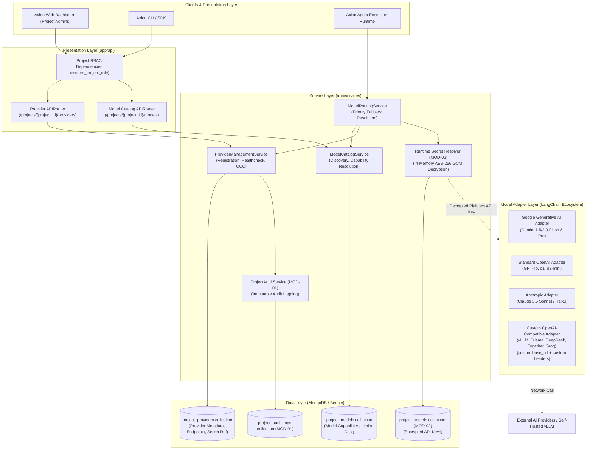
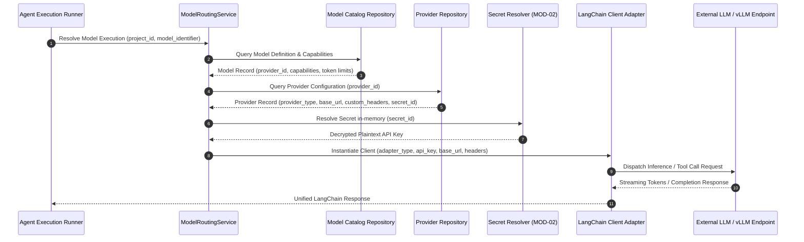
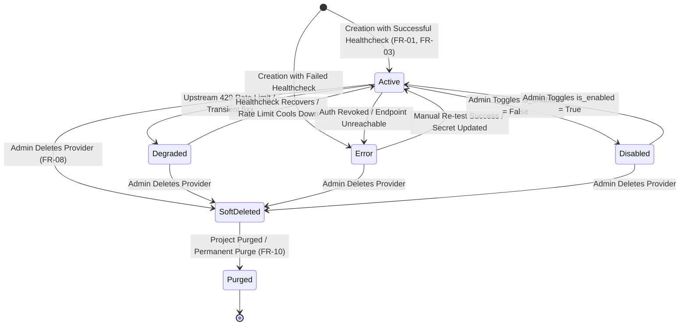

# Software Requirements Specification (SRS)
## Module 06: Provider & Model Management (Axion Runtime)

- **Document Version**: 1.0.0
- **Status**: Approved for Architectural Review & Implementation
- **Module ID**: `MOD-06`
- **Component**: `apps/api`
- **Architectural Reference**: `docs/specs/srs-01-project-management.md`, `docs/specs/srs-02-project-secrets-management.md`, `docs/specs/srs-03-project-credentials-management.md`, `AGENTS.md`
- **Target Integrations**: LangChain Integration Ecosystem (Google Generative AI / Gemini, OpenAI, Anthropic, Mistral, Cohere), Custom OpenAI-Compatible Inference Endpoints (vLLM, Ollama, DeepSeek, Together AI, Groq, OpenRouter, Self-Hosted LLM Proxies)

---

## 1. Executive Summary & Purpose

The **Provider & Model Management Module (`MOD-06`)** establishes the centralized configuration, discovery, capability cataloging, and lifecycle management subsystem for artificial intelligence model providers within the **Axion Runtime** platform.

In an enterprise AI platform orchestrating multi-agent systems and automated workflows, agent runners must interact with heterogeneous Large Language Models (LLMs), multimodal models, and specialized embedding models across distinct execution environments. Different workflows require different provider architectures—ranging from hyperscaler managed APIs (Google Gemini, OpenAI, Anthropic) to cost-optimized open-source models hosted on private inference servers (via vLLM, Ollama) or secondary cloud providers (DeepSeek, Together AI, Groq).

### 1.1 Critical Domain Separation: Secrets vs. Providers vs. Credentials

It is essential to maintain clear architectural boundaries between the related AI runtime subsystems:
- **Project Secrets (`MOD-02`) [Outbound Integration Secrets]**: Heterogeneous external credentials (e.g., raw API keys, OAuth tokens, connection strings) stored using two-tier Envelope Encryption (AES-256-GCM + AAD project binding). `MOD-02` owns encryption, storage, and runtime decryption of plaintext secret values.
- **Project Credentials (`MOD-03`) [Inbound Platform API Keys]**: High-entropy tokens issued by Axion to external machine actors (CLI, SDKs, CI/CD runners) for authenticating incoming API requests into Axion.
- **Provider & Model Management (`MOD-06`) [Model Topology & Capabilities]**: Configures external model provider connectivity, custom endpoint URLs (`base_url`), custom headers, capability flags (streaming, tool-calling, vision, structured outputs), model context limits, pricing metadata, and resilient failover chains. `MOD-06` **never stores raw secrets or API keys**. Instead, it references secrets strictly by `secret_id` bound to `MOD-02`.

### 1.2 Core Objectives
1. **Unified Multi-Provider Governance**: Provide a single control plane for managing both native cloud providers and custom inference servers per project workspace.
2. **First-Class Custom OpenAI-Compatible Support**: Full support for any self-hosted or alternative inference provider implementing the OpenAI API standard by allowing custom `base_url`, custom HTTP headers, and bespoke model names without requiring code modifications.
3. **Zero Plaintext Secret Storage**: Provider configurations only reference `secret_id` foreign keys; secret resolution and in-memory decryption are delegated entirely to `MOD-02`.
4. **Dynamic Cataloging & Automated Model Discovery**: Allow automatic polling of upstream model listings (such as `/v1/models`) while supporting manual registration and capability overrides.
5. **Granular Capability Mapping**: Maintain detailed, machine-readable model metadata (context window size, token limits, tool-calling support, vision support, JSON structured output support).
6. **Resilient Routing & Fallback Policies**: Support deterministic fallback priority chains to automatically switch between providers when rate limits (HTTP 429) or upstream outages occur.
7. **Strict Multi-Tenant Isolation**: Ensure all provider configurations and model definitions are strictly scoped to a project boundary, preventing cross-tenant leakage.
8. **Optimistic Concurrency Control (OCC)**: Guard all administrative updates and state transitions against concurrent modification using revision counters.
9. **Cascading Lifecycle Management**: Integrate with `MOD-01 Project Management` so that purging a project automatically cleans up all associated providers and models.

---

## 2. System Context & Architectural Design

### 2.1 System Architecture Diagram

### 2.2 Runtime Model Resolution & Dispatch Sequence

---

## 3. Supported Provider Architectures & Ecosystem Integrations

### 3.1 Native Managed Cloud Providers
The system provides built-in adapter configurations for premier commercial AI providers:
1. **Google Generative AI (Gemini)**:
   - Primary Library: `langchain-google-genai`
   - Target Models: `gemini-2.0-flash`, `gemini-1.5-pro`, `gemini-1.5-flash`, `text-embedding-004`
   - Authentication: Google AI Studio API Key or GCP Service Account Key
   - Native Features: Multimodal video/audio/image analysis, 1M–2M context windows, system instructions, function calling.
2. **OpenAI**:
   - Primary Library: `langchain-openai`
   - Target Models: `gpt-4o`, `gpt-4o-mini`, `o1`, `o3-mini`, `text-embedding-3-small/large`
   - Authentication: OpenAI API Key (`sk-...`)
   - Native Features: Structured outputs (strict JSON schema), parallel tool calling, reasoning tokens.
3. **Anthropic**:
   - Primary Library: `langchain-anthropic`
   - Target Models: `claude-3-5-sonnet`, `claude-3-5-haiku`, `claude-3-opus`
   - Authentication: Anthropic API Key (`sk-ant-...`)
   - Native Features: Extended thinking, computer use, prompt caching, tool calling.
4. **Additional Native Providers**:
   - AWS Bedrock, Azure OpenAI, Mistral AI, Cohere.

### 3.2 Custom OpenAI-Compatible Inference Providers
A primary requirement of `MOD-06` is supporting the ubiquitous OpenAI API specification used by open-source inference runners and specialized providers.

Behind the scenes, these providers leverage standard OpenAI client libraries configured with alternative parameters:
- **Custom `base_url`**: Directing requests to internal networks or alternative domains (e.g., `http://vllm-service.cluster.local:8000/v1`, `https://api.deepseek.com/v1`, `https://api.together.xyz/v1`, `http://localhost:11434/v1`).
- **Custom HTTP Headers**: Injecting organizational headers, routing tokens, or custom authorization formats (e.g., `X-Title`, `HTTP-Referer` for OpenRouter; project tags; custom tenant tokens).
- **Custom Model Identifiers**: Any custom-named fine-tuned or open-source model (e.g., `deepseek-ai/DeepSeek-V3`, `meta-llama/Llama-3.3-70B-Instruct`, `mistralai/Mistral-Small-24B`).
- **Target Systems Supported**:
  - **Self-Hosted vLLM**: High-throughput distributed LLM serving.
  - **Ollama**: Local and edge developer inference.
  - **DeepSeek API**: Cost-effective frontier reasoning models.
  - **Together AI / Groq / Fireworks**: Ultra-low latency inference accelerators.
  - **Corporate AI Gateways / LiteLLM / Cloudflare AI Gateway**: Enterprise reverse proxies enforcing central compliance.

---

## 4. Data Specifications & Entity Relationships

*(Note: Data models are formally defined via database specifications and field constraints; zero code implementation is included).*

### 4.1 Entity: `ProjectProvider`
Stored in MongoDB collection: `project_providers`

| Field Name | Type | Constraint | Description |
|---|---|---|---|
| `_id` | BSON ObjectId | Primary Key | Unique internal identifier for the provider instance |
| `project_id` | BSON ObjectId | Indexed, Required | Foreign key binding the provider strictly to an Axion Project |
| `name` | String | Required, 1–100 chars | Human-readable name (e.g., "Corporate DeepSeek Instance") |
| `slug` | String | Required, URL-safe | Unique identifier within the project for path/SDK references |
| `provider_type` | Enum String | Required | Supported: `google_genai`, `openai`, `anthropic`, `custom_openai_compatible`, `azure_openai`, `aws_bedrock`, `mistral` |
| `secret_id` | BSON ObjectId | Required | Foreign key to `project_secrets` (`MOD-02`) containing encrypted credentials |
| `base_url` | String | Optional (Mandatory for Custom) | Upstream API endpoint URL (e.g., `https://api.deepseek.com/v1`) |
| `api_version` | String | Optional | Provider API version parameter (e.g., Azure OpenAI version string) |
| `custom_headers` | Key-Value Map | Optional | Arbitrary key-value string pairs injected into outgoing HTTP calls |
| `timeout_seconds` | Integer | 1 to 600, Default: 60 | Maximum socket and read timeout for upstream requests |
| `max_retries` | Integer | 0 to 5, Default: 2 | Automatic retry attempts on transient network or 5xx failures |
| `status` | Enum String | Required | `active`, `degraded`, `disabled`, `error` |
| `last_healthcheck_at` | DateTime (UTC) | Optional | Timestamp of the most recent automated or manual connectivity test |
| `healthcheck_status` | Enum String | Optional | `healthy`, `unreachable`, `auth_failed`, `rate_limited` |
| `healthcheck_latency_ms`| Integer | Optional | Latency in milliseconds of the last successful healthcheck |
| `healthcheck_message` | String | Optional, Max 500 chars | Descriptive message or error reason from last healthcheck |
| `is_default` | Boolean | Default: False | Indicates whether this is the default provider for the project |
| `is_deleted` | Boolean | Default: False | Soft-delete status indicator |
| `deleted_at` | DateTime (UTC) | Optional | Soft-deletion timestamp |
| `revision` | Integer | Required, Default: 1 | Optimistic Concurrency Control (OCC) revision counter |
| `created_by` | String | Required | Clerk user ID or machine credential ID that created the provider |
| `updated_by` | String | Required | Clerk user ID or machine credential ID of last modification |
| `created_at` | DateTime (UTC) | Required | Creation timestamp |
| `updated_at` | DateTime (UTC) | Required | Last update timestamp |

#### Database Indexes for `project_providers`
1. Compound Unique Index: `(project_id, slug)` where `is_deleted == False` (Enforces unique slug per project).
2. Compound Unique Index: `(project_id, name)` where `is_deleted == False` (Prevents duplicate provider names).
3. Query Filter Index: `(project_id, is_deleted, status)` (Accelerates listing active providers).
4. Secret Reference Index: `(secret_id)` (Supports cascade validation before secret deletion).

---

### 4.2 Entity: `ProjectModel`
Stored in MongoDB collection: `project_models`

| Field Name | Type | Constraint | Description |
|---|---|---|---|
| `_id` | BSON ObjectId | Primary Key | Unique internal identifier for the model record |
| `project_id` | BSON ObjectId | Indexed, Required | Foreign key binding the model to the project |
| `provider_id` | BSON ObjectId | Indexed, Required | Foreign key binding the model to its parent `ProjectProvider` |
| `model_id` | String | Required, 1–150 chars | Upstream identifier (e.g., `gemini-1.5-pro`, `deepseek-chat`, `gpt-4o`) |
| `display_name` | String | Required, 1–100 chars | Human-friendly name displayed in the UI / catalog |
| `description` | String | Optional, Max 500 chars | Notes on model strengths, domain specialization, or architecture |
| `model_type` | Enum String | Required | `chat_completion`, `text_completion`, `embedding`, `reranker` |
| `supports_streaming` | Boolean | Default: True | Flag indicating support for server-sent event (SSE) token streaming |
| `supports_tools` | Boolean | Default: False | Flag indicating native tool/function calling support |
| `supports_vision` | Boolean | Default: False | Flag indicating multimodal vision (image input) support |
| `supports_json_mode` | Boolean | Default: False | Flag indicating enforced JSON schema / structured output support |
| `supports_reasoning` | Boolean | Default: False | Flag indicating extended reasoning / chain-of-thought token extraction |
| `max_input_tokens` | Integer | Optional, > 0 | Maximum allowable prompt / context window token count |
| `max_output_tokens` | Integer | Optional, > 0 | Maximum allowable completion generation token count |
| `default_temperature` | Float | 0.0 to 2.0, Default: 0.7 | Recommended default generation temperature |
| `input_cost_per_million` | Decimal/Float | Optional, >= 0 | Estimated USD cost per 1,000,000 input prompt tokens |
| `output_cost_per_million`| Decimal/Float | Optional, >= 0 | Estimated USD cost per 1,000,000 completion tokens |
| `is_enabled` | Boolean | Default: True | Admin toggle to enable/disable model from agent selection |
| `is_default` | Boolean | Default: False | Flag indicating default model for the project in this model type |
| `is_deleted` | Boolean | Default: False | Soft-delete status indicator |
| `deleted_at` | DateTime (UTC) | Optional | Soft-deletion timestamp |
| `revision` | Integer | Required, Default: 1 | Optimistic Concurrency Control (OCC) counter |
| `created_at` | DateTime (UTC) | Required | Creation timestamp |
| `updated_at` | DateTime (UTC) | Required | Last update timestamp |

#### Database Indexes for `project_models`
1. Compound Unique Index: `(provider_id, model_id)` where `is_deleted == False` (Prevents duplicate models per provider).
2. Compound Index: `(project_id, is_enabled, is_deleted)` (Optimizes active model discovery).
3. Capability Search Index: `(project_id, supports_tools, supports_vision, is_enabled)` (Fast filtering for agent planners).

---

### 4.3 Entity: `ModelRoutingPolicy`
Stored in MongoDB collection: `project_routing_policies`

| Field Name | Type | Constraint | Description |
|---|---|---|---|
| `_id` | BSON ObjectId | Primary Key | Unique policy identifier |
| `project_id` | BSON ObjectId | Indexed, Required | Foreign key binding policy to an Axion Project |
| `name` | String | Required | Friendly policy name (e.g., "Primary Reasoning with Failover") |
| `primary_model_id` | BSON ObjectId | Required | Foreign key to `project_models` representing first-choice model |
| `fallback_model_ids` | List of ObjectIds | Max 5 models | Ordered list of backup models to try if primary fails with 429/5xx |
| `retry_timeout_ms` | Integer | Default: 3000ms | Latency threshold after which fallback candidate is triggered |
| `fallback_on_codes` | List of Integers | Default: [429, 500, 502, 503] | Upstream HTTP status codes triggering fallback switch |
| `is_active` | Boolean | Default: True | Active toggle |
| `created_at` | DateTime (UTC) | Required | Creation timestamp |
| `updated_at` | DateTime (UTC) | Required | Last update timestamp |

---

## 5. Functional Requirements (FR-01 to FR-12)

### FR-01: Provider Connection Creation & Secret Binding
- **Description**: An authorized human administrator (`OWNER` or `ADMIN`) registers a new model provider for a project by binding it to an encrypted secret in `MOD-02`.
- **Preconditions**:
  - The caller holds `OWNER` or `ADMIN` role in the target project.
  - The referenced `secret_id` must exist in `project_secrets` (`MOD-02`), belong to the identical `project_id`, and be in an active (non-deleted) state.
  - The project must exist and be in `ACTIVE` state.
- **Execution Flow**:
  1. Caller submits provider `name`, `slug`, `provider_type`, `secret_id`, optional `base_url`, and optional `custom_headers`.
  2. The service verifies the existence and tenant boundary of `secret_id`.
  3. The service verifies uniqueness of `slug` within the project.
  4. If `is_default` is set to `True`, any existing default provider of the same type in the project has `is_default` set to `False`.
  5. The service executes an immediate live connectivity test (FR-03). If successful, status is set to `active`; if failed, status is set to `error` with diagnostic details preserved.
  6. The provider record is persisted with `revision = 1`.
  7. A `PROVIDER_CREATED` audit event is dispatched to `project_audit_logs`.
- **Postconditions**:
  - Provider is available for model discovery and agent routing.
  - Zero raw credentials exist in the provider record.
- **Error Conditions**:
  - `400 Bad Request`: Invalid URL format, missing `base_url` for custom providers, or invalid provider type.
  - `403 Forbidden`: Caller lacks `ADMIN` or `OWNER` role.
  - `404 Not Found`: Target project or referenced `secret_id` not found.
  - `409 Conflict`: Provider `slug` or `name` already exists in this project.

### FR-02: Custom OpenAI-Compatible Provider Configuration
- **Description**: Support arbitrary external inference providers implementing the OpenAI REST specification.
- **Preconditions**:
  - `provider_type` is set to `custom_openai_compatible`.
- **Validation Rules**:
  - `base_url` is strictly required and must be a well-formed HTTP/HTTPS URI (e.g., `https://api.together.xyz/v1`, `http://vllm-node:8000/v1`).
  - `custom_headers` accepts arbitrary string key-value mappings (e.g., `{"HTTP-Referer": "https://axion.ai", "X-Title": "Axion Agent"}`).
  - Header keys are validated against common security injection patterns (no CRLF injection).
- **Execution Flow**:
  - The runtime configures LangChain's `ChatOpenAI` client with `openai_api_base = base_url`, `default_headers = custom_headers`, and uses the decrypted secret as `openai_api_key`.

### FR-03: Provider Connection Healthcheck & Verification
- **Description**: Perform a live dry-run ping against the upstream provider to verify credentials, endpoint availability, and calculate network latency.
- **Allowed Callers**: Human `ADMIN`, `OWNER`, or automatic background monitoring worker.
- **Execution Flow**:
  1. The service resolves the decrypted secret from `MOD-02` into memory.
  2. The service dispatches a lightweight test request:
     - For OpenAI / Custom OpenAI-compatible: Performs `GET /v1/models` or a single-token completion `{"model": "...", "max_tokens": 1}`.
     - For Google Generative AI: Performs `client.list_models()` or single-token test.
     - For Anthropic: Performs single-token message generation test.
  3. Latency is calculated as wall-clock duration from request dispatch to response headers receipt.
  4. If successful (HTTP 200), record: `healthcheck_status = healthy`, `healthcheck_latency_ms = duration`, `status = active`.
  5. If failed:
     - HTTP 401 / 403: `healthcheck_status = auth_failed`, `status = error`.
     - HTTP 429: `healthcheck_status = rate_limited`, `status = degraded`.
     - Connection Timeout / DNS failure: `healthcheck_status = unreachable`, `status = error`.
  6. The healthcheck outcome is returned in the API response and updated in the database.

### FR-04: Dynamic Model Catalog Discovery
- **Description**: Automatically discover and register available models directly from the provider's upstream API.
- **Allowed Callers**: Human `ADMIN`, `OWNER`.
- **Execution Flow**:
  1. Caller triggers discovery endpoint `POST /projects/{project_id}/providers/{provider_id}/discover`.
  2. The service connects to the upstream provider using decrypted credentials.
  3. Queries the provider model list (e.g., `GET /v1/models` for OpenAI/vLLM/DeepSeek, `list_models` for Google).
  4. For each discovered model:
     - If the model already exists in `project_models` for this provider: refreshes every attribute the upstream actually reports (limits, sampling defaults, capability flags, model type). Values the upstream is silent about are left untouched, so a corrected upstream limit always overwrites the stale one.
     - If the model is new: automatically populates `model_id`, auto-generates `display_name`, and stores only the attributes present in the upstream payload.
  5. Returns a summary of newly added, updated, and existing models.
- **Truthfulness Rule**: Discovery never fabricates capabilities, token limits, or sampling defaults. Anything the upstream listing does not state is stored as `NULL` (`supports_*`, `max_input_tokens`, `max_output_tokens`, `default_temperature`) instead of being guessed from the model name; `model_type` is the only storage-required classification (defaulting to `chat_completion`).
- **Fallback**: For providers without automated discovery APIs (or where discovery is restricted), administrators use manual registration (FR-05).

### FR-05: Manual Model Definition & Registration
- **Description**: Manually define a model under an existing provider.
- **Allowed Callers**: Human `ADMIN`, `OWNER`.
- **Input Attributes**: `provider_id`, `model_id` (upstream identifier), `display_name`, `model_type`, `supports_streaming`, `supports_tools`, `supports_vision`, `supports_json_mode`, `max_input_tokens`, `max_output_tokens`, `input_cost_per_million`, `output_cost_per_million`.
- **Validation**:
  - `model_id` cannot be duplicate under the same `provider_id`.
  - Token counts must be positive integers.
  - Costs must be non-negative decimals.

### FR-06: Model Capability & Constraint Inspection
- **Description**: Allow human members and automated agent planners to query available models filtered by exact operational capabilities.
- **Allowed Callers**: Human `VIEWER`+, Machine API Keys with `projects:read` or `*` scope.
- **Query Filters**:
  - `supports_tools`: Boolean (returns only models capable of function/tool calling).
  - `supports_vision`: Boolean (returns only multimodal image-processing models).
  - `supports_json_mode`: Boolean (returns models enforcing structured JSON).
  - `model_type`: Filter by completion vs embedding.
  - `provider_id`: Filter by specific provider instance.
- **Output**: List of models with full capability flags, token limits, and pricing metadata.

### FR-07: Resilient Routing & Multi-Provider Fallback Resolution
- **Description**: Dynamic resolution of models with automatic failover during workflow and agent execution.
- **Execution Flow**:
  1. An agent runner requests model resolution for an execution step.
  2. The service checks if a `ModelRoutingPolicy` is configured for this step.
  3. If primary model is healthy, returns primary provider connection and decrypted key.
  4. If the primary provider has `status == degraded` or experienced consecutive HTTP 429/503 errors within the last 60 seconds:
     - Automatically selects the next candidate in `fallback_model_ids`.
     - Logs a routing fallback warning event.
     - Injects fallback model credentials into the agent runner.

### FR-08: Provider & Model Lifecycle Management (OCC Guarded)
- **Description**: Updating metadata, toggling enable/disable status, or soft-deleting providers and models.
- **OCC Invariant**: All mutations must supply `expected_revision`. If the database revision differs, the update is rejected with `409 Conflict` (`REVISION_CONFLICT`).
- **Soft Deletion**: Sets `is_deleted = True`, `deleted_at = utcnow()`. Soft-deleted providers and models are immediately excluded from discovery, listings, and routing.
- **Secret Unlink Invariant**: A secret in `MOD-02` cannot be deleted if an active (non-deleted) provider still references its `secret_id`.

### FR-09: Default Provider & Model Assignment
- **Description**: Designate a single provider as the default for the project, and a single model as the default per model type.
- **Execution Flow**:
  - Marking a provider `is_default = True` atomically unsets `is_default` on any previously default provider in the project.
  - Marking a model `is_default = True` atomically unsets `is_default` on any previously default model of the same `model_type` within the project.

### FR-10: Cascading Project Purge Integration
- **Description**: Permanent removal of all provider and model configurations when a project is permanently purged.
- **Integration**:
  - When `ProjectService.purge_project` (`MOD-01`) executes, it invokes:
    1. `ProjectModelRepository.purge_by_project(project_id)`.
    2. `ProjectProviderRepository.purge_by_project(project_id)`.
    3. `ProjectRoutingPolicyRepository.purge_by_project(project_id)`.
  - Dispatches `PROVIDER_PURGED` and `MODEL_PURGED` audit logs to `project_audit_logs`.

### FR-11: Zero Plaintext Secret Invariant & Runtime Resolution
- **Description**: Guarantee that plaintext credentials never leak into provider database records or API responses.
- **Security Rules**:
  - The provider document strictly stores `secret_id`.
  - API responses for `GET /providers` return `secret_id`, `secret_name`, and masked key hints from `MOD-02`. Zero plaintext is ever included.
  - Decryption happens exclusively in-memory during agent execution or live healthchecks via `SecretResolver` (`MOD-02`).

### FR-12: Comprehensive Audit Trail Dispatch
- **Description**: Every administrative modification emits an immutable audit event to `project_audit_logs`.
- **Recorded Events**:
  - `provider.created`: Provider registration with provider type and endpoint metadata.
  - `provider.updated`: Modifications to headers, URLs, or status.
  - `provider.healthcheck`: Recorded on health status changes.
  - `provider.deleted`: Soft deletion of provider.
  - `provider.purged`: Permanent removal.
  - `model.created`: Model registered or discovered.
  - `model.updated`: Capability or limit updates.
  - `model.deleted`: Model soft deletion.

### FR-13: Live Upstream Model Inspection via API Key
- **Description**: Probe an upstream provider API in real-time to fetch and inspect the available models using either a live API key (or `secret_id`), before or independently of saving a provider configuration.
- **Allowed Callers**: Human `ADMIN`, `OWNER`.
- **Dual Invocation Modes**:
  1. **Pre-Registration Inspection (`POST /projects/{project_id}/providers/inspect-models`)**:
     - **Input**: `provider_type`, credentials (either a raw in-flight `api_key` for preview or an existing `secret_id`), optional `base_url`, optional `custom_headers`.
     - **Execution**: Dispatches a live request directly to the upstream model endpoint:
       - For OpenAI / Custom OpenAI-compatible (vLLM, DeepSeek, Ollama, Together): Calls `GET {base_url}/models` passing the bearer key and custom headers.
       - For Google Generative AI: Calls Google AI Studio API (`models.list` / Gemini SDK).
       - For Anthropic: Fetches available models from Anthropic API.
     - **Output**: Returns an unpersisted, normalized list of available models with upstream IDs, friendly display names, context limits, and only the capabilities the upstream actually reports.
     - **Security Invariant**: Any raw `api_key` provided in this inspection payload is held transiently in memory for the duration of the HTTP call and is never logged or persisted to disk/database.
     - **Upstream Field Mapping (Google Generative AI)**: `inputTokenLimit` → `max_input_tokens`; `outputTokenLimit` → `max_output_tokens` (suppressed for `embedContent` entries, whose `outputTokenLimit: 1` is not a generation cap); `temperature` → `default_temperature`; `maxTemperature` → `max_temperature`; `thinking` → `supports_reasoning`; `supportedGenerationMethods` → `model_type` and `supports_streaming`. Tools/vision/JSON-mode are not reported by `models.list` and therefore stay `null`.
     - **Diagnostics**: The exact upstream JSON (plus our normalization of it) is written to `UPSTREAM_PAYLOAD_DUMP_DIR` (default `apps/api/debug/upstream` in development, disabled elsewhere) so every reported limit can be traced to the provider's own response. Credentials are never written; query strings are stripped.
  2. **Existing Provider Live Query (`GET /projects/{project_id}/providers/{provider_id}/live-models`)**:
     - Resolves the provider's bound `secret_id` via `MOD-02` in memory, calls the upstream models endpoint, and returns the live upstream list for comparison against the locally registered catalog.

---

## 6. Non-Functional Requirements (NFR-01 to NFR-06)

### NFR-01: Low Latency Configuration Resolution
- **Target**: Resolving a model definition, provider configuration, and resolving the bound secret from memory must complete in **< 10ms** (excluding upstream network latency).
- **Strategy**: Indexed database queries on compound keys; in-memory caching for frequently resolved routing policies with 30-second TTL invalidation.

### NFR-02: Security & Tenant Isolation
- **Boundary Rule**: Cross-tenant referencing is strictly prohibited. A provider in Project A cannot reference a `secret_id` belonging to Project B. Attempting to bind a foreign secret must return `404 Not Found` (anti-enumeration).
- **Network Security**: Custom `base_url` values are validated against private IP blocklists (SSRF protection) unless explicitly running in a self-hosted on-premise deployment mode.

### NFR-03: Resilience & Circuit Breaking
- When an upstream provider returns consecutive failures (e.g., 3 consecutive HTTP 5xx or connection timeouts within 60 seconds), the provider status transitions to `degraded`.
- Background healthchecks poll degraded providers every 60 seconds; once two consecutive healthchecks pass, status returns to `active`.

### NFR-04: Extensibility Without Architectural Erosion
- Adding new provider adapters (e.g., Hugging Face, Cerebras, SambaNova) must follow the Open/Closed Principle (OCP). The database schema accommodates new providers via generic `base_url` and `custom_headers` without altering existing collections.

### NFR-05: Concurrency Control
- All mutation operations enforce Optimistic Concurrency Control (OCC). Race conditions during concurrent provider updates by multiple team administrators are safely rejected with `409 Conflict`.

### NFR-06: Strict LangChain Ecosystem Compatibility
- Parameter naming and capability definitions must cleanly map to LangChain's standard abstractions (`BaseChatModel`, `ChatOpenAI`, `ChatGoogleGenerativeAI`, `ChatAnthropic`) to ensure zero impedance mismatch during agent execution.

---

## 7. State Machine & Provider Lifecycle Transitions

---

## 8. Proposed API Endpoints Overview (12 REST Endpoints)

| HTTP Method | Route Path | Caller Allowed | Description |
|---|---|---|---|
| `POST` | `/projects/{project_id}/providers` | Human `ADMIN`, `OWNER` | Register a new provider and bind to `secret_id` |
| `GET` | `/projects/{project_id}/providers` | Human `VIEWER`+, Machine `projects:read` | List all providers in the project with status and health |
| `GET` | `/projects/{project_id}/providers/{provider_id}` | Human `VIEWER`+, Machine `projects:read` | Inspect single provider configuration metadata |
| `PATCH` | `/projects/{project_id}/providers/{provider_id}` | Human `ADMIN`, `OWNER` | Update metadata, `base_url`, headers, timeout using OCC |
| `DELETE` | `/projects/{project_id}/providers/{provider_id}` | Human `ADMIN`, `OWNER` | Soft-delete a provider |
| `POST` | `/projects/{project_id}/providers/{provider_id}/test` | Human `ADMIN`, `OWNER` | Trigger live on-demand connection healthcheck |
| `POST` | `/projects/{project_id}/providers/{provider_id}/discover` | Human `ADMIN`, `OWNER` | Query upstream provider API and auto-persist models into database |
| `POST` | `/projects/{project_id}/providers/inspect-models` | Human `ADMIN`, `OWNER` | Live query upstream provider using in-flight API key or secret_id to preview available models without saving |
| `GET` | `/projects/{project_id}/providers/{provider_id}/live-models` | Human `ADMIN`, `OWNER` | Live query upstream provider using saved provider credentials to view current upstream model catalog |
| `POST` | `/projects/{project_id}/models` | Human `ADMIN`, `OWNER` | Manually register a model under a provider |
| `GET` | `/projects/{project_id}/models` | Human `VIEWER`+, Machine `projects:read` | List models with capability filtering (tools, vision) |
| `PATCH` | `/projects/{project_id}/models/{model_id}` | Human `ADMIN`, `OWNER` | Update model capabilities, limits, or pricing with OCC |
| `DELETE` | `/projects/{project_id}/models/{model_id}` | Human `ADMIN`, `OWNER` | Soft-delete a model from catalog |
