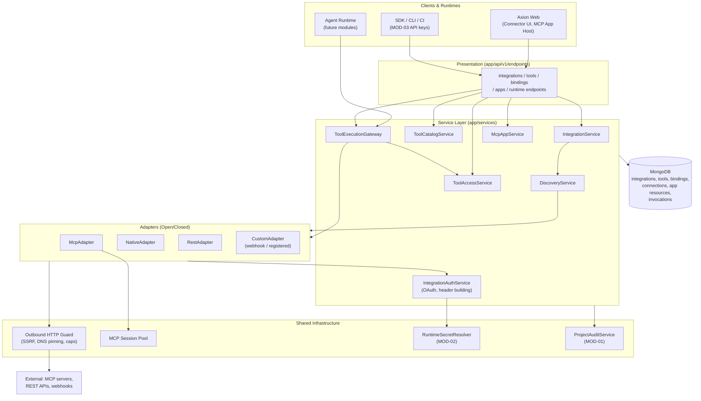
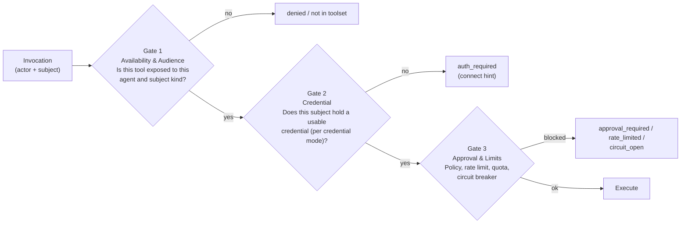
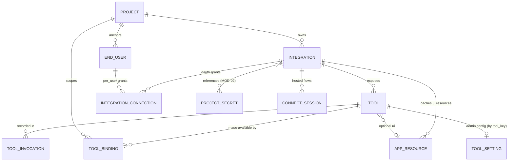
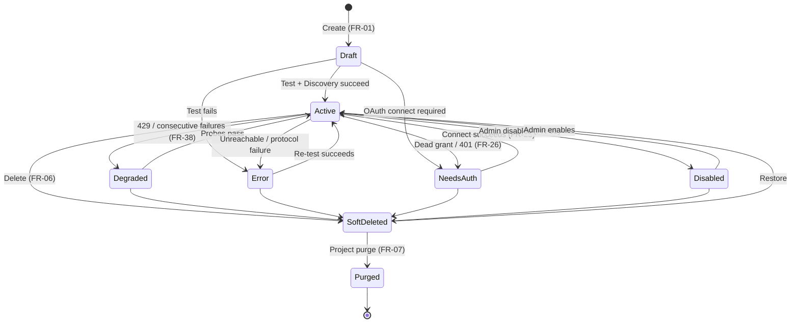
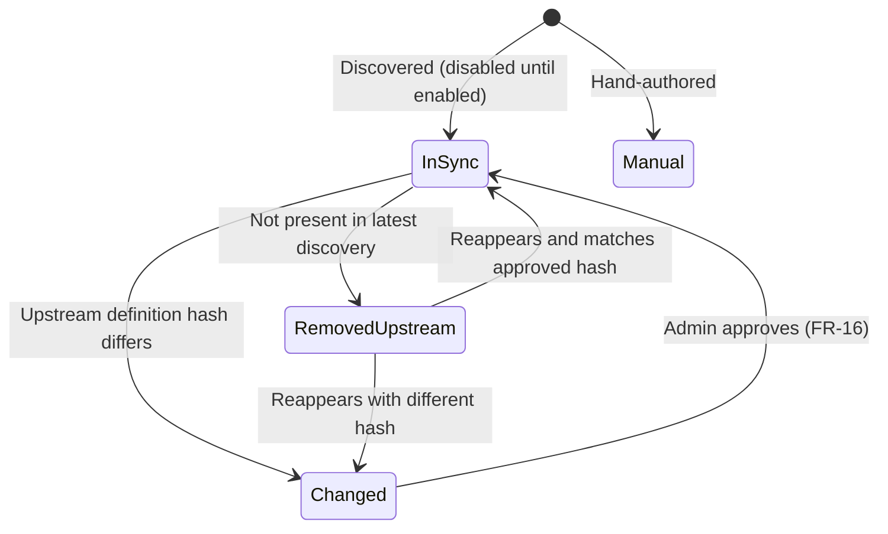
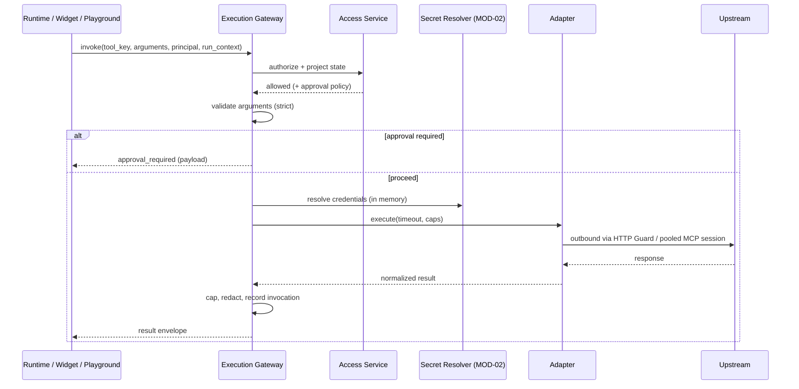

# Software Requirements Specification (SRS)
## Module 07: Tool & Integration Management (Axion Runtime)

- **Document Version**: 1.4.0
- **Status**: Draft for Architectural Review
- **Module ID**: `MOD-07`
- **Component**: `apps/api` (backend), `apps/web` (connector management UI and MCP App host)
- **Architectural Reference**: `docs/system-design-rules.md`, `docs/specs/srs-01-project-management.md`, `docs/specs/srs-02-project-secrets-management.md`, `docs/specs/srs-03-project-credentials-management.md`, `docs/specs/srs-06-provider-and-model-management.md`, `AGENTS.md`
- **Target Standards**: Model Context Protocol (MCP) Streamable HTTP transport (legacy HTTP+SSE as deprecated fallback), MCP Authorization (OAuth 2.1 + PKCE, RFC 9728 Protected Resource Metadata, RFC 8414 Authorization Server Metadata, RFC 7591 Dynamic Client Registration), MCP Apps extension (`ui://` resources rendered in sandboxed iframes), OpenAPI 3.x, JSON Schema 2020-12
- **Target Frameworks**: FastAPI, Beanie ODM (MongoDB), Clerk Authentication, Pydantic v2, official MCP Python SDK, `httpx`
- **Reference Implementation Analysed**: `D:\agent-marketplace\agent-backend` (MVP; see Section 3), including its `docs/architecture/DYNAMIC_CONNECTORS_AND_PROTOCOLS_FR_NFR_SPECIFICATION.md` and `docs/modules/external-users.md`
- **Design Principles**: SOLID (normative; see Sections 3.5 and 10.8)
- **Current Delivery Focus**: **Backend API (`apps/api`) only.** All web work (`apps/web`: connector UI, hosted connect pages, MCP App host) is deferred. The backend must still expose every endpoint, error code, and header contract the web will need, so the UI can be built later against generated OpenAPI types without backend changes.

> This document contains **no implementation code**. Entities, interfaces, and flows are specified as requirements only.

---

## 1. Executive Summary & Purpose

The **Tool & Integration Management Module (`MOD-07`)** is the centralized subsystem through which an Axion project connects its agents to external capabilities: tools implemented inside Axion, remote MCP servers (including their interactive MCP Apps), REST APIs, and developer-built custom integrations.

Today's reference system (the Agent Marketplace backend) proves the concept but grew organically: MCP servers, REST sources, and RCP sources are three near-identical modules; discovered tools are stored as a bare name and description; tool arguments are silently "loosened" so invalid calls never fail; remote URLs are fetched with no network-safety guard; and tool names depend on the connector's display name. Axion is a production platform, so `MOD-07` replaces that shape with one extensible model.

### 1.1 Domain Separation

| Module | Responsibility | Relationship to `MOD-07` |
|---|---|---|
| `MOD-01` Project Management | Projects, membership, RBAC, audit log, lifecycle | `MOD-07` objects are project-scoped; reuses roles, lifecycle states, audit |
| `MOD-02` Project Secrets | Encrypted storage and in-memory resolution of outbound secrets | `MOD-07` stores **only `secret_id` references**; never plaintext |
| `MOD-03` Project Credentials | Inbound machine API keys and scopes | `MOD-07` adds scopes `tools:read`, `tools:invoke`, `end_users:assert`, `end_users:manage`, `connections:manage` |
| `MOD-06` Provider & Model Management | LLM provider and model catalog | Peer module; same patterns (healthcheck, OCC, secret binding). LLM providers are **not** integrations |
| `MOD-07` Tool & Integration Management | What agents can *do*: connections, tool catalog, access, execution | This document |
| Future agent/runtime modules | Agent definitions, run loop, sandbox | Consume `MOD-07` only through the Execution Interface (Section 8) |

### 1.2 Core Objectives

1. **One Model, Many Protocols**: A single `Integration → Tool → Binding` model covers native, MCP, REST, and custom providers. New provider types are added by registering an adapter, not by changing the runtime or the schema.
2. **Separation of Concerns**: Tool *definitions*, integration *connections*, *authentication*, *access control*, and *execution* are distinct components with explicit interfaces.
3. **First-Class MCP and MCP Apps**: Full discovery of tools, resources, resource templates, and prompts; durable tool snapshots; change detection; interactive app widgets with a hardened host contract.
4. **Zero Plaintext Credentials**: All sensitive values are `MOD-02` secret references or `MOD-02`-grade envelope-encrypted OAuth tokens. Nothing sensitive reaches logs, responses, or UI widgets.
5. **Deterministic, Safe Execution**: Strict argument validation (no silent coercion), timeouts, size caps, circuit breaking, and a uniform result shape regardless of provider.
6. **Least-Privilege Access Control**: Per-project, per-integration, per-tool, and per-agent availability; approval policies for destructive tools.
7. **Production Network Safety**: SSRF protection, redirect control, and host allow-listing on every outbound call.
8. **Auditability & Observability**: Administrative changes in the project audit log; high-volume invocation telemetry in a dedicated retention-bound store with trace correlation.
9. **Lifecycle Coherence**: Follows `MOD-01` project states and cascades on purge; OCC on every mutation.
10. **Two Authentication Levels**: The *builder* (the project member who creates agents) authenticates an integration once for everyone (`project_shared`), or the integration requires each *subject* (a project member or one of the project's **end users**) to authenticate individually (`per_user`). Credentials of one subject are never usable by another.
11. **End-User Governance**: Builders decide whether, and which, end users may use which tools; end users can see and revoke their own connections; builders can never see end-user tokens.
12. **SOLID by Construction**: Single-responsibility services, registry-based extension, contract-tested adapters, role-specific interfaces, and dependency inversion through ports (Section 10.8).

---

## 2. Scope & Module Boundaries

### 2.1 In-Scope

- **Native Tools**: A code-defined catalog of Axion-implemented tools, materialized per project with configuration and secret bindings.
- **MCP Integrations**: Connecting to remote MCP servers over Streamable HTTP (legacy SSE fallback); capability negotiation; discovery of tools, resources, resource templates, prompts; change notification handling; session pooling.
- **MCP Apps**: Discovery of `ui://` app resources linked to tools; cached, hash-pinned app resource storage; a mediated bridge for app-initiated tool calls and resource reads; host sandbox contract for the web client.
- **REST Integrations**: OpenAPI 3.x import with operation selection, plus manually authored HTTP tools; parameter mapping; auth profiles.
- **Custom Integrations**: A signed-webhook integration type (Axion calls a developer-hosted HTTPS endpoint) and an in-process adapter registration contract for first-party extensions.
- **Tool Discovery & Inspection**: Refresh, diff, and review of upstream tool catalogs; change (drift) detection.
- **Tool Configuration**: Enablement, description overrides, locked or default parameters, timeouts, rate limits, approval policy.
- **Authentication Profiles**: None, API key, bearer, basic, custom headers with secret templates, OAuth 2.1 authorization code with PKCE (MCP), and OAuth client credentials.
- **Access Control**: Project RBAC, machine scopes, per-agent tool bindings, per-tool approval policy.
- **Execution Interface**: Provider-neutral resolve-and-invoke contract with a standard result envelope.
- **Principals & Per-User Authentication**: A subject model (project, member, end user); `project_shared` and `per_user` credential modes; hosted connect flows for end users; per-user OAuth, per-user API keys.
- **End-User Anchor (minimal)**: A project-scoped end-user record resolved just in time from a trusted caller, with short-lived end-user session tokens, blocking, and erasure. (Hoisting this into its own module is an open question, Section 16.)
- **End-User Access Control**: Audience rules (members, end users, machine), per-end-user allow/deny, per-end-user quotas.
- **Context-Bound Arguments & Dry Run**: Server-verified context injected into tool arguments (hidden from the model) and simulated execution for non-read-only tools.
- **Telemetry & Audit**: Admin audit events and invocation records.

### 2.2 Out-of-Scope

- **Agent definitions and the run loop** (prompting, planning, memory): future agent modules. `MOD-07` exposes a toolset; it does not decide when tools are called.
- **Sandboxed code execution**: A `MOD-04`-style sandbox; native tools that need it call it as a dependency.
- **Local `stdio` MCP servers**: Spawning arbitrary processes on a multi-tenant host is excluded. (Deferred; may return as an isolated runner.)
- **Hosting or publishing MCP servers** from Axion, and a public tool marketplace.
- **Approval UI and notification delivery**: `MOD-07` defines the policy and the `approval_required` signal; the human approval workflow is owned by the runtime/UI layer (see Open Questions, Section 16).
- **Secret storage and encryption primitives**: `MOD-02`.
- **User authentication**: Clerk and `MOD-01`.
- **RCP (`rcp-sdk`) as a first-class type**: Not carried over; revisit if there is demand (Section 16).
- **Authenticating end users to the customer's own application**: The customer's backend does that; Axion only trusts an assertion made with a project machine credential (FR-70).

### 2.3 System Context

---

## 3. Analysis of the Reference Implementation (Agent Marketplace Backend)

`D:\agent-marketplace\agent-backend` is an Express/Mongoose MVP. This section records what it does so `MOD-07` can keep what works and fix what does not.

### 3.1 What It Does

| Area | Reference behaviour |
|---|---|
| MCP servers (`modules/mcp`) | `http` and `sse` transports; auth `none`, `apiKey`, `oauth`; OAuth with PKCE and Dynamic Client Registration; `authMode` `owner` (shared token) or `user` (per-user token); rotating client history; dead-grant detection (`needs_auth`) |
| MCP Apps | A second raw-SDK client reads `_meta.ui.resourceUri` from tools (the LangChain adapter drops `_meta`); templates cached on the connector by "Test Connection"; `resources/read` and `tools/call` proxied by connector id |
| Runtime tool loading | Per agent run: build auth headers, connect all servers, fetch tools, prefix names with the slugified connector name, relax every tool's input schema, skip failing servers with a log line |
| REST/RCP sources | Manifest URL fetched **live on every agent run**; tools namespaced by source name; bearer secret from project secrets |
| Built-in tools | Code registry (`web_search`, `weather`, `image_generation`) with config fields, secret slots, and a `test` hook; per-project enable and `secretRefs` |
| Ownership | `ownerType` of `PersonaUser`, `Project`, or `ExternalUser` on every model |
| Principals | `PersonaUser` (Clerk) and `ProjectRuntime` (API key) principals; end users are `ExternalUser` anchors `(project, externalUserId)` resolved just in time; per-user MCP connections keyed by subject (`PersonaUser` or `ExternalUser`) |
| Context parameter inversion | `paramContextMap` and reserved tokens (`{{externalUserId}}`, `{{tenantId}}`) inject server-verified context into upstream calls and hide those parameters from the model |
| Failure containment | Empty upstream bodies become `{status: ok}`; timeouts and 5xx become structured errors to the model; a 15 s upstream timeout; 3-failure/60 s cooldown; dry-run strips mutating tools |
| Agent access | `canUserExecuteAgent` evaluates domain match, soft delete, `isActive`, and `visibility` before an agent runs |

### 3.2 Strengths to Preserve

- Discovery of OAuth endpoints and dynamic client registration with PKCE as the default for public clients.
- Distinguishing "owner-shared" from "per-user" credentials, and surfacing "user must connect" separately from "admin must configure".
- Persisting `needs_auth` when a refresh grant is dead rather than retrying forever.
- Server-prefixed tool names to avoid cross-server collisions.
- Per-tool `test` hooks for native tools and Test Connection for remote ones.
- MCP Apps discovery through `_meta.ui` and a mediated proxy for widget calls.
- Context parameter inversion: identity-bearing arguments come from verified server context, never from the model.
- Structured upstream-failure containment and deterministic output normalization.
- External-user anchors scoped by `(project, externalUserId)` with a compound unique index.

### 3.3 Defects and Gaps to Fix

| # | Finding | Consequence | `MOD-07` response |
|---|---|---|---|
| G-01 | Three near-duplicate source types (MCP, REST, RCP) | Triple maintenance; inconsistent behaviour | Single `Integration` with typed config (Section 5.1) |
| G-02 | Discovered tools stored as `name`+`description` only | No schema, annotations, or per-tool control; cannot review or pin | Full `Tool` entity with schema, annotations, hash (Section 5.2) |
| G-03 | `loosenSchema` silently drops invalid arguments | Write tools may run with missing or discarded fields; failures hidden from the model | Strict validation; structured error returned so the model can self-correct (FR-31) |
| G-04 | REST/RCP manifests fetched live on every run | Latency, availability coupling, no review step | Import-time snapshot with explicit refresh and diff (FR-21) |
| G-05 | No SSRF guard on MCP/REST/RCP URLs | Internal network and cloud metadata reachable by project users | Mandatory outbound guard (FR-40, NFR-S2) |
| G-06 | Tool names derive from connector display name | Renaming breaks agent bindings; collisions possible | Immutable `slug` plus stable `tool_key` (FR-01, FR-14) |
| G-07 | App templates depend on a prior Test Connection; user-mode discovery writes shared data at run time | Missing widgets; runtime writes to shared documents | Discovery is an explicit, audited operation; runtime never mutates catalog (FR-17, FR-50) |
| G-08 | New MCP connection per `callTool`/`readResource` | Latency and server load | Session pool (FR-18, NFR-P3) |
| G-09 | Failures swallowed ("log and skip") | Tools silently vanish | Explicit integration status plus per-run availability report (FR-33) |
| G-10 | Any readable user can call any tool by connector id | Over-broad authorization | Gateway authorization on every call, including app-initiated calls (FR-35, FR-51) |
| G-11 | OAuth tokens encrypted with a different scheme than secrets | Two cryptographic models to maintain | `MOD-02` envelope encryption with AAD binding for tokens (FR-27) |
| G-12 | No tool-change detection | "Rug-pull" risk: a server can change a tool's description or behaviour after approval | Hash-based drift detection with re-approval (FR-16) |
| G-13 | No output size limits or result sanitization | Context blowup; sensitive data passthrough | Result caps and redaction hooks (FR-34) |
| G-14 | No approval policy | Destructive tools run unattended | Annotation-driven approval policy (FR-37) |

### 3.4 Migration Mapping (Keep / Change / Drop)

| Reference element | Decision |
|---|---|
| `Mcp` model | **Change** → `Integration` of type `mcp` |
| `RestApiToolSource`, `RestApiTool` | **Change** → `Integration` of type `rest` plus imported `Tool` rows |
| `RcpSource` | **Drop** (revisit later) |
| `ProjectTool` + built-in registry | **Change** → `Integration` of type `native` per enabled native provider |
| `McpUserConnection` | **Change** → `IntegrationConnection` (Section 5.3) |
| `ownerType: PersonaUser/ExternalUser` on definitions | **Drop** — integrations are project-owned; there is no per-owner polymorphism |
| `ExternalUser` as connection subject | **Keep** as `end_user` subject type (Section 4.1) |
| `paramContextMap`, reserved tokens | **Keep** → context-bound arguments (FR-76) |
| Dry-run tool stripping, output normalization | **Keep** → FR-77, FR-78 |
| `domain` field | **Drop** — replaced by `project_id` |
| Dynamic client registration, PKCE, dead-grant handling | **Keep** |
| `loosenSchema` | **Drop** |
| Live manifest fetch per run | **Drop** — snapshot plus refresh |

### 3.5 SOLID Review (Reference Implementation and Draft 1.0.0 of This SRS)

This review is normative input to Section 10.8. Items marked **R** are in the reference code; items marked **D** were in version 1.0.0 of this document and are corrected here.

| ID | Principle | Violation | Correction in this SRS |
|---|---|---|---|
| R-1 | SRP | `mcp.service.js` (~790 lines) mixes CRUD, OAuth, connection testing, tool/resource proxying, and agent-cache invalidation | Separate `IntegrationService`, `ConnectFlowService`, `TokenService`, `IntegrationHealthService`, `McpAppService` (10.8) |
| R-2 | SRP | `mcp.tools.js` resolves tokens, rewrites schemas, discovers UI templates, **writes to the database at run time**, builds clients, and builds the widget map | Runtime is read-only (FR-50); discovery, auth, validation, and client construction are separate components |
| R-3 | OCC / OCP | `ownerType` branching (`PersonaUser`/`Project`/`ExternalUser`) repeated in services and repositories; every new owner kind edits many files | Single project owner; subject kinds resolved by a registry-backed `SubjectResolver` |
| R-4 | DIP | Services are module-level singletons (`export default new …`) importing concretes | Constructor-injected ports with optional defaults (10.8) |
| R-5 | DIP / ISP | Service reaches into the raw MCP SDK client (`_connectAppsClient`) | `McpClientPort` behind the MCP adapter only |
| R-6 | OCP / DRY | MCP, REST, and RCP are three parallel implementations | One `Integration` plus adapter registry |
| R-7 | DIP | MCP service calls `agentFactory.invalidate` (domain depends on the agent runtime) | `DomainEventPort`: `MOD-07` publishes `ToolsetChanged`; consumers subscribe |
| D-1 | SRP | `Tool` mixed provider-synced fields and admin-owned settings, giving two writers on one document | Split into `ToolDefinition` (discovery-owned) and `ToolSetting` (admin-owned) (5.2) |
| D-2 | ISP | One fat adapter interface (`discover`, `health`, `execute`, `describe_config_schema`, `supported_auth_types`, `close`) forced webhook and native adapters to stub resources and apps | Role interfaces and capability lookup (Section 8) |
| D-3 | OCP | An "Auth Service" that builds auth material for every `auth_type` implies a growing switch | `AuthStrategy` registry; services never branch on `auth_type` |
| D-4 | SRP / OCP | Gateway described as a ten-step procedure inside one component | Gateway only composes ordered `InvocationStage` objects |
| D-5 | DIP | Services named concrete dependencies (MCP SDK, `RuntimeSecretResolver`, `ProjectAuditService`) | Ports: `McpClientPort`, `CredentialResolverPort`, `AuditPort` |
| D-6 | SRP | `IntegrationService` covered lifecycle, discovery, testing, and OAuth | Decomposed service table (10.8) |
| D-7 | OCP | A discriminated `config` union invites `if type ==` switches in services | Each adapter owns and validates its config schema; services treat `config` as opaque |
| D-8 | DIP | Cache invalidation implied direct calls between services | Domain events (`ToolsetChanged`, `ConnectionChanged`) |

---

## 4. Terminology

| Term | Definition |
|---|---|
| **Integration** | A configured connection from a project to a provider of tools (one MCP server, one REST API, one native provider, one custom endpoint) |
| **Tool** | A single callable capability discovered from or defined by an integration, with an input schema |
| **Tool Key** | The stable, project-unique identifier of a tool: `{integration_slug}.{tool_name}`; the only identifier agents bind to |
| **Binding** | A rule making a tool or integration available to a subject (project default or a specific agent) |
| **Auth Profile** | The declarative description of how an integration authenticates, referencing `MOD-02` secrets |
| **Connection** | A stored OAuth grant (tokens) for an integration, shared by the project or owned by one user |
| **Toolset** | The resolved, access-filtered list of tools given to an agent run, frozen at run start |
| **MCP App** | An interactive UI (HTML resource with `ui://` URI) that an MCP server associates with a tool |
| **App Resource** | A cached, hash-pinned copy of a MCP App's HTML plus its declared CSP and permissions |
| **Drift** | A change in an upstream tool's definition relative to the last approved snapshot |
| **Adapter** | The pluggable component that discovers and executes tools for one integration type |
| **Execution Gateway** | The single entry point through which every tool call passes |
| **Builder** | The project member (`OWNER`/`ADMIN`) who creates agents and configures integrations |
| **End User** | A person using an agent built by the project; **not** a Clerk or Axion account; identified by an id the project's own backend asserts |
| **Subject** | The identity on whose behalf a tool call runs: `project`, `member`, or `end_user` |
| **Actor** | The caller that makes the request: a Clerk user, a machine credential, or the runtime |
| **Credential Mode** | `project_shared` (builder authenticates once) or `per_user` (each subject authenticates) |
| **Audience** | Which kinds of subjects (members, end users, machine) a binding makes a tool available to |
| **Connect Link** | A single-use, short-lived URL that starts a hosted connection flow for one subject |
| **End-User Session Token** | A short-lived, narrowly scoped token minted by the project's backend so an end user's browser can manage its own connections and use MCP Apps |
| **Context-Bound Argument** | A tool argument filled from server-verified context and hidden from the model |

### 4.1 Principals, Credential Modes, and the Three Gates

**Principals**

| Principal | Who | Authenticates to Axion with | Identifier |
|---|---|---|---|
| Builder | Project `OWNER`/`ADMIN` who creates agents and integrations | Clerk session | Clerk user ID + project role |
| Member | Any other project member (viewer, member) using agents in the Axion UI | Clerk session | Clerk user ID + project role |
| End user | A customer of the project using a deployed agent | **Not** to Axion directly: the project's backend asserts the end user with a machine credential, or mints an End-User Session Token | `ProjectEndUser` (`project_id`, `external_id`) |
| Machine client | The project's backend, SDK, CI | MOD-03 API key | Credential ID + scopes |
| Runtime | Axion's agent runtime | Internal service principal | Carries the verified subject of the run |

Every invocation carries a **principal context** with an *actor* (who is calling) and a *subject* (on whose behalf). The subject is derived from the authenticated actor, never from model output or tool arguments.

**Credential modes** (chosen by the builder per integration)

| Mode | Who authenticates upstream | Calls act as | Typical examples |
|---|---|---|---|
| `project_shared` | The builder, once | The builder's configured identity or service account, for every subject | Company Slack bot, internal CRM service account, search API key |
| `per_user` | Each subject, separately, through a hosted connect flow | That individual subject's own upstream account | An end user's Google Calendar, a member's GitHub account |

Rules: in `per_user` mode there is **no fallback** to a shared credential (it would let an unconnected subject borrow the builder's access); a subject without a connection receives an `auth_required` result that tells the runtime or UI how to start the connect flow. A `project_shared` integration is **closed to end users by default** because end users would otherwise act with the builder's identity; opening it needs an explicit acknowledgment (FR-83).

**The three gates** — every call must pass all three, evaluated independently:

---

## 5. Data Specifications & Entity Relationships

*(Data models are specified by fields and constraints only; no implementation code.)*

### 5.1 Entity: `Integration`
Collection: `project_integrations`

| Field | Type | Constraint | Description |
|---|---|---|---|
| `_id` | ObjectId | PK | Identifier |
| `project_id` | ObjectId | Required, indexed | Tenant boundary |
| `type` | Enum | Required, immutable | `native`, `mcp`, `rest`, `custom` |
| `slug` | String | Required, immutable, `^[a-z][a-z0-9_]{1,39}$` | Namespace segment of every `tool_key`; unique per project among non-purged integrations |
| `name` | String | Required, 1–100 chars | Display name (mutable) |
| `description` | String | Optional, ≤500 | Description |
| `config` | Subdocument | Required, discriminated by `type` | See 5.1.1 |
| `auth_profile` | Subdocument | Required | See 5.1.2 |
| `status` | Enum | Required | `draft`, `active`, `degraded`, `needs_auth`, `error`, `disabled`, `soft_deleted` |
| `status_reason` | String | Optional, ≤500 | Last diagnostic |
| `is_enabled` | Boolean | Default true | Administrative switch |
| `end_user_access` | Enum | Default `closed` | `closed` or `open`; master switch for the `end_users` audience. For `project_shared` integrations, opening requires `shared_identity_ack` |
| `shared_identity_ack` | Subdocument | Optional | Who acknowledged, when, and the acknowledged text version (FR-83) |
| `last_discovery_at` | DateTime | Optional | Most recent successful discovery |
| `catalog_hash` | String | Optional | Hash of the full discovered tool set |
| `health` | Subdocument | Optional | `status`, `latency_ms`, `checked_at`, `message` |
| `consecutive_failures` | Integer | Default 0 | Drives circuit breaker |
| `revision` | Integer | Required, default 1 | OCC counter |
| `is_deleted` / `deleted_at` | Boolean / DateTime | Soft delete | |
| `created_by` / `updated_by` | String | Required | Clerk user ID or credential ID |
| `created_at` / `updated_at` | DateTime (UTC) | Required | |

**5.1.1 `config` variants**

| Type | Fields |
|---|---|
| `native` | `provider_key` (registry key), `settings` (validated against the provider's declared config schema) |
| `mcp` | `url` (https required outside dev), `transport` (`streamable_http`, `sse_legacy`, `auto`), `protocol_version` (negotiated), `server_info` (name, version), `capabilities` (negotiated: tools, resources, prompts, apps), `allowed_app_domains` (admin-approved CSP domains), `request_timeout_seconds`, `max_concurrent_calls` |
| `rest` | `base_url`, `spec_source` (`openapi_url`, `openapi_upload`, `manual`), `spec_hash`, `default_headers` (non-secret), `allowed_hosts`, `request_timeout_seconds`, `max_response_bytes` |
| `custom` | `kind` (`webhook`, `registered`), for webhook: `endpoint_url`, `signing_secret_id` (`MOD-02`), `timestamp_tolerance_seconds`; for registered: `adapter_key` |

**5.1.2 `auth_profile` variants**

| `auth_type` | Fields | Notes |
|---|---|---|
| `none` | — | |
| `api_key` | `credential_mode`, `secret_id` (required when `project_shared`), `placement` (`header` or `query`), `name` (e.g. `X-API-Key`), `prefix` (optional) | In `per_user` each subject supplies their own key on the hosted connect page; it is stored as a connection |
| `bearer` | `credential_mode`, `secret_id` (required when `project_shared`) | `Authorization: Bearer`; `per_user` as above |
| `basic` | `username_secret_id`, `password_secret_id` | |
| `custom_headers` | `headers` map whose values may contain `{{secrets.NAME}}` placeholders | Reuses `MOD-02` template parser |
| `oauth_authorization_code` | `credential_mode` (`project_shared` or `per_user`), `client_id`, `client_secret_id` (optional), `authorization_endpoint`, `token_endpoint`, `scopes`, `token_endpoint_auth_method`, `registration` (`dynamic` or `manual`), `redirect_uri_set` | PKCE mandatory; endpoints discovered when absent |
| `oauth_client_credentials` | `client_id`, `client_secret_id`, `token_endpoint`, `scopes` | Machine-to-machine upstreams; always `project_shared` |

**Credential mode applies to** `oauth_authorization_code`, `api_key`, and `bearer`. `none`, `basic`, `custom_headers`, and `oauth_client_credentials` are always `project_shared`. Changing `credential_mode` on a live integration revokes all existing connections and sets the integration to `draft` pending re-test.

**Indexes**: unique `(project_id, slug)` for non-purged; unique `(project_id, name)` where `is_deleted == False`; `(project_id, is_deleted, status)`; `(project_id, type)`; **secret reference index** over every `secret_id` field (supports deletion guard, FR-08). Per `docs/learnings.md` lesson 12, partial indexes must use expressions MongoDB supports.

### 5.2 Entities: `ToolDefinition` and `ToolSetting`

A tool is split into two documents with **different writers** so discovery and administrators never contend on one record (SRP; resolves D-1).

**5.2.1 `ToolDefinition`** — collection `project_tools`. Written only by Discovery (or by manual authoring for `manual` tools).

| Field | Type | Constraint | Description |
|---|---|---|---|
| `_id` | ObjectId | PK | |
| `project_id` | ObjectId | Required | Tenant boundary |
| `integration_id` | ObjectId | Required | Parent |
| `tool_key` | String | Required, immutable | `{integration_slug}.{upstream_name_normalized}`; unique per project |
| `upstream_name` | String | Required | Exact name on the provider |
| `title` | String | Optional | Human label |
| `description` | String | Required | Upstream description (verbatim, hashed) |
| `input_schema` | JSON Schema | Required | Upstream argument schema |
| `output_schema` | JSON Schema | Optional | Upstream result schema |
| `annotations` | Subdocument | Optional | `read_only`, `destructive`, `idempotent`, `open_world` (from MCP annotations, native manifests, or HTTP method) |
| `ui` | Subdocument | Optional | `resource_uri`, `visibility` (`model`, `app`, or both), `app_resource_id` |
| `definition_hash` | String | Required | Hash of name, description, schemas, annotations, ui |
| `sync_state` | Enum | Required | `in_sync`, `changed`, `removed_upstream`, `manual` |
| `discovered_at` / `last_seen_at` | DateTime | Required | |
| `revision` | Integer | Required | OCC |

**Indexes**: unique `(project_id, tool_key)`; `(integration_id, sync_state)`.

**5.2.2 `ToolSetting`** — collection `project_tool_settings`. Written only by administrators. **Keyed by `tool_key`**, so settings survive a tool disappearing upstream and reappearing.

| Field | Type | Constraint | Description |
|---|---|---|---|
| `_id`, `project_id` | — | Required | |
| `tool_key` | String | Required | Joins to `ToolDefinition` by key, not by id |
| `is_enabled` | Boolean | Default per FR-13 | Project-level availability |
| `approved_hash` | String | Optional | The `definition_hash` an admin last approved (FR-16) |
| `approval_policy` | Enum | Required | `auto`, `require_approval`, `deny` |
| `description_override` | String | Optional | Text shown to the model instead of the upstream description |
| `locked_arguments` | Map | Optional | Constants fixed by the admin, hidden from the model |
| `default_arguments` | Map | Optional | Applied when the model omits an argument |
| `context_arguments` | Map | Optional | Parameter name → context key (FR-76), hidden from the model |
| `timeout_seconds` | Integer | 1–300 | Overrides the integration default |
| `rate_limit_per_minute` | Integer | Optional | Per-project cap for this tool |
| `per_end_user_rate_limit_per_minute` | Integer | Optional | Per-end-user cap (FR-82) |
| `revision` | Integer | Required | OCC |

**Indexes**: unique `(project_id, tool_key)`; `(project_id, is_enabled)`.

A tool is *effective* only when its definition and its setting agree (hash approved, enabled). The Toolset Resolver (FR-31) is the only component that joins them.

### 5.3 Entity: `IntegrationConnection`
Collection: `integration_connections` — a stored credential belonging to **one subject** for one integration (OAuth grant, or a user-supplied API key or bearer token).

| Field | Type | Description |
|---|---|---|
| `_id`, `project_id`, `integration_id` | — | Identity and tenant boundary |
| `subject_type` | Enum | `project`, `member`, `end_user` |
| `subject_id` | String | `null` for `project`; Clerk user ID for `member`; `ProjectEndUser` id for `end_user` |
| `subject_key` | String | Derived: `project`, `member:{id}`, or `end_user:{id}` (used for the unique index; avoids partial-index pitfalls, `docs/learnings.md` lesson 12) |
| `credential_kind` | Enum | `oauth`, `api_key`, `bearer` |
| `access_token_envelope` | EncryptedEnvelope | `MOD-02` envelope; AAD bound to `project_id`, `integration_id`, `subject_key`. Holds the API key or bearer value for non-OAuth kinds |
| `refresh_token_envelope` | EncryptedEnvelope | Optional; same binding |
| `expires_at` | DateTime | Access token expiry |
| `granted_scopes` | List | As returned by the authorization server |
| `external_account` | Subdocument | Non-sensitive label of the upstream account (e.g. email or handle) so users see "Connected as …" |
| `status` | Enum | `active`, `needs_auth`, `revoked`, `suspended` (end user blocked) |
| `last_used_at` | DateTime | Updated at a coarse granularity |
| `last_error`, `last_error_at` | — | Dead-grant diagnostics |
| `revision` | Integer | OCC (token refresh is a compare-and-swap) |
| `created_at`, `updated_at` | DateTime | |

**Indexes**: unique `(integration_id, subject_key)`; `(project_id, subject_type, subject_id)` (supports end-user erasure and "my connections"); `(integration_id, status)`.

**Visibility rule**: no endpoint, to any role, returns `*_envelope` content. Builders see connection *metadata* (subject label, status, external account label, timestamps), never credentials.

### 5.4 Entity: `AppResource`
Collection: `project_app_resources`

| Field | Description |
|---|---|
| `integration_id`, `project_id`, `uri` (`ui://…`) | Identity |
| `mime_type` | Expected MCP App HTML profile |
| `content` | Fetched HTML, size-capped (default 2 MB) |
| `content_hash` | SHA-256 of `content` |
| `approved_hash` | Last admin-approved hash |
| `declared_csp` | Domains the app asks to contact or load (connect, resource, frame, base URI) |
| `declared_permissions` | Browser permissions requested (camera, microphone, geolocation, clipboard) |
| `fetched_at`, `sync_state` | `in_sync`, `changed`, `unavailable` |

**Indexes**: unique `(integration_id, uri)`.

### 5.5 Entity: `ToolBinding`
Collection: `tool_bindings` — Gate 1 (availability and audience).

| Field | Description |
|---|---|
| `project_id` | Tenant |
| `subject_type` | `project_default`, `agent`, or `end_user` (an explicit allow/deny for one named end user) |
| `subject_id` | Opaque agent identifier (validated through `AgentDirectoryPort` once an agent module exists), or the `ProjectEndUser` id; null for project default |
| `audience` | Set of `members`, `end_users`, `machine`; applies to `project_default` and `agent` bindings; default `{members}` |
| `target_type` | `integration` or `tool` (by `tool_key`) |
| `target_id` | Integration id or `tool_key` |
| `effect` | `allow` or `deny` (deny wins) |
| `approval_policy_override` | Optional policy **stricter** than the tool's own |
| `revision`, audit fields | |

**Indexes**: unique `(project_id, subject_type, subject_id, target_type, target_id)`; `(project_id, subject_id)`.

The `end_users` audience is effective only when the target integration has `end_user_access = open`.

### 5.6 Entity: `ToolInvocation`
Collection: `tool_invocations` (high volume; TTL-bound, default 30 days)

| Field | Description |
|---|---|
| `_id`, `project_id`, `tool_id`, `tool_key`, `integration_id` | Identity |
| `actor` | `type` (`user`, `machine`, `runtime`), `id` |
| `subject` | `type` (`project`, `member`, `end_user`), `id`; erased or pseudonymized on end-user deletion (FR-79) |
| `dry_run` | Boolean |
| `run_context` | `agent_id`, `run_id`, `thread_id` (opaque, optional) |
| `origin` | `runtime`, `playground`, `app_widget` |
| `status` | `ok`, `tool_error`, `validation_error`, `denied`, `approval_required`, `timeout`, `upstream_error`, `circuit_open`, `rate_limited` |
| `arguments_redacted` | Arguments with secret-looking and schema-flagged fields masked, size-capped |
| `result_summary` | Size, block types, `is_error`; content only if project enables retention |
| `latency_ms`, `trace_id`, `request_id`, `started_at` | |

**Indexes**: `(project_id, started_at desc)`; `(project_id, tool_key, started_at)`; TTL on `started_at`.

### 5.7 Native Tool Provider Registry (code, not database)

Native tools are declared in code as manifests: `provider_key`, display metadata, `settings` schema, required secret slots, tool definitions (name, schemas, annotations), and a self-test. Enabling a native provider for a project creates an `Integration` of type `native` and materializes its `Tool` rows. The manifest version is recorded so upgrades follow the same drift rules as remote tools.

### 5.8 Audit Actions (additions to `ProjectAuditAction`)

`integration.created`, `integration.updated`, `integration.deleted`, `integration.purged`, `integration.enabled`, `integration.disabled`, `integration.tested`, `integration.discovered`, `integration.connected`, `integration.disconnected`, `tool.updated`, `tool.enabled`, `tool.disabled`, `tool.approved`, `tool.drift_detected`, `binding.created`, `binding.deleted`, `app_resource.approved`, `tool.invoked` (sensitive invocations only: destructive tools, denied or approval-gated calls, and `playground` calls), `connection.created`, `connection.revoked` (with actor and reason), `connect_link.created`, `end_user.created`, `end_user.blocked`, `end_user.unblocked`, `end_user.deleted`, `integration.end_user_access_changed` (including shared-identity acknowledgment), `tool_policy.updated`.

### 5.9 Entity: `ProjectEndUser`
Collection: `project_end_users` — the minimal end-user anchor (modelled on the reference `ExternalUser`).

| Field | Constraint | Description |
|---|---|---|
| `_id`, `project_id` | Required | |
| `external_id` | Required, 1–255 chars | The id the project's backend uses for this person; **unique per project** |
| `display_name`, `email` | Optional | Convenience labels supplied by the asserting backend; `email` never used for authorization |
| `attributes` | Optional, small map, allow-listed keys | Usable by context-bound arguments (FR-76) |
| `status` | Required | `active`, `blocked`, `deleted` |
| `first_seen_at`, `last_seen_at` | Required | |
| `revision` | Required | OCC |

**Indexes**: unique `(project_id, external_id)`; `(project_id, status)`.

### 5.10 Entity: `ConnectSession`
Collection: `integration_connect_sessions` — a single-use hosted connection flow.

| Field | Description |
|---|---|
| `_id` | Opaque id; the public link carries a high-entropy secret stored **hashed** |
| `project_id`, `integration_id` | Scope |
| `subject_type`, `subject_id` | The single subject this link may connect |
| `created_by` | Actor that requested the link |
| `return_url` | Validated against the project's `allowed_return_origins` |
| `oauth_state_nonce`, `pkce_verifier_envelope` | Flow state (verifier envelope-encrypted) |
| `status` | `pending`, `completed`, `expired`, `failed` |
| `expires_at` | TTL, default 15 minutes |
| `consumed_at` | Set on first use; a consumed link is dead |

### 5.11 Entity: `ProjectToolPolicy`
Collection: `project_tool_policies` — one document per project.

| Field | Description |
|---|---|
| `allowed_return_origins` | Origins to which hosted flows may redirect end users (exact match; no wildcards) |
| `end_user_connect_enabled` | Master switch for end-user connect flows |
| `default_approval_policy` | Fallback for tools without a policy |
| `invocation_content_retention_days` | 0 = metadata only |
| `end_user_default_rate_limit_per_minute` | Per-end-user fallback (FR-82) |
| `revision` | OCC |

---

## 6. Functional Requirements

### 6.A Integration Lifecycle

#### FR-01: Create Integration
- **Description**: An `OWNER` or `ADMIN` registers an integration of a supported type.
- **Preconditions**: Project `ACTIVE`; every referenced `secret_id` exists, is not deleted, and belongs to the same project.
- **Flow**:
  1. Caller supplies `type`, `slug`, `name`, `config`, `auth_profile`.
  2. Service validates the config against the adapter's declared schema for that type.
  3. Service validates the target URL through the Outbound Guard (FR-40).
  4. Service verifies `slug` uniqueness among non-purged integrations (`MOD-01` slug-reservation semantics).
  5. Integration is stored as `draft`.
  6. For OAuth profiles requiring user action, status becomes `needs_auth`; otherwise service performs Test (FR-04) and Discovery (FR-12), then sets `active`, `degraded`, or `error`.
  7. `integration.created` audit event is dispatched.
- **Errors**: `400` invalid config or blocked URL; `403` insufficient role; `404` project or secret not found (anti-enumeration); `409` duplicate slug (translated by index inspection, per AGENTS invariant 3).
- **Postcondition**: `slug` is immutable for the integration's life.

#### FR-02: List and Inspect
- `VIEWER`+ and machine scope `tools:read` may list and inspect integrations. Responses include status, health, counts, and auth *state* (e.g. `connected`, `needs_auth`), never secret values or tokens. Filtering by `type`, `status`, and name search; additive status flags per AGENTS invariant 5.

#### FR-03: Update Integration
- `OWNER`/`ADMIN`. OCC on `revision` (`409` on mismatch). `type` and `slug` cannot change. Changing `url`, `auth_profile`, or secret bindings clears cached app resources' approval state and sets status `draft` pending re-test. Emits `integration.updated`.

#### FR-04: Test Connection
- **Description**: Live verification without altering the tool catalog.
- **Behaviour by type**:
  - `mcp`: initialize handshake, protocol and capability negotiation, a `ping`; reports server name/version, negotiated capabilities.
  - `rest`: authenticated request to a configured health path, or an `OPTIONS`/`HEAD` to `base_url`.
  - `native`: the provider's self-test.
  - `custom/webhook`: a signed `ping` event.
- **Outcome mapping** (as `MOD-06` FR-03): auth failure → `needs_auth` or `error`; rate limiting → `degraded`; DNS/timeout → `error`; success records `latency_ms`.
- Allowed: `OWNER`/`ADMIN`. Emits `integration.tested`.

#### FR-05: Enable / Disable
- Disabling stops all execution immediately (gateway rejects with `integration_disabled`) and removes the integration's tools from resolved toolsets; catalog and bindings are retained.

#### FR-06: Soft Delete
- `OWNER`/`ADMIN`. Sets `soft_deleted`; tools become unavailable; bindings are retained but inert; pooled sessions are closed; OAuth connections are marked `revoked`. Restorable by `OWNER`/`ADMIN` while the project is active.

#### FR-07: Cascade Purge
- On project purge, `MOD-07` deletes in this order: invocations, bindings, app resources, connections, tools, integrations. `MOD-02` secret purge follows afterwards so reference guards do not block. Failures leave a retry marker (no transactions on standalone MongoDB; AGENTS invariant 8). Emits `integration.purged`.

#### FR-08: Secret Reference Guard
- `MOD-02` deletion of a secret referenced by any non-purged integration is refused with a conflict listing integration names (not secret values). Rotating a secret requires no change to integrations; the next call resolves the new value.

### 6.B Tool Catalog & Discovery

#### FR-10: Discovery
- **Description**: Populate or refresh an integration's tool catalog.
- **Behaviour by type**:
  - `mcp`: list tools (paginated to exhaustion), resources, resource templates, and prompts as negotiated; read tool `annotations` and `_meta.ui`.
  - `rest`: parse the OpenAPI document; create *candidate* tools for operations; nothing is enabled until selected (FR-21).
  - `native`: materialize from the provider manifest.
  - `custom/webhook`: tools are manually authored (FR-23).
- Discovery is an explicit operation (`OWNER`/`ADMIN`) and an automatic one on MCP `list_changed` notifications when the integration is `active`. Every discovery computes `catalog_hash` and a diff.
- Emits `integration.discovered`. Runtime paths never run discovery (resolves G-07).

#### FR-11: Catalog Diff and Drift
- For each tool: new upstream tool → created with `sync_state = in_sync`, `is_enabled = false`, pending approval; changed `definition_hash` → `sync_state = changed`, tool is **suspended** (excluded from toolsets) until re-approved (FR-16); missing upstream → `removed_upstream` (excluded, retained for bindings and history).
- A discovery response summarizes added, changed, and removed tools.

#### FR-12: Resources and Prompts
- MCP resources, templates, and prompts are listed and inspectable but are **not** auto-exposed to agents in v1; they are available to the web UI and to MCP Apps (FR-45). Exposing prompts or resources to agents as tools is a configuration option deferred to a later phase.

#### FR-13: Default Enablement
- Newly discovered remote tools default to **disabled**. Native tools flagged `default_enabled` by their manifest are enabled on provider activation. `read_only` annotated tools may be bulk-enabled by an admin in one action.

#### FR-14: Stable Tool Identity
- `tool_key` is `{slug}.{normalized_upstream_name}`; the normalization (lowercase, non-alphanumeric to `_`, collision suffix) is deterministic and stored. Renaming the integration's display name never changes keys. The runtime presents the model a provider-legal name derived from `tool_key` without changing the key.

#### FR-15: Tool Configuration
- `OWNER`/`ADMIN` write the tool's **`ToolSetting`**: `is_enabled`, `description_override`, `locked_arguments`, `default_arguments`, `context_arguments`, `timeout_seconds`, `rate_limit_per_minute`, `per_end_user_rate_limit_per_minute`, `approval_policy`. Locked, default, and context arguments are validated against the definition's `input_schema`; locked and context-bound arguments are removed from the schema exposed to the model. OCC applies to the setting; discovery never writes it.

#### FR-16: Re-Approval
- An admin reviews the diff of a `changed` tool (old vs new description and schema) and approves, which records `approved_hash = definition_hash` in the tool's `ToolSetting` and returns the definition to `in_sync`. Emits `tool.approved`. Rationale: tool descriptions are model-visible prompts; silent changes are a prompt-injection vector.

#### FR-17: Native Tool Upgrades
- When Axion ships a new native manifest version, the same drift flow applies; non-breaking additions can be auto-approved by manifest flag.

### 6.C MCP Connection Management

#### FR-18: Session Pool
- The system maintains a pool of MCP client sessions keyed by `(integration_id, auth_subject)`. Sessions are created lazily, reused across calls, health-checked, closed after an idle timeout, and recreated on transport failure or `404 session expired`. Pool size per integration is bounded by `max_concurrent_calls`. Credentials are refreshed before reuse when near expiry.

#### FR-19: Protocol and Capability Negotiation
- The client declares its identity and the MCP Apps extension capability, negotiates protocol version, and records server info and capabilities on the integration. If the server requires a protocol the client does not support, status becomes `error` with a clear reason.

#### FR-20: Transport Fallback
- `streamable_http` is preferred. On failure during creation, the system may try legacy SSE once and records the working transport. Fallback never occurs mid-session.
- Implemented: `transport` is `streamable_http` (default), `sse_legacy`, or `auto`. Only `auto` falls back, and only when the Streamable HTTP request was answered with 400, 404, or 405 and no 401, 403, 429, or 5xx was seen; auth, rate-limit, and server errors surface as errors. The transport actually used is reported as `transport` in the probe `server_info` and on the session.

### 6.D REST Integrations

#### FR-21: OpenAPI Import
- Caller supplies a spec URL or file. The system validates it (3.0/3.1), resolves `$ref`s with a size and depth cap, extracts operations as candidate tools (name from `operationId` or method+path; description from summary/description; input schema from parameters and request body; annotations from HTTP method: `GET`/`HEAD` read-only, `DELETE` destructive, `PUT` idempotent). An admin selects which operations to import. The spec hash is stored; **refresh** re-imports and diffs (drift rules apply).

#### FR-22: Parameter Mapping and Request Construction
- Each REST tool records where each argument goes (path, query, header, cookie, body field). Path parameters are URL-encoded; headers reject CR/LF; the final URL host must equal an allowed host; redirects are disabled by default (FR-40).

#### FR-23: Manual and Webhook Tools
- Admins can author a tool by hand (name, description, input schema, mapping) for `rest`, or for `custom/webhook`. Webhook calls carry a timestamp and an HMAC signature computed with the `MOD-02` signing secret, plus an idempotency key header, so receivers can verify origin and replay safety.

### 6.E Authentication

#### FR-24: Credential Resolution
- At execution time, the Auth Service resolves referenced secrets through `RuntimeSecretResolver` into memory, builds the outbound auth material, uses it for one call (or pooled session), and discards it. Plaintext never touches logs, metrics, errors, traces, or invocation records.

#### FR-25: OAuth Flow (Authorization Code + PKCE) for Any Subject
- **Initiation**: The flow is always started for exactly one **subject** and one integration:
  - `project` subject: a builder (`ADMIN`/`OWNER`) in the Axion UI.
  - `member` subject: that Clerk member in the Axion UI.
  - `end_user` subject: through a Connect Link (FR-72) or an End-User Session Token (FR-71).
- The system discovers protected-resource and authorization-server metadata, performs dynamic client registration when configured and supported, generates a PKCE verifier/challenge and a signed, expiring `state` bound to project, integration, subject, connect session, and redirect URI.
- **Callback**: One callback route validates `state` (signature, expiry, single use), exchanges the code, and stores tokens (FR-27) under the subject recorded in the connect session, **never** under whoever happens to be logged in at callback time. The callback relies solely on `state` and the connect session.
- **Return**: The browser is redirected to a validated URL: an in-app path for builders/members; an origin in the project's `allowed_return_origins` for end users. The redirect carries only an outcome status and the integration slug — never tokens or codes.

#### FR-26: Token Refresh and Dead Grants
- Access tokens are refreshed shortly before expiry via compare-and-swap on the connection `revision`, so concurrent calls perform one refresh. A refresh rejected as `invalid_grant` or `invalid_client` sets **that connection** to `needs_auth` and records the reason; it does not change other subjects' connections. For a `project_shared` connection the integration status also becomes `needs_auth`; for a `per_user` connection only that subject receives `auth_required`.

#### FR-27: Credential Storage
- Tokens and user-supplied keys are stored as `MOD-02`-grade envelope ciphertext with AAD bound to `(project_id, integration_id, subject_key)`. Ciphertext therefore cannot be moved to another subject, integration, or project. Credentials are never exposed by any endpoint, to any role.

#### FR-28: Credential Mode Semantics
- **`project_shared`**: one connection with `subject_type = project`, managed by builders. Every subject's call uses it.
- **`per_user`**: one connection per subject. At execution the Gateway selects the connection for the verified subject only. A subject with no usable connection yields `auth_required`; there is **no fallback** to any other subject's or the project's credential.
- Per-user mode supports OAuth, API key, and bearer credential kinds.
- If an upstream call returns `insufficient_scope`, the result is `auth_required` with the missing scopes so the subject can re-consent (incremental authorization).

#### FR-29: Disconnect, Rotate, and Revoke
- A subject can disconnect their own connection (members in the UI; end users through the hosted page or End-User Session Token). Builders can **revoke** any connection (recorded with actor and reason) but cannot read it. Disconnect and revoke attempt upstream token revocation where the provider supports it, delete the token envelopes, and set the status. Changing `client_id` or registration retires the previous client and invalidates dependent connections.

### 6.F Access Control & Toolset Resolution

#### FR-30: Availability Rules (Gates 1 and 2)
A tool is available to a call if and only if **all** hold:
1. **Project**: `ACTIVE`.
2. **Integration**: `is_enabled`, not deleted, status not `error`; and if the subject is an `end_user`, `end_user_access = open`.
3. **Tool**: its `ToolSetting` is enabled with an approved hash, its definition `sync_state` is `in_sync` or `manual`, and `approval_policy != deny`.
4. **Bindings**: the binding rules below allow it for this agent and **audience** (the subject's kind).
5. **Subject**: if `end_user`, the end user is not `blocked` or `deleted`, and no explicit `deny` binding names them.
6. **Credential** (Gate 2): for `per_user` integrations the subject holds an `active` connection; for `project_shared` the project connection (if any is required) is `active`.

**Binding evaluation**: explicit `deny` beats `allow`; an agent-level binding overrides the project default; with no agent binding the project default applies; with no project default nothing is available (default-deny). The audience set must contain the subject's kind. The default audience of a new binding is `members` only.

Failure of rules 1–5 means the tool is **not offered**. Failure of rule 6 means the tool is offered as `auth_required` (FR-31), because the subject can fix it.

#### FR-31: Toolset Resolution
- Given `(project_id, agent_id?, principal context)`, the Toolset Resolver returns the provider-neutral toolset: for each tool its model-visible name, description (override applied), input schema (locked and context-bound arguments removed), annotations, `ui` hints, and approval policy.
- It also returns a **resolution report**: tools excluded and why (`disabled`, `drift`, `denied`, `audience_not_allowed`, `integration_error`, `end_user_blocked`) and **`auth_required` entries** for per-user integrations the subject has not connected, each with the integration name, why, and whether a connect flow is available to this principal (`connect_available`).
- The toolset is frozen for a run via `toolset_version`. Because toolsets depend on the subject, the cache key includes the subject kind and subject id.
- The resolver never triggers discovery or network calls.

#### FR-32: Role and Scope Matrix

| Operation | Human role | Machine scope | End-user session |
|---|---|---|---|
| Create/update/delete integration, bind secrets, set credential mode | `OWNER`, `ADMIN` | — | — |
| Open an integration to end users (with acknowledgment for `project_shared`) | `OWNER`, `ADMIN` | — | — |
| Connect a `project` credential | `OWNER`, `ADMIN` | — | — |
| Discover, approve drift, configure tools, manage bindings and tool policy | `OWNER`, `ADMIN` | — | — |
| List/inspect integrations, tools, bindings | `VIEWER`+ | `tools:read` | — |
| Resolve toolset (runtime) | — | `tools:read` or runtime principal | — |
| Invoke tool (runtime) | — | `tools:invoke` or runtime principal | — |
| Playground invocation | `MEMBER`+ for `read_only` tools; `ADMIN`+ otherwise | — | — |
| Assert/upsert an end user; mint end-user sessions | — | `end_users:assert` | — |
| List/block/unblock/delete end users | `ADMIN`+ | `end_users:manage` | — |
| Create a Connect Link for an end user | `ADMIN`+ | `connections:manage` | — |
| Connect/disconnect **own** per-user connection | `MEMBER`+ (own) | — | Own only |
| View own connections | `MEMBER`+ (own) | — | Own only |
| Revoke another subject's connection | `ADMIN`+ | `connections:manage` | — |
| View connection metadata of other subjects | `ADMIN`+ | `connections:manage` | — |
| Use MCP Apps / app-initiated calls | `MEMBER`+ | — | Allowed when audience permits |
| View invocation records | `ADMIN`+ | `tools:read` | — |

Non-members receive `404`, never `403`, for project resources (anti-enumeration). An end-user session token is valid for exactly one `(project, end_user)` and is rejected by every administrative endpoint.

### 6.G Execution Interface

#### FR-33: Unified Invocation Contract
- Every call, from any adapter, uses one request shape (project, tool key, arguments, principal context with actor **and** subject, run context, idempotency key, optional timeout override, `dry_run` flag) and returns one result shape: `status` (see 5.6), standard content blocks (text, image, resource link, structured data), `structured_content` when the tool declares an output schema, `is_error`, error `code` and model-safe `message`, `latency_ms`, optional `ui` reference, and `invocation_id`.
- The result always tells the runtime whether the failure is **retryable** and whether the **model can correct it** (validation errors) or only an admin can fix it (auth/config errors).

#### FR-34: Gateway Pipeline
Every invocation executes these steps in order; any step may short-circuit with a structured result. Each step is an independent, single-responsibility `InvocationStage`; the Gateway only composes the ordered list (Section 10.8):
1. Resolve tool by `tool_key` within the project (`404` equivalent if absent).
2. Project state check (`ACTIVE` only).
3. Authorization: availability, audience, and end-user status (FR-30, FR-32).
4. Context-argument injection (FR-76), then argument validation against the effective schema, after applying defaults and locked arguments; **no silent dropping or coercion**; unknown fields are rejected unless the schema allows them.
5. Approval gate (FR-37).
6. Rate limit and circuit breaker check (FR-38).
7. Credential resolution for the **verified subject** (FR-24, FR-75).
8. Adapter execution with timeout, cancellation, and payload caps (replaced by a simulated result in dry-run, FR-77).
9. Result normalization, size capping (default 256 KB per call, configurable ≤ 5 MB), and redaction hooks.
10. Telemetry and, where required, audit.

#### FR-35: Single Entry Point
- All callers (runtime, playground, MCP App bridge, machine clients) enter through the Gateway; no endpoint or adapter is callable directly. This resolves G-10.

#### FR-36: Idempotency
- Callers may supply an idempotency key. Repeated calls with the same key and arguments within a retention window return the recorded result rather than re-executing, for tools not annotated `idempotent` only when the key is supplied. Tools annotated `read_only` ignore the key.

#### FR-37: Approval Policy
- `approval_policy` of `auto` executes; `deny` rejects; `require_approval` returns `approval_required` with a stable approval payload (tool, redacted arguments, reason) without executing. The runtime or UI resolves approval and re-submits with an approval token issued by the platform and bound to the exact arguments hash and a short expiry. Default policy derives from annotations: `destructive` or `open_world` + non-read-only → `require_approval`; `read_only` → `auto`; unknown annotations → `require_approval`.

#### FR-38: Rate Limiting and Circuit Breaking
- Per-project, per-integration, and optional per-tool limits. After 3 consecutive upstream failures (5xx, timeout, connection error) within 60 seconds an integration enters `degraded` and the breaker opens, returning `circuit_open` quickly. A background probe retests every 60 seconds; two consecutive successes close the breaker (consistent with `MOD-06` NFR-03). Tool-level errors returned by a healthy server (`is_error`) do **not** count as failures.

#### FR-39: Cancellation and Timeouts
- Every call has a timeout (tool override, else integration default, hard max 300 s). Caller disconnects and run cancellation propagate to the adapter, which cancels the upstream request where the protocol supports it.

### 6.H Outbound Network Safety

#### FR-40: Outbound HTTP Guard
All outbound requests made by adapters (MCP, REST, webhook, OAuth discovery/token calls, app resource fetches, OpenAPI fetches) pass through one guard that:
1. Allows only `https` (and `http` only to explicit loopback in development mode or when the deployment flag for on-premises private targets is on).
2. Resolves DNS, **pins** the resolved IP for the connection, and rejects loopback, private (RFC 1918), link-local (including `169.254.169.254` metadata), unique-local, multicast, and reserved ranges, re-checking on every redirect hop.
3. Disables redirects by default; when enabled, caps hops and re-validates each host.
4. Enforces connect/read timeouts, response size caps, and content-type expectations.
5. Rejects userinfo in URLs and CR/LF in header values.
6. Supports a per-integration host allow-list that may only *narrow* what the guard permits.
7. Logs blocked attempts as security events without leaking internal addresses to non-admin responses.

### 6.I MCP Apps

#### FR-45: App Discovery and Linking
- During discovery, tools whose metadata declares a UI resource are linked to an `AppResource`. The system fetches the `ui://` resource through the pooled session, validates MIME type and size, stores it with its hash, and records declared CSP and permissions. Tool `ui.visibility` determines whether a tool is model-callable, app-callable, or both; **app-only tools are never placed in agent toolsets.**

#### FR-46: App Approval and Pinning
- An admin approves an app resource (and its declared CSP domains and permissions) before it renders. Declared domains outside `allowed_app_domains` are not granted. A content hash change sets `sync_state = changed` and blocks rendering until re-approved. Permissions (camera, microphone, geolocation, clipboard) are **denied by default** and require explicit approval per integration.

#### FR-47: Rendering Contract (Web Host Requirements) — DEFERRED UI, BINDING API CONTRACT

> The backend (FR-45, 46, 48, 49) must be complete and testable without a web host. This contract is what the future web host must follow.
The web client acts as the MCP App host and must:
1. Render the app inside a sandboxed iframe served from a **separate, cookie-less origin**, with the sandbox attribute minimized (scripts allowed; same-origin with the host not allowed; top navigation and popups denied by default).
2. Deliver the approved CSP to the iframe document; the host never loosens it.
3. Communicate only through the host-guest message channel (JSON-RPC over `postMessage`), validating message origin and structure; unknown methods are rejected.
4. Provide the app with the tool call's input and result as the protocol defines, and theme/locale/display-mode context.
5. Never provide tokens, cookies, Clerk session data, End-User Session Tokens, or secrets to the app.
6. Offer inline, fullscreen, and picture-in-picture display modes where the protocol defines them, and show a clear "app from {integration name}" provenance label.
7. Degrade gracefully to the text/structured tool result when the app is unapproved, blocked, or fails to load.

#### FR-48: App-Initiated Tool Calls
- App messages requesting `tools/call` are forwarded by the host to the Axion API as the **current principal** (a Clerk member, or an end user presenting an End-User Session Token) and enter the Gateway with `origin = app_widget`. Restrictions: only tools of the **same integration** and with `visibility` including `app`; subject to full authorization, validation, approval, and rate limits; limited per-app per-minute.

#### FR-49: App Resource Reads
- App-initiated `resources/read` is restricted to the same integration and to URIs the integration's discovered resources or templates declare; results are size capped.

#### FR-50: No Runtime Catalog Mutation
- Rendering or invoking an app never creates or changes catalog rows. App resource refresh is an explicit admin discovery operation.

#### FR-51: App Telemetry
- App renders, app-initiated calls, and blocked messages are recorded with `origin = app_widget` for audit and abuse analysis.

### 6.J Custom Integrations

#### FR-55: Webhook Integrations
- A developer registers an HTTPS endpoint, a signing secret (`MOD-02`), and hand-authored tools. Axion posts a signed JSON request (tool name, arguments, project and run identifiers, timestamp, idempotency key) and expects a result in the standard envelope. Non-2xx and malformed bodies map to `upstream_error`. Documentation of the signature scheme is part of the module's deliverables.

#### FR-56: Registered Adapters (First-Party Extension Point)
- New integration types are introduced by registering an adapter that declares its config schema, auth types supported, discovery behaviour, execution behaviour, and health check. The Gateway, access control, secrets, audit, and web catalog treat registered adapters identically to built-in ones. No change to the runtime contract is permitted by a new adapter.

### 6.K Observability & Audit

#### FR-60: Audit Events
- All administrative operations in 5.8 are written to the project audit log through `ProjectAuditService` with actor, target, and change summary (never secrets or tokens).

#### FR-61: Invocation Records and Metrics
- Every invocation writes a `ToolInvocation`. Metrics (counters and latency histograms) are emitted per project (low-cardinality labels: type, status), and traces propagate `trace_id` into outbound calls where supported. Retention is configurable per deployment; content retention is off by default.

#### FR-62: Per-Run Availability Report
- At toolset resolution, the system reports which integrations were skipped and why, so the runtime/UI can display "Connector X needs reconnecting" instead of silently omitting tools (resolves G-09).

### 6.L Web Experience (Requirement-Level) — DEFERRED

> Not in the current delivery. Retained so the backend API is designed to support it; no backend requirement depends on the web being built.

#### FR-65: Connector Management UI
- Project-scoped pages to: browse integration types; add and configure an integration with guided auth; connect OAuth; test; run discovery and review the diff; review and approve changed tools and app resources; enable/disable tools; set approval policies; manage agent bindings; view invocation history and health. Destructive actions require confirmation. API types are generated from OpenAPI (`pnpm generate:api`).

### 6.M End Users, Per-User Authentication & Context

#### FR-70: End-User Anchor and Identity Assertion
- An end user exists in Axion only because a **trusted caller asserted them**. Assertion is an upsert by `(project_id, external_id)` made with a machine credential holding `end_users:assert`; it is also performed implicitly the first time a runtime call arrives carrying an `end_user_id`. A newly seen id creates a `ProjectEndUser` just in time; an existing one has `last_seen_at` updated.
- End users cannot choose or change their own id. A model or tool argument can never name the subject.
- Trust boundary (explicit): any holder of the project's `end_users:assert` credential may act for **any** end user of that project. This is accepted because that credential belongs to the project's own backend; it is mitigated by the narrow scope, key rotation (`MOD-03`), per-call audit, and FR-75.

#### FR-71: End-User Session Tokens
- A project's backend calls an endpoint (scope `end_users:assert`) to mint a **session token** for one end user. The token is signed, short-lived (default 10 minutes, max 60), bound to `(project_id, end_user_id)`, and carries a capability list limited to `connections:own` and `apps:use`. It lets the end user's browser manage their own connections and host MCP Apps **without** a Clerk account.
- It is refused by every endpoint outside those capabilities, is not accepted for invocation by the runtime, and becomes invalid immediately when the end user is blocked or deleted.

#### FR-72: Hosted Connect Flow for End Users
- **Request**: The project's backend (scope `connections:manage`, or an admin) requests a Connect Link for `(integration, end_user)`, optionally with `return_url` and requested scopes.
- **Validation**: Integration is `per_user`, `end_user_access = open`, and `end_user_connect_enabled`; `return_url` origin is in `allowed_return_origins`; the end user is active.
- **Link**: A single-use, 15-minute URL (the secret part stored hashed; Section 5.10) pointing at an Axion-hosted page.
- **Page**: Served by `apps/web` as a **public route** that does not depend on a Clerk session (the link itself is the credential), with `frame-ancestors 'none'`, a strict CSP, `Referrer-Policy: no-referrer`, and no third-party scripts. It shows the project name, integration name and description, the scopes being requested, and what the agent may do with the connection, then starts the provider's OAuth flow (FR-25) or, for per-user API keys, a key-entry form validated with a test call before storage.
- **Completion**: The credential is stored under the end user's subject (FR-27); the browser returns to `return_url` with an outcome only. The backend may poll connection status.
- A consumed, expired, or tampered link yields `connect_session_expired` and cannot be replayed.

#### FR-73: Member Per-User Connections
- For `per_user` integrations, a Clerk member connects their own account from the Axion UI (same flow, `subject_type = member`). A builder's own `per_user` connection is a member connection like any other; it is **not** a project credential.

#### FR-74: Connection Visibility and Management
- **End user** (session token or hosted page): sees their own connections (integration, status, `external_account` label, connected date) and may disconnect; sees nothing of any other subject.
- **Builder**: sees per-integration aggregates (connected, `needs_auth`, revoked counts) and a subject list with metadata only; may revoke a connection or block an end user; can never read credentials.
- **Machine** (`connections:manage`): same visibility as builders, scoped to its project.

#### FR-75: Subject Binding at Execution
- The subject of an invocation is fixed by the authenticated actor and the run context. The Gateway selects credentials **only** for that subject. Requests that mismatch (e.g. runtime context says end user A but arguments mention B) are rejected with `subject_mismatch`. The credential resolver port takes `(integration, subject)` and has no "any subject" overload.

#### FR-76: Context-Bound Arguments
- An admin maps tool parameters to **server-verified context keys** in `ToolSetting.context_arguments`. Allowed keys: `project.id`, `member.id`, `end_user.id`, `end_user.external_id`, `end_user.<allow-listed attribute>`, `agent.id`, `run.id`.
- At execution, mapped values are injected, **overwriting** anything the model supplied; the parameters are removed from the schema shown to the model so they cannot be guessed or prompt-injected.
- REST/webhook templates may reference `{{ctx.<key>}}`; these placeholders can be populated only from verified context, not from arguments.
- If a mapped key cannot be resolved (e.g. no end user in a member run), the call fails with `context_unavailable` rather than sending an empty value.

#### FR-77: Dry Run
- A request may set `dry_run`. For tools **not** annotated `read_only`, the Gateway validates arguments and returns a simulated result without any outbound call; `read_only` tools execute normally unless the caller selects strict dry-run, which simulates everything. Dry-run results are marked in the envelope and recorded.

#### FR-78: Result Normalization and Failure Containment
- An empty, null, or undefined upstream result becomes a deterministic `ok` result with no content. Timeouts, connection errors, and 5xx responses become structured errors (FR-33), never uncaught exceptions that terminate an agent run.

#### FR-79: End-User Lifecycle and Erasure
- **Block**: all of the end user's calls are denied (`end_user_blocked`), session tokens are invalidated, connections become `suspended`; unblock restores them.
- **Delete**: connections are revoked upstream where supported and their envelopes deleted immediately; the `ProjectEndUser` becomes `deleted`; invocation records referencing the end user have `subject.id` removed and arguments dropped; pending connect sessions are cancelled. Erasure of tokens is synchronous; erasure of invocation data completes within a configurable window (default 30 days) via the TTL store.
- Project purge removes all end users and connections (FR-07).

#### FR-80: Concurrency and Quotas for Refresh
- Per-user token refresh is single-flight per connection. A burst of calls from one end user cannot trigger more than one refresh per connection per expiry.

#### FR-81: Subject-Aware Session Pooling
- MCP sessions for `per_user` integrations are pooled per `(integration, subject_key)` with a shorter idle timeout (default 2 minutes) and a bounded per-integration cap with least-recently-used eviction, so many end users cannot exhaust memory. A pooled session is never reused across subjects.

#### FR-82: Per-End-User Rate Limits
- In addition to project/integration/tool limits (FR-38), a per-end-user rate limit (tool setting, falling back to the project policy) prevents one end user from exhausting a shared upstream quota or the project's capacity.

#### FR-83: Opening Shared Identity to End Users
- Setting `end_user_access = open` on a `project_shared` integration requires `acknowledge_shared_identity = true` in the request; the text version and acknowledging builder are stored and audited (`integration.end_user_access_changed`). Closing it again takes effect immediately.

---

## 7. Integration State Machine

### 7.1 Tool Sync State Machine

### 7.2 Invocation Sequence

---

## 8. Execution Interface Specification

The runtime depends on **two ports** only. Their concrete shapes are specified here as contracts; code is out of scope.

| Port | Operations | Guarantees |
|---|---|---|
| `ToolCatalogPort` | `resolve_toolset(project, agent?, principal)` → toolset, version, report | Access-filtered; frozen by `toolset_version`; never triggers discovery or network calls |
| `ToolExecutionPort` | `invoke(request)` → result envelope | Provider-neutral; applies the full Gateway pipeline; never throws provider-specific errors to callers |

**Adapter contract** (internal) is a set of small **role interfaces**; an adapter implements only the roles it supports, and callers discover support through a capability lookup rather than calling stubs:

| Role interface | Operations | Implemented by |
|---|---|---|
| `ConfigDescriptor` | Describe and validate the adapter's config schema and supported auth strategies | All adapters |
| `ToolExecutor` | `execute` with timeout and cancellation | All adapters |
| `ToolDiscoverer` | `discover` (paginated, returns definitions) | native, MCP, REST (OpenAPI) |
| `HealthProber` | `probe` | All adapters |
| `ResourceReader` | List/read resources and templates | MCP |
| `PromptProvider` | List/get prompts | MCP |
| `AppResourceProvider` | Fetch `ui://` resources and declared metadata | MCP |
| `SessionLifecycle` | `close`, pool hooks | MCP |

Adapters hold no business rules about authorization, approvals, subjects, or auditing — those belong to Gateway stages and services. Credentials reach an adapter only as an opaque `ResolvedCredentials` value built by the matching `AuthStrategy`.

A thin projection layer may convert a resolved toolset into the agent framework's tool objects (e.g. LangChain structured tools) at the runtime boundary; that projection is not part of `MOD-07`'s domain model.

---

## 9. API Endpoints Overview

All routes are under `/api/v1`, use the standard response envelope and `error.code` values, and require Clerk auth unless noted.

### 9.1 Integrations

| Method | Route | Caller | Description |
|---|---|---|---|
| `POST` | `/projects/{pid}/integrations` | `ADMIN`+ | Create (FR-01) |
| `GET` | `/projects/{pid}/integrations` | `VIEWER`+, `tools:read` | List |
| `GET` | `/projects/{pid}/integrations/{iid}` | `VIEWER`+, `tools:read` | Inspect |
| `PATCH` | `/projects/{pid}/integrations/{iid}` | `ADMIN`+ | Update with OCC (FR-03) |
| `DELETE` | `/projects/{pid}/integrations/{iid}` | `ADMIN`+ | Soft delete (FR-06) |
| `POST` | `/projects/{pid}/integrations/{iid}/restore` | `ADMIN`+ | Restore |
| `POST` | `/projects/{pid}/integrations/{iid}/test` | `ADMIN`+ | Test connection (FR-04) |
| `POST` | `/projects/{pid}/integrations/{iid}/discover` | `ADMIN`+ | Discover and diff (FR-10, FR-11) |
| `POST` | `/projects/{pid}/integrations/{iid}/enable` / `disable` | `ADMIN`+ | Toggle (FR-05) |
| `POST` | `/projects/{pid}/integrations/import-openapi/preview` | `ADMIN`+ | Parse spec and list candidate operations without saving (FR-21) |
| `GET` | `/projects/{pid}/integration-types` | `VIEWER`+ | Types, config schemas, auth options, native provider catalog |

### 9.2 OAuth

| Method | Route | Caller | Description |
|---|---|---|---|
| `POST` | `/projects/{pid}/integrations/{iid}/oauth/authorize` | `ADMIN`+ (project connection), `MEMBER`+ (own member connection), end-user session (own) | Returns authorization URL for exactly one subject (FR-25) |
| `GET` | `/integrations/oauth/callback` | Public, `state`-validated | Code exchange and redirect |
| `GET` | `/projects/{pid}/integrations/{iid}/connections` | `ADMIN`+, `connections:manage` | Aggregate counts and subject metadata (never credentials) (FR-74) |
| `DELETE` | `/projects/{pid}/integrations/{iid}/connections/{cid}` | `ADMIN`+ (revoke), `connections:manage` | Revoke a connection with reason (FR-29) |

### 9.3 Tools, Bindings, Resources

| Method | Route | Caller | Description |
|---|---|---|---|
| `GET` | `/projects/{pid}/tools` | `VIEWER`+, `tools:read` | List with filters (integration, enabled, sync state, annotations, search) |
| `GET` | `/projects/{pid}/tools/{tool_id}` | `VIEWER`+ | Detail incl. schema and diff when `changed` |
| `PATCH` | `/projects/{pid}/tools/{tool_id}` | `ADMIN`+ | Configure with OCC (FR-15) |
| `POST` | `/projects/{pid}/tools/{tool_id}/approve` | `ADMIN`+ | Approve drift (FR-16) |
| `POST` | `/projects/{pid}/tools/bulk` | `ADMIN`+ | Bulk enable/disable/approval policy |
| `POST` | `/projects/{pid}/tools/{tool_id}/test-invoke` | See FR-32 | Playground call |
| `GET` / `PUT` | `/projects/{pid}/tool-bindings` | `VIEWER`+ / `ADMIN`+ | List and replace bindings for a subject (FR-30) |
| `GET` | `/projects/{pid}/integrations/{iid}/resources` | `VIEWER`+ | MCP resources and templates |
| `GET` | `/projects/{pid}/integrations/{iid}/prompts` | `VIEWER`+ | MCP prompts |
| `GET` | `/projects/{pid}/invocations` | `ADMIN`+, `tools:read` | Invocation records (cursor pagination) |

### 9.4 Runtime & Apps

| Method | Route | Caller | Description |
|---|---|---|---|
| `POST` | `/projects/{pid}/runtime/toolset` | `tools:read` / runtime | Resolve toolset and report (FR-31) |
| `POST` | `/projects/{pid}/runtime/invoke` | `tools:invoke` / runtime | Invoke via Gateway (FR-34) |
| `GET` | `/projects/{pid}/integrations/{iid}/apps` | `VIEWER`+ | App resources and approval state |
| `POST` | `/projects/{pid}/app-resources/{rid}/approve` | `ADMIN`+ | Approve content hash, CSP, permissions (FR-46) |
| `GET` | `/projects/{pid}/app-resources/{rid}/content` | `MEMBER`+ or end-user session | Approved HTML for host rendering |
| `POST` | `/projects/{pid}/apps/tool-calls` | `MEMBER`+ or end-user session | App-initiated call (FR-48) |
| `POST` | `/projects/{pid}/apps/resource-reads` | `MEMBER`+ or end-user session | App-initiated read (FR-49) |

### 9.5 Error Codes (additions)

`integration_not_found`, `integration_slug_conflict`, `integration_disabled`, `integration_needs_auth`, `integration_unreachable`, `integration_misconfigured`, `url_blocked`, `tool_not_found`, `tool_unavailable`, `tool_drift_pending`, `tool_denied`, `argument_validation_failed`, `approval_required`, `rate_limited`, `circuit_open`, `upstream_timeout`, `upstream_error`, `result_too_large`, `app_not_approved`, `app_origin_violation`, `secret_in_use`, `revision_conflict`, `state_transition_invalid`, `auth_required`, `connection_revoked`, `insufficient_scope`, `end_user_blocked`, `audience_not_allowed`, `subject_mismatch`, `context_unavailable`, `return_url_not_allowed`, `connect_session_expired`, `shared_identity_ack_required`, `end_user_access_closed`.

### 9.6 End Users, Connect Flows & Policy

| Method | Route | Caller | Description |
|---|---|---|---|
| `PUT` | `/projects/{pid}/end-users/{external_id}` | `end_users:assert` | Upsert (assert) an end user (FR-70) |
| `GET` | `/projects/{pid}/end-users` | `ADMIN`+, `end_users:manage` | List with status filter, cursor pagination |
| `GET` | `/projects/{pid}/end-users/{external_id}` | `ADMIN`+, `end_users:manage` | Inspect (with connection metadata) |
| `POST` | `/projects/{pid}/end-users/{external_id}/block` / `unblock` | `ADMIN`+, `end_users:manage` | FR-79 |
| `DELETE` | `/projects/{pid}/end-users/{external_id}` | `ADMIN`+, `end_users:manage` | Erase (FR-79) |
| `POST` | `/projects/{pid}/end-users/{external_id}/sessions` | `end_users:assert` | Mint an End-User Session Token (FR-71) |
| `POST` | `/projects/{pid}/integrations/{iid}/connect-links` | `ADMIN`+, `connections:manage` | Create a single-use Connect Link (FR-72) |
| `GET` | `/integrations/connect/{token}` | Public, token-validated | Hosted connect page entry |
| `GET` | `/projects/{pid}/me/connections` | `MEMBER`+ or end-user session | List **own** connections (FR-74) |
| `POST` | `/projects/{pid}/me/connections/{iid}` | `MEMBER`+ or end-user session | Start connect for self (OAuth URL or key entry) |
| `DELETE` | `/projects/{pid}/me/connections/{iid}` | `MEMBER`+ or end-user session | Disconnect self |
| `PUT` | `/projects/{pid}/integrations/{iid}/end-user-access` | `ADMIN`+ | Open/close end-user access with acknowledgment (FR-83) |
| `GET` / `PATCH` | `/projects/{pid}/tool-policy` | `ADMIN`+ | Read/update `ProjectToolPolicy` with OCC |

---

## 10. Non-Functional Requirements

### 10.1 Performance (NFR-P)

| ID | Requirement |
|---|---|
| NFR-P1 | Toolset resolution (no network) p95 **< 25 ms** for ≤ 500 tools, using indexed queries and a 30 s TTL cache invalidated on any catalog, binding, or integration change |
| NFR-P2 | Gateway overhead excluding upstream and credential resolution p95 **< 15 ms** |
| NFR-P3 | Pooled MCP sessions avoid per-call handshakes; warm call overhead excluding upstream **< 10 ms**; idle timeout default 5 minutes |
| NFR-P4 | Discovery of ≤ 200 tools completes in **< 15 s** excluding upstream latency; discovery is asynchronous-safe (progress reported) if longer |
| NFR-P5 | Per-integration concurrency cap enforced (default 16) without head-of-line blocking other integrations |

### 10.2 Security (NFR-S)

| ID | Requirement |
|---|---|
| NFR-S1 | Zero plaintext credentials in storage, logs, traces, responses, invocation records, or widgets (AGENTS invariant 7) |
| NFR-S2 | All outbound requests pass the Outbound Guard (FR-40); a conformance test suite covers private ranges, metadata addresses, DNS rebinding, redirects, IPv6, and encoded-host tricks |
| NFR-S3 | Tool definitions and results are treated as **untrusted input**: descriptions are length-capped and stripped of control characters; results are size-capped; the runtime receives them clearly delimited as tool output |
| NFR-S4 | Tenant isolation: every query includes `project_id`; cross-project references (secrets, bindings, tools) return `404` |
| NFR-S10 | **Subject isolation**: a connection is usable only by its own subject; credentials are AAD-bound to the subject; pooled sessions are never shared across subjects; no endpoint returns another subject's data to an end user |
| NFR-S11 | Connect Links and End-User Session Tokens are high-entropy, short-lived, single-purpose, stored hashed (links), revocable, and never logged; hosted pages set strict CSP, `frame-ancestors 'none'`, and no third-party scripts |
| NFR-S12 | `return_url` redirects use exact-origin allow-listing; no open redirects; no tokens or codes in redirect URLs |
| NFR-S13 | Identity-bearing arguments come only from verified context (FR-76); the model cannot set, read, or override them |
| NFR-S5 | MCP Apps run in an isolated origin with CSP and permission policy approved by an admin; apps never receive credentials; message origin is verified |
| NFR-S6 | OAuth uses PKCE always, exact redirect URI matching, signed single-use `state`, and `resource` indicators where supported |
| NFR-S7 | Webhook calls are signed (HMAC-SHA-256 over timestamp and body) with replay tolerance configurable (default 5 minutes) |
| NFR-S8 | All mutations audited; secrets and token values are redacted in audit diffs |
| NFR-S9 | Header, URL, and argument injection (CR/LF, path traversal in path parameters) rejected |

### 10.3 Reliability (NFR-R)

| ID | Requirement |
|---|---|
| NFR-R1 | Failure of one integration never affects others (bulkheads per integration, independent timeouts) |
| NFR-R2 | Circuit breaker and probe behaviour per FR-38 |
| NFR-R3 | Partial failure windows in multi-step writes (e.g. integration + tools, purge cascade) use compensating actions and are documented (AGENTS invariant 8) |
| NFR-R4 | OCC on every mutation with `ReturnDocument.AFTER` semantics; `404`/`409`/`state_transition_invalid` distinguished by reload (AGENTS invariant 4) |
| NFR-R5 | Token refresh is single-flight per connection via compare-and-swap |
| NFR-R6 | Service restarts lose only pooled sessions; no durable state is held in memory |

### 10.4 Scalability (NFR-C)

| ID | Requirement |
|---|---|
| NFR-C1 | Support ≥ 50 integrations and ≥ 2,000 tools per project; ≥ 100 concurrent invocations per API instance |
| NFR-C2 | Invocation store grows bounded via TTL and write batching; no unbounded arrays inside integration or tool documents |
| NFR-C3 | The Gateway and adapters are stateless apart from the session pool, so the module can be extracted to a worker tier without contract changes |
| NFR-C4 | Support ≥ 100,000 end users per project with ≥ 1 connection each per per-user integration; connection lookup by `(integration_id, subject_key)` p95 < 5 ms; per-subject pooled sessions bounded (FR-81) |

### 10.5 Observability (NFR-O)

Structured logs with `request_id`, `project_id`, `integration_id`, `tool_key`, and `invocation_id` (never arguments or results by default); metrics for call rate, error rate by status, latency histograms, pool size, breaker state, discovery duration, drift events; distributed traces spanning Gateway → adapter → upstream.

### 10.6 Maintainability & Architecture (NFR-M)

| ID | Requirement |
|---|---|
| NFR-M1 | Follows the 4-layer rules in `docs/system-design-rules.md`: endpoints → services → repositories → models; endpoints never touch the DB; repositories raise domain errors, never HTTP exceptions |
| NFR-M2 | Collaborators come from `get_*_repository()` / `get_*_service()` providers with optional constructor parameters so tests can inject fakes |
| NFR-M3 | Each Beanie model declares its own collection name; no shared root (`is_root` forbidden, AGENTS invariant 1) |
| NFR-M4 | Raw PyMongo writes use `serialize_for_mongo` (invariant 2); duplicate-key errors are translated by index (invariant 3); catches are narrow (invariant 6) |
| NFR-M5 | New integration types require only a new adapter and config schema — no changes to Gateway, access control, or schema (OCP) |
| NFR-M6 | Test suite runs with no live MongoDB, MCP server, or network: in-memory repositories, a fake MCP server fixture, and a fake HTTP transport |
| NFR-M7 | The SOLID rules in Section 10.8 are enforced by review and by automated architecture tests |

### 10.7 Compatibility (NFR-X)

- Track the MCP specification revision explicitly; negotiated version is stored; unsupported versions fail clearly.
- MCP Apps support is feature-gated by negotiated capability so servers without it keep working.
- Tool names presented to model providers conform to common provider constraints (character set, length) while `tool_key` remains the source of truth.
- OpenAPI 3.0 and 3.1 supported; larger specs are rejected with guidance rather than partially imported.

### 10.8 SOLID Design Compliance (Normative)

These requirements bind the implementation. Violations found during review (Section 3.5) are corrected by them.

**Service decomposition (Single Responsibility)** — each component has one reason to change and a list of things it must not do.

| Component | Single responsibility | Must not |
|---|---|---|
| `IntegrationService` | Integration CRUD and lifecycle state | Run discovery, talk OAuth, execute tools |
| `IntegrationHealthService` | Probes, status, breaker state | Edit configuration |
| `DiscoveryService` | Call `ToolDiscoverer`, diff against definitions, persist definitions | Write `ToolSetting`; run at execution time |
| `ToolSettingService` | Admin configuration and approvals of tools | Read upstream |
| `ToolsetResolver` | Join definitions, settings, bindings, connections into a toolset and report | Mutate anything; call the network |
| `ToolAccessService` | Gate 1 and subject/audience rules | Know about protocols or credentials |
| `ConnectionService` | Connection records and lifecycle (revoke, suspend) | Perform OAuth exchanges |
| `TokenService` | Refresh with compare-and-swap, dead-grant detection | Decide access |
| `ConnectFlowService` | Connect sessions, OAuth/key-entry flows, redirects | Store tokens outside `ConnectionService` |
| `EndUserService` | End-user anchor, sessions, block/erase | Authorize tools |
| `McpAppService` | App resources, approval, bridge validation | Execute generic tools |
| `ToolExecutionGateway` | Compose ordered `InvocationStage` objects and return the envelope | Implement stage logic |
| Invocation stages | One concern each: resolve, project state, authorize, context injection, validate, approve, limit, credentials, execute, normalize, record | Reach into other stages' data |

**Open/Closed**
- Extension points are **registries**: `AdapterRegistry`, `AuthStrategyRegistry`, `InvocationStage` list, `SubjectResolver` registry, `ContextKeyRegistry`. Adding an integration type, auth type, subject kind, or context key adds new files and a registration line; it changes no existing service, stage, schema, or endpoint.
- No `if type ==`, `if auth_type ==`, or `if subject_type ==` branching outside registries and the composition root. An architecture test scans for this.
- Each adapter owns its config schema; services treat `config` as an opaque, adapter-validated value.

**Liskov Substitution**
- Every adapter and `AuthStrategy` must pass a shared **contract test suite**: same error taxonomy, timeouts and cancellation honoured, `close` idempotent, no extra preconditions on callers, no extra side effects (e.g. no writes) in `discover`/`probe`. A new adapter is not mergeable until the suite passes against it.
- Absence of a capability is expressed by **not implementing the role** (capability lookup), never by a stub that raises or returns fake data.

**Interface Segregation**
- Role interfaces (Section 8); repository protocols per aggregate and split by intent where useful (read vs write); ports are small and caller-specific (`CredentialResolverPort` takes `(integration, subject)` and returns only what is needed).
- Callers (runtime, UI) depend only on `ToolCatalogPort` and `ToolExecutionPort`.

**Dependency Inversion**
- High-level services depend on abstractions (ports) defined beside the domain in `app/core/protocols`; concretes live in adapters/infrastructure and are wired **only** in dependency providers (`get_*_service()`), keeping constructor parameters optional so tests can inject fakes (AGENTS.md).

| Port | Abstracts | Concrete (not referenced by services) |
|---|---|---|
| `CredentialResolverPort` | Resolving credentials for `(integration, subject)` | `MOD-02` resolver plus `ConnectionService` |
| `TokenCipherPort` | Envelope encrypt/decrypt with AAD | `MOD-02` crypto |
| `OutboundHttpPort` | Guarded HTTP (FR-40) | `httpx` client with guard |
| `McpClientPort` | MCP sessions | Official MCP SDK (inside the MCP adapter only) |
| `AuditPort` | Audit events | `MOD-01` `ProjectAuditService` |
| `DomainEventPort` | `ToolsetChanged`, `ConnectionChanged`, `EndUserBlocked` | In-process bus now; queue later |
| `EndUserDirectoryPort` | Resolve/assert end users | `EndUserService` (or a future module) |
| `AgentDirectoryPort` | Validate agent ids for bindings | Future agent module |
| `ClockPort`, `IdGeneratorPort` | Time and ids | System implementations |
| Repository protocols | Persistence | Beanie/PyMongo repositories |

- Lower layers never import higher ones; the module never calls the agent runtime — it **publishes events** and the runtime subscribes (corrects R-7).
- No module-level singletons holding state; no service constructs its own collaborators.

---

## 11. Frontend Requirements (Summary) — DEFERRED

> Out of the current backend-first delivery. The backend API (Section 9) is the contract these screens will consume.

- Integration catalogue with type cards (Native, MCP server, REST/OpenAPI, Webhook).
- Guided MCP setup: URL → detect auth requirements → connect → discover → review tools → enable.
- Diff viewer for changed tool definitions and app resources.
- Tool table with filters, bulk actions, annotation badges (read-only, destructive, open-world), approval policy selector.
- Binding editor for project default and per-agent availability.
- Playground to invoke a tool with a generated argument form and see the standard envelope and rendered MCP App.
- Health, status reason, and "needs reconnect" prominence; invocation history.
- Credential mode selector (shared vs per-user) with a plain-language explanation of who the calls act as; "open to end users" toggle with the shared-identity acknowledgment.
- Connections view: builder aggregate and subject list (metadata only), revoke action; members' own "My connections" page.
- Axion-hosted, embeddable-by-redirect connect page for end users (project-branded name, integration, scopes, consent, outcome redirect) and a hosted "manage my connections" page opened with an End-User Session Token.
- End-user list with block/unblock/erase and per-end-user connection status.
- Context-argument mapper in the tool editor showing which parameters are hidden from the model.
- Accessibility and loading/empty/error states for all views; no secret values ever rendered.

---

## 12. Architectural Decision Records

| ADR | Decision | Rationale |
|---|---|---|
| ADR-01 | One `Integration` entity with a discriminated config, not one collection per protocol | Eliminates the reference's triple duplication; adapters give extensibility |
| ADR-02 | Tools are persisted snapshots, discovery is explicit | Reviewable, pinned, fast to resolve, resilient to upstream outages; resolves live-fetch coupling |
| ADR-03 | Drift suspends changed tools until re-approval | Tool descriptions are model-visible; guards against upstream tool poisoning |
| ADR-04 | All execution through one Gateway | A single place for authz, validation, approval, limits, redaction, and audit |
| ADR-05 | Strict validation instead of loosened schemas | Visible, correctable errors; no silent data loss on write tools |
| ADR-06 | Default-deny bindings, default-disabled discovered tools | Safe defaults for a live platform |
| ADR-07 | OAuth tokens use `MOD-02` envelope encryption rather than user-visible secrets | One cryptographic model; tokens remain unrevealable |
| ADR-08 | MCP Apps: cached, hash-pinned, admin-approved, rendered in an isolated origin | HTML from third parties is untrusted code |
| ADR-09 | Immutable `slug` and derived `tool_key` | Stable agent bindings regardless of renames |
| ADR-10 | No `stdio` MCP and no RCP in the first release | Process spawning is unsafe in multi-tenant hosting; RCP is niche and JS-specific |
| ADR-11 | Invocation records in a separate TTL store, admin events in the project audit log | Different volume and retention needs |
| ADR-12 | Mandatory Outbound Guard shared by all adapters | The reference has none on integration URLs; one implementation is testable and auditable |
| ADR-13 | Subject model (`project`, `member`, `end_user`) with `project_shared` and `per_user` credential modes | Expresses both authentication levels without per-protocol special cases |
| ADR-14 | No fallback from `per_user` to shared credentials | Prevents privilege escalation through a missing connection |
| ADR-15 | `project_shared` integrations are closed to end users until explicitly opened and acknowledged | End users would otherwise act with the builder's identity |
| ADR-16 | End users are asserted by a trusted machine credential, not self-registered; browsers use short-lived session tokens | Axion cannot authenticate the customer's users; keeps trust boundary explicit |
| ADR-17 | Credentials AAD-bound to `(project, integration, subject)` | Ciphertext cannot be replayed under another subject |
| ADR-18 | Split `ToolDefinition` (discovery-owned) from `ToolSetting` (admin-owned, keyed by `tool_key`) | Removes writer contention; settings survive upstream churn (SRP) |
| ADR-19 | Gateway composes `InvocationStage` objects; adapters expose role interfaces; registries for extension | SOLID: SRP, OCP, ISP |
| ADR-20 | Context-bound arguments injected from verified context and hidden from the model | Identity must not be model-controllable; carried over from the reference's `paramContextMap` |
| ADR-21 | Domain events instead of calls into the agent runtime | DIP; removes the reference's reverse dependency |

---

## 13. Delivery Phases

| Phase | Content | Exit criteria |
|---|---|---|
| **1 — Foundation (backend)** | Models (incl. subject model, `ToolDefinition`/`ToolSetting` split, end-user anchor), ports and registries, native provider registry, `none`/`api_key`/`bearer`/`custom_headers` auth (project-shared), Gateway stages, Outbound Guard, MCP Streamable HTTP adapter with discovery, drift, bindings with audiences, end-user assertion and session tokens, audit, tool catalog/config/binding REST endpoints, OpenAPI contract published (`pnpm generate:api`) | Runtime resolves and invokes native and MCP tools for members and end users; SSRF suite and adapter contract suite pass |
| **2 — OAuth, Per-User Auth & Apps** | OAuth 2.1 + PKCE + dynamic registration, subject-bound token envelopes, dead-grant handling, **`per_user` mode for members and end users**, Connect Links and the JSON/redirect endpoints behind the connect flow (page itself deferred), subject-aware session pool, `list_changed`, MCP Apps discovery/approval/hosting/bridge for members and end users, app-only tool rules | A real OAuth MCP server works in both credential modes; an end user completes the connect flow via the API (driven by a test client); MCP App resources are discovered, pinned, approved, and served through the API with bridge-validation tests (no web host required) |
| **3 — REST & Custom** | OpenAPI import and refresh, manual REST tools, webhook integrations with signing, registered adapter contract and documentation | Import a real OpenAPI spec, invoke, refresh with diff |
| **4 — Governance & Scale** | Approval workflow integration, per-end-user quotas at scale, invocation analytics, circuit-breaker probes, bulk operations, legacy SSE fallback hardening, end-user erasure automation | Load and chaos tests meet NFRs |

---

## 14. Verification & Acceptance Criteria

### 14.1 Acceptance Checklist

- [ ] Every sensitive field is a `MOD-02` reference or an envelope; a grep-style test finds no plaintext in any response, log, audit event, invocation record, or error.
- [ ] Creating an integration whose URL resolves to a private, loopback, link-local, or metadata address is rejected, including after redirect and DNS rebinding.
- [ ] Discovered tools default to disabled; changed definitions suspend the tool until approved.
- [ ] A tool called with invalid arguments returns `argument_validation_failed` and is **not** executed; no field is silently dropped.
- [ ] A `destructive` tool without an explicit policy returns `approval_required`.
- [ ] A tool denied at the agent level is absent from that agent's toolset and rejected if invoked directly.
- [ ] An app-only tool never appears in an agent toolset; an app cannot call another integration's tools.
- [ ] A changed MCP App resource does not render until re-approved; permissions default to denied.
- [ ] Renaming an integration does not change any `tool_key`.
- [ ] A secret referenced by an integration cannot be deleted; rotation takes effect on the next call without integration changes.
- [ ] OAuth: PKCE enforced, `state` single-use, dead grant sets `needs_auth` and halts retries, concurrent refresh performs one token exchange.
- [ ] Circuit breaker opens after three consecutive upstream failures and closes after two successful probes.
- [ ] Non-members receive `404`; insufficient role receives `403`; stale `revision` receives `409`.
- [ ] Project archive blocks mutations and invocations; soft delete hides everything; purge cascades in order and is retry-safe.
- [ ] In `per_user` mode, subject A can never cause a call using subject B's credential; an unconnected subject gets `auth_required` and **no** shared fallback.
- [ ] A connection's ciphertext copied to another subject, integration, or project fails to decrypt (AAD binding).
- [ ] A `project_shared` integration cannot be opened to end users without acknowledgment; closing it blocks end-user calls immediately.
- [ ] An end-user session token is rejected by every administrative endpoint and by runtime invocation, and dies when the end user is blocked or deleted.
- [ ] Connect Links are single-use, expire, and cannot be replayed; `return_url` outside `allowed_return_origins` is rejected; redirects never contain tokens or codes.
- [ ] Builders can list connection metadata and revoke connections but no endpoint returns any credential.
- [ ] Context-bound arguments cannot be overridden by the model and are absent from the model-visible schema; an unresolvable key yields `context_unavailable`.
- [ ] Dry-run of a non-read-only tool makes no outbound request.
- [ ] End-user erasure deletes tokens synchronously and removes the subject from invocation records within the retention window.
- [ ] Architecture tests: no `if type ==`/`auth_type`/`subject_type` branching outside registries; services import only ports; every adapter and auth strategy passes the contract suite.
- [ ] Test suite passes with no live MongoDB, MCP server, or network access.

### 14.2 Verification Scenarios

1. **MCP happy path**: register a fake MCP server (api-key), discover tools, enable one, bind to an agent, resolve toolset, invoke; verify envelope, invocation record, audit entries.
2. **Rug-pull**: change a tool description upstream, rediscover; tool suspends, toolset excludes it, approval restores it.
3. **SSRF matrix**: loopback, RFC 1918, `169.254.169.254`, IPv6 loopback, decimal/hex IP encodings, hostname resolving to private IP, redirect to private IP.
4. **Concurrency**: two admins edit the same tool; one receives `409`. Ten parallel calls with an expiring token produce one refresh.
5. **OAuth failure**: revoke the grant upstream; next call yields `needs_auth`, the report names the integration, and no further refresh is attempted.
6. **MCP App**: discover linked app; verify blocked until approval; render with approved CSP; attempt cross-origin fetch and disallowed `postMessage` methods and confirm they fail; app tool call is authorized as the Clerk user and subject to approval.
7. **REST**: import a multi-operation OpenAPI spec, select two operations, invoke with path/query/body mapping, verify header injection is rejected and response caps apply.
8. **Webhook**: verify signature, timestamp tolerance, and replay rejection at a fake receiver.
9. **Lifecycle**: archive, soft-delete, restore, purge; confirm cascade order and secret guard behaviour.
10. **Failure isolation**: one integration hangs; calls to others stay within latency targets.
11. **Two auth levels**: builder connects a shared OAuth MCP server; another integration is `per_user`. An end user and a member each connect their own accounts; calls act as each respectively; the builder sees metadata only.
12. **End-user onboarding**: backend asserts an end user, requests a Connect Link, the user completes consent, returns to the allow-listed URL; the backend sees `active` status; a second end user cannot use the first user's connection even with a forged argument.
13. **Dead grant isolation**: revoke one end user's grant upstream; only that end user gets `auth_required`; others and the shared connection are unaffected.
14. **Blocking and erasure**: block an end user (calls denied, connections suspended), unblock, then delete; tokens gone immediately, invocation records pseudonymized.
15. **Context injection**: model attempts to pass another user's id into a context-bound parameter; the verified value is sent instead.
16. **Extensibility**: add a stub adapter and auth strategy in a test; verify no existing service, stage, or schema changes are needed.

---

## 15. Dependencies & Required Changes to Other Modules

| Module | Change |
|---|---|
| `MOD-01` | Add audit actions (5.8); call `MOD-07` purge cascade; no schema change |
| `MOD-02` | Expose a "referenced-by" check API for secret deletion (FR-08); allow envelope encryption of arbitrary payloads with caller-provided AAD for OAuth tokens (FR-27); `RuntimeSecretResolver` used by the Auth Service |
| `MOD-03` | Register scopes `tools:read`, `tools:invoke`, `end_users:assert`, `end_users:manage`, `connections:manage` |
| End-user anchor | `ProjectEndUser` and session-token minting ship with `MOD-07` behind `EndUserDirectoryPort`; candidate to extract into its own module (Q11) |
| `MOD-06` | None; share the healthcheck/status vocabulary and the Outbound Guard (move to `app/core`) |
| Future agent module | Implements `ToolCatalogPort`/`ToolExecutionPort` consumers and the approval workflow; owns agent identifiers used by bindings |
| `apps/web` | Connector management UI; MCP App host and isolated origin deployment |
| Infrastructure | A separate cookie-less origin/domain for hosting app iframes; egress policy as defence in depth |

---

## 16. Open Questions (Recommendations Included)

| # | Question | Recommendation |
|---|---|---|
| Q1 | Should per-user OAuth connections ship in v1? | **Resolved: yes.** Both credential modes, for members and end users, ship in phase 2 (Section 4.1) |
| Q2 | Who implements the human approval workflow? | Runtime/UI layer; `MOD-07` only issues policy, payload, and bound approval tokens |
| Q3 | Should RCP be supported? | No for v1; revisit on demand via a registered adapter |
| Q4 | Expose MCP prompts/resources to agents? | Not in v1; UI and apps only |
| Q5 | Local `stdio` MCP servers? | Excluded; consider an isolated runner service later | excluded 
| Q6 | Retain invocation content (arguments/results)? | Off by default, enable per project with a retention period |
| Q7 | Public/curated catalog of MCP servers? | Out of scope; add as a curated list in the UI later |
| Q8 | On-premises deployments needing private-network targets? | Deployment flag plus per-integration allow-list; default off |
| Q9 | Which MCP specification revision is the baseline? | Pin at implementation time to the latest stable revision; MCP Apps requirements in this SRS must be re-verified against the then-current extension specification |
| Q10 | Where do agent IDs come from for bindings before an agent module exists? | Opaque strings validated by a directory port; project default bindings work without agents | 
| Q11 | Should the end-user anchor be its own module (conversations, memory, and billing will also need it)? | Yes, eventually. Ship the minimal anchor here behind `EndUserDirectoryPort` so extraction is mechanical | i think yes 
| Q12 | Should `per_user` ever fall back to the shared credential for unconnected subjects? | No (ADR-14). Revisit only as an explicit per-integration option with its own acknowledgment |
| Q13 | Is trusting the project's backend to name any end user acceptable? | **Resolved for v1: yes**, with narrow scope, rotation, and audit (FR-70). *Signed end-user assertions* (the customer's backend signs a short statement "this is end user X" with a registered key, so Axion can verify it without holding an API key that can name anyone) are a later hardening |
| Q14 | Where is the hosted connect page served and branded? | **Resolved**: as public routes in the existing `apps/web` Next.js app (e.g. `/connect/[token]`, `/connections`), outside the Clerk-protected `/dashboard` matcher; strict security headers; branding limited to project name and logo. Only the **MCP App iframe** origin must be separate (FR-47) |
| Q15 | Should end users be able to see which agents used their connection? | Recommended: show last-used time now; per-call history later, subject to privacy review |

---

## 16A. Implementation Status (Backend)

### Phase 1 (complete)
Data models; repositories and OCC; ports, registries and domain events; Outbound URL Guard with DNS pinning; native
provider and **MCP adapter on the official MCP Python SDK 2.x** (Streamable HTTP); static auth strategies (`none`,
`api_key`, `bearer`, `basic`, `custom_headers`); discovery with drift detection; tool settings and approval; bindings
with audiences; toolset resolution; the execution gateway (12 stages); approval tokens; end-user assertion, session
tokens, block and erasure; project-purge cascade; secret-deletion guard.

### Phase 2, slice A: OAuth and per-user connections (complete)
- **OAuth 2.1 + PKCE (S256 only) for MCP servers** using the SDK's discovery and registration helpers: RFC 9728
  protected-resource metadata, RFC 8414 server metadata, RFC 7591 dynamic registration, RFC 8707 `resource`, RFC 9207
  issuer checks, RFC 7009 revocation. Manual client id and secret (MOD-02) supported. Every OAuth request goes through
  the Outbound Guard.
- **Two authentication levels**: `project_shared` (an admin connects once; everyone acts through it) and `per_user`
  (each member or end user connects their own account; no fallback to any other credential).
- **Connections**: one per `(integration, subject)`, sealed with AES-GCM envelopes whose AAD binds project,
  integration, and subject. Refresh is single-flight with compare-and-swap; dead grants (`invalid_grant`,
  `invalid_client`) mark only the affected connection `needs_auth` and stop retries; transient failures do not.
- **Connect flow**: single-use links (hashed), OAuth `state` (hashed), PKCE verifier (sealed), atomic session claim,
  exact-origin return-URL allow-list, outcome-only redirects. Per-user API keys and bearer tokens via verified key entry.
- **Gate 2** is real: toolsets report `auth_required` (with `connect_available`) for per-user integrations and omit
  shared integrations that are not connected; the gateway returns `auth_required` instead of falling back.
- **Governance**: `ProjectToolPolicy` (end-user connect switch, return origins, link TTL); admin and machine
  (`connections:manage`) can list metadata and revoke but never read credentials; blocking suspends, unblocking
  resumes, erasing deletes tokens and revokes upstream; changing credentials or deleting an integration revokes its
  connections; project purge cascades.
- **Endpoints** (13 more): connect links, authorize, public connect and callback, connections list/revoke, tool policy,
  and self-service `me/connections` for members (Clerk) and end users (session token with `connections:own`).

**Deliberate differences from this SRS**

| Topic | SRS | As built | Reason |
|---|---|---|---|
| End-user bindings | allow or deny | **deny only** | An end-user allow could override an agent-level deny |
| Binding precedence | deny wins | end-user deny, then agent rules, then project default; deny wins within a level | Makes "agent overrides default" and "deny wins" consistent |
| FR-83 acknowledgment | `project_shared` integrations | every `project_shared` integration, uniformly | No per-type special case (OCP) |
| MCP SDK | "official SDK" | official SDK 2.x over `httpx2`, guarded by a custom transport | SDK exposes no HTTP status; handled with a response hook |
| Hosted connect page | Axion-hosted consent page | the link redirects straight to the provider; no Axion page | UI is deferred; the provider's consent screen is shown |
| Per-user discovery | with a connected user's credentials | with the calling admin's **own** connection | An admin connects their own account, then runs discovery |
| Revoked state | `connections.status = revoked` | the record is deleted | Deleting removes the credential outright; the audit log keeps the history |
| `oauth_client_credentials` | token endpoint discovered | explicit https `profile.oauth.token_endpoint` (no discovery), client secret is a MOD-02 secret, always `project_shared`, in-memory token cache (single flight, 60 s skew, never persisted) | There is no user to redirect and no protected-resource metadata to rely on; a restart simply fetches a new token |
| Toolset cache (NFR-P1) | 30 s TTL cache | process-wide cache of *listings* only (30 s TTL, per project/subject/agent), invalidated by `ToolsetChanged`; invocation never uses it | Multi-process deployments see another process's change within the TTL; the project lifecycle is checked on every call |
| Concurrency cap (NFR-P5) | per-integration cap, default 16 | per-integration, per-process semaphore (`TOOL_MAX_CONCURRENT_CALLS`, per integration `config.max_concurrent_calls`); a bounded wait then a retryable `integration_busy` | The cap is per process, not cluster-wide |
| Session pool (FR-18, FR-81) | pooled per subject | pooled per credential fingerprint (per-user credentials imply per-subject) | `connect` has no subject parameter; the fingerprint gives the same isolation |
| `list_changed` for per-user integrations | automatic re-discovery | marked `catalog_stale` for an admin to refresh | Discovery must use one person's credentials and tools may differ per user |

### Phase 2, slice B: MCP Apps and MCP resources (complete)
- **Resources and prompts** of an MCP server are listed through the adapter (`ResourceReader`, `PromptProvider` roles,
  implemented only by the MCP adapter; capability lookup, no stubs elsewhere).
- **App resources**: the HTML an MCP App tool points at (`_meta.ui.resourceUri`, `ui://`) is fetched through the adapter,
  must be `text/html` and at most 2 MB, and is stored with its SHA-256 and the CSP domains and browser permissions it
  declares (sanitized: https/wss origins only, no wildcards, at most 20 per category).
- **Approval** is of one exact hash plus an explicit grant of domains and permissions, each a subset of what the app
  declared. The approve request carries the hash the admin reviewed (`APP_CONTENT_CHANGED` otherwise). A changed or no
  longer served app is blocked until re-approved; discovery and sync never approve anything.
- **Rendering**: `GET /app-resources/{id}/content` returns the approved HTML with only the approved domains and
  permissions, `Cache-Control: no-store`; unapproved is `409 APP_NOT_APPROVED`; end users see apps only for integrations
  opened to them (otherwise indistinguishable from "does not exist").
- **Bridge**: an approved app may call tools of **its own integration** that declare the app as a caller, through the full
  gateway (audience, validation, approval, rate limits, audit, `origin = app_widget`, forced by the service); read only
  resources and templates its own integration exposes; and is rate limited per app and user. Tools with no UI metadata
  are model-facing and not callable by apps.
- 7 endpoints; a shared dependency (`make_subject_caller`) serves members (Clerk) and end users (session token with
  `apps:use`); API keys are refused on person-only endpoints.

### Phase 2, slice C: session pool and list_changed (complete)
- **Session pool** (FR-18, FR-81): initialized MCP sessions are reused across calls. Each session is owned by a dedicated
  task (an SDK `anyio` requirement), keyed by integration, integration revision and a keyed hash of the credentials, so
  users with different credentials never share a session and a shared project credential is one session for everyone.
  Per-user sessions expire sooner (120 s vs 300 s); per-integration (8) and global (256) caps evict the least recently
  used idle session and otherwise serve an unpooled session rather than block. Any failure evicts the session; only
  "session expired" is retried, once. Pooling removes the per-call handshake (verified: roughly one request per call
  instead of four).
- **Invalidation**: changing credentials or the endpoint, disabling or deleting an integration, and revoking, disconnecting,
  blocking or erasing a connection publish `McpSessionsInvalidated`, and the pool closes that integration's sessions.
- **list_changed** (FR-10): the MCP connector forwards the SDK's tools/resources/prompts list-changed notifications as
  `McpListChanged`. A subscriber re-discovers shared integrations (debounced, coalesced, one follow-up run if a change
  arrives mid-run) with every safety rule intact: new tools arrive disabled, changed approved tools are suspended,
  apps are re-pinned but never approved. Per-user integrations are marked `catalog_stale` instead, because tools can
  differ per user and discovery needs one person's credentials. Failures are contained and never affect the session
  that delivered the notification.
- Process-level wiring (subscribers, shutdown of the pool) is registered at the composition root in the app lifespan.

### Still to build
REST/OpenAPI and webhook adapters (deferred by decision: MCP first); OAuth client credentials; bulk tool
operations; the web UI and hosted pages. End users cannot register their own MCP servers (out of scope by decision).

---

## 17. Revision History

| Version | Date | Description |
|---|---|---|
| 1.0.0 | 2026-11-15 | Initial draft based on analysis of the Agent Marketplace backend and Axion MOD-01/02/03/06 |
| 1.7.0 | 2026-11-15 | OAuth client credentials (`oauth_client_credentials`) for machine-to-machine MCP servers |
| 1.6.0 | 2026-11-15 | Legacy SSE transport and `auto` fallback (FR-20); real-socket test harness; real `list_changed` delivery verified |
| 1.5.0 | 2026-11-15 | Toolset listing cache and per-integration concurrency cap; performance targets asserted by tests (logic and cache, not DB latency) |
| 1.4.0 | 2026-11-15 | Phase 2 slice C implemented (MCP session pool, list_changed handling); MCP side complete |
| 1.3.0 | 2026-11-15 | Phase 2 slice B implemented (MCP resources, prompts, and MCP Apps) |
| 1.2.0 | 2026-11-15 | Phase 2 slice A implemented (OAuth, per-user connections); implementation status rewritten |
| 1.1.0 | 2026-11-15 | Added principals, credential modes, per-user authentication for members and end users, end-user governance, context-bound arguments, dry run; split tool definition/setting; added SOLID review and normative SOLID requirements; incorporated reference connectors spec and external-users module |
