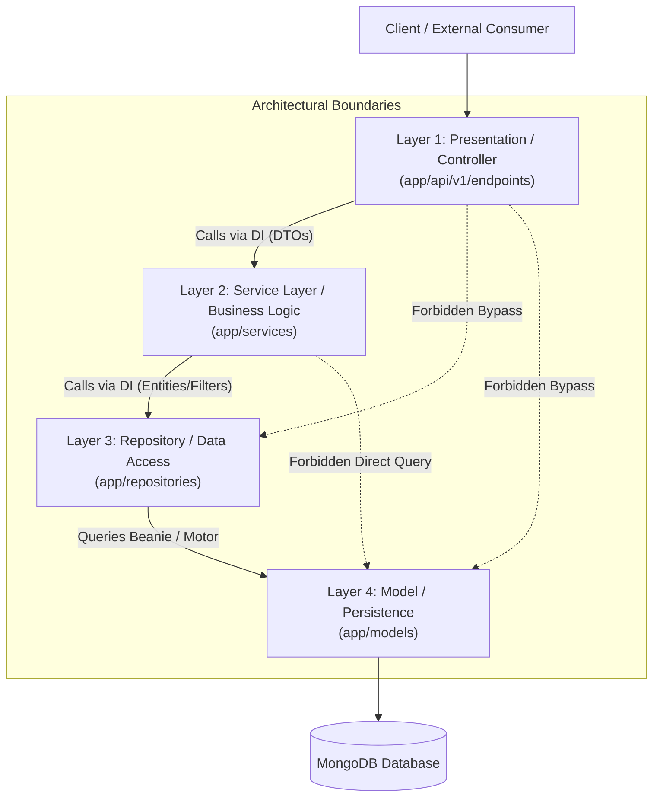

# Axion Runtime - System Design & Architecture Rules

## 1. Executive Summary & Purpose

This document establishes the official software engineering architecture and system design standards for the **Axion Runtime** backend (`apps/api`).

The primary goals of these standards are:

- **Zero Architectural Erosion**: Enforce strict boundary separation between presentation, domain logic, data access, and persistence.
- **High Testability**: Ensure every business logic component can be tested in isolation with zero monkeypatching or test database spin-up requirements.
- **Portability & Reuse**: Business logic in services remains decoupled from HTTP transports, allowing identical services to be invoked from CLI utilities, message queues, temporal workers, or gRPC endpoints.
- **Maintainability & Uniformity**: Provide consistent patterns for dependency injection, data transfer objects (DTOs), error handling, and repository queries across the codebase.

---

## 2. The 4-Layer Architectural Pattern

All backend code in `apps/api` strictly adheres to the **4-Layer Architecture**:



### Layer Responsibility Matrix

| Layer                                                       | Primary Responsibility                                                                                                            | Allowed Inbound Callers                         | Allowed Outbound Calls                                                      | Strictly Forbidden Dependencies                                                                       |
| :---------------------------------------------------------- | :-------------------------------------------------------------------------------------------------------------------------------- | :---------------------------------------------- | :-------------------------------------------------------------------------- | :---------------------------------------------------------------------------------------------------- |
| **1. Controller / Router** (`app/api/`)                     | HTTP parameter extraction, request body validation, route registration, response formatting, status codes, OpenAPI documentation. | HTTP Clients, API Gateways                      | Service Layer (`Depends(get_*_service)`)                                    | Direct Repository calls, raw Beanie queries (`Model.find`), business rule execution, DB transactions. |
| **2. Service Layer** (`app/services/`)                      | Core business rules, role calculation, domain workflows, cross-entity orchestration, external third-party API integration.        | Controllers, Background Jobs, CLI commands      | Repository Layer (`Depends(get_*_repo)`), Domain Exceptions, Schemas / DTOs | FastAPI HTTP objects (`Request`, `Response`, `HTTPException`), direct Beanie/Motor ODM queries.       |
| **3. Repository Layer** (`app/repositories/`)               | Data access abstraction, query composition, sorting, pagination, aggregation pipelines, MongoDB session / transaction management. | Service Layer                                   | Beanie Documents (`app/models/`), Motor/PyMongo drivers                     | HTTP context, Service layer, business validation logic.                                               |
| **4. Model & Schema Layer** (`app/models/`, `app/schemas/`) | Physical database schemas (Beanie `Document`), indexes, lifecycle hooks, and DTO contracts (Pydantic `BaseModel`).                | Repository Layer (Models), All Layers (Schemas) | Beanie, Pydantic                                                            | Direct execution of application workflows.                                                            |

---

## 3. Inviolable Architectural Constraints

### Constraint 1: Strict Unidirectional Dependency Flow

Dependencies MUST flow strictly top-down:
$$\text{Controller} \longrightarrow \text{Service} \longrightarrow \text{Repository} \longrightarrow \text{Model}$$

- **No layer jumping**: A Controller MUST NOT call a Repository directly. A Controller MUST NOT import or call Beanie ODM methods directly on models (e.g. `User.find_one(...)`).
- **No reverse dependencies**: Repositories must never import or reference Services or Controllers. Services must never import or reference Controllers.

### Constraint 2: Transport-Agnostic Service Layer

The Service layer must remain completely independent of HTTP transport mechanisms:

- **No HTTP imports in Services**: Never import `fastapi.Request`, `fastapi.Response`, or `fastapi.HTTPException` into any file under `app/services/`.
- **Domain Exceptions Only**: Services communicate failures by raising domain exceptions (e.g., `NotFoundError`, `ConflictError`, `ValidationError`, `ForbiddenError` defined in `app.core.exceptions`).
- FastAPI's global exception handlers translate domain exceptions into standardized `ApiErrorResponse` envelopes with the appropriate HTTP status codes.

### Constraint 3: Complete Query Encapsulation in Repositories

- **No raw ODM calls outside Repositories**: All Beanie/MongoDB query expressions (e.g. `.find()`, `.aggregate()`, `.find_one()`, `.insert()`, `.save()`) must reside exclusively within classes implementing `BaseRepository` in `app/repositories/`.
- **Identifier Abstraction**: Repositories accept clean primitives (e.g., `str` IDs) and handle internal casting to `PydanticObjectId` or `bson.ObjectId`. Services and Controllers should not have to deal with raw BSON types.

### Constraint 4: Strict Separation of DTOs and Database Documents

- **Request DTOs (`schemas/*`)**: Represent input contracts. Strict Pydantic models with explicit validations.
- **Response DTOs (`schemas/*`)**: Represent output contracts. Explicitly sanitize and format data returned to clients.
- **Documents (`models/*`)**: Represent physical MongoDB storage representations.
- **Document Leakage Prohibition**: A Controller MUST NOT return a raw Beanie `Document` instance directly as an HTTP response. All outputs must be serialized through response DTOs (e.g. `ApiResponse[UserResponse]`).

### Constraint 5: Dependency Injection Over Classmethod/Static Singletons

- All Services and Repositories MUST be instantiable classes injected via FastAPI's `Depends()` mechanism.
- Avoid `@classmethod` or `@staticmethod` for business logic and data access routines. Static methods inhibit mocking, state isolation, and dependency substitution during unit testing.

---

## 4. Generic Base Repository Pattern

All data access operations extend the generic `BaseRepository[T]`, providing standard CRUD primitives while isolating ODM details.

### Implementation: `app/repositories/base.py`

```python
"""
Generic Base Repository providing standardized CRUD operations for Beanie Documents.
"""
from typing import Any, Generic, List, Mapping, Optional, Sequence, Type, TypeVar
from beanie import Document, PydanticObjectId
from beanie.odm.queries.find import FindMany
from bson import ObjectId

T = TypeVar("T", bound=Document)


class BaseRepository(Generic[T]):
    """
    Abstract base repository encapsulating Beanie ODM operations.
    """

    def __init__(self, model_class: Type[T]) -> None:
        self.model_class = model_class

    def _to_object_id(self, id_val: str | PydanticObjectId | ObjectId) -> ObjectId:
        """Safely convert string or PydanticObjectId to BSON ObjectId."""
        if isinstance(id_val, ObjectId):
            return id_val
        try:
            return ObjectId(str(id_val))
        except Exception as exc:
            raise ValueError(f"Invalid ObjectId format: {id_val}") from exc

    async def get_by_id(self, id: str | PydanticObjectId | ObjectId) -> Optional[T]:
        """Fetch a single document by its primary key ID."""
        try:
            oid = self._to_object_id(id)
            return await self.model_class.get(oid)
        except ValueError:
            return None

    async def find_one(self, *expressions: Mapping[str, Any] | bool, **kwargs: Any) -> Optional[T]:
        """Find a single document matching criteria."""
        return await self.model_class.find_one(*expressions, **kwargs)

    async def find_many(
        self,
        *expressions: Mapping[str, Any] | bool,
        skip: int = 0,
        limit: int = 100,
        sort: Optional[Any] = None,
        **kwargs: Any,
    ) -> List[T]:
        """Query multiple documents with pagination and sorting."""
        query: FindMany[T] = self.model_class.find(*expressions, **kwargs).skip(skip).limit(limit)
        if sort is not None:
            query = query.sort(sort)
        return await query.to_list()

    async def count(self, *expressions: Mapping[str, Any] | bool, **kwargs: Any) -> int:
        """Count documents matching criteria."""
        return await self.model_class.find(*expressions, **kwargs).count()

    async def exists(self, *expressions: Mapping[str, Any] | bool, **kwargs: Any) -> bool:
        """Check whether at least one matching document exists."""
        count = await self.count(*expressions, **kwargs)
        return count > 0

    async def create(self, document: T) -> T:
        """Insert a new document into MongoDB."""
        await document.insert()
        return document

    async def update(self, document: T) -> T:
        """Save changes to an existing document."""
        await document.save()
        return document

    async def delete(self, document: T) -> None:
        """Delete a document from MongoDB."""
        await document.delete()

    async def delete_by_id(self, id: str | PydanticObjectId | ObjectId) -> bool:
        """Delete a document by ID. Returns True if deleted, False if not found."""
        doc = await self.get_by_id(id)
        if doc is not None:
            await self.delete(doc)
            return True
        return False
```

---

## 5. Concrete Domain Implementation Standards

Here is the normative standard for implementing any domain entity within Axion Runtime, demonstrated with the **User** domain.

### 5.1 Model Layer: `app/models/user.py`

Defines the physical database collection schema and indexes using Beanie:

```python
from datetime import datetime, timezone
from enum import Enum
from typing import Optional
from beanie import Document, Indexed
from pydantic import Field


class UserRole(str, Enum):
    ADMIN = "admin"
    USER = "user"


class User(Document):
    clerk_id: Indexed(str, unique=True)  # type: ignore[valid-type]
    email: Optional[Indexed(str, unique=True)] = None  # type: ignore[valid-type]
    first_name: Optional[str] = None
    last_name: Optional[str] = None
    image_url: Optional[str] = None
    role: UserRole = UserRole.USER
    is_active: bool = True
    created_at: datetime = Field(default_factory=lambda: datetime.now(timezone.utc))
    updated_at: datetime = Field(default_factory=lambda: datetime.now(timezone.utc))

    class Settings:
        name = "users"
        indexes = [
            "clerk_id",
            "email",
            "role",
            "is_active",
        ]
```

### 5.2 Repository Layer: `app/repositories/user_repository.py`

Encapsulates all queries targeting the `users` collection:

```python
from typing import Optional
from app.models.user import User, UserRole
from app.repositories.base import BaseRepository


class UserRepository(BaseRepository[User]):
    def __init__(self) -> None:
        super().__init__(User)

    async def get_by_clerk_id(self, clerk_id: str) -> Optional[User]:
        return await self.find_one({"clerk_id": clerk_id})

    async def get_by_email(self, email: str) -> Optional[User]:
        return await self.find_one({"email": email})

    async def count_all(self) -> int:
        return await self.count()


def get_user_repository() -> UserRepository:
    """Dependency injection provider for UserRepository."""
    return UserRepository()
```

### 5.3 Service Layer: `app/services/user_service.py`

Encapsulates business rules, authorizations, and entity state updates. Operates entirely without HTTP awareness:

```python
from typing import Optional
from app.core.exceptions import NotFoundError
from app.core.logging import logger
from app.models.user import User, UserRole
from app.repositories.user_repository import UserRepository, get_user_repository
from fastapi import Depends


class UserService:
    def __init__(self, user_repo: UserRepository) -> None:
        self.user_repo = user_repo

    async def get_by_clerk_id(self, clerk_id: str) -> Optional[User]:
        return await self.user_repo.get_by_clerk_id(clerk_id)

    async def get_by_id(self, user_id: str) -> Optional[User]:
        return await self.user_repo.get_by_id(user_id)

    async def sync_clerk_user(
        self,
        clerk_id: str,
        email: Optional[str] = None,
        first_name: Optional[str] = None,
        last_name: Optional[str] = None,
        image_url: Optional[str] = None,
    ) -> Optional[User]:
        """
        Synchronizes Clerk profile state with the internal MongoDB user document.
        Assigns ADMIN to the first registered user; USER to subsequent users.
        """
        existing_user = await self.user_repo.get_by_clerk_id(clerk_id)

        if existing_user is not None:
            has_changes = False
            if email and existing_user.email != email:
                existing_user.email = email
                has_changes = True
            if first_name != existing_user.first_name:
                existing_user.first_name = first_name
                has_changes = True
            if last_name != existing_user.last_name:
                existing_user.last_name = last_name
                has_changes = True
            if image_url and image_url != existing_user.image_url:
                existing_user.image_url = image_url
                has_changes = True

            if has_changes:
                await self.user_repo.update(existing_user)
                logger.info(f"Updated profile for user '{clerk_id}' in MongoDB.")

            return existing_user

        # First user bootstrap
        total_users = await self.user_repo.count_all()
        role = UserRole.ADMIN if total_users == 0 else UserRole.USER

        new_user = User(
            clerk_id=clerk_id,
            email=email,
            first_name=first_name,
            last_name=last_name,
            image_url=image_url,
            role=role,
            is_active=True,
        )
        created_user = await self.user_repo.create(new_user)
        logger.info(f"Created new synced user '{clerk_id}' with role '{role.value}'.")
        return created_user

    async def update_role(self, clerk_id: str, new_role: UserRole) -> User:
        user = await self.user_repo.get_by_clerk_id(clerk_id)
        if not user:
            raise NotFoundError(f"User with Clerk ID '{clerk_id}' not found")

        user.role = new_role
        await self.user_repo.update(user)
        logger.info(f"Updated role for user '{clerk_id}' to '{new_role.value}'.")
        return user


def get_user_service(
    user_repo: UserRepository = Depends(get_user_repository),
) -> UserService:
    """Dependency injection provider for UserService."""
    return UserService(user_repo=user_repo)
```

### 5.4 Presentation Layer (Controller): `app/api/v1/endpoints/auth.py`

Receives validated HTTP requests, delegates immediately to `UserService`, and serializes the response DTO:

```python
from typing import Annotated
from fastapi import APIRouter, Depends, Path, status

from app.api.deps import CurrentAdmin, CurrentUser
from app.schemas.auth import AuthenticatedUser, UpdateUserRoleRequest
from app.schemas.common import ApiErrorResponse, ApiResponse
from app.services.user_service import UserService, get_user_service

router = APIRouter(prefix="/auth", tags=["Authentication"])


@router.get(
    "/me",
    response_model=ApiResponse[AuthenticatedUser],
    status_code=status.HTTP_200_OK,
    summary="Get Authenticated User",
)
async def get_me(current_user: CurrentUser) -> ApiResponse[AuthenticatedUser]:
    return ApiResponse(
        data=current_user,
        message="Authenticated user profile retrieved successfully",
    )


@router.put(
    "/users/{clerk_id}/role",
    response_model=ApiResponse[AuthenticatedUser],
    status_code=status.HTTP_200_OK,
    summary="Update User Role",
    responses={
        status.HTTP_401_UNAUTHORIZED: {"model": ApiErrorResponse},
        status.HTTP_403_FORBIDDEN: {"model": ApiErrorResponse},
        status.HTTP_404_NOT_FOUND: {"model": ApiErrorResponse},
    },
)
async def update_user_role(
    body: UpdateUserRoleRequest,
    clerk_id: Annotated[str, Path(description="Target Clerk User ID")],
    user_service: Annotated[UserService, Depends(get_user_service)],
    _admin: CurrentAdmin = None,  # type: ignore[assignment]
) -> ApiResponse[AuthenticatedUser]:
    updated_user = await user_service.update_role(clerk_id, body.role)

    user_response = AuthenticatedUser.from_document(updated_user)
    return ApiResponse(
        data=user_response,
        message=f"User role updated to '{body.role.value}' successfully",
    )
```

---

## 6. Testing Strategy & Zero-Monkeypatch Standards

By adhering to this 4-layer model with dependency injection, unit testing achieves maximum velocity and reliability.

### 6.1 Unit Testing Services (Zero Database Required)

```python
import pytest
from unittest.mock import AsyncMock
from app.models.user import User, UserRole
from app.services.user_service import UserService


@pytest.mark.asyncio
async def test_update_user_role_success():
    # 1. Arrange mock repository
    mock_repo = AsyncMock()
    existing_user = User(clerk_id="user_123", role=UserRole.USER)
    mock_repo.get_by_clerk_id.return_value = existing_user

    # 2. Instantiate service directly with mock repository
    service = UserService(user_repo=mock_repo)

    # 3. Act
    result = await service.update_role("user_123", UserRole.ADMIN)

    # 4. Assert
    assert result.role == UserRole.ADMIN
    mock_repo.update.assert_awaited_once_with(existing_user)
```

### 6.2 Router / Controller Testing via `dependency_overrides`

```python
import pytest
from httpx import AsyncClient
from app.main import app
from app.services.user_service import UserService, get_user_service
from unittest.mock import AsyncMock


@pytest.mark.asyncio
async def test_update_role_endpoint(async_client: AsyncClient):
    mock_service = AsyncMock(spec=UserService)
    mock_service.update_role.return_value = AsyncMock(
        id="65f1234567890abcdef12345",
        clerk_id="user_123",
        role="admin",
        is_active=True,
    )

    # Override service provider
    app.dependency_overrides[get_user_service] = lambda: mock_service

    try:
        response = await async_client.put(
            "/api/v1/auth/users/user_123/role",
            json={"role": "admin"},
        )
        assert response.status_code == 200
        assert response.json()["data"]["role"] == "admin"
    finally:
        app.dependency_overrides.clear()
```

---

## 7. Developer Workflow & Rule Enforcement

To guarantee architectural integrity over time, the following gates are enforced in the CI/CD pipeline and code review process:

### 7.1 Automated Linting & Boundary Rules (Ruff)

In `apps/api/pyproject.toml`, Ruff rules enforce:

- Import sorting and formatting (`I`).
- Disallowed imports in the service layer (services must not import `fastapi.HTTPException`, `fastapi.Request`, or `fastapi.Response`).
- Disallowed direct Beanie queries in routers (routers must not import `app.models.*` for querying).

### 7.2 Pull Request Architectural Review Checklist

Every PR modifying backend functionality must satisfy the following checklist before merge approval:

- [ ] **Layer Conformance**:
  - [ ] Are route handlers (`app/api/`) free of business rules and database queries?
  - [ ] Are services (`app/services/`) free of HTTP exceptions and request/response objects?
  - [ ] Are all database queries encapsulated within a repository in `app/repositories/`?
- [ ] **Dependency Injection**:
  - [ ] Are all services and repositories injected via `Depends()`?
  - [ ] Are there zero static/`@classmethod` methods for domain logic?
- [ ] **Data Contracts & DTOs**:
  - [ ] Does the endpoint return a validated response DTO wrapped in `ApiResponse[T]`?
  - [ ] Are internal Beanie documents properly converted to DTOs without leaking private fields?
- [ ] **Test Coverage**:
  - [ ] Does the new service method include unit tests using a mocked repository?
  - [ ] Does the endpoint include an integration test overriding service dependencies?

---

## 8. Migration Roadmap for Legacy Code

For existing code in `apps/api` currently violating the 4-layer standard:

1. **Step 1: Create Repository Layer**:
   Create `app/repositories/base.py` and domain repositories (e.g. `app/repositories/user_repository.py`). Move all `User.find_one`, `User.find`, and `.insert()`/`.save()` calls into the repository.
2. **Step 2: Refactor Services to Instance Classes**:
   Remove `@classmethod` from `UserService`. Accept `UserRepository` in `__init__`. Provide `get_user_service` dependency function.
3. **Step 3: Update Controller Endpoints**:
   Inject `UserService` via `Depends(get_user_service)` in endpoints. Eliminate manual model conversion loops in endpoint handlers.
4. **Step 4: Update Authentication & Security Dependencies**:
   Update `app/api/deps.py` (`get_current_user`) to resolve `UserService` through dependency injection rather than calling static methods.
